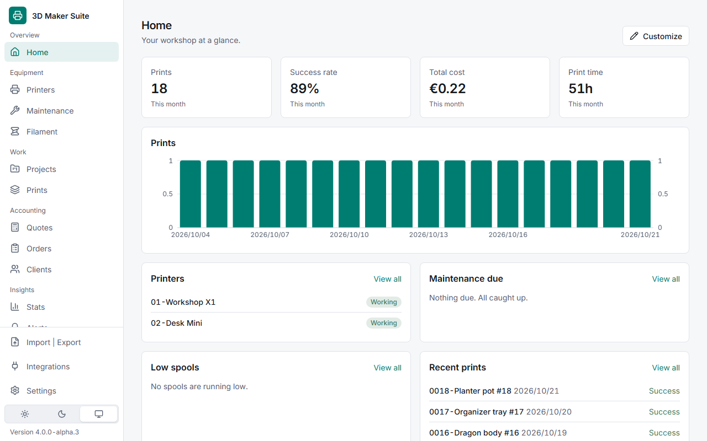
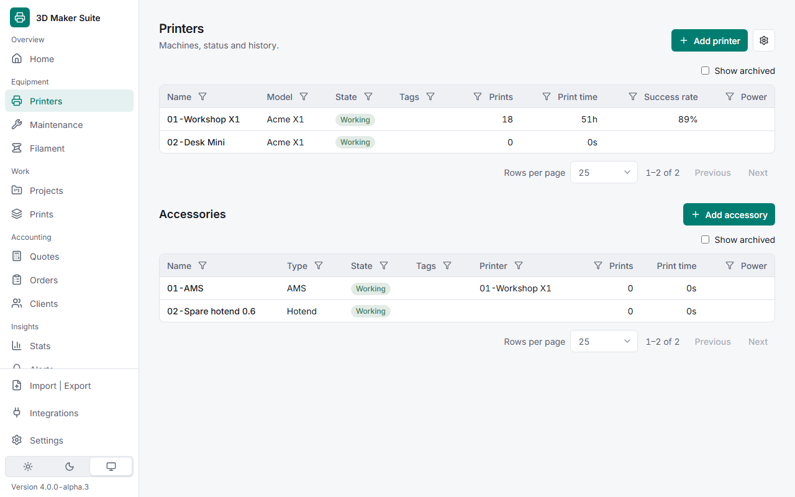

# 3D Maker Suite

A local-first manager for your 3D printing: printers, maintenance, filament, projects, prints, costs and stats. Runs on your own PC. Your data stays in a SQLite file on your disk.

<!-- SCREENSHOT: dashboard (light theme), 1280px wide -->


## Features

- **Printers**: inventory, timeline, comments, warranty and purchase info
- **Maintenance**: reusable tasks, due by hours, prints or days
- **Filament**: brands, materials, profiles, spools with numbers and colour names, remaining grams, low-spool alerts
- **Projects**: 3MF models with plates, thumbnails, tags, collections, filament colours, and a description from a linked `.md` or `.txt` file
- **Prints**: history with outcome, filament usage per AMS slot (up to 16 for multicolor), energy, and an estimated duration when only the grams are known
- **Costs and stats**: cost per print snapshotted at record time, charts by period
- **Integrations** (optional): Bambu Cloud, Bambu Studio and OrcaSlicer, with a sync mode and frequency per data type
- **Import**: spreadsheets (spools, printers, prints) and slicer catalogs from a zip, reviewed row by row before anything is saved
- **Backups**: scheduled online SQLite backups, restore, CSV, JSON and spreadsheet export
- **Light and dark themes**, mobile-friendly, keyboard navigable; set your own app name, logo and favicon

<!-- SCREENSHOT: printers list or project detail -->


## Install

Requirements: **Node.js 22 LTS** and **pnpm**.

```bash
git clone https://github.com/emanuelmoniz/3d-maker-suite.git
cd 3d-maker-suite
pnpm install
pnpm start
```

Then open <http://127.0.0.1:4300>. Full steps and Windows notes: [docs/install.md](docs/install.md).

## Connect Bambu Cloud (optional)

Sign in with your Bambu account on the Integrations page. The app syncs print history every hour and printers every day by default (mode and frequency are set per type), and you can sync each type or a date range by hand. Prints an automatic sync cannot match to one spool wait for your review, with a **Sync needs review** alert. Manual entry works without an account.

Details, region choice and troubleshooting: [docs/bambu-cloud.md](docs/bambu-cloud.md).

## Using it from another device

By default the app only answers on this PC. To reach it from your phone or another computer on your network, set `APP_PASSWORD` and `HOST` (or the port and host in Settings → Network). Running it on a NAS? See [docs/install.md](docs/install.md#your-pc-or-a-nas). See [docs/configuration.md](docs/configuration.md).

## Documentation

| Topic | Where |
|---|---|
| Install and first run | [docs/install.md](docs/install.md) |
| Settings and environment variables | [docs/configuration.md](docs/configuration.md) |
| Bambu Cloud setup | [docs/bambu-cloud.md](docs/bambu-cloud.md) |
| Import spreadsheets and slicer catalogs | [docs/import.md](docs/import.md) |
| Open in slicer | [docs/open-in-slicer.md](docs/open-in-slicer.md) |
| Backups | [docs/backups.md](docs/backups.md) |
| FAQ | [docs/faq.md](docs/faq.md) |
| Architecture and decisions | [docs/architecture.md](docs/architecture.md), [docs/adr](docs/adr/) |
| Contributing, adapters, languages | [CONTRIBUTING.md](CONTRIBUTING.md) |
| Changes | [CHANGELOG.md](CHANGELOG.md) |

## Status

Version 1.2.0-alpha.1 (pre-release). English only for now; the code is ready for more languages (see [CONTRIBUTING.md](CONTRIBUTING.md)).

## License

[MIT](LICENSE). The Bambu Cloud integration uses an unofficial API and is not affiliated with Bambu Lab.
