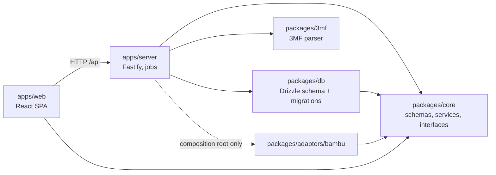
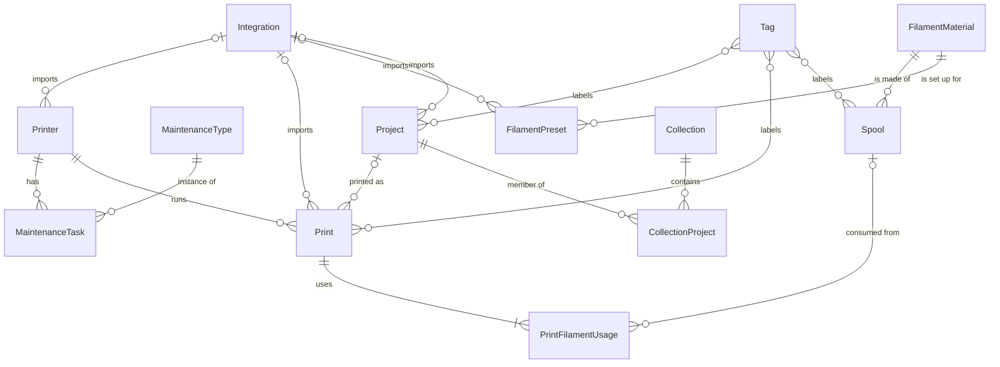
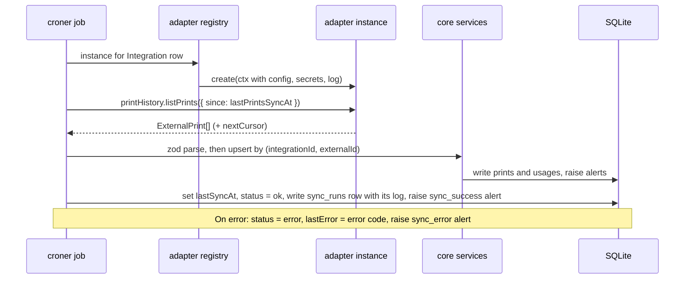

# Architecture

3D Maker Suite is a local-first web app: a Fastify server on the user's PC serves a React SPA and owns a single SQLite database. Vendor integrations (Bambu Lab first) plug in through small capability interfaces defined in core.

Decisions behind this document live in [`docs/adr`](adr/):

| ADR | Decision |
|---|---|
| [0001](adr/0001-local-only-run.md) | Run locally, bind to 127.0.0.1, no auth |
| [0002](adr/0002-sqlite.md) | SQLite via better-sqlite3 + Drizzle |
| [0003](adr/0003-adapter-pattern.md) | Brand-agnostic core, vendor adapters |
| [0004](adr/0004-i18n-strategy.md) | i18next, Intl formatting, error codes from the API |
| [0005](adr/0005-secrets-storage.md) | AES-256-GCM with a local key file |
| [0006](adr/0006-bambu-cloud-first.md) | Bambu Cloud is the first integration |
| [0007](adr/0007-slicing.md) | Slice with the installed slicer's CLI (Bambu Studio first) |
| [0010](adr/0010-stay-on-sqlite.md) | Stay on SQLite, no external database servers |
| [0017](adr/0017-shared-slicer-presets.md) | One hub slicer preset library, shared with desktops through the slicers' own `.info` rules |
| [0020](adr/0020-catalog-module.md) | One Catalog module; presets come only from slicer files and are read-only; spools describe the filament |

## Packages



- `packages/core` imports no vendor code. Neither does `apps/web`, and in `apps/server` only the composition root that builds the adapter registry may import one.
- `apps/web` imports only zod schemas and types from core. It never imports services.
- Zod schemas in `packages/core/src/schemas` are the single source of types. API validation, OpenAPI and the frontend all use them.

## Conventions

- **IDs:** `crypto.randomUUID()` as text.
- **Time:** UTC ISO 8601 strings, shown in the user's locale and time zone.
- **Units:** mass in grams, length in mm, duration in seconds.
- **Money:** integer minor units in one app currency, set in Settings.
- **Display:** all formatting goes through `Intl` (see ADR-0004).
- **Imported rows:** any row that can come from an integration has `origin: 'manual' | 'integration'`, `integrationId?` and `externalId?`, with a unique constraint on `(integrationId, externalId)`. That makes sync an idempotent upsert.
- **Catalog:** brands, printer models and printer presets are hard-deleted, and only while nothing points at them (the API answers 409 `in_use` with the dependents). Imported printers keep sending brand/model strings; sync finds or creates the catalog rows.
- **Archive and delete:** the 16 archivable entities have `archivedAt`; delete is real and refused while something depends on the item (ADR-0018, [the guide](https://emanuelmoniz.github.io/3d-maker-suite/Archive-and-Delete)). History rows keep `ON DELETE RESTRICT` as a backstop.
- **Dates in queries:** stored as `toISOString()` text, so range filters compare as strings and use the date indexes (`prints.startedAt`).

## Domain glossary

| Entity | Meaning | Key fields |
|---|---|---|
| **Brand** | Printer maker | name (unique, any case), url?, logoPath? |
| **PrinterModel** | A model of a brand | brandId, model (unique per brand, any case), powerW? (pre-fills new printers), imagePath? (shown for printers without a photo) |
| **MachinePreset** | Slicer machine preset for a model | name, printerModelId, nozzleDiameterMm, sourcePreset? (`<library>:<preset id>` when imported) |
| **Printer** | A physical machine | name, modelId, serial?, nozzleDiameterMm, state (from the `printerStates` setting), powerW?, purchasedAt?, purchasePrice?, warrantyEndsAt?, warrantyNotes?, photoPath?, archivedAt? |
| **PrinterComment** | Note on a printer timeline | printerId, body, pinned, status (`open` | `resolved`) |
| **MaintenanceType** | Reusable maintenance template | name, intervalSec?, intervalPrints?, intervalDays? (the first one reached triggers), appliesToModelIds[] + appliesToPrinterIds[] (union; empty = all printers) |
| **UsageCorrection** | A hand correction of usage (a used machine, a counter read off it) | printerId or accessoryId, deltaSec, deltaPrints, note?, createdAt |
| **MaintenanceTask** | A logged "done" event | printerId, typeId, doneAt, printerRuntimeSecAt, printerPrintsAt, notes? |
| **FilamentMaterial** | A plastic (PLA, PETG…) | name, densityGcm3?, nozzleTempC?, bedTempC?, pricePerKg? (the default for a spool without a price paid) |
| **FilamentPreset** | A slicer's filament preset (settings only, no colour) | brand, material, name, diameterMm, densityGcm3, sourcePreset? |
| **Spool** | A physical roll of filament | brandId?, materialId, name?, colorHex, colorName?, initialGrams, remainingGrams, pricePaid?, purchasedAt?, openedAt?, location?, archivedAt? |
| **Print** | One print job | printerId, projectId?, noProject (no project on purpose), machinePresetId?, title, plate?, startedAt, durationSec, outcome, failureReason?, notes?, energyWh?, energySource? (`'estimated' \| 'measured'`), costSnapshot? |
| **PrintFilamentUsage** | Filament used by one print, one row per slot (AMS) | printId, spoolId?, grams, slot?, material?, colorHex? |
| **PrintOutcome** | Value type on Print, no table of its own | `'success' \| 'failed' \| 'cancelled'`, plus an optional failureReason |
| **Project** | A printable model, usually a 3MF file | name, filePath?, sourceUrl?, thumbnailPath?, meta (plates, estimated time and grams per plate) |
| **Tag** | Free-form label | name, color. Many-to-many with Project, Print and Spool |
| **Collection** | Manual, ordered group of Projects | name, description?. Membership: CollectionProject(collectionId, projectId, position) |
| **Integration** | A configured adapter instance | adapterId (e.g. `bambu-cloud`), name, enabled, config (JSON, not secret), secrets (encrypted), status, lastSyncAt?, lastError? |
| **Alert** | A persisted notice raised by a job | kind, entityType, entityId, createdAt, readAt?, resolvedAt? |

Notes:

- **Maintenance "due" is computed, not stored.** It comes from the latest MaintenanceTask for each (printer, type), compared with the printer's current hours, print count and the date.
- **Printer totals are derived.** Hours and print count are the sum of its Prints plus its UsageCorrections (up to the time asked for). The user types the real totals; the API stores the difference.
- **Usage keeps the material.** `PrintFilamentUsage.spoolId` can be null for imported prints where the spool is unknown. Its `material` is then what prices it (that material's default), so cost and stats still work.
- **A spool is not a preset** (ADR-0020). A spool says what is on the shelf (brand, material, name, colour); a preset is a slicer setting. A plate keeps both per slot. A spool's price per kg is its price paid, else its material's default.
- **Cost is snapshotted.** `costSnapshot` freezes the computed cost when a print is recorded, so later price changes don't rewrite history (cost engine: Step 19).
- **Alerts** (ADR-0008) have a kind (the message), a severity (`error`, `warning`, `success`), a module, a task (what raised it) and an optional detail (a sync run's log). At most one unresolved alert exists per (kind, entityType, entityId).
- **Connector versions.** When a device's event stream first opens on another version than the hub's, `devices.outdatedSince` stores the hub version and the time, and the hub publishes one `connector.update` (not to a connector that rolled back or is newer than the hub). Reconnects and hub restarts keep that record, and a new hub version starts it over. `connector_outdated` is raised 15 minutes after that time, or at once when the connector reports a failed update.
- **Tag storage** is one polymorphic table, `taggings(tagId, entityType, entityId)`. It has no FK to the tagged row, so a trigger removes the taggings of deleted prints, and the delete helper removes those of other deleted items.
- **Print rules** are enforced as DB CHECKs and mirrored in zod: a `success` print has no `failureReason`, and `energyWh` and `energySource` are set together.

## Entity relations



`Alert` points to any entity through `(entityType, entityId)`. It is left out of the diagram because it has no foreign key.

## Integration interfaces

These live in `packages/core/src/integrations`. Only `printers` and `printHistory` exist in code so far; the other capabilities are added by the steps that use them (14, 16, 18). Rules:

- Adapters **return DTOs and never touch the database.** Core validates the DTOs with zod and upserts them by `(integrationId, externalId)`.
- Each capability is an optional property on the instance. An adapter implements only what its vendor supports.
- An adapter is one source: `kind: 'cloud'` is an account, `kind: 'host'` an address on the network and its key (a printer, ADR-0015), `kind: 'local'` a folder and program on the server's disk. A vendor with several ships one adapter each (Bambu Cloud and Bambu Studio). The kind says where data comes from, not which types: `capabilities` lists those. A cloud source is usable once signed in, a local one once its folder is found on the server; otherwise the hub shows it as not available. `isSlicerKind` tells a slicer install (`local`, `server`, `worker`) from an account (`cloud`, `host`): only an account is enabled, synced and listed on the Sources tabs. A printer on the network (`isNetworkPrinter`: `host` with `printerStatus`) syncs no printers (`syncTypes`): it is one printer, linked when it is saved.
- The DTO types below are the `z.infer` shapes of zod schemas in `packages/core/src/schemas`.

```ts
interface IntegrationAdapter {
  id: string;                    // 'bambu-cloud'; UI name is the i18n key `integrations:adapters.<id>.name`
  kind: 'cloud' | 'host' | 'local' | 'server' | 'worker';
  capabilities: Capability[];    // only what this source really provides
  configSchema: ZodObject;       // non-secret settings
  secretsSchema: ZodObject;      // fields encrypted at rest (ADR-0005)
  create?(ctx: IntegrationContext): IntegrationInstance;  // account-backed; a local source has none
  library?: FilamentLibrary;     // a slicer's presets, read from its config folder
}

interface IntegrationContext {
  config: unknown;               // already parsed with configSchema
  secrets: SecretStore;
  log: Logger;                   // pino child logger, secret paths redacted
  signal: AbortSignal;
}

interface SecretStore {          // scoped to one Integration row
  get(key: string): Promise<string | undefined>;
  set(key: string, value: string): Promise<void>;   // e.g. refreshed tokens
  delete(key: string): Promise<void>;
}

interface IntegrationInstance {
  test(): Promise<{ ok: true } | { ok: false; code: IntegrationErrorCode }>;
  printers?: PrinterInventorySource;
  printHistory?: PrintHistorySource;
  status?: PrinterStatusSource;
  spools?: SpoolInventorySource;
  spoolUsage?: SpoolUsageTarget;
  filaments?: FilamentLibrarySource;
  projects?: ProjectSource;
  slicer?: SlicerLauncher;
  marketplace?: MarketplaceLinker;
}

type IntegrationErrorCode =
  | 'auth_required' | 'auth_expired' | 'rate_limited' | 'unreachable' | 'unknown';

interface PrinterInventorySource {
  listPrinters(): Promise<ExternalPrinter[]>;
}

interface PrintHistorySource {
  listPrints(q: { since?: string; until?: string; cursor?: string }):
    Promise<{ items: ExternalPrint[]; nextCursor?: string }>;
}

interface PrinterStatusSource {  // the `printerStatus` capability; read-only, no printer control
  readStatus(): Promise<PrinterSnapshot[]>;  // one per printer; one that doesn't answer is `offline`
}

interface SpoolInventorySource {
  listSpools(): Promise<LibrarySpool[]>;
}

interface SpoolUsageTarget {     // the `spoolUsage` capability (Spoolman two-way)
  // Idempotent: the spool holds `grams` for `key` (`<printId>:<slot>`) afterwards, whatever it held.
  writeUsage(u: { spoolId: string; key: string; grams: number; sent: number }): Promise<{ gone?: boolean }>;
  createSpool(s: SpoolToCreate): Promise<{ spoolId: string }>;  // finds the one it made before
}

interface FilamentLibrarySource {
  listPresets(): Promise<ExternalFilamentPreset[]>;
}

interface ProjectSource {
  scan(): AsyncIterable<ExternalProject>;
  watch?(onChange: (e: { type: 'upsert' | 'remove'; externalId: string }) => void): () => void;
}

interface SlicerLauncher {
  canOpen(filePath: string): boolean;
  open(filePath: string): Promise<void>;
}

interface MarketplaceLinker {     // pure, no network in v1
  matchUrl(url: string): ListingRef | null;
  findInProject(meta: ProjectMeta): ListingRef | null;  // e.g. designer URL in 3MF metadata
}

type ExternalPrinter = {
  externalId: string; name: string; brand: string; model: string;
  serial?: string; nozzleDiameterMm?: number;
};

type ExternalPrint = {
  externalId: string; printerExternalId: string; title: string; startedAt: string;
  durationSec?: number; outcome: PrintOutcome; failureReason?: string;
  filaments: {
    slot?: number; material?: string; colorHex?: string;
    grams?: number;            // unset: the printer doesn't say
    gramsEstimated?: boolean;
    rfid?: string; spoolId?: string;  // the spool the printer named; spoolId as a spool link keys it
    chargedAtSource?: boolean;        // its host charged the spool library already (Moonraker)
  }[];
  sourceUrl?: string;  // shown, never fetched by core
  peerId?: string;     // its externalId in another source of the same printer
};

type PrinterSnapshot = {
  printerExternalId: string; at: string;
  state: 'offline' | 'idle' | 'preparing' | 'printing' | 'paused' | 'finished' | 'cancelled' | 'error';
  job?: {                      // each field only when the printer says
    id?: string; peerId?: string; file?: string; title?: string; plate?: number;
    startedAt?: string; elapsedSec?: number; progress?: number; etaSec?: number;
    layer?: number; totalLayers?: number; slots?: number[]; failureReason?: string;
  };
  temperatures?: { nozzle?: number; nozzleTarget?: number; bed?: number; bedTarget?: number; chamber?: number };
  slots: {
    slot: number; material?: string; colorHex?: string; rfid?: string; spoolId?: string;
    active?: boolean; gramsUsed?: number;
  }[];
};

type ExternalFilamentPreset = {
  externalId: string; brand: string; material: string; name: string;
  diameterMm: number; densityGcm3?: number;
};

type ExternalProject = { externalId: string; name: string; filePath: string; modifiedAt: string };

type ListingRef = { marketplace: string; listingId: string; url: string };
```

The local-folder `ProjectSource` (3MF folder watcher, Step 16) isn't tied to any vendor. It ships as a built-in source in the server, not as an adapter package.

### Sync flow



- **Where:** `apps/server/src/integrations/sync.ts`. One run syncs one type. Each integration + type has a policy in `sync_policies`: `mode` (`off`, `manual`, `auto`), `frequency` (`15m`, `1h`, `1d`, `1w`, `1M`), `lastRunAt`, `cursor` and `pending`. Rows are sparse: a type without one follows `defaultPolicy` in `packages/core` (prints auto 1h, printers auto 1d, everything with a preview manual). A croner job ticks every 15 minutes and runs each set-up `auto` type whose frequency has passed since its last successful run, manual or scheduled. A prints run can take a `from`/`to` range, which re-reads that window without moving the incremental start (the prints `cursor`). Each run is logged with its type and range. One run per integration at a time (409 `sync_running`).
- **Sync from a page:** `POST /api/integrations/sync` with `{ types: SyncType[] }` (min 1) runs those types now, due or not, as manual runs (`Syncer.runTypes`). It runs them in every working integration, oldest first, where the type is set up, its resolved policy (sparse row, else `defaultPolicy`) is `auto`, and the caller may sync it (`mayTask(..., "editorSync")`). Manual and Off types, and rows the caller may not sync, are left out, not refused. It runs one integration after another and the types in adapter order (catalog: brands before printer models before presets). It answers `{ results: [{ integrationId, type, status: ok | error | skipped, code?, updated, pending }] }`, where `updated` counts every row written, new ones too. An integration already syncing is `skipped` with `sync_running`. A failed run is `error` with its code, and that integration's later types are `skipped` with the same code, as the scheduler stops at a failing vendor. The other integrations still run. Same gate as Sync now (`integrations.sync` or `.manage`). The page Sync buttons (Printers, Filament, Prints, Catalog) call it.
- **Remove integration:** `DELETE /api/integrations?library=<id>` (`integrations.manage`) removes every row of a card (the adapters whose `library.id`, or own id, is `<id>`). All rows are checked first: one syncing is 409 `sync_running` and nothing is removed. Each goes through `removeIntegration` (managed installs and workers removed, device re-synced, avatar dropped); imported rows stay with `integrationId` null. It answers `{ removed: [id] }`.
- **Sign in a new account:** `POST /api/integrations/login` (`integrations.manage`, 6.1.0 Step 10c) signs an adapter with `login` in before its row exists. `{ adapterId, config, email, password }` validates the config, refuses a second spool-usage target (`integration_exists`) and calls `adapter.login`. A challenge (`email_code`, `totp`) is kept in memory against a random opaque token for 10 minutes and answered as `{ status: "challenge", challenge, token }`; `{ token, code }` finishes it. A wrong code keeps the token; an unknown or expired one is 409 `login_not_started`, and a restart drops them all. Only a sign-in that returns secrets creates the row (`insertIntegration`, the same insert as `POST /api/integrations`): the account's profile is read first with those secrets, and an existing row of the same adapter with that email is 409 `integration_exists`. It answers `{ status: "ok", integration }` and starts a printers sync. Vendor failures are `{ status: "error", code }`, and nothing is saved. A saved account signs in again with `POST /api/integrations/:id/login` (same steps, the pending step kept per row) from its Edit page. Neither the password, the token nor the secrets are logged or returned.
- **Types with a preview** (slicer filament presets; `apps/server/src/integrations/imports.ts`) need a choice per row, so a run imports only the rows that need none: a user preset whose brand and material are already in the catalog. The rest is counted in `pending` and waits for the preview and confirm flow, which is itself logged as a manual run of that type.
- **Dedupe is insert-only** on `(integrationId, externalId)`: a row that already exists is skipped, never overwritten, so local edits win. Each incremental run re-fetches prints from its cursor minus 7 days, so prints that finished after the previous run are not missed.
- **Imported prints** need their printer to be imported by the same integration first; otherwise they are skipped. Filament usages are stored with grams and slot only (spool/preset matching: Step 13).
- **Sync log:** `sync_runs` keeps the last 100 runs per integration (trigger, result, error code, created/skipped counts).
- **Deleting an integration** keeps the imported rows (`integrationId` becomes null) and drops its credentials and sync log.

### Printer status and the job tracker

A source with the `printerStatus` capability says what each printer is doing now (ADR-0015). A snapshot is always whole: an adapter whose printer sends only what changed merges it itself. Snapshots are kept in memory only.

`track(state, snapshot)` in `packages/core/src/services/jobTracker.ts` turns them into prints. It is pure and holds one small JSON state per printer:

| Phase | Meaning |
|---|---|
| `unknown` | Not watching: nothing seen yet, or the printer went offline with no job. |
| `idle` | Watching and no job runs. The printer may still show a job that ended. |
| `active` | A job is preparing, printing or paused. |

- A print is emitted once, when an `active` job reaches `finished`, `cancelled` or `error`. An end state with no job watched is an old job and is never recorded, so two end events for one job are one print.
- The job keeps its file, ids, title, plate and slots from the first snapshots that had them, and the highest progress, layer and elapsed time. The snapshot that ends a job often has none of them.
- Two snapshots are different jobs only when both name an id and they differ, or (without two ids) both name a file and they differ.
- A job first seen while already printing is `partial`: its start is a guess and a slot may be missing.
- A job that is gone with no end state is emitted with `endSeen: false`, as a success if it had reached 100% and as failed otherwise.
- Offline during a job keeps the job. With the stored state, a restart during a print does too.

**Runner** (`apps/server/src/integrations/printerStatus.ts`): one poll loop per working source with `printerStatus` on, every 3 s while a printer is preparing, printing or paused, else every 15 s. A source the printer pushes to (`PrinterStatusSource.onChange`: Bambu LAN, from its MQTT reports) is read as soon as its snapshot changes, at most once a second per source (a burst of reports is one read, and a read already running gets one more after it); the timer stays as the fallback, and a source that stops, is paused or moves to a machine is unsubscribed. The connector's source bridge does the same on its machine. It looks for sources switched on, off or set up anew every 10 s. A printer missing from a read, or a source that fails, is `offline`. The tracker's state per printer is stored in `settings` (`printerTrackers`) when a job starts or ends, so a restart during a print still records it.

**A print the tracker sees end is written at once** (`Syncer.recordPrint`), through the same review as a sync, never held back: its project is the one its title names (`linkPrints`) or none, and a slot without a sure spool waits in Filament to review. Only printers you have count: a source's printer that isn't imported yet has no status and no prints.

**Record prints** (`sync_policies.record_prints`, default on) belongs to a network printer's prints line (`printsLineOf`: `prints`, else `printerStatus`); `PATCH /api/integrations/:id` answers 400 `invalid_policy` for it on any other line. Off, `recordPrint` writes nothing, for the hub's own tracker and for a connector's `POST /api/hub/device/sources/prints` alike (the item is answered `done`, so the connector stops sending it); live status and the tracker go on. On a `prints` line it also takes `prints` out of the active capabilities, so no history run starts, and switching it back on moves the line's `cursor` to now.

**API:** `GET /api/printers/status` lists every printer's latest snapshot by printer id; `GET /api/printers/status/events` is an SSE stream that sends the same list again whenever something besides the read time changes. Both need `printers` read. Each entry carries `failing` when its source can't be read at all: `refused` (a wrong key or signed out: `isRefused`, the auth error codes; a connector posts `failing` and `refused`) or `other`; only `refused` is **Source error**. An entry with `pending: true` is a source that started and hasn't read yet (**Checking…**): a source that never read a printer still gets an offline entry for its linked printers, so the error shows. `monitoringOf` (`packages/core/src/services/monitoring.ts`) turns a printer's entries into the Printers list's **Monitoring** state (none, synced, online, offline, machine offline, error; the best of several sources); a printer with no entry is not monitored, or `synced` when `syncOnly` is passed: all its enabled sources lack the `printerStatus` capability (`syncOnlyPrinters`, `apps/server/src/integrations/printerSources.ts`; the list rows carry `syncOnly`). `GET /api/printers` sorts and filters by `monitoring` (the values of `MONITORING_FILTERS`): the route reads each printer's state from the in-memory status (`monitoringKey`), the filter is an `IN` on the matching ids and the sort a `CASE` rank (`monitoringRank`), so paging stays in SQL. `GET /api/printers/:id/connection` (`printers` read) lists the printer's sources for its Connection section: adapter, `enabled`, `deviceId` and `deviceName`, `live` (the adapter has `printerStatus`), `lastSyncAt` and, for a sync-only source, `liveAdapterId` (an adapter that reads the same printer live by serial, for the hint), and, with `integrations.manage` only, the `host` and the names of the stored `secrets`, never their values.

A source with both live status and a history (Moonraker) can name one job twice: the tracker keys a job by its start when the printer gave it no id yet, and the history names it by its id later. `printRows` treats a start key (`isStartKey`) and an id of the same source within 60 seconds as one print: the stored one takes the real id.

One printer can have several sources. `printerOfSource` finds the printer by its own source key, else by serial. The printer row keeps the source that brought it in; a later source of the same serial is linked in `printer_sources` when its printers sync (`apps/server/src/integrations/printerSources.ts`), and its prints and status land on that printer. A printer on the network is linked when it is saved instead (`linkNetworkPrinter`): `POST`/`PATCH /api/integrations` take `printer` (`new` or a printer id), and `POST` also `printerName` for a new printer (the name is the printer's, never stored in the source's config; Step 10b), ask the source what it is (`tryOut`, through its machine when it has one) and refuse with the source's error code (422) when it doesn't answer. A source with a `serial` config field (`readsPrinterSerial`, Bambu LAN) gets the serial of its linked printer (`sourceConfig`), on the server and in what a connector is sent. `GET /api/printers/:id` names its `sources` and `serialFrom`, the source that gives its serial; a PATCH that changes it then is 409 `serial_from_source`. `samePrint` finds the print another source already recorded: by the id either side names, else by a start within 60 seconds (`packages/core/src/services/printSources.ts`).

### System info (6.1.0 Step 12)

A machine's CPU, memory, disks and addresses are live and never stored (`systemInfoSchema`, `packages/core/src/schemas/system.ts`). `readSystemInfo(paths)` (`packages/host`) reads them the same way on every OS: CPU % from two `os.cpus()` samples 500 ms apart (Windows has no load average), memory from `totalmem`/`freemem`, one `fs.statfs` per drive the given folders are on (grouped by `stat().dev`; a missing folder is skipped), and the non-internal IPv4 addresses (`detectedIps`, shared with the server's Public address).

- **Connector → hub:** while its event stream is open, a connector sends `PUT /api/hub/device/system` at once and every 30 s (`SYSTEM_REPORT_MS`), for its data folder, synced folder and shared folders. A hub before 6.1.0 answers 404, which it ignores.
- **Hub:** the hub channel (`lib/hubChannel.ts`) keeps each online device's last report in memory, with the address the request came from (`req.ip`, which follows `APP_TRUST_PROXY`). It drops the report when the device's last stream closes, so a reconnect never shows stale numbers.
- **Machine page:** `GET /api/hub/devices/:id/system` answers `{ system, seenFrom }`, with nulls while the device is offline or hasn't reported yet. It needs the right to view that machine (`machineGuard`).
- **This server:** `GET /api/server/system` (`settings.server`) reads the server's own info for the data directory and the hub project folders. In Docker it gives no addresses (they'd be the container's) and says `docker: true`.

### Public branding (6.1.0 Step 13b)

The sign-in page has no session, so two branding reads are public (`isPublic`, `lib/auth.ts`, GET and HEAD only): `GET /api/branding/public` answers `{ appName, showName, logo }` (`appName` is empty for the default; `logo` is the image's version or null), and `GET /api/branding/logo` serves the logo image. Nothing else from the preferences leaks; the favicon, `GET /api/branding` and every write stay behind a session. `brandMark` (`apps/web/src/lib/branding.ts`) is the one rule for the sidebar and the sign-in card; the connector's status page has its own copy of it (`header` in `status.ts`), fed by `loadBranding`, which also reads `brandShowName`.

### A spool in several libraries (`spool_sources`)

A spool has one link per spool library (Bambu Cloud, Spoolman): `spool_sources` holds the spool, the library (the adapter id, the key's part before its first `:`), the key (`<library>:<id>`) and when it was linked. Helpers in `apps/server/src/lib/spoolSources.ts`.

- **Import:** `bySource` hits by any link. The spool handler's `exclusive(db, library)` takes the spools that library holds (linked to it, or unlinked from it by you) out of the candidates, so two rolls of one library are never one spool. A spool another library brought in stays a candidate: `matchSpoolRows` fits it on material and colour alone (each library names a filament its own way), and the review marks the row `link`. It always waits for a person (`auto: "wait"`), also when nothing else differs, and updating it adds the link.
- **Unlink** (`DELETE /api/filament/spools/:id/sources/:library`) keeps the row with `unlinked_at` set, and marks the key in `deleted_sources`. After that, nothing of that library is suggested for the spool or made there for it, and the library's spool comes back as a skip. Picking it in a review links it again and clears the mark.
- **Delete:** `deleteItem` marks every key the spool is linked by.
- **Prints:** `matchPrint` finds a slot's named library spool (`spoolId`) by any of a spool's links.

### Loaded spools from the printer (`autoLoad`, Step 19b)

A spool's slot is on the spool row (`loaded_printer_id`, `loaded_slot`, `loaded_at`) with `loaded_by`: `user` (`PUT /api/printers/:id/slots`, which takes any slot 0-255) or `printer`. The route and the reconciler share `loadSpool` (`apps/server/src/lib/spoolLoad.ts`), which clears the slot, then sets the spool there and takes it out of its old slot. A spool already there keeps its `loaded_at`, and confirming it by hand makes it `user`.

- **Snapshot:** `physicalSlots` on a printer snapshot says its `slots` are what is physically loaded and the list is complete, also when idle. Bambu LAN sets it once its report has the trays. Moonraker doesn't, because its slots come from the job file.
- **Match:** `matchLoaded(slot, spools, recent)` in `packages/core/src/services/spoolMatch.ts` takes the tag or library spool check of `matchPrint` first (`tagged`, sure, wherever the spool is). For a physical slot it then runs `matchSpool` as of today with no grams, among the spools not loaded `elsewhere`.
- **Reconciler:** `apps/server/src/integrations/autoLoad.ts` is a `printerStatus.subscribe` listener. It also runs after any successful API write. On each run it goes over every online printer's reported slots against the database, so a restart needs nothing kept. A tagged spool is loaded by the printer and replaces any spool, also a `user` one. A `user` spool stays otherwise. The one sure match (no twin tray of the same material and colour) is loaded by the printer. A `printer` spool that no longer fits the reading is unloaded. A physical tray that went empty unloads a `printer` spool. A slot you cleared stays empty while the reading stays the same (memory only). A tag is still learned only when a slot is charged.
- **Live status:** `printerStatus.annotate` adds `loaded` (the slot, spool and `by`, as stored) and `suggestions` (several fit: `spoolHistory().before`'s last in the slot, else the oldest, kept in memory) to each `PrinterStatus`. When the reconciler changes either, it calls `printerStatus.changed()`, and the SSE stream sends the list again. The web refetches its spools when `loaded` changes. A printer through a connector gets the same: the connector posts the snapshot with `physicalSlots`, and the hub reconciles.

### Writing usage back (`spoolUsage`)

A spool library that is also a target (Spoolman, ADR-0015) gets what each print took, exactly once. Nothing is sent when a print is recorded. The runner (`apps/server/src/integrations/spoolPush.ts`) works out what each library spool should hold per print slot from `print_filament_usages`, compares it with what it last confirmed (`spool_usage_pushes`), and sends only the differences (`pushTargets` in `packages/core/src/services/spoolPush.ts`). Retries, restarts, edits and deletes all come down to the same comparison.

- **Which slots:** charged ones on an app spool linked to the library (`spool_sources`), whichever library it came from first. `chargedAtSource` ones are left out: the printer's host reported them (Moonraker to Spoolman), or a backlog import saved them with the spools up to date.
- **A new link** (an import, a spool linked in the review) starts from the prints made before its `linked_at`: those are the library's history. A link that goes away is forgotten without a write.
- **An app spool not in the library** that a print charged after the integration was added is made there, as it is now (`createSpool`). That covers one entered by hand or from another library. Two kinds are left out. One you unlinked from that library. And one that a library spool waits to be linked to (`Syncer.suggestedSpools`: the `link` rows of its spools review, while its spools line is on).
- **The adapter makes each write idempotent:** Spoolman has no idempotency key, so the Spoolman adapter sets the used weight and a marker field holding the grams per key in one `PATCH`, and reads the marker first. A write whose answer was lost is seen there on the retry.
- **When:** a second after any change that went through (`kick`), after a tracked print, and on every sync tick, which also retries. What waits is the `pending` of the integration's `spoolUsage` policy.
- **Not while its host reports:** a write reads the spool, then writes it, so a library spool a printing printer's host reports to (a live-status slot with `chargedAtSource`) waits until a minute after that print (`watch`, `HOST_GRACE_MS`). A slot with no `spoolId` holds every spool.

### Adding a vendor

1. Create `packages/adapters/<vendor>` named `@3d-maker-suite/adapter-<vendor>` that exports an `IntegrationAdapter`. Throw `IntegrationError(code)` for known failures. `packages/adapters/mock` is the reference.
2. Add it to `apps/server/package.json` and to the list in `apps/server/src/integrations/registry.ts`, the only file allowed to import adapters (Biome `noRestrictedImports`).
3. Add `integrations:adapters.<id>.name` and `.fields.<field>` to `apps/web/src/locales/en/integrations.json`. The setup form is generated from `configSchema` and `secretsSchema`.

## Web routes: Settings (6.1.0 Step 15)

`/settings` is a layout route (`apps/web/src/pages/settings/SettingsShell.tsx`): the title, a tab row, and the open tab's page. A tab shows only with the right its page needs, and the address of a tab the caller may not open goes to `/settings`. The API checks the same rights on its own.

| Tab | Address | Right |
| --- | --- | --- |
| General | `/settings` | everyone |
| Hub management | `/settings/hub` | `hub.manage`, while the hub is on |
| Integrations | `/settings/integrations` | `integrations.manage`, or a sync or review task on that page |
| Users, Roles | `/settings/users`, `/settings/roles` | `users.manage`, while accounts are on |
| Data | `/settings/data/import`, `/settings/data/export` | `integrations.manage` |
| Logs | `/settings/logs` | `settings.logs`; the log settings are the gear button's page `/logs/settings`; the tab shows even while logging is off |

The old list addresses (`/hub`, `/integrations`, `/import`, `/logs`, `/users`, `/users/roles`) redirect to their tab and keep search and hash. Sub-pages keep their addresses: `/integrations/new`, `/integrations/$id/edit`, `/hub/settings`, `/logs/settings`, `/hub/devices/$deviceId`, `/catalog/settings`, the preset pages, `/users/$id`, `/users/roles/$id` and `/import/...`.

## Web routes: Catalog (6.1.0 Step 23)

Catalog is a sidebar item under Filament in Equipment, shown with `catalog` read (`shell/nav.ts` `needsRead`; the mobile More sheet follows). `/catalog/printers` and `/catalog/filament` are its tabs (`pages/catalog/CatalogPage.tsx`); `/catalog` opens the first, a table's `#<id>` on the other tab lands on its own tab, and without `catalog` read the address goes to `/`. `/settings/catalog`, `/settings/catalog/printers` and `/settings/catalog/filament` redirect there and keep search and hash. Catalog settings stay at `/catalog/settings` (Sources, Consumers, Library) with a back link to the Catalog page, and the preset pages at `/catalog/{printer,process,filament}-presets/$id`; the sidebar highlights Catalog on all of them.

The Printers page (`pages/printers/PrintersPage.tsx`) has three tabs, one address each: `/printers`, `/printers/accessories` (6.1.0 Step 24) and `/printers/maintenance` (Step 25, `MaintenanceTab` from `pages/maintenance/MaintenancePage.tsx`). The title and gear stay on every tab; the Printers and Accessories tabs have their own add and sync actions. Printers and Accessories show with `printers` read, Maintenance with `maintenance` read; a role with only one is sent to the tab it can read. The sidebar has no Maintenance item: `/maintenance` redirects to the tab (search and hash kept), the task pages (`/maintenance/new`, `/maintenance/types/$id`, `/$id/edit`) keep their addresses with a back link to the tab, and `alsoActive` on the Printers nav item keeps it highlighted on them. A `/printers` address with `accessories.*` search params redirects to the Accessories tab, keeping only those params and the hash. The accessory pages (`/printers/accessories/new`, `/$id`, `/$id/edit`) keep their addresses and their back link goes to the tab.

## Runtime layout

See ADR-0001. The data directory holds:

```
app.sqlite        database (WAL mode)
secret.key        32-byte encryption key, user-only permissions
thumbnails/       extracted 3MF / print thumbnails
backups/          VACUUM INTO snapshots
```
