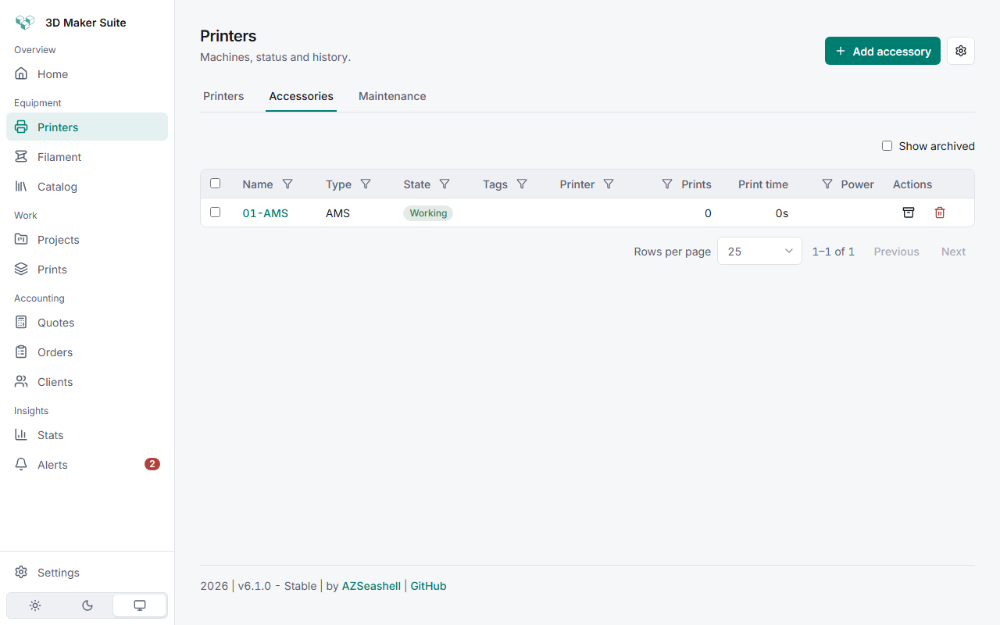
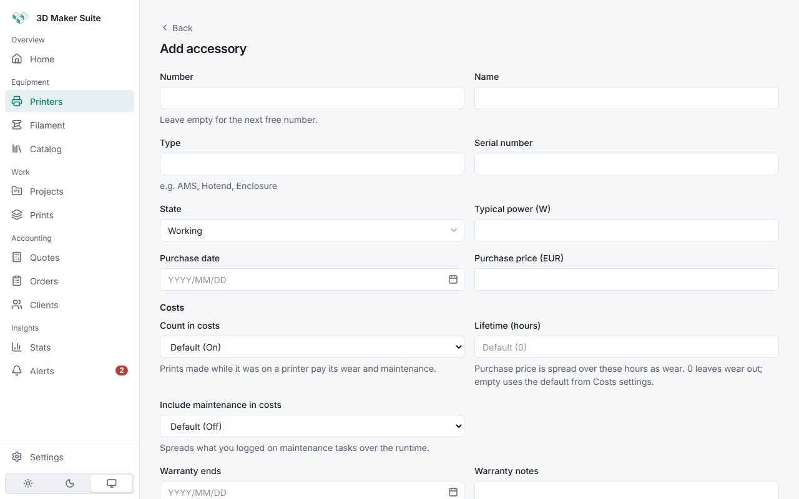
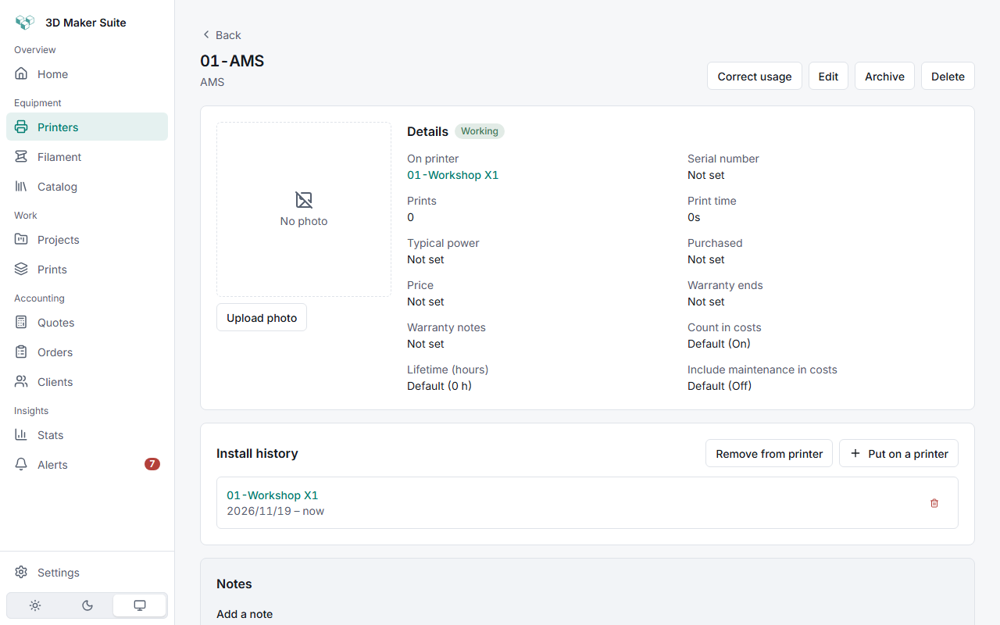

# Accessories

Parts you fit to a printer, such as an AMS, a hotend or an enclosure: the list, adding and editing one, its page with usage and costs, and the history of the printers it was on.

Accessories are the second tab of the **Printers** page, next to **Printers** and **Maintenance**. An accessory keeps its own prints, print time, costs and maintenance. These follow it from printer to printer.

## Who can use it

| You can | You need |
|---|---|
| See the list and an accessory's page | **Printers** with **Read** |
| Put an accessory on a printer, take it off, or delete an install record | **Printers** with **Write** |
| Add, edit, archive, restore or delete an accessory. Correct usage, set the photo, notes and tags | **Printers** with **Manage** |

Works the same with or without a hub.

## Before you start

- Nothing is needed to add an accessory. You do not need a printer first.
- The states you can pick (**Working**, **Maintenance**, **Out of order**, **Retired** and your own) are the same as for printers. You change them in [Printers settings](Printers-Settings.md#printers).

## Accessories tab

Open **Printers**, then **Accessories**. The list has every accessory. With none yet, the page says **No accessories yet** and **AMS units, hotends, enclosures and the like go here.**

The **Add accessory** button at the top right opens [the add form](#add-or-edit-an-accessory). The gear opens [Printers settings](Printers-Settings.md).

### Columns

| Column | What it shows |
|---|---|
| **Name** | The accessory, as its number and name, for example `01-AMS lite`. It opens the accessory's page |
| **Type** | What kind of part it is, for example `AMS` |
| **State** | **Working**, **Maintenance**, **Out of order**, **Retired**, or a state you added |
| **Tags** | The accessory's tags, when tags are on |
| **Printer** | The printer it is on now, with an **Archived** label if that printer is archived. Empty when it is not installed |
| **Prints** | How many prints it has, with corrections |
| **Print time** | Its total print time |
| **Power** | Its typical power in watts |
| The last column | **Archive** or **Restore** for the row, and the selection checkbox |

Press a column header to sort. Most columns have a filter too. **State** is filtered by your states and **Printer** by your printers.

**Show archived** finds archived accessories. A person with **Manage** can tick rows to archive, restore or delete many at once. How this works, and what blocks a delete, is on [Archive and delete](Archive-and-Delete.md).

## Add or edit an accessory

**Add accessory** opens the form. On an accessory's page, **Edit** opens the same form with its values. **Save** opens the accessory's page. **Cancel** goes back.

### Fields

| Field | What it means | Required | Example |
|---|---|---|---|
| **Number** | The accessory's number, shown before its name. Leave it empty for the next free number. Each number is used once, archived accessories too | No | `3` |
| **Name** | What you call it | Yes | `AMS lite` |
| **Type** | A free word for the kind of part. It suggests the types you used before. Maintenance tasks can be limited to a type | Yes | `AMS` |
| **Serial number** | The maker's serial number | No | `00M00A123` |
| **State** | Its state. The first one in your list is used for a new accessory | Yes | **Working** |
| **Typical power (W)** | Used to estimate energy for the prints it is on | No | `30` |
| **Purchase date** | When you bought it | No | `2026-03-14` |
| **Purchase price (EUR)** | What you paid, in your currency, which the label shows | No | `120.00` |
| **Warranty ends** | The date the warranty ends. Unlike a printer's, an accessory's ending warranty raises no alert | No | `2028-03-14` |
| **Warranty notes** | Where the receipt is, who to call | No | `Shop receipt in the drawer` |
| **Tags** | Your own labels | No | `spare` |

The **Costs** group has three fields. Each one starts as **Default (…)**, which uses the value in [Quotes settings](Quotes-Settings.md). Pick another value to change it for this accessory only.

| Field | What it means |
|---|---|
| **Count in costs** | **On**: prints made while it was on a printer pay its wear and maintenance. **Off** leaves it out |
| **Lifetime (hours)** | The purchase price is spread over these hours as wear. `0` leaves wear out. Empty uses the default |
| **Include maintenance in costs** | Spreads what you logged on maintenance tasks over its runtime |

If the number is taken, the form says **Another accessory already has this number. It may be archived.**

## Accessory details

Press an accessory's name to open its page. The title has its type and an **Archived** label if it is archived. The buttons at the top right are **Correct usage**, **Edit**, **Archive** (or **Restore**) and **Delete**, and need **Manage**. See [Archive and delete](Archive-and-Delete.md).

### Details

The top card has the photo and the facts. It shows a **State** label and these rows:

| Row | What it shows |
|---|---|
| **On printer** | The printer it is on now, which opens that printer, or **Not installed** |
| **Serial number** | Its serial number |
| **Prints** | The prints of the printers it was on, while it was on them, plus corrections |
| **Print time** | The same for print time |
| **Typical power** | Its power in watts |
| **Purchased**, **Price**, **Warranty ends**, **Warranty notes** | The values from the form |
| **Count in costs**, **Lifetime (hours)**, **Include maintenance in costs** | The value, or **Default (…)** with the setting it follows |

Empty values show **Not set**. Use the photo's buttons to **Upload photo** or **Remove photo**.

### Install history

The **Install history** card lists every printer the accessory has been on, newest first. Each line has the printer, which opens it, and the period, for example `14 Mar 2026 – now`. A period with an end date shows that date instead of **now**. An archived printer has an **Archived** label.

The buttons are:

| Button | What it does |
|---|---|
| **Put on a printer** | Opens [the install dialog](#put-an-accessory-on-a-printer) |
| **Remove from printer** | Shown only while it is installed. Opens [the remove dialog](#take-an-accessory-off-a-printer) |
| The bin on a line | **Delete record** asks **Delete this record?** and removes that period from the history. It can't be undone. The prints still count for the other periods |

With no history, the card says **Never installed.** An archived accessory shows no buttons here.

### Notes

The **Notes** card keeps short notes about the accessory. It works as on a printer. See [Printers](Printers.md#notes).

## Correct usage

**Correct usage** is for an accessory you bought used, or one that has made prints you never logged. It works as on a printer. See [Printers](Printers.md#correct-usage).

## Common tasks

### Add an accessory

1. Open **Printers**, then **Accessories**.
2. Press **Add accessory**.
3. Fill in **Name** and **Type**. Fill in the other fields if you want costs and warranty.
4. Press **Save**.

### Put an accessory on a printer

You can start from the printer or from the accessory.

1. On the accessory's page, press **Put on a printer**. On a printer's page, press **Add accessory** in its **Accessories** card instead.
2. Choose the **Printer**, or on a printer's page the **Accessory**. The list holds only free accessories.
3. Check **Installed on**. It starts as today.
4. Leave **Removed on** empty if the accessory is still on the printer. Fill it only to record a period in the past.
5. Press **Add**.

An accessory can be on one printer at a time. If the dates meet another period, the dialog says **It was on a printer during that period. Pick another date.** If the removal date is before the install date, it says **The removal can't be before the install.**

On a printer's page, when every accessory is already on a printer, the dialog says so and links to **Add accessory**.

### Take an accessory off a printer

1. On the accessory's page, press **Remove from printer**. On a printer's page, press **Remove** next to it.
2. Check **Removed on**. It starts as today.
3. Press **Remove**.

The accessory stays in its history with that date. Prints the printer makes after that day are no longer counted for the accessory.

### Move an accessory to another printer

1. Take it off the first printer.
2. Put it on the second one, with **Installed on** set to the day you moved it.

### Put an accessory out of use

1. Open the accessory and press **Edit**.
2. Change **State** to **Retired** or **Out of order**, then **Save**.
3. To hide it from the list, take it off its printer and press **Archive**.

## Related settings

- [Quotes settings](Quotes-Settings.md) has the default lifetime, **Count in costs** and **Include maintenance in costs** for accessories.
- The states are in [Printers settings](Printers-Settings.md#printers).
- Maintenance tasks for accessories are on [Maintenance](Maintenance.md).

## Limits and tips

- An accessory with install history or maintenance records can't be deleted. Archive it instead.
- Archiving is blocked while the accessory is on a printer. Take it off first.
- An archived accessory can't be put on a printer, and its page shows no **Put on a printer** button. Restore it first.
- The number is shown before the name with two digits, for example `01-AMS lite`. Keep the same type words so the type filter and maintenance tasks find them all, for example always `AMS`.

## Problems and fixes

| What you see | What to do |
|---|---|
| The **Accessories** tab doesn't show | Your role has no **Printers** right. With only **Maintenance** you see that tab |
| No **Add accessory** button | Adding needs **Printers** with **Manage** |
| **Put on a printer** has no printers to choose | Add a printer first. Archived printers are not listed |
| **Remove it from its printer first.** on Archive | Take it off its printer, then archive it |
| **Another accessory already has this number. It may be archived.** | Use another number, or leave the field empty |
| **Couldn't save the accessory.** | Check the required fields and try again. If it keeps failing, see [Troubleshooting](Troubleshooting.md) |

## Related pages

- [Printers](Printers.md)
- [Printers settings](Printers-Settings.md)
- [Maintenance](Maintenance.md)
- [Archive and delete](Archive-and-Delete.md)
