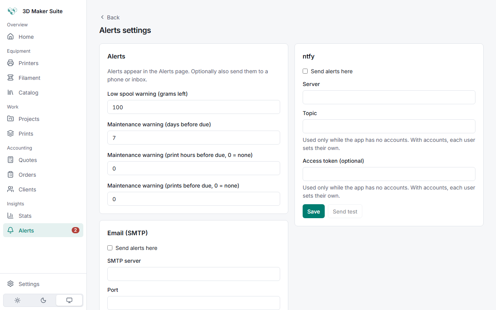

# Alerts settings

When low spools and maintenance alerts start, and the email and ntfy servers that send alerts out of the app.

Open it with the gear button at the top right of [Alerts](Alerts.md). The back arrow returns to **Alerts**. The page is called **Alerts settings**. It has no tabs and no **Sources**, because alerts are raised by the app, not imported. It has three cards: **Alerts**, **Email (SMTP)** and **ntfy**.

## Who can use it

| You can | You need |
|---|---|
| Open the page and change it | **Alert settings** |

**Alert settings** is a switch on a role, with the hint **Thresholds and the email and ntfy channels.** Someone without it doesn't get the gear and is sent back to **Alerts**. The thresholds save as you leave a field. The channels have their own **Save** button. The settings are shared by everyone who uses this server. Works the same with or without a hub.

## Before you start

For email or ntfy, you need the details of a mail server, or the address of an ntfy server. Without them, alerts still appear in the app.

## Thresholds

The first card, called **Alerts**, repeats what the page is for: **Alerts appear in the Alerts page. Optionally also send them to a phone or inbox.**

If a kind of alert reaches nobody, an orange line says **No enabled user gets the {kind} alert.** (or **No enabled user gets these alerts: {kinds}.**). Users with the right to manage users also get an **Edit roles** link, which opens the roles so you can turn the kind on for one of them.

| Field | What it means | Required | Example |
|---|---|---|---|
| **Low spool warning (grams left)** | A spool at or under this many grams gets the **Low** label and raises **Spool running low**. A spool can set its own value in its form | Yes | `100` |
| **Maintenance warning (days before due)** | How many days ahead a maintenance alert appears. A task can set its own | Yes | `7` |
| **Maintenance warning (print hours before due, 0 = none)** | The same, counted in print hours | Yes | `0` |
| **Maintenance warning (prints before due, 0 = none)** | The same, counted in prints | Yes | `0` |

The app starts with `100`, `7`, `0` and `0`. The values are whole numbers, and the grams can't be negative. A task's own limits, set in its form, win over these. See [Maintenance](Maintenance.md).

The low spool field is the same as the one in [Filament settings](Filament-Settings.md). Change it in either place and both show it.

### Who gets which alert

These settings don't decide who gets an alert. Each role sets **Off**, **In app** or **Notify** per kind in **Roles**, and each user can follow the role or choose their own in **My account**. See [Alerts](Alerts.md#who-can-use-it).

## Email (SMTP)

The server that sends alerts by email.

| Field | What it means | Required | Example |
|---|---|---|---|
| **Send alerts here** | Turns the channel on | No | On |
| **SMTP server** | The mail server's address | Yes, to turn it on | `smtp.example.com` |
| **Port** | The mail server's port | Yes, to turn it on | `587` |
| **Username (optional)** | The login, if the server asks for one | No | `alerts@example.com` |
| **Password** | The login's password. It is stored encrypted and never shown again | No | |
| **From address** | The sender shown on the email | Yes, to turn it on | `alerts@example.com` |
| **To address** | Where the email goes when the app has no accounts. With accounts, each user sets their own | No | `me@example.com` |

## ntfy

[ntfy](https://ntfy.sh) sends a message to a phone or computer through a topic.

| Field | What it means | Required | Example |
|---|---|---|---|
| **Send alerts here** | Turns the channel on | No | On |
| **Server** | The ntfy server's address | Yes, to turn it on | `https://ntfy.sh` |
| **Topic** | The topic to send to when the app has no accounts. With accounts, each user sets their own | No | `my-printers` |
| **Access token (optional)** | For a protected topic. Stored encrypted and never shown again | No | |

**To address**, **Topic** and **Access token** carry the hint **Used only while the app has no accounts. With accounts, each user sets their own.**

### Save and test a channel

- **Save** stores the card. Next to it, **Saved** confirms it. If a required field is empty, it says **Fill in all required fields to turn this on.**
- A password or token that is stored shows **Saved. Leave empty to keep it.** Leave the box empty to keep it, or type a new one to replace it.
- **Send test** sends a test message and says **Test sent** or **Test failed. Check the settings.** It is only available once the channel is saved and on, and the test goes to your own address or topic.
- An alert is sent once per person and channel. A destination that fails is tried again at a later check.

## Common tasks

### Warn sooner about a low spool

1. Open **Alerts**, then the gear.
2. Raise **Low spool warning (grams left)**, for example to `200`.
3. Click outside the field.

### Send alerts by email

1. Fill **SMTP server**, **Port**, **From address** and, if needed, **Username** and **Password**.
2. Tick **Send alerts here** and press **Save**.
3. Press **Send test** and check your inbox.
4. Ask each user to set their email in **My account**, **My delivery**, and set the alert kinds they want to **Notify**.

### Send alerts to a phone with ntfy

1. Fill **Server**, tick **Send alerts here** and press **Save**.
2. Install the ntfy app on the phone and subscribe to a topic.
3. Each user puts their topic in **My account**, **My delivery**, then **Send test**.

## Limits and tips

- Links in email and ntfy messages point to the app's public address. Set it in **Settings**, see [Server and remote access](Server-and-Remote-Access.md).
- Without user accounts, the **To address**, **Topic** and **Access token** here are the only destination.
- The SMTP password and the ntfy token are never returned by the API or written to the logs.
- A channel that is off, or that fails, never stops alerts from appearing in the app.

## Problems and fixes

| What you see | What to do |
|---|---|
| **Fill in all required fields to turn this on.** | Fill the server, port and from address (email), or the server (ntfy), then save |
| **Test failed. Check the settings.** | Check the address, port, login and that the server is reachable from this one |
| **No enabled user gets the {kind} alert.** | Turn the kind on for a role, or use **Edit roles** |
| I don't get emails | Check **My delivery** in **My account**, and that the kind is set to **Notify** |
| No gear on **Alerts** | Your role has no **Alert settings** |

## Related pages

- [Alerts](Alerts.md)
- [Maintenance](Maintenance.md)
- [Filament settings](Filament-Settings.md)
- [Server and remote access](Server-and-Remote-Access.md)
