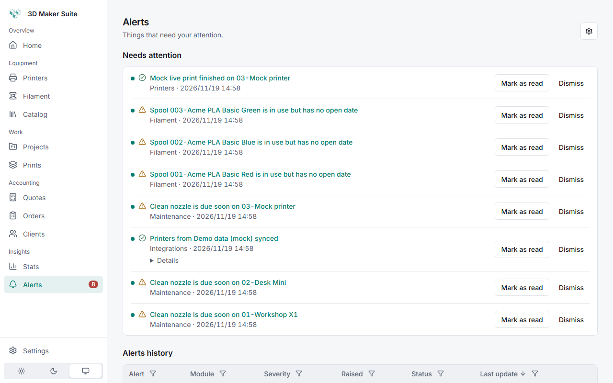

# Alerts

What needs your attention: spools running low, maintenance due, a sync that failed, a print that finished and more. Each alert has a short title, a page of its own, and buttons to read, snooze or dismiss it.

## Who can use it

Everyone who signs in can open **Alerts**. There is no right for the page itself. What you see depends on your role and your own choices:

- Each kind of alert needs a right. You never get a kind whose right you lack, and never an alert about a project you can't see.
- Each role sets, per kind, **Off**, **In app** or **Notify**. Notify also sends it by email or ntfy. A user can change this on their own [My account](My-Account.md#my-alerts) page, or follow the role with **Same as role**.
- Read, snooze and dismiss are yours alone. Other people keep their own.

The gear button at the top right opens [Alerts settings](Alerts-Settings.md). You need **Alert settings** to see it. Works the same with or without a hub, but hub alerts (a connector out of date, a file conflict, a mass delete, a printer unreachable) only appear with the hub on.

## Before you start

Nothing. Alerts are raised by the app itself. The menu item shows a count of the alerts nobody has looked at yet (unread and not snoozed).

## Which alerts exist

| Alert | When it appears | It needs |
|---|---|---|
| **Spool running low** | A spool is at or below its low-spool level | **Filament** read |
| **Spool without price** | A spool has no price | **Filament** read |
| **Spool without open date** | A spool is in use but has no open date | **Filament** read |
| **Maintenance** | A task is due soon or overdue | **Maintenance** read |
| **Warranty ending** | A printer's warranty ends soon | **Printers** read |
| **Printer offline** | A printer stops answering during a print for over 2 minutes | **Printers** read |
| **Printer unreachable** | The connector of a printer went offline during a print | **Printers** read |
| **Print finished**, **Print failed** | One alert per print. A cancelled print raises none, and neither does imported history | **Prints** read |
| **Filament to review** | Filament slots wait for a spool. One alert with the count | **Prints** write |
| **Sync needs review** | A sync left rows for you to check | **Review imports** |
| **Sync finished**, **Sync failed** | A sync ended | **Run syncs** |
| **Print setup changed**, **Auto slice failed** | A project file changed its plates or filament, or slicing again failed | **Projects** read, and the project visible |
| **Sync conflict** | A hub file changed in two places | **Projects** read |
| **Preset conflict**, **Preset skipped**, **Preset deletes held** | A slicer preset changed in two places, wasn't stored, or too many were removed at once | **Catalog** write |
| **Update available** | A new version of the app | **Server settings** |
| **Slicer update** | A new version of a slicer | **Manage integrations** |
| **Connector outdated**, **Sync paused: many deletes** | A workstation needs updating, or deleted many files at once | **Manage the hub** |

Most are **In app** by default. **Spool without price** and **Spool without open date** are **Off** by default. **Admin** gets every kind as **Notify**.

A **condition** alert (a spool, maintenance, a warranty, printer offline, sync needs review, filament to review, connector outdated, deletes held) closes by itself for everyone when the cause is fixed. An **event** alert (a failed sync, a finished print) stays until each person dismisses it.

## Alerts list

Open **Alerts**. The first group, **Needs attention**, lists alerts you haven't dismissed or snoozed. With none, the page says **All clear** and tells you what shows up here.

Each row shows:

- A blue dot when it's unread.
- An icon for its severity: **Error**, **Warning** or **Success**.
- The title, as a link to the alert's own page.
- The module and the date it was raised.
- A **Details** line for sync alerts. Open it to see what the sync did, line by line.
- **Mark as read** or **Mark as unread**, and **Dismiss**.

A successful alert (**Success**, such as a finished sync) leaves this group as soon as you read it, and moves to the history.

The list refreshes about once a minute.

## Alert details

Click a title to open the alert. Opening it marks it read for you, once. Mark it unread again and it stays unread.

The page is called **Alert**; the back arrow returns to the list. If it was removed you get **This alert no longer exists.**

It shows the title, a few words of context and a table:

| Row | What it shows |
|---|---|
| **Severity** | **Error**, **Warning** or **Success** |
| **Module** | The part of the app it belongs to |
| **Task** | What it is about: the maintenance task, the sync type, the version, the spool or printer |
| **Result** | For a finished sync: how many rows are new and how many updated |
| **Raised** | When it appeared |
| **Status** | **Unread**, **Read**, **Snoozed until {date}**, **Dismissed** or **Resolved on {date}** |

A sync alert has its **Details** log next to the table on a wide screen. A low spool says how many grams are left.

### Buttons that fix it

Each alert offers the button that gets you to the fix, shown when you may use it:

| Alert | Button |
|---|---|
| Spool running low | **View spool** |
| Spool without price or open date | **Edit spool** |
| Maintenance | **View task**, and **Mark as done** (needs **Maintenance** write) |
| Sync needs review | **Review** |
| Sync finished | A button to the thing it filled, such as **View printers** or **View prints** |
| Sync failed | **Open integration** or **Open sources**. **Sign in again** if the account was signed out |
| Print setup changed, Auto slice failed | **Open print setup** |
| Sync conflict | **Open project** |
| Filament to review | **Review filament** |
| Update available | **Open updates** |
| Slicer update | **Open integration** |
| Connector outdated, sync paused | **Open Hub management** |

**Mark as done** opens the maintenance log, and the alert closes when you save.

### Read, snooze and dismiss

| Button | What it does |
|---|---|
| **Mark as read**, **Mark as unread** | Changes only your own state |
| **Snooze 1 day**, **Snooze 7 days** | Hides the alert from you for that long and holds your email and ntfy until it ends. On a maintenance alert they read **Postpone 1 day** and **Postpone 7 days**. They show on the details page only |
| **Remove snooze** | Brings a snoozed alert back |
| **Dismiss** | Removes the alert from your list |
| **Restore alert** | Brings a dismissed alert back (on its details page) |

Everything here is personal. Dismissing or snoozing never changes what someone else sees.

## Alerts history

Below the list, **Alerts history** is a table of everything that no longer needs attention: resolved, dismissed or snoozed alerts, and successes you have read.

| Column | What it shows |
|---|---|
| **Alert** | The title, as a link. Filters by kind |
| **Module** | Sorts and filters |
| **Severity** | Sorts and filters |
| **Raised** | When it appeared. Sorts and filters by date |
| **Status** | **Snoozed**, **Read**, **Dismissed** or **Resolved**. Sorts and filters |
| **Last update** | The last change. Sorts and filters. The newest are first |
| (last column) | **Remove snooze**, on snoozed rows |

Click a heading to sort and use its filter to narrow the rows. Open a title to see the alert again. **The alerts history could not be loaded.** means the list failed; reload.

## Common tasks

### Deal with a low spool

1. Open the alert from the list.
2. Press **View spool** to see it, or **Edit spool** to change the weight.
3. The alert closes by itself when the spool is no longer low.

### Be reminded of maintenance later

1. Open the maintenance alert.
2. Press **Postpone 1 day** or **Postpone 7 days**.

### Get alerts on your phone

1. Set up a server for email or ntfy in [Alerts settings](Alerts-Settings.md) (an admin does this once).
2. Open [My account](My-Account.md#my-delivery), and in **My delivery** add your address or ntfy topic.
3. Set the kinds you want to **Notify**.

## Related settings

- [Alerts settings](Alerts-Settings.md): when low spools and maintenance alerts start, and the email and ntfy servers.
- **Roles** in **Settings**: which kinds each role gets.
- [My account](My-Account.md): your own choices and where your alerts are sent.

## Limits and tips

- An alert is shown once per person and channel. A destination that fails is tried again later, and a failing one waits 15 minutes so it doesn't slow the others.
- A disabled user, or one with a disabled role, gets nothing.
- Without user accounts the page works for one person, and the global email and ntfy settings apply.

## Problems and fixes

| What you see | What to do |
|---|---|
| **All clear** | Nothing needs attention |
| **This alert no longer exists.** | It was resolved and removed. Go back to the list |
| An alert I expected isn't there | Your role has it **Off**, or lacks the right for it. Check **Roles** and [My account](My-Account.md#my-alerts) |
| A button is missing | You lack the right for that fix |
| **Sign in again** | The account of a source was signed out. Press it to sign in again |

## Related pages

- [Alerts settings](Alerts-Settings.md)
- [Maintenance](Maintenance.md)
- [Filament](Filament.md)
- [Filament review](Filament-Review.md)
- [Sources and sync](Sources-and-Sync.md)
