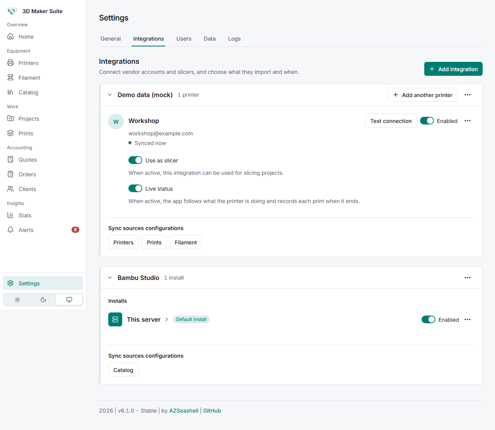

# Bambu Cloud

Reads your printers, print history and filament spools from your Bambu Lab account. It is optional. Everything it brings in can also be typed in by hand.

## Who can use it

Setting it up needs **Set up integrations**. Syncing and reviewing what it found need **Run syncs** and **Review imports**, and the sync set to allow it. See [Integrations](Integrations.md#who-can-use-it) and [Sources and sync](Sources-and-Sync.md). Works the same with or without a hub.

## Before you start

- A Bambu Lab account that already has your printers bound, through Bambu Studio or Bambu Handy.
- An internet connection on the computer that runs the app.
- No LAN Only mode, Developer mode or access code is needed.

## Connect

1. Open **Settings**, then **Integrations**, and press **Add integration**.
2. Pick **Bambu Cloud**.
3. Pick your **Region**: **Global** or **China**.
4. Enter your account **Email** and **Password**, and press **Add**.
5. If Bambu asks for a verification code (from your email, or from an authenticator app), the same form asks for it. Enter the **Verification code** and press **Add** again.

The password is sent to Bambu once and is never stored. The app stores only the access token, encrypted on disk. The account is created only when the sign-in goes through: a wrong password, a wrong code or leaving the form saves nothing. Its printers are imported right away. An account that is already set up (the same Bambu email) is refused with **Already set up: find its card on the Integrations page.**

A code stays valid for 10 minutes. After that, or after a restart of the app, the form asks for the password again and says **The sign-in timed out. Enter your email and password again.**

| Field | What it means | Required | Example |
|---|---|---|---|
| **Region** | Where your account lives. **China** uses Bambu's China servers | Yes | Global |
| **Email** | Your Bambu account | Yes | `sam@example.com` |
| **Password** | Used once to sign in | Yes | |
| **Verification code** | The code Bambu sent, or your authenticator's code | When asked | `123456` |

## Your accounts

The **Bambu Cloud** card on [Integrations](Integrations.md#integrations-page) has one block per account, with **Add another account** at the top.

- **The block:** the account's photo (or its initials), name, email and region, and whether it is signed in. The name, email and photo are read from your Bambu profile when you sign in and on each sync. If that read fails, the last values stay and the sync goes on.
- **Test connection**, **Enabled** and **⋯** (**Edit**, **Delete**): as on any account. Switched off, nothing syncs from the account.
- **Sync sources configurations:** the buttons **Printers**, **Prints**, **Filament** and **Catalog** open that module's **Sources** tab, where each type has its line.
- The card's own **⋯** menu has **Remove integration**. It removes every account on the card.

The server downloads the photo from `public-cdn.bblmw.com` and keeps a copy, so your browser never calls Bambu. On a NAS or server with a firewall, allow that host too, or the card shows initials.

## Sign in again

When Bambu refuses the saved sign-in, because it expired or was revoked, the block shows **Signed out** and syncs raise a **Sync failed** alert.

1. Click **Signed out** on the block, or **Sign in again** on the alert. The **Edit** page opens.
2. Under **Sign in**, enter your **Email** and **Password**, and press **Sign in**.
3. Enter the **Verification code** if asked, and press **Verify**.

The page then says **Signed in. The printers are synced now.** Other settings on the page, such as the region, are saved with **Save changes**. A sign-in lasts about three months.

## What it reads

| Data | What happens | Set on |
|---|---|---|
| **Printers** | New printers are added. Existing ones keep your notes and settings. A printer you added by hand with the same serial number is linked to the cloud one, not copied | **Printers → Settings → Sources**. Auto, every day |
| **Print history** | Finished prints since the last sync. Prints started from the phone app, or while the computer was off, are included. Every new print is recorded at once | **Prints → Settings → Sources**. Auto, every hour |
| **Spools** | The filament manager's spools, each with brand, material, name (`PLA Basic`), colour and colour name. No filament preset is made for them | **Filament → Settings → Sources**. Manual |
| User presets | The machine, process and filament presets you saved in Bambu Studio, read from your account and never written back | **Catalog → Catalog settings → Sources**. Manual |

The lines are explained once, on [Sources and sync](Sources-and-Sync.md). To sync one now, use **Sync now** in the **⋯** menu of the account's line. **Review and import** opens the review screen with what the account offers. Each sync reports its result as an alert: new and updated rows, rows waiting for review, or an error.

### Print history and spools

Each slot of a print is matched to a spool by material and colour. A match counts only when exactly one active spool fits and it wasn't bought after the print. A print older than the spool's entry in the app gets the spool but takes nothing off it, because the weight you entered already includes it. A slot that matches no single spool goes to [Filament review](Filament-Review.md), where it is matched again on every sync. The review level decides which slots wait there. See [Prints settings](Prints-Settings.md#review-of-automatic-prints).

A print is linked to a project by its title when one matches.

### User presets

Each kind has its own line under **Catalog**: **Printer user presets**, **Process user presets** and **Filament user presets**. They become the same presets as Bambu Studio's own, so a preset the app already has from Studio is counted once. An edit in Studio updates the row on the next run and keeps the values you typed, such as a price. A preset you delete in Studio raises a **Sync needs review** alert. **Delete** removes the row when nothing uses it, **Archive** keeps one you edited, and a used one stays with the reason shown. Presets that came from a slicer zip are never touched. See [Catalog settings](Catalog-Settings.md#sources).

## Live status

Bambu Cloud alone gives no live status: the printer shows **Synced only** in [Printers](Printers.md#connection-and-monitoring). For live status, state, progress, the AMS and a print recorded the moment it ends, add [Bambu LAN](Bambu-LAN.md) for the same printer. It stays one printer in the app, and each print is recorded once, whichever source sees it first.

## Spools: why they are not synced on their own

A new account has **Spools** on **Manual**: nothing is imported until you press **Sync now** or review. **Track usage** is off. Change both on **Filament → Settings → Sources** if you want them.

The remaining weight Bambu reports is an estimate, not a measurement:

- The AMS has no scale. It counts the filament it feeds out and the turns of the spool, and works out the rest from the spool's size.
- It is only close for Bambu spools. Third-party spools differ in diameter, width and winding, and have no RFID tag.
- The Filament Manager sometimes stops updating, or goes back to 1000 g, also with Bambu spools.
- Bambu Studio's local copy can differ from the cloud.

**Track usage** on the **Spools** line takes the remaining weight of synced spools from Bambu. Switch it off to keep the weight your prints took off: spools sync then only adds and links spools. Don't track usage from both prints and spools at the same time. The weight is overwritten or counted twice, and the page warns you.

A spool can be in several libraries at once, for example here and in [Spoolman](Spoolman.md). It is one spool in the app, linked to each.

## Common tasks

### Bring in your Bambu printers and history

1. Add the account, see [Connect](#connect). Its printers come in at once.
2. Open **Prints**, then the gear, then **Sources**. Print history is on **Auto**, every hour.
3. For older prints, open the line's **⋯** menu and press **Review and import a period…**.

### Sign in with a new password

1. On the account's block, press **⋯**, then **Edit**.
2. Under **Sign in**, enter your email and the new password, and press **Sign in**.

## Related settings

- **Printers**, **Prints**, **Filament** and **Catalog** **Sources** tabs hold the account's lines.
- [Prints settings](Prints-Settings.md#review-of-automatic-prints) holds the review level.

## Limits and tips

- The Bambu Cloud API is unofficial and can change without notice. The integration lives in one package, so a change affects only it. The app keeps working without the cloud.
- The app never writes to your Bambu account.
- Failed syncs raise a **Sync failed** alert, and the app keeps the data it has.

## Problems and fixes

| What you see | What to do |
|---|---|
| **Sign-in expired. Connect again.** | Click **Signed out** on the account and sign in again on its **Edit** page |
| **The vendor is limiting requests. It will retry later.** | Wait about an hour. Syncing pauses and tries again by itself |
| **The vendor's servers refused this app's request. If it keeps happening, check for an update of 3D Maker Suite.** | Bambu's protection rejected the app. Update the app if it keeps happening |
| **The vendor changed its service and this version can't read it any more. Check for an update of 3D Maker Suite.** | Bambu changed its answer format. Update the app |
| **Wrong email or password.** | Enter them again |
| **That code is wrong or has expired. Check it and try again.** | Ask Bambu for a new code. A code lasts 10 minutes |
| The photo is replaced by initials | Allow `public-cdn.bblmw.com` through the firewall |
| A printer shows **Synced only** | Normal. Add [Bambu LAN](Bambu-LAN.md) for live status |

## Related pages

- [Integrations](Integrations.md)
- [Bambu LAN](Bambu-LAN.md)
- [Spoolman](Spoolman.md)
- [Sources and sync](Sources-and-Sync.md)
- [Filament review](Filament-Review.md)
- [Printers](Printers.md)
