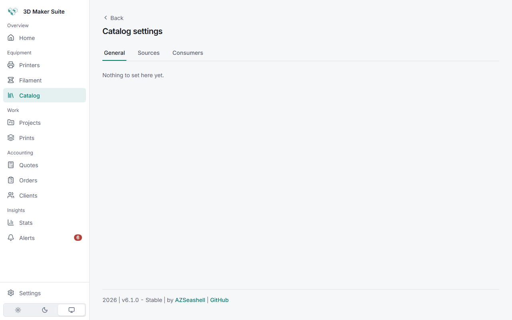
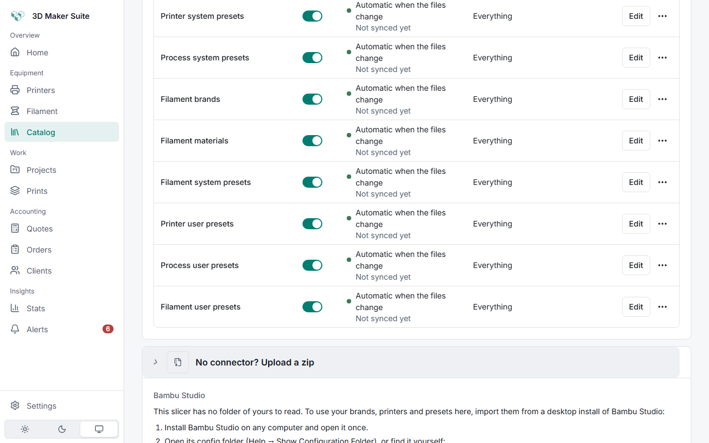
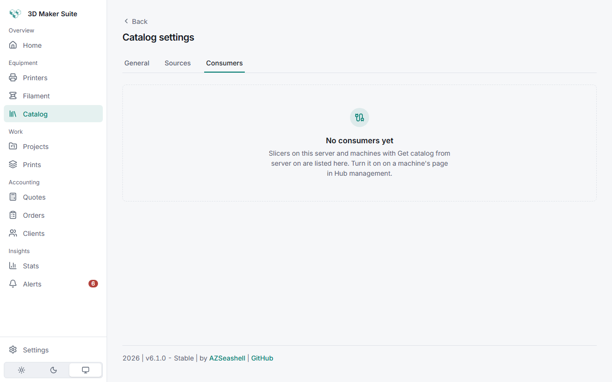
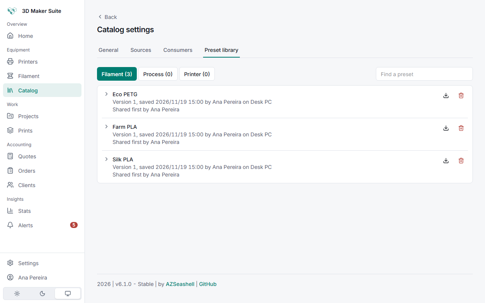

# Catalog settings

The settings of the **Catalog**: where brands, models, materials and presets come from, which computers and slicers get the catalog, and the hub's preset library.

Open it with the gear button at the top right of the **Catalog**. The back arrow returns to the **Catalog**. It has up to four tabs: **General**, **Sources**, **Consumers** and **Preset library**.

## Who can use it

| You can | You need |
|---|---|
| Open the page and look at every tab | **Catalog** with **Read** |
| Change the lines on **Sources**, and run or review them | **Catalog** with **Manage**, or the **Run syncs** or **Review imports** right on that source |
| See the **Preset library** | The hub turned on, with **Catalog** access |
| Delete, restore or resolve held deletes in the library | **Catalog** with **Write**, with a hub |
| Switch a computer's catalog lines | **Catalog** with **Write** and the right to edit that computer |
| Change which slicer is the hub's slicer, or the server's own slicer lines | **Set up integrations** |

Each control checks its own right, so with **Read** alone you can look but not change anything. Without **Catalog** at **Read** there is no gear. **Preset library** shows only with a [hub](Hub-Setup.md).

## General

This tab has nothing to set yet. It says **Nothing to set here yet.** The tabs next to it hold everything.

## Sources

**Sources** lists everything that can feed the catalog. Each source is a card, and each card is one table of lines. A line is one kind of data from one source. The kinds are:

- **Brands**, **Printer models**, **Filament brands** and **Filament materials**
- **Printer presets**, **Process presets** and **Filament presets**, the slicer's system presets
- The slicer's **User presets**, for printer, process and filament presets

Every line has the same controls as on any **Sources** tab: **On**, **When**, **What**, and the **⋯** menu with **Sync now**, **Review and import** and the sync log. These are explained once on [Sources and sync](Sources-and-Sync.md). The tab says **No sources** when nothing can feed the catalog. Brands, models and materials are then added by hand.

The cards you can see:

| Card | What it is |
|---|---|
| **This server** | The slicers installed on the server. The one marked **Server's slicer** is the source of the system presets, brands and models. **Folder not found** means the app can't read its folder. **Change in Integrations** picks another one |
| An account, such as **Bambu Cloud** | An account that allows user presets. Its user preset lines are listed per slicer |
| A computer | A computer paired with the hub, with a slicer. It shares the slicer's user presets with the hub. **Machine** opens its page in Hub management |
| **No connector? Upload a zip** | The slicer's config folder as a zip, for a computer that has no connector |

You switch a source on in **Settings → Integrations**, or in **Hub management** for a computer. Switching it off here takes it off the tab and keeps what it already brought in.

### Choose brands

Under the server's slicer, **Choose brands** lets you pick the printer and filament brands you use, from what the slicer ships.

1. Press **Choose brands**.
2. Search with **Find a brand**, or use **Select all** for a list.
3. Tick the brands you want under **Available**. Those under **In your catalog** are already in and are locked.
4. Press **Import** with the number of brands.

Each brand comes with its models and its system presets. After a pick, the system lines change to **Only what I already have**, so only what you have is checked for updates. User presets don't change. A line below the button lists the brands you have.

### Upload a zip

Under **No connector? Upload a zip**, each slicer has an upload for its config folder. The page [Presets](Presets.md#how-presets-arrive) tells where each slicer keeps that folder and what to zip.

### A computer's share switches

With a hub, a computer's card has a switch for each kind of user preset, for example **Share Filament presets from OrcaSlicer on Studio PC**. A computer must have **Send catalog to server** on, on its page in Hub management, to be listed. A slicer that is no longer found on it says so. When deletes wait for you, a link opens the **Preset library**.

## Consumers

**Consumers** is the other direction: who **gets** the catalog. It lists slicers on this server and computers with **Get catalog from server** on (turn that on on a computer's page in **Hub management**). Without any, the tab says **No consumers yet**. The hub's own slicer has no switch for **System presets**: its folder is the catalog, and its state says **Server's slicer**.

Each card has a table per slicer with two lines.

| Line | What it does |
|---|---|
| **System presets** | Writes the catalog's brands, models and system presets into the slicer. A switch turns it on. The state column says what is going on |
| **User presets** | Writes the hub's user presets into the slicer. A switch turns it on. The state says what waits |

### What the state says

| State | It means |
|---|---|
| **Off** | The switch is off |
| **Not received yet** | On, but nothing has arrived |
| **The hub has no catalog yet** | The hub has nothing to send. Choose its slicer first |
| **Waiting for the slicer to close** | The slicer is open. It gets the files once it closes |
| **Being written** | The files are on their way |
| **Received** and a date, or **Up to date** | It has everything |
| **Couldn't write**, with the reason | Fix the cause, then try again |
| **Not sent: slicer … here, catalog from …** | The versions don't match |
| **Waiting for the machine's first report** | The computer hasn't reported yet |
| A number **waiting for the slicer to close** or **being written** | User presets that are queued |

A computer that is offline, or whose connector is older than the hub, says so at the top of its card. Update the connector from **Hub management**.

The **⋯** menu of a line has **What is received**. It shows the folder it writes to and the last backup. For system presets it also has a table **Presets versions per vendor**, with **Vendor**, **The hub's copy** and **In this slicer**. A version that differs is highlighted.

Before the first write, the app makes a backup of the slicer's folder. The path is shown in the menu.

A queue can also list **Presets to delete in** the slicer. A slicer's cloud account can bring back a file deleted from disk, so those must be deleted in the slicer.

## Preset library

With a hub, this tab is the one library of slicer user presets that the hub's slicer and the slice workers use. Computers share their user presets into it, and computers with **Install** on get them back. With no presets yet, it says **No slicer presets yet**, and tells you to turn on sharing for a computer or upload a zip.

### The list

- When there are two slicers, buttons at the top switch between them.
- Choose a **Preset type**: **Filament**, **Process** or **Printer**, each with its count.
- **Find a preset** filters by name.

A preset shows its name, **Based on** the preset it builds on, the version and when and by whom it was saved. Open it with the arrow to see the **Earlier versions** and which printers, plates or prints use it. A link opens the preset's page in the Catalog. A download button saves it. With **Write**, the **Restore version** button makes an earlier version the next one.

### Delete and restore

- The bin button on a row deletes the preset. A box asks **Delete…?** and explains that it is removed from the hub's slicer, the slice workers and every computer with **Install** on, unless a computer has edits it hasn't sent. Slices that used it need slicing again. On a PC signed in to Bambu Studio, delete it in the slicer too.
- **Deleted presets** lists what you deleted. **Restore** brings one back as its next version.

### Deletes waiting for you

A delete in a slicer reaches every computer. Two cases are held for you instead: many presets removed at once, and a computer whose slicer account another user's computer shares. The card **Deletes waiting for you** says which computer and how many. Choose **Delete them**, or **Keep them**, which writes them back.

### Conflict copies

When a computer saves its own version of a preset that changed on the hub, the app keeps it under a new name as a **conflict copy**. Download both, keep what you need in your slicer, then delete the copy.

## Common tasks

### Bring in the brands you use

1. Open **Catalog settings → Sources**.
2. On **This server**, press **Choose brands** and pick them.
3. Press **Import**.

### Get presets from a computer without a connector

1. Open **Catalog settings → Sources**.
2. Under **No connector? Upload a zip**, upload the slicer's zipped config folder.

### Send the catalog to a computer's slicer

1. In **Hub management**, open the computer and switch on **Get catalog from server**.
2. Open **Catalog settings → Consumers** and switch on **System presets**, **User presets** or both on its card.
3. Close the slicer on that computer. The files are written once it closes.

### Remove a preset from every computer

1. Open **Catalog settings → Preset library**.
2. Press the bin button on the preset and confirm **Delete preset**.

## Related settings

- **Settings → Integrations** switches slicers and accounts on and picks the hub's slicer.
- **Hub management** has each computer's **Send catalog to server** and **Get catalog from server** switches.

## Limits and tips

- Presets come only from a slicer. They can't be added by hand.
- The hub has one slicer per type as its source, which is picked in **Settings → Integrations**.
- The app backs up a slicer's folder before it writes to it the first time.
- A delete in the library reaches the computers. Use **Keep them** when you aren't sure.

## Problems and fixes

| What you see | What to do |
|---|---|
| **No sources** | Add a slicer or an account in **Settings → Integrations**, or pick a computer as the hub's slicer |
| **No consumers yet** | Turn on **Get catalog from server** on a computer's page in **Hub management** |
| **Folder not found** | The server can't read the slicer's folder. Check the integration |
| **Waiting for the slicer to close** | Close the slicer on that computer |
| **That machine's connector is too old for this** | Update the connector from **Hub management**, then try again |
| **The hub has no catalog yet** | Pick the hub's slicer, with **Change in Integrations** |
| No **Preset library** tab | The hub is off |
| The gear opens **Sources** | Your role can sync or review, but has no **Manage** on **Catalog** |

## Related pages

- [Catalog](Catalog.md)
- [Presets](Presets.md)
- [Sources and sync](Sources-and-Sync.md)
- [Hub setup](Hub-Setup.md)
- [Connector setup](Connector-Setup.md)
