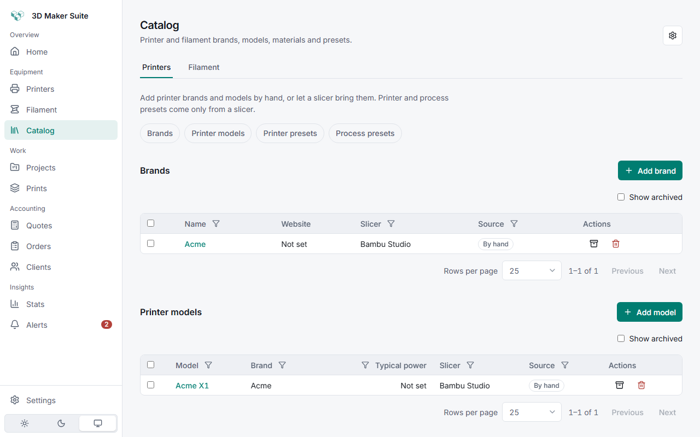
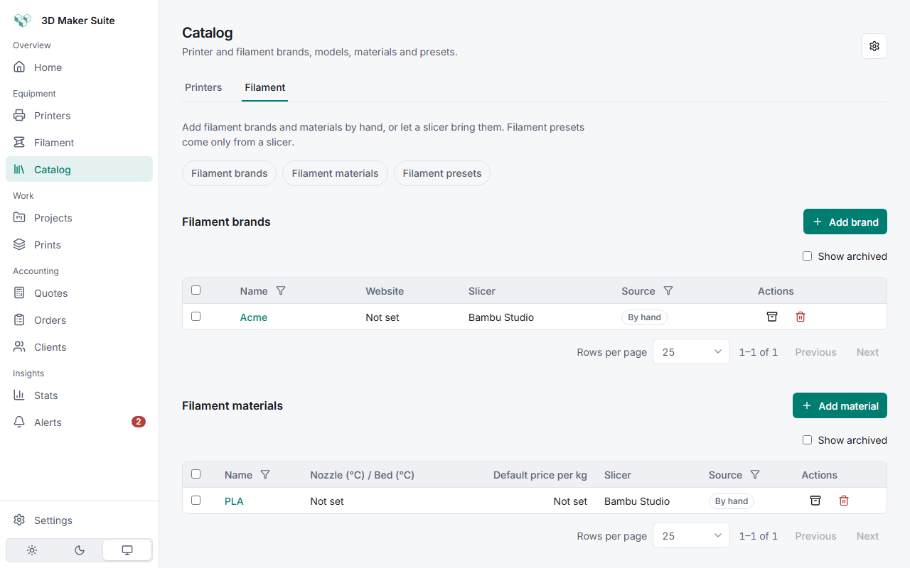
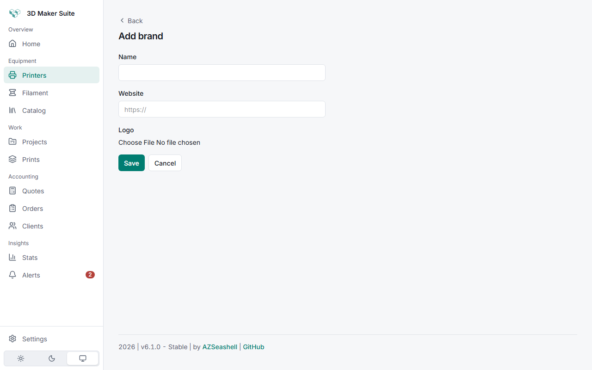
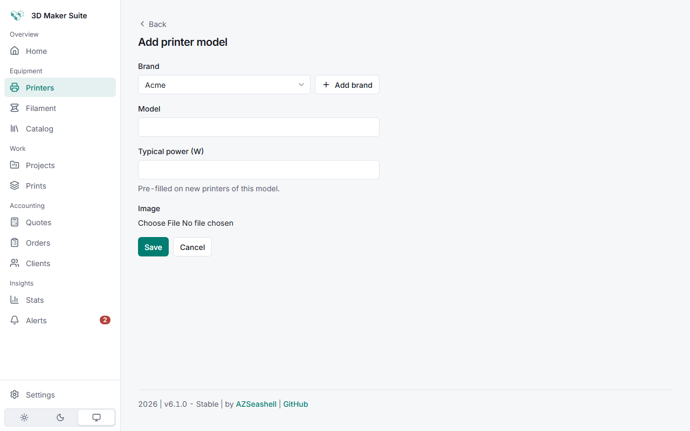
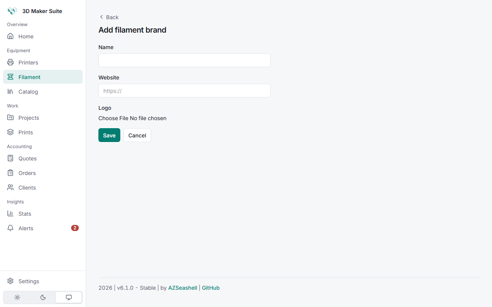
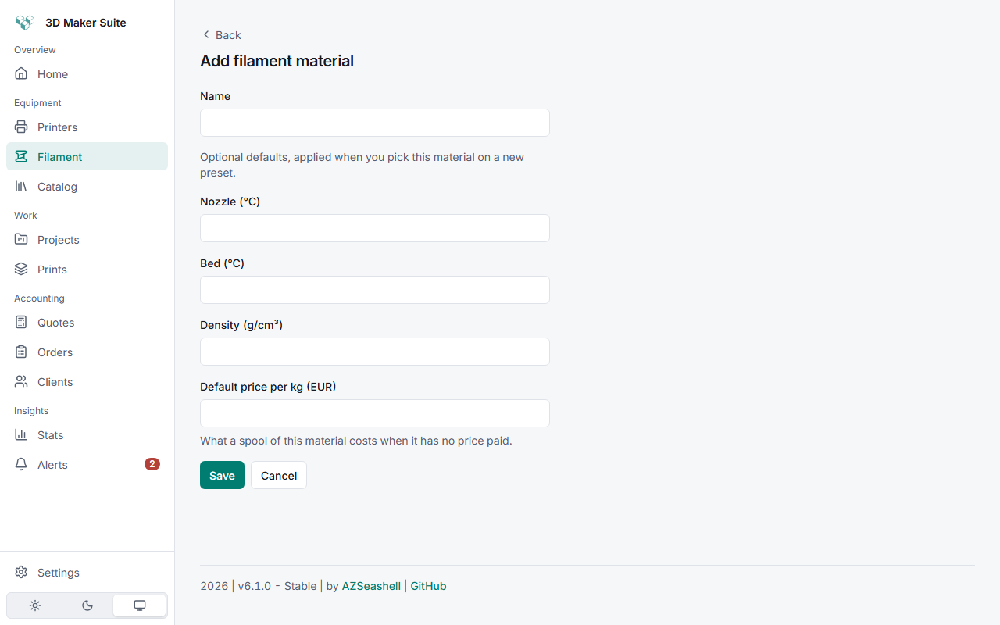

# Catalog

The lists the rest of the app picks from: printer brands and models, filament brands and materials, and the slicer presets that belong to them.

You open the **Catalog** from the sidebar. It has two views, **Printers** and **Filament**. Each view is one long page with a few tables. Brands and models (or materials) are yours to add by hand, or a slicer can bring them. Presets only come from a slicer. See [Presets](Presets.md).

## Who can use it

| You can | You need |
|---|---|
| See the Catalog and open a preset | **Catalog** with **Read** |
| Add, edit, archive, restore or delete a brand, model or material, and archive or delete a preset | **Catalog** with **Manage** |
| Change the Catalog settings | **Catalog** with **Manage**, or the **Run syncs** or **Review imports** right on a source that feeds the catalog |

Without **Read** on **Catalog**, the address takes you to the dashboard. Works the same with or without a hub.

## Before you start

- You can use the app with an empty catalog. A printer needs a model, and a spool needs a material, so add those first or bring them in from a slicer.
- To fill the catalog from a slicer, see [Catalog settings](Catalog-Settings.md#sources).

## What you see on both views

The page header has two buttons:

- **Sync all** runs every catalog table now, in each source that is set to **Auto**. It only shows when a source can sync. See [Sources and sync](Sources-and-Sync.md).
- The gear opens [Catalog settings](Catalog-Settings.md).

Under the tabs, a line says where rows come from. A row of small buttons under it jumps to each table of the view, in page order.

Every table has the same kind of controls. Press a column header to sort. Columns with a filter let you narrow the rows. **Show archived** finds archived rows. You can tick rows to archive, restore or delete many at once. How this works, and what blocks a delete, is on [Archive and delete](Archive-and-Delete.md).

Each table has its own **Sync** button too. It runs only that table.

### The Source column

Every row says where it came from.

| You see | It means |
|---|---|
| **By hand** | You added it |
| **By hand (older)** | A preset made by hand in an older version of the app. It has no file to read |
| **Bambu Studio (system)** or **OrcaSlicer (system)** | The slicer ships it |
| **Bambu Studio (user)** or **OrcaSlicer (user)** | Someone made it in the slicer |
| An account name, such as **Bambu Cloud** | The account brought it in |

A row a source brought is found again by its **name** on the next import. That is why its name can't change in the form. See [Forms](#forms).

## Printers view

Open **Catalog** and choose **Printers**. It has four tables.

### Brands

The printer brands. **Add brand** opens [the brand form](#printer-brand-form).

| Column | What it shows |
|---|---|
| **Name** | The brand, with its logo. For roles that can manage, it opens the edit form |
| **Website** | The address of the brand's website. It opens in a new tab |
| **Slicer** | The slicers whose presets use this brand |
| **Source** | Where the row came from |
| The last column | **Archive** or **Restore**, and the selection checkbox |

### Printer models

The models of each brand. **Add model** opens [the model form](#printer-model-form).

| Column | What it shows |
|---|---|
| **Model** | The model, with its picture. It opens the edit form |
| **Brand** | The model's brand |
| **Typical power** | The power in watts that new printers of this model start with |
| **Slicer** | The slicers whose presets use this model |
| **Source** | Where the row came from |
| The last column | **Archive** or **Restore**, and the selection checkbox |

### Printer presets and Process presets

These two tables list what the slicer brought. They have no add button. A line under each title says **From your slicer's files. Archive one to hide it from the pickers.** The columns are explained on [Presets](Presets.md#printer-presets).

At the end of the page, **How presets arrive** says where presets come from and links to [Integrations](Catalog-Settings.md#sources) and to the zip upload.

## Filament view

Choose **Filament**. It has three tables.

### Filament brands

Works like the printer brands. **Add brand** opens [the filament brand form](#filament-brand-form). The columns are **Name**, **Website**, **Slicer** and **Source**.

### Filament materials

**Add material** opens [the material form](#filament-material-form).

| Column | What it shows |
|---|---|
| **Name** | The material, for example `PLA`. It opens the edit form |
| **Nozzle (°C) / Bed (°C)** | The default temperatures, shown as `220 / 60 °C`. A dash means not set |
| **Default price per kg** | What a spool of this material costs when it has no price paid. It uses your currency |
| **Slicer** | The slicers whose presets use this material |
| **Source** | Where the row came from |
| The last column | **Archive** or **Restore**, and the selection checkbox |

### Filament presets

The slicer's filament presets. They have no add button. The columns are explained on [Presets](Presets.md#filament-presets).

## Forms

A form opens from an **Add** button, or from a row's name. The back arrow goes back to the table the row is in. **Save** keeps your changes and **Cancel** goes back. Rows that exist already also have **Archive** and **Delete** in the header.

If you save a name that is used already, the form says **An entry with this name already exists. It may be archived.** Look for it with **Show archived**.

### Printer brand form

| Field | What it means | Required | Example |
|---|---|---|---|
| **Name** | The brand's name. Locked when a slicer brought the brand | Yes | `Bambu Lab` |
| **Website** | The brand's address, starting with `https://` | No | `https://bambulab.com` |
| **Logo** | A PNG, JPEG or WebP picture. **Remove image** takes it away | No | |

### Printer model form

| Field | What it means | Required | Example |
|---|---|---|---|
| **Brand** | The model's brand. You can add a brand from the list. With no brands, it says **Add a brand first.** Locked when a slicer brought the model | Yes | `Bambu Lab` |
| **Model** | The model's name. Locked when a slicer brought it | Yes | `A1` |
| **Typical power (W)** | Pre-filled on new printers of this model | No | `95` |
| **Image** | A PNG, JPEG or WebP picture of the model | No | |

### Filament brand form

The same fields as the printer brand form: **Name**, **Website** and **Logo**.

### Filament material form

The form says **Optional defaults, applied when you pick this material on a new preset.**

| Field | What it means | Required | Example |
|---|---|---|---|
| **Name** | The material's name. Locked when a slicer brought it | Yes | `PLA` |
| **Nozzle (°C)** | The default nozzle temperature | No | `220` |
| **Bed (°C)** | The default bed temperature | No | `60` |
| **Density (g/cm³)** | The default density | No | `1.24` |
| **Default price per kg** (in your currency) | What a spool of this material costs when it has no price paid | No | `22.00` |

## Common tasks

### Add a printer model by hand

1. Open **Catalog** and choose **Printers**.
2. Under **Printer models**, press **Add model**.
3. Pick the **Brand**, or add one from the list, and type the **Model**.
4. Press **Save**.

### Bring brands and models from a slicer

1. Connect the slicer, or upload its config folder as a zip. See [Catalog settings](Catalog-Settings.md#sources).
2. Press **Sync all**, or let **Auto** do it.

### Hide something you don't use

1. Find the row and press **Archive**.
2. It no longer shows in the pickers. **Show archived** finds it again, and **Restore** brings it back.

## Related settings

- [Catalog settings](Catalog-Settings.md) has the sources, the consumers and the preset library.
- [Quotes settings](Quotes-Settings.md) has the figures that use a material's price and a model's power.

## Limits and tips

- A row a slicer brought has a locked name. To rename it, rename it in the slicer. Archive it if you don't want it.
- An archived brand, model or material stays on the things that use it. It just isn't offered for new ones.
- A delete is blocked while something uses the row. Archive it instead. See [Archive and delete](Archive-and-Delete.md).

## Problems and fixes

| What you see | What to do |
|---|---|
| The Catalog opens the dashboard | Your role has no **Read** on **Catalog** |
| The add buttons don't show | Your role has no **Manage** on **Catalog** |
| **Sync all** doesn't show | No source has a catalog table on **Auto**, or your role can't run syncs |
| A name can't be changed | A slicer brought the row. Its name is locked |
| **An entry with this name already exists** | Look for it with **Show archived**, then restore it |
| A table is empty | Add rows by hand, or connect a slicer. See [Catalog settings](Catalog-Settings.md#sources) |

## Related pages

- [Presets](Presets.md)
- [Catalog settings](Catalog-Settings.md)
- [Printers](Printers.md)
- [Filament](Filament.md)
- [Sources and sync](Sources-and-Sync.md)
- [Archive and delete](Archive-and-Delete.md)
