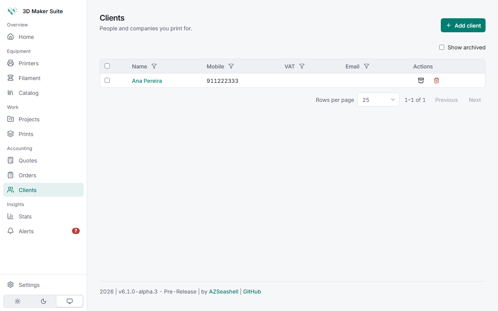
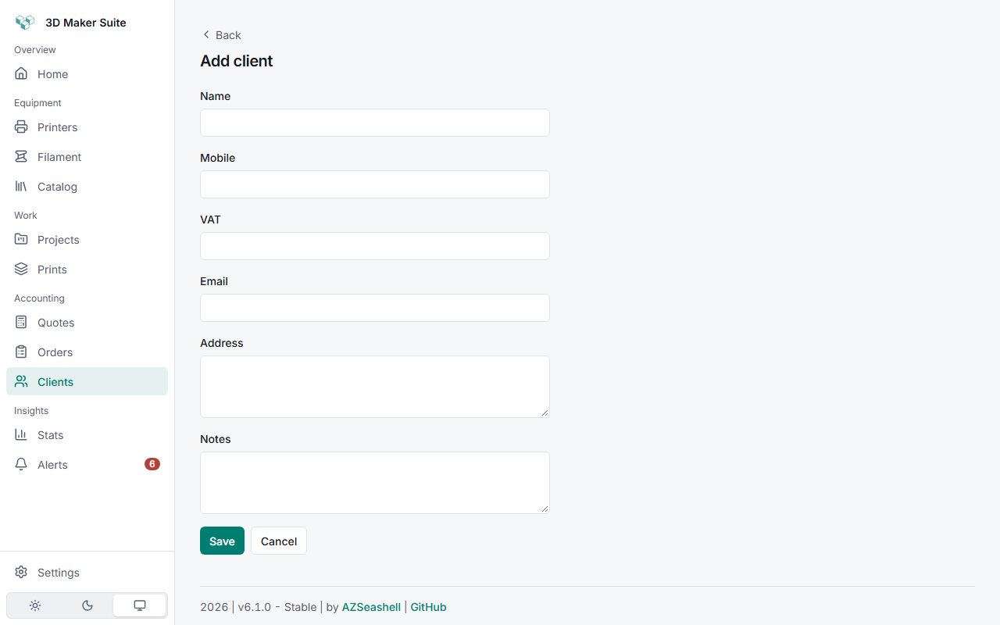
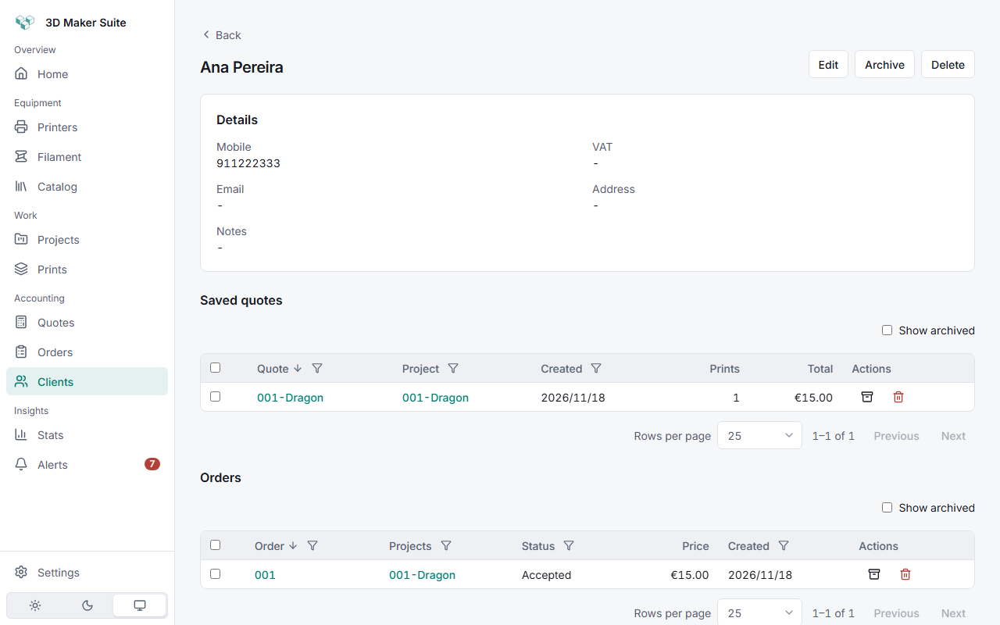

# Clients

The people and companies you print for: the list of clients, the client form, and a client's page with their quotes and orders.

A client holds contact details. You pick one on a [quote](Quotes.md) or an [order](Orders.md), and their page gathers everything you made for them.

## Who can use it

The right is **Quotes, orders and clients**.

| You can | You need |
|---|---|
| See the list and open a client | **Read** |
| Add a client, change one, archive, restore or delete one | **Write** |

Clients have no settings page. Works the same with or without a hub.

## Before you start

Nothing. You can also add a client without leaving a quote or an order: press **New client** next to the **Client** field.

## Clients list

Open **Clients**. With none saved, the page says **No clients yet** and **Add the people and companies you print for.**, with an **Add client** button. With **Write** the button also sits at the top right.

The table is called **Clients**:

| Column | What it shows |
|---|---|
| **Name** | The client, as a link to their page. Sorts and filters by name |
| **Mobile** | The phone number. Sorts and filters |
| **VAT** | The VAT or tax number. Sorts and filters |
| **Email** | The email address. Sorts and filters |

Click a heading to sort. **Show archived**, archive, restore and delete work as on every list; see [Archive and delete](Archive-and-Delete.md). A client can't be deleted while quotes or orders use them. Archive them instead.

**Couldn't load clients. Is the server running?** means the list didn't load. Check the app is running and reload.

## Add or edit a client

**Add client** opens the form, called **Add client**. **Edit** on a client's page opens **Edit client**. The same form opens in a window when you press **New client** in a quote or an order, and the new client is picked for you.

| Field | What it means | Required | Example |
|---|---|---|---|
| **Name** | The person or company | Yes | `Ana Pereira` |
| **Mobile** | The phone number | Yes | `+351 912 345 678` |
| **VAT** | The VAT or tax number | No | `PT123456789` |
| **Email** | The email address. It must look like one | No | `ana@example.com` |
| **Address** | Where to send or bill. Several lines work | No | `Rua das Flores 1, Porto` |
| **Notes** | Anything you want to remember | No | `Prefers pickup` |

- **Save** saves the client and opens their page. In the window, it picks the client and closes it. **Cancel** goes back.
- **Mobile**, **VAT** and **Email** must each be unique. A second client with the same value gives **Another client has this mobile. It may be archived.** (or **VAT**, or **email**). An archived client counts too: restore that one, or change the value.
- **Couldn't save the client.** means the server refused it. Try again.

## Client details

Open a client from the list. The title is their name, with an **Archived** badge when archived. The header has **Edit**, and **Archive** and **Delete**, with **Write**.

The **Details** card shows **Mobile**, **VAT**, **Email**, **Address** and **Notes**. A missing value shows `-`.

Under it are two tables:

- **Saved quotes:** their quotes, as on [Quotes](Quotes.md#quotes-list), with the same filter and sorting.
- **Orders:** their orders, as on [Orders](Orders.md#orders-list), without the **Client** column.

A table only shows when the client has any. **Client not found.** means the client was deleted. Go back to **Clients**.

## Common tasks

### Add a client

1. Open **Clients**, then **Add client**.
2. Fill in **Name** and **Mobile**, and anything else you know.
3. Press **Save**.

### Add a client while you make a quote or an order

1. Press **New client** next to **Client**.
2. Fill in the window and press **Save**. The client is picked.

### See everything for one client

1. Open **Clients**, then the client's name.
2. Read **Saved quotes** and **Orders**.

### Stop showing a client

1. Open the client and press **Archive**.
2. **Show archived** on the list brings them back, and **Restore** returns them.

## Limits and tips

- Only **Name** and **Mobile** are required. Fill in **VAT** and **Address** if you send invoices.
- The pickers in the forms list the first 100 clients.
- An archived client stays on their old quotes and orders.
- Changing a client's details changes them everywhere the client is used.

## Problems and fixes

| What you see | What to do |
|---|---|
| **Another client has this mobile. It may be archived.** | Use another number, or find the other client with **Show archived** and restore them |
| **Another client has this VAT. It may be archived.** | The same, for the VAT |
| **Another client has this email. It may be archived.** | The same, for the email |
| **Couldn't save the client.** | Try again. The server log has the reason |
| A client can't be deleted | Quotes or orders use them. Archive instead. See [Archive and delete](Archive-and-Delete.md) |
| No **Add client** button | Your role has no **Write** on **Quotes, orders and clients** |

## Related pages

- [Quotes](Quotes.md)
- [Orders](Orders.md)
- [Orders settings](Orders-Settings.md)
