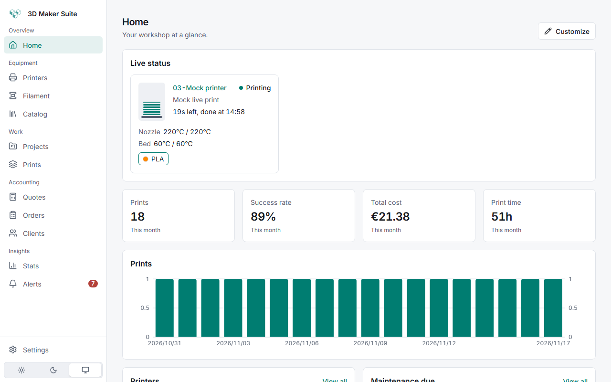

# Dashboard

The **Home** page. It shows your workshop at a glance: what the printers are doing, your numbers, what needs care and what you printed last. You choose which cards it shows and in what order.

## Who can use it

Everyone who signs in sees **Home**. Each widget shows only data you may see, so a card can be empty for you while it is full for someone else. The layout is your own: with user accounts on, each user has a layout, and changing yours changes nobody else's.

## Before you start

Nothing. The first time, you get a ready layout. A new install shows empty cards until you add printers, spools and prints.

## Dashboard

**Home** is a grid of cards called widgets. On a wide screen the grid has four columns. On a phone the cards stack in one column.

Each widget shows live data and, when it makes sense, a **View all** link to the page behind it.

### The widgets

| Widget | What it shows | Settings |
|---|---|---|
| **Live status** | One card per printer that reports what it is doing: state, progress, time left, temperatures and filament. Takes the full width. See [Printer details](Printers.md#live-status) | None |
| **Stat** | One number, such as the count of prints. Its small text says the period | **Metric**, **Period** |
| **Chart over time** | Bars per day for the period. Takes the full width | **Metric**, **Period** |
| **Printers** | Each printer with its state (**Working**, **Maintenance**, **Out of order**, **Retired**, or your own). The name opens the printer | None |
| **Maintenance due** | Tasks that are coming up or overdue, with the printer or accessory. **View all** opens the Maintenance tab | **Rows shown** |
| **Low spools** | Spools at or below the low-spool level, lowest first. **View all** opens Filament | **Rows shown** |
| **Recent prints** | The latest prints with date and outcome (**Success**, **Failed**, **Cancelled**). **View all** opens Prints | **Rows shown** |

Choices in the settings:

| Setting | Choices |
|---|---|
| **Metric** on a **Stat** | **Prints**, **Success rate**, **Print time**, **Filament** (grams used), **Total cost** |
| **Metric** on a **Chart over time** | **Prints**, **Print time**, **Total cost** |
| **Period** | **This month** (from the 1st), **Last 7 days**, **Last 30 days** |
| **Rows shown** | A number from 1 to 20. The default is 5 |

The numbers come from the same data as the **Stats** page, with the same rules. **Low spools** uses the low-spool level set in the app's settings. **Maintenance due** lists only what is not on time yet; it says **Nothing due. All caught up.** when all is fine.

When a widget has nothing to show, it says so in plain words, for example **No printers yet.** or **No prints logged yet.** The **Live status** card also says **No printer reports what it is doing yet.** and, if you may set up integrations, links to **Integrations**.

### Customize

1. Press **Customize**. Each widget gets a small bar above it.
2. Use the bar:
   - **Move earlier** and **Move later** change the order.
   - **Widget settings** (the gear) opens the settings of that widget. It is there only for widgets that have settings.
   - **Remove widget** takes the card off the page.
3. To add one, choose it in **Widget to add**, then press **Add widget**. It goes at the end. You can add the same kind several times, for example one **Stat** for prints and another for cost.
4. Press **Done**.

Every change is saved at once. There is no save button.

**Reset layout** puts back the first layout.

The first layout is: **Live status**, four **Stat** cards (**Prints**, **Success rate**, **Total cost**, **Print time**), a **Chart over time** of prints, then **Printers**, **Maintenance due**, **Low spools** and **Recent prints**.

## Common tasks

### Show the total cost of this month

1. Press **Customize**.
2. Choose **Stat** in **Widget to add** and press **Add widget**.
3. Open its **Widget settings**. Set **Metric** to **Total cost** and **Period** to **This month**.
4. Press **Done**.

### Hide the live printers

1. Press **Customize**.
2. On **Live status**, press **Remove widget**.
3. Press **Done**. **Add widget** brings it back.

### Start over

Press **Customize**, then **Reset layout**, then **Done**.

## Related settings

- The low-spool level and the maintenance warning time are in the app's **Settings**. They decide what **Low spools** and **Maintenance due** list.
- The currency, units and date format are in **Settings**. The widgets follow them.

## Limits and tips

- Widgets are not shared. Each user arranges their own **Home**.
- You can't change the width of a widget. A **Stat** is one column, a list is two and a chart or **Live status** is all four.
- **Live status** shows only printers that report a status. A printer that is only synced from an account is not on it. See [Printers](Printers.md#connection-and-monitoring).
- The numbers count archived printers and spools. See [Archive and delete](Archive-and-Delete.md).

## Problems and fixes

| What you see | What to do |
|---|---|
| **No widgets. Choose Customize to add some.** | You removed them all. Press **Customize**, then **Reset layout** or add some |
| **Live status** says no printer reports | No source reads a printer's status yet. Add one in **Integrations**. See [Printers](Printers.md#connection-and-monitoring) |
| A **Stat** shows `…` | The numbers are still loading. Wait a moment |
| A widget is missing after an update | A kind of widget that no longer exists is hidden. Press **Customize** to remove it |

## Related pages

- [Printers](Printers.md)
- [Sources and sync](Sources-and-Sync.md)
- [Archive and delete](Archive-and-Delete.md)
