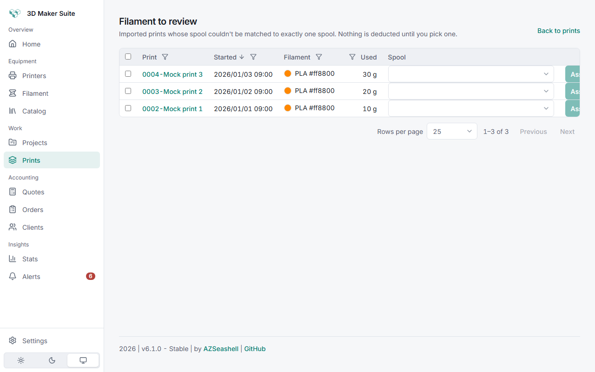

# Filament review

The waiting room for imported filament: slots of prints that no one has matched to a spool yet. You pick the spool, or choose not to track the slot.

When a printer or an account sends a print, the app tries to find the spool each filament slot came from. If it is sure, the weight is taken from that spool. If it isn't, the slot waits here, and **nothing is taken from any spool until you decide.**

## Who can use it

| You can | You need |
|---|---|
| Open the page and see the table | **Prints** with **Read** |
| Assign a spool, accept a suggestion, add a spool, or choose **Don't track** | **Prints** with **Write** |

Without **Write**, the tick boxes and buttons don't show.

## Before you start

- Have the spools you own in [Filament](Filament.md). The table offers only spools that are not archived and not empty.
- Decide how much should wait here with the review level. See [Review level](#review-level).

## Where it opens from

- On **Prints**, the line **N filament slots from imported prints need a spool.** has a **Review** link.
- Filament to review is also an alert, see the alerts settings, opened with the gear on **Alerts**.

The page is called **Filament to review**. **Back to prints** returns to the list.

## Review table

Each row is one filament slot of one print. With nothing waiting, the page says **Nothing to review** and **Every imported print is matched to a spool.**

### Columns

| Column | What it shows |
|---|---|
| **Print** | The print's number and name. It opens the print |
| **Started** | When the print began |
| **Filament** | The colour and material the printer reported, such as `PLA #C12E1F`, with a colour dot. **Unknown filament** if it reported none |
| **Used** | The grams. A `~` and an input mean the grams are an estimate: a total scaled by how far the print got. Type the real grams there if you know them |
| **Spool** | A list of spools to pick from |
| The last column | **Accept** or **Assign**, **Add new spool** and **Don't track** |

You can sort and filter the columns **Print**, **Started**, **Filament** and **Used**. A filter that shows no rows leaves the table in place, with its **Clear** button.

### The spool list

The list holds the spools that were opened on or before the print's day. Spools that match the reported material come first, and those that match the colour too come before them. If the app has a suggestion, it is already picked, and it stays on the list even if the print's day would hide it.

### Buttons on a row

| Button | What it does |
|---|---|
| **Accept** | Shown when the picked spool is the app's suggestion. It takes the grams from that spool |
| **Assign** | Shown when you picked another spool. It takes the grams from that one. It is off until a spool is picked |
| **Add new spool** | Opens the new spool form with the colour and material filled in. The new spool is picked for the row, and you press **Assign** |
| **Don't track** | Skips this slot. The grams stay on the print, but no spool is deducted |

If it fails, the page says **Couldn't assign that spool. Check that it has enough filament left.**

## Bulk actions

Tick rows, or the box in the header, and a bar shows the count with three buttons. The ticks apply to the rows the filter shows.

| Button | What it does |
|---|---|
| **Accept suggestions** | Accepts each row's own suggestion at once |
| **Assign a spool…** | Opens **Assign a spool to N slots**. Pick one **Spool** for all of them and press **Assign**. Slots the spool doesn't fit are left as they are and listed afterwards |
| **Don't track** | Asks **Don't track N slots?** and says **The grams stay on the prints, but no spool is deducted. This can't be undone.** Confirm with **Don't track** |

After **Assign** or **Accept suggestions**, if some rows were blocked, the page says **Assigned X of Y** and lists each blocked row with the reason. Those rows stay ticked, so you can try another spool.

## Review level

The review level decides which slots wait here:

| Level | What waits here |
|---|---|
| **Never** | Nothing. A slot with no sure spool is not tracked |
| **When unsure** | A slot with no sure spool, a guess among several spools, or estimated grams. This is the default |
| **Always** | Every slot, even a sure one |

It is set for all prints in [Prints settings](Prints-Settings.md#review-of-automatic-prints). A source or a printer can set its own, and the most specific one wins: printer, then source, then global. **Use the default** follows the next level up.

## Common tasks

### Review the waiting slots

1. Open **Prints** and press **Review**.
2. For each row, check the **Spool**. A suggested one is already picked.
3. Press **Accept** or **Assign**.

### Accept all suggestions

1. Tick the header box, so all rows are ticked.
2. Press **Accept suggestions**.
3. Check any rows listed as blocked.

### Add a spool you don't have yet

1. On the row, press **Add new spool**.
2. Fill in the form and save it.
3. Press **Assign** on the row.

### Fix estimated grams

1. Type the real grams into the input beside the `~`.
2. Press **Accept** or **Assign**. The spool is charged the grams you typed.

## Related settings

- The review level is in [Prints settings](Prints-Settings.md#review-of-automatic-prints), on a source's **Edit** in the **Sources** tab, and on a printer's form.
- The gear on **Alerts** decides who gets the alert for filament to review.

## Limits and tips

- Nothing is charged until you decide. Weights in [Filament](Filament.md) stay as they were until then.
- **Don't track** can't be undone. A print that is not tracked says **Not tracked** on its page.
- A spool learns its tag the first time a slot with that tag is charged to it. Picking the right spool here fixes a wrong one.
- To stop waiting for every print, set the review level to **Never** or switch **Track usage** off on a source.

## Problems and fixes

| What you see | What to do |
|---|---|
| **Couldn't update the review list. Is the server running?** | Check that the app is running and reload |
| **Couldn't assign that spool. Check that it has enough filament left.** | Pick a spool with more filament, or lower the grams |
| The spool you want is not on the list | It is empty, archived, or was opened after the print's day |
| No buttons, only the table | You need **Prints** with **Write** |

## Related pages

- [Prints](Prints.md)
- [Prints settings](Prints-Settings.md)
- [Filament](Filament.md)
- [Printers](Printers.md)
