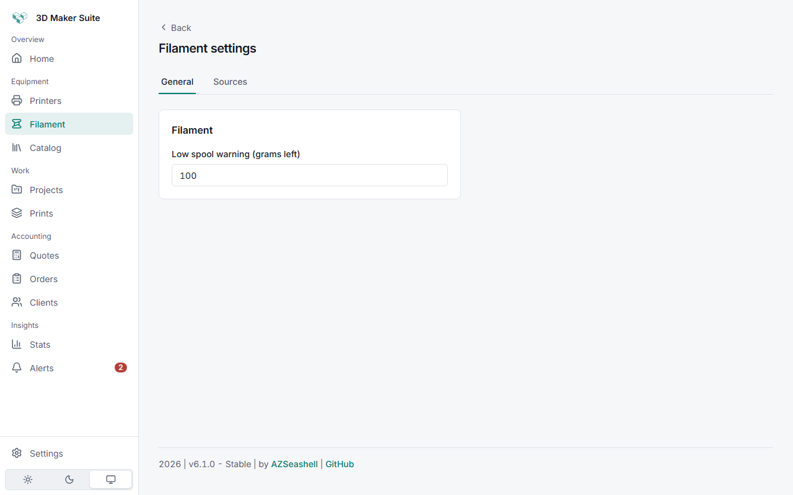
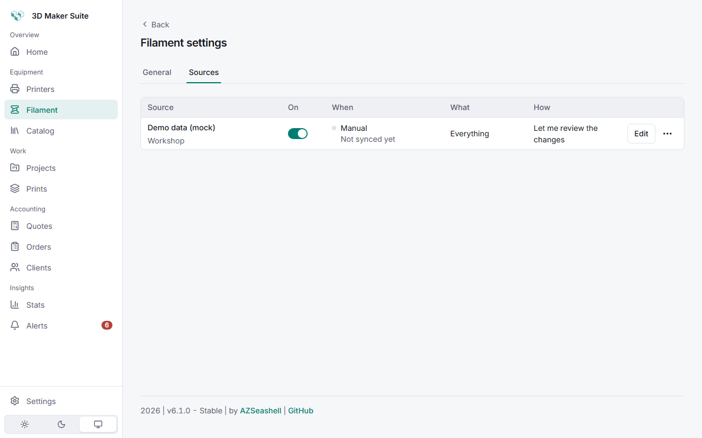

# Filament settings

The settings of the **Filament** page: when a spool counts as low, and where spools come from.

Open it with the gear button at the top right of **Filament**. It has two tabs, **General** and **Sources**. The back arrow returns to **Filament**.

## Who can use it

| You can | You need |
|---|---|
| Open **General** and change it | **Filament** with **Manage** |
| Open **Sources** | **Filament** with **Manage**, or the **Run syncs** or **Review imports** right on a source that feeds spools |

Someone who has only the sync or review right sees the gear open **Sources** and no **General** tab. Changes save as you leave a field. There is no save button.

## General

The **Filament** card has one field.

| Field | What it means | Required | Example |
|---|---|---|---|
| **Low spool warning (grams left)** | A spool with this many grams left or fewer gets a **Low** label in the list and raises the low spool alert. A spool can set its own value in its form | Yes | `100` |

The same field is in the alerts settings (the gear on **Alerts**), which also says who gets the alert and how. Changing it in one place changes it in the other.

## Sources

The **Sources** tab lists the accounts that can bring spools in, such as [Bambu Cloud](Bambu-Cloud.md) or [Spoolman](Spoolman.md). Each line is **Spools** from one source, with when it syncs and what it syncs. You switch a source on in **Settings → Integrations**. If none is on, the tab says **No sources** and that spools here are added by hand.

How a line works is explained once, on [Sources and sync](Sources-and-Sync.md): **Auto** and **Manual**, **Sync now**, **What to sync**, **Review and import** and the sync log.

A spool that came from a source shows it on its page, and can be unlinked there. See [Filament](Filament.md#unlink-a-spool-from-a-source).

## Common tasks

### Change the low weight warning

1. Open **Filament**, then the gear.
2. Change **Low spool warning (grams left)**.
3. Click outside the field. It is saved.

### Bring in spools from a source

1. Switch on **Spools** for the account in **Settings → Integrations**.
2. Open **Filament**, then the gear, then **Sources**.
3. Press **Sync now** on the **Spools** line, or let **Auto** do it.

## Related settings

- The gear on **Alerts** has the low spool alert and who gets it.
- [Quotes settings](Quotes-Settings.md) has the cost figures that use a spool's price.
- Filament brands, materials and presets are in the **Catalog**.

## Limits and tips

- Each spool can set its own low weight in its form. It beats this default.

## Problems and fixes

| What you see | What to do |
|---|---|
| The gear doesn't show | Your role has no **Manage** on **Filament** and no sync or review right |
| **No sources** on the Sources tab | Switch on **Spools** for an account in **Settings → Integrations**, or add spools by hand |
| The settings page can't load | Check that the app is running and reload |

## Related pages

- [Filament](Filament.md)
- [Sources and sync](Sources-and-Sync.md)
- [Printers](Printers.md)
