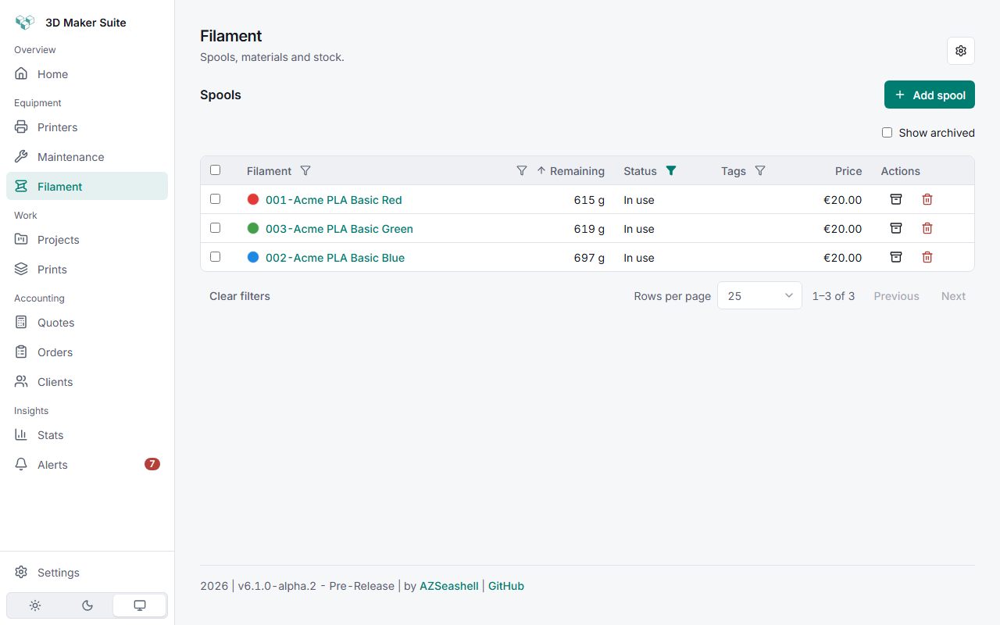
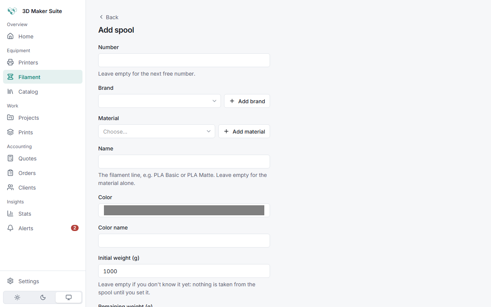
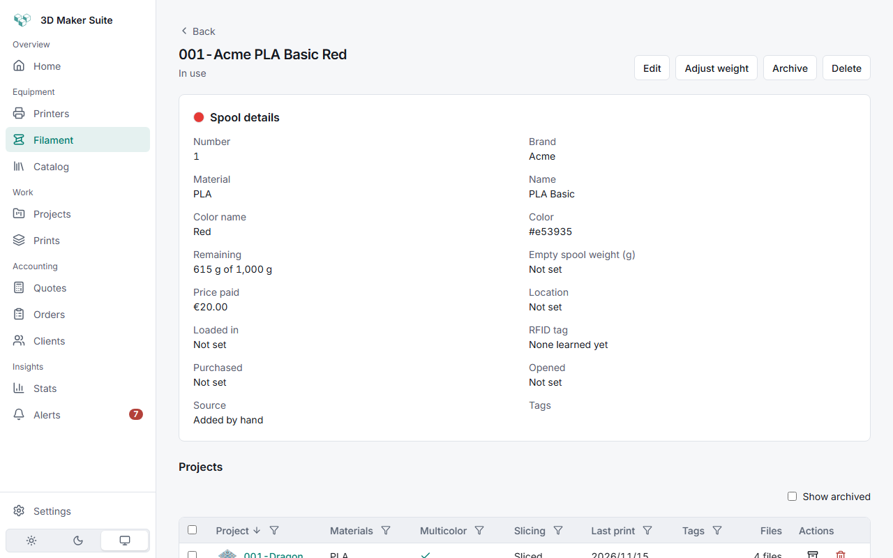

# Filament

Your spools: the list, adding and editing one, a spool's page with its weight history, prints and projects, adjusting its weight, and unlinking it from a source.

A spool is one roll of filament you own. It knows its material, colour, price and how much is left. Prints take filament from the spool loaded in a printer's slot, and the weight goes down. The brands, materials and presets a spool uses are kept in the **Catalog**.

## Who can use it

| You can | You need |
|---|---|
| See the list and a spool's page | **Filament** with **Read** |
| Add or edit a spool, adjust its weight, forget its tag, unlink it, archive, restore or delete it | **Filament** with **Write** |
| Change the Filament settings | **Filament** with **Manage** |

Works the same with or without a hub.

## Before you start

- A spool needs a material. The list of materials is in the **Catalog**. You can also add a material from the spool form.
- To have prints take their filament from a spool, load the spool in a printer's slot. See [Printers](Printers.md#loaded-spools).
- To bring spools in from Bambu Cloud or Spoolman, switch on **Spools** for that account in **Settings → Integrations**. See [Filament settings](Filament-Settings.md#sources).

## Spools list

Open **Filament**. With no spools, the page says **No spools yet** and **Add the spools you own: a material is all a spool needs.**

The **Add spool** button opens [the add form](#add-or-edit-a-spool). A sync button next to it fetches spools from your sources. The gear opens [Filament settings](Filament-Settings.md).

The list starts on the spools in play: the **Status** filter is set to **New** and **In use**. Clear the filter to see **Empty** spools too.

### Columns

| Column | What it shows |
|---|---|
| **Filament** | A colour dot and the spool's name, made of its number, filament and colour, for example `01-PLA Basic Red`. It opens the spool's page |
| **Remaining** | The weight left. A **Low** label shows when it is at or under the low weight warning and the spool is not empty |
| **Status** | **New**, **In use** or **Empty** |
| **Tags** | The spool's tags, when tags are on |
| **Price** | What you paid. A grey price is an estimate from the material's **Default price per kg**, used when you gave no price paid |
| The last column | **Archive** or **Restore** for the row, and the selection checkbox |

Press a column header to sort. The list is sorted by **Remaining** at first. **Filament**, **Remaining** and **Status** have filters too.

**Show archived** finds archived spools. You can tick rows to archive, restore or delete many at once. How this works, and what blocks a delete, is on [Archive and delete](Archive-and-Delete.md).

## Add or edit a spool

**Add spool** opens the form. On a spool's page, **Edit** opens the same form with its values, and the page's title says **Edit spool**. **Save spool** opens the spool's page, or the list for a new spool. **Cancel** goes back.

### Fields

| Field | What it means | Required | Example |
|---|---|---|---|
| **Number** | The spool's number, shown before its name. Leave it empty for the next free number. Each number is used once, archived spools too | No | `12` |
| **Brand** | The filament brand. You can add one from the list | No | `Bambu Lab` |
| **Material** | The material. You can add one from the list | Yes | `PLA` |
| **Name** | The filament line. Leave it empty for the material alone | No | `PLA Basic` |
| **Color** | The colour, picked on a colour chooser. It starts grey | Yes | Red |
| **Color name** | What you call the colour | No | `Jade White` |
| **Initial weight (g)** | The filament on a full spool. It starts at `1000`. Leave it empty if you don't know it yet: nothing is taken from the spool until you set it. Once you set it, it can't be emptied again | No | `1000` |
| **Remaining weight (g)** | Only on a new spool. Leave it empty for a full spool | No | `640` |
| **Status** | Only when editing: **New**, **In use** or **Empty** | Yes | **In use** |
| **Empty spool weight (g)** | What the empty reel weighs. | No | `250` |
| **Low weight warning (g)** | When the spool counts as low. Leave it empty to use the default from [Filament settings](Filament-Settings.md#general) | No | `100` |
| **Warn when this spool runs low** | Switch the low alert off for this spool. It is on by default | No | On |
| **Price paid** | What you paid, in your currency | No | `22.99` |
| **Purchased** | The day you bought it | No | `2026-05-02` |
| **Opened** | The day you opened it | No | `2026-05-10` |
| **Location** | Where you keep it | No | `Shelf 2` |
| **Tags** | Your own labels, when tags are on | No | `silk` |

On an existing spool the remaining weight is not on the form. Change it with [**Adjust weight**](#adjust-the-weight) so the change is written in the history. If you change the initial weight, the remaining weight moves by the same amount.

If the number is taken, the form says **Another spool already has this number. It may be archived.** Any other failure says **Couldn't save the spool.**

## Spool details

Press a spool's name to open its page. The title is the spool's name and the line under it is its status. The buttons at the top right need **Write**:

| Button | What it does |
|---|---|
| **Edit** | Opens [the form](#add-or-edit-a-spool) |
| **Adjust weight** | Opens [the weight dialog](#adjust-the-weight) |
| **Archive** or **Restore**, and **Delete** | See [Archive and delete](Archive-and-Delete.md) |

### Spool details card

The card is called **Spool details**, with an **Archived** label when it is archived. Its rows are:

| Row | What it shows |
|---|---|
| **Number**, **Brand**, **Material**, **Name**, **Color name**, **Color** | The values from the form. The colour is its hex code |
| **Remaining** | The weight left of the initial weight, for example `640 g of 1000 g` |
| **Empty spool weight**, **Price paid**, **Location**, **Purchased**, **Opened** | The values from the form |
| **Loaded in** | The printer and slot the spool is in, for example `Workshop A1 · Slot 1`. It opens that printer. **Not set** when it is not loaded |
| **RFID tag** | The tag the spool learned from a print. **None learned yet** until then. **Forget tag** removes a wrong one. The next print that reads it teaches it again |
| **Source** | **Added by hand**, or each library the spool is linked to, for example `Bambu Cloud · linked 14 May 2026`, with an **Unlink** button |
| **Tags** | The spool's tags, when tags are on |

Empty values show **Not set**.

### Projects and prints

Two tables list the **Projects** and the **Prints** that took filament from this spool. They work like the main lists on **Projects** and **Prints**. With none, the page says **No project has used this spool yet.** and **No print has used this spool yet.**

## Adjust the weight

**Adjust weight** sets how much is left. It also lists every change so far.

1. On the spool's page, press **Adjust weight**.
2. Under **Reason**, pick **Manual weigh-in** if you weighed the spool, or **Correction** if you are fixing a mistake.
3. Type the **New remaining weight (g)**. It starts at the current weight.
4. Add a **Note** if you like.
5. Press **Save**.

The **History** list under the form has a line for each change with its date, the grams added or taken away, and the weight after it. A line is **Manual**, **Print** (a print took filament) or **Correction**, with your note. A new spool says **No changes yet.** If it fails, the dialog says **Couldn't adjust the weight.**

## Common tasks

### Add a spool

1. Open **Filament**.
2. Press **Add spool**.
3. Pick the **Material**, and the **Brand** if you know it.
4. Pick the **Color**.
5. Fill in the weights and the price if you want costs and a low warning.
6. Press **Save spool**.

### Use up a spool

1. Load the spool in a printer's slot. See [Printers](Printers.md#loaded-spools).
2. Print. Each print lowers the **Remaining** weight.
3. When it is empty, set the **Status** to **Empty** with **Edit**. You can archive it as well.

### Fix a wrong weight

1. Weigh the spool and take away the **Empty spool weight (g)** if you set one.
2. Open the spool and press **Adjust weight**.
3. Pick **Manual weigh-in**, type the weight, and press **Save**.

### Unlink a spool from a source

Unlink a spool when it should stop following a library such as Bambu Cloud or Spoolman.

1. Open the spool. Find **Source**.
2. Press **Unlink** next to the library. The dialog asks **Unlink this spool from …?**
3. Read what it says and press **Unlink**.

The spool stays, with its weight and history, and stays linked to its other libraries. The library's own spool is not linked to it again and is not imported as a new spool. Its next import shows it as skipped, and you can link or import it there. No print of this spool is written to that library any more.

## Related settings

- The default low weight warning is in [Filament settings](Filament-Settings.md#general).
- The gear on **Alerts** has the low spool alert and who gets it.
- Brands, materials and presets are in the **Catalog**.
- **Settings → Costs** has the cost figures that use a spool's price.

## Limits and tips

- Nothing is taken from a spool until it has an initial weight.
- An archived spool leaves the printer slot it was in.
- A spool with prints can't be deleted. Archive it instead. See [Archive and delete](Archive-and-Delete.md).
- Keep one number per spool. Write it on the reel, and you find it in the list at once.
- A grey price in the list is only an estimate. Fill in **Price paid** to make it exact.

## Problems and fixes

| What you see | What to do |
|---|---|
| **Couldn't load filament. Is the server running?** | Check that the app is running and reload |
| The list is empty but you have spools | The **Status** filter hides **Empty** spools. Clear it. Archived spools need **Show archived** |
| No **Add spool** button | Adding needs **Filament** with **Write** |
| A print is not taken from a spool | The spool is not loaded in the printer's slot. See [Printers](Printers.md#loaded-spools) |
| **Another spool already has this number. It may be archived.** | Use another number, or leave the field empty |
| **Couldn't save the spool.** | Check the required fields and try again. If it keeps failing, see [Troubleshooting](Troubleshooting.md) |
| **Spool not found.** | The spool was deleted. Go back to the list |

## Related pages

- [Filament settings](Filament-Settings.md)
- [Printers](Printers.md)
- [Sources and sync](Sources-and-Sync.md)
- [Archive and delete](Archive-and-Delete.md)
