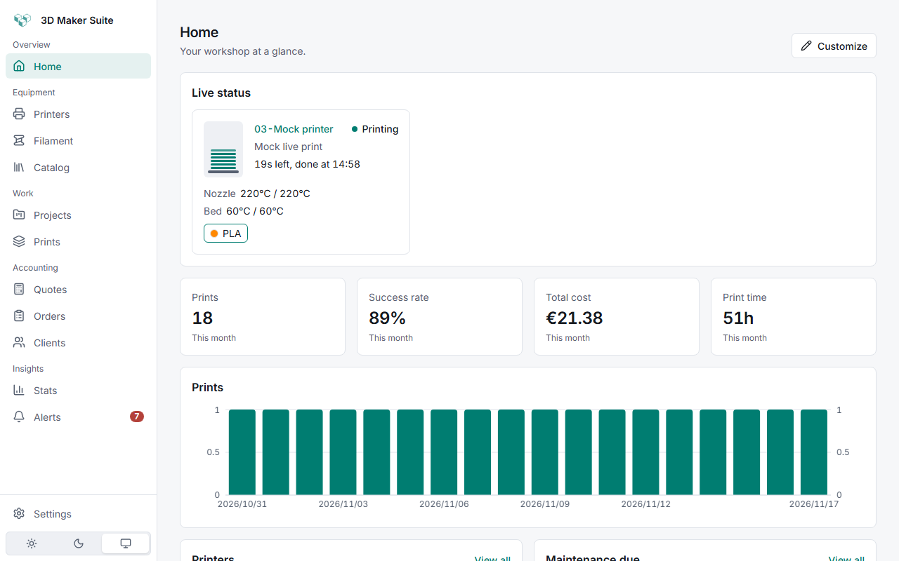

# 3D Maker Suite

3D Maker Suite helps you manage your 3D printing in one place: printers, maintenance, filament, projects, prints, costs and stats.

It runs on your own computer, or in Docker on a NAS or server. Your data stays with you.

## Using this guide

Use the sidebar to find a topic. The guide explains how to install the app and how to use each of its pages.

The app carries its own copy of the guide, for the version you have installed. Open `/guide/` on the app's address, for example <http://localhost:4300/guide/>. It needs no internet and no sign-in. Each page shows the version it belongs to and a **Newest version online** link to the latest guide, in case you are on an older version.

## Finding your way in the app

- **On a computer**, the menu is on the left, in groups: **Overview**, **Equipment**, **Work**, **Accounting** and **Insights**. **Settings**, your name and the theme switch are at the bottom. On a narrow window the menu shows only icons.
- **On a phone**, a bar at the bottom holds **Home**, **Filament**, **Projects** and **Prints**. **More** opens the other pages, **Settings**, your account and the theme switch.
- You only see the pages your role lets you open. **Alerts** carries a count of unread alerts.
- The foot of each page shows the version and links to the website and GitHub.
- Each page has a **Help** icon (a question mark) next to its title. It opens this guide in a new tab, at the part that explains that page, in the app's own copy. On a **Settings** tab it opens the section for that tab.
- Many pages have a gear button at the top right. It opens that page's settings, such as [Printers settings](Printers-Settings.md).

New here? Start with [Choose how to run](Choose-How-to-Run.md), then [First run](First-Run.md).
