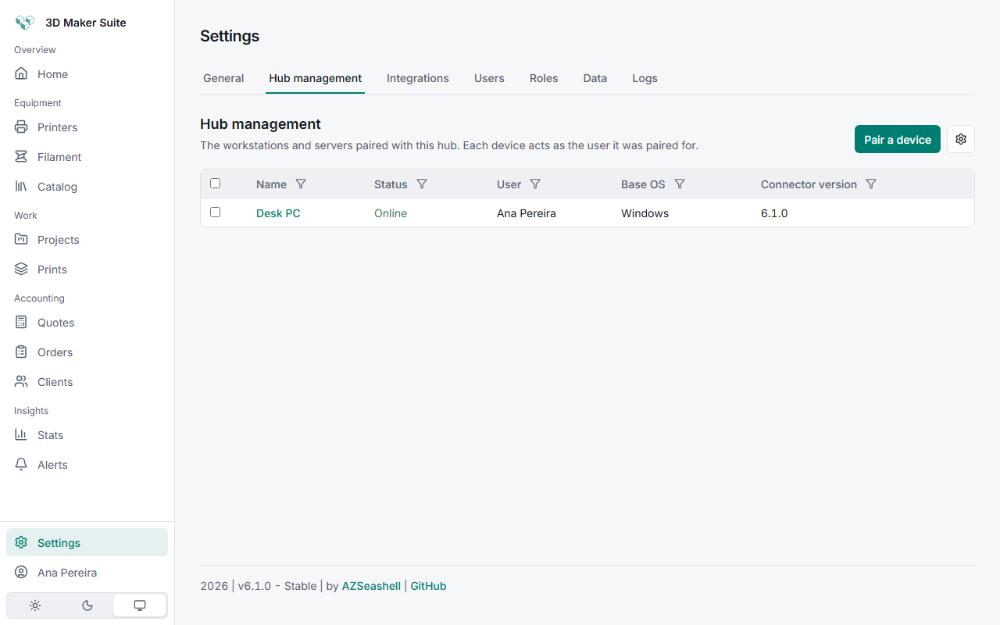
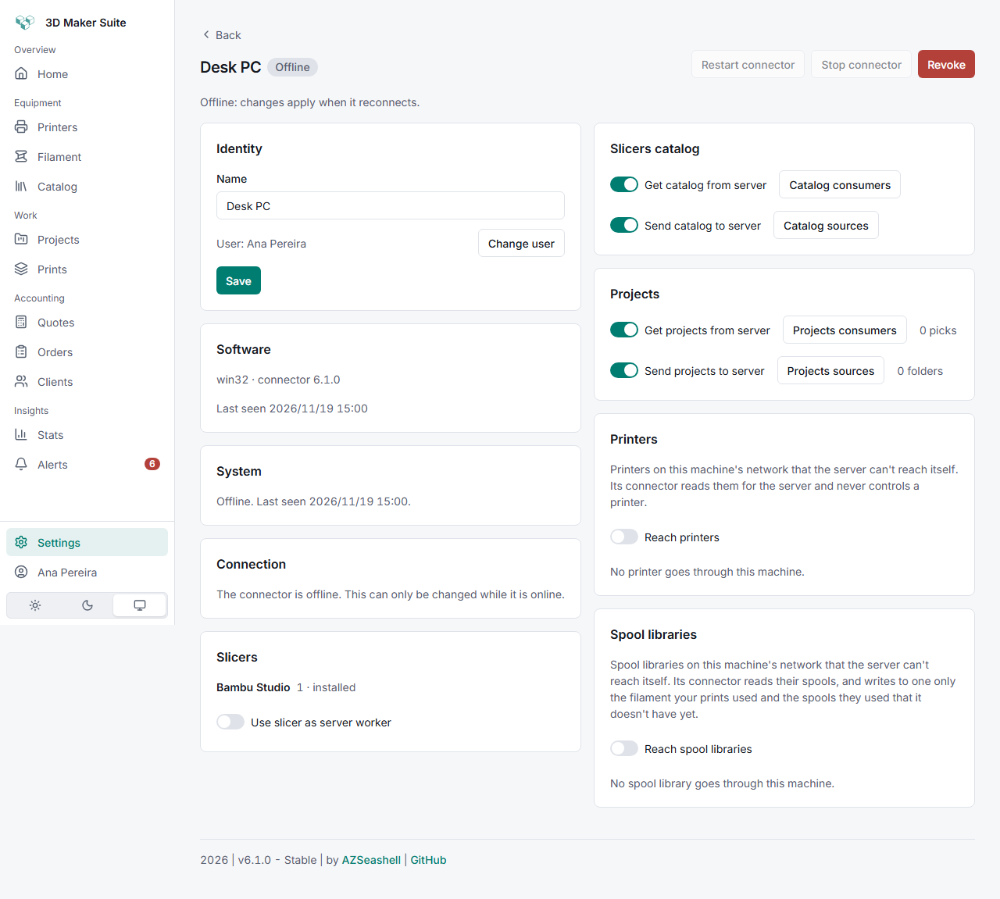
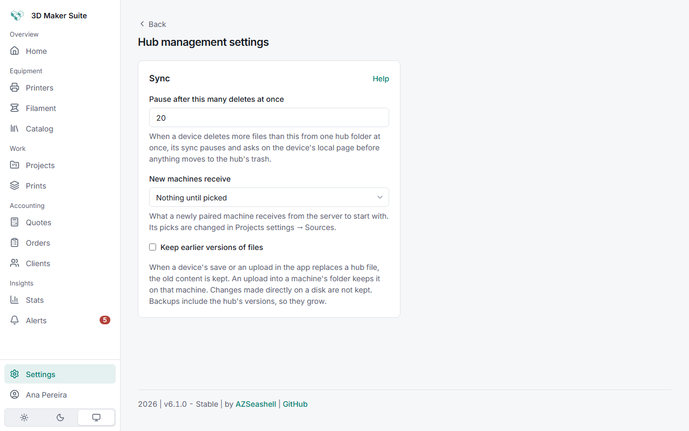

# Hub management

Hub management lists the computers paired with your hub, pairs new ones, and opens each computer's page. Its settings cover syncing and file versions. The hub's slicer preset library has its own tab in [Catalog settings](Catalog-Settings.md#preset-library).

## Who can use it

- The tab shows in **Settings** only while the [hub is on](Hub-Setup.md#turn-the-hub-on). With it off, there is no tab.
- **Manage the hub** is needed to pair, rename, update, revoke and change every setting of every computer. Admin has it. See [Roles](Roles.md#hub-server-and-users).
- A person whose computer is paired to them can open that computer's page without it. They see its values, and can change a section only with the matching right of **Their own machines**: **Connection**, **Catalog** or **Projects**. The last two also need **Write** on that module. See [Roles](Roles.md#their-own-machines).

## Before you start

Turn the hub on and install a connector, see [Hub setup](Hub-Setup.md) and [Connector setup](Connector-Setup.md).

## Devices

The table lists every paired computer. Search, sort and filter work as on other lists.

| Column | What it shows |
|---|---|
| **Name** | The computer's name. It opens its page |
| **Status** | **Online** or **Offline**. An offline computer says when it was **Last seen**, or **Not seen yet**. **Outdated** means its connector isn't on the hub's version and it updates itself when it connects. **Update failed** means the last update didn't work |
| **User** | The user the computer acts as, with their rights |
| **Base OS** | **Windows**, **Linux** or **macOS**. Hover for the full system name |
| **Connector version** | The version of the connector on it |

With no computers, the page says **No devices yet**.

### Tick several computers

Tick rows to get a bar with two buttons:

- **Restart** restarts the connectors. An offline one can't be restarted.
- **Revoke** asks first. See [Revoke a computer](#revoke-a-computer).

Computers that couldn't do it stay ticked, and the list names them.

## Pairing

Press **Pair a device**, pick the **User** the computer will act as, then press **Create code**. The code works once, until the time shown, only for that user, and is shown only once. Press **Copy code**, then **Done**. Only users who aren't disabled are listed.

Then enter the code on the connector's own page. The steps are in [Connector setup](Connector-Setup.md#pair-the-computer).

## Machine page

Open a computer from the table. The title is its name, with an **Online** or **Offline** pill. Top right are **Restart connector**, **Stop connector** and **Revoke**, for those allowed to use each. **Stop connector** asks **Stop the connector on {name}?**: it goes offline and starts again only when someone logs in on that computer or starts it by hand. While the computer is offline, a note says changes apply when it reconnects. If your browser runs on that computer, a link opens its local page.

A section you can't edit shows its values as text, for example **Get projects from server: on**.

### Identity

The **Name** field, saved with **Save**, and the **User** it acts as. **Change user** opens **Change this connector's user**: pick another user, and the next dialog, **Code for {name}**, shows a one-time code. Enter it on that connector's local page. Nothing changes until you do. The computer then acts with the new user's role.

### Software

Its system, the connector version, and when it was last seen. When it is outdated, the card says why: older than the hub, **Could not download version…** or **Version… did not start on the device, so it went back**. **Update now** tells an online connector to update. An offline one gets it when it connects.

### System

The CPU load, memory, disks and network addresses, as the connector last reported them. The report comes every 30 seconds while the computer is online. It also says the address the hub sees the computer from. Offline, only **Last seen** is shown, never old numbers.

### Connection

- **Local page port:** the port of the connector's own page. A new port applies after a restart, and the page says **Saved. Restart the connector…**.
- **Start with the computer:** starts the connector when you log in.

These need the connector online. Offline, the card says so. A connector too old for this says **Update or restart it on its computer**.

### Slicers

Lists the slicers found on the computer, each with its version and **installed**. The one the hub uses carries **Server's slicer**.

- **Use slicer as server worker:** lets the hub send slicing to this computer. Turning it off asks **Stop using {name} as a server worker?**, then removes its slicer installs in **Integrations** and uninstalls a slicer the hub installed there. What they imported stays.
- With **Set up integrations**, links open **Set up** a slicer on this machine, or the slicer's card in **Integrations**. See [Slicers](Slicers.md).

### Slicers catalog

Shows only when the computer has a slicer.

- **Get catalog from server:** the hub writes the catalog into its slicer. Its **Catalog consumers** link opens that tab of [Catalog settings](Catalog-Settings.md#consumers).
- **Send catalog to server:** its user presets join the hub's [preset library](Catalog-Settings.md#preset-library). Its **Catalog sources** link opens that tab.

### Projects

- **Get projects from server:** its folders get copies of the hub's projects. It shows how many **picks** it has, and a line of its sync state, such as **Up to date · 12 files**, **Syncing…**, or **Sync paused: 25 files deleted in … at once**. Confirm or restore those on the connector's local page. Turning it off asks first: **Stop receiving projects on…?** removes its copies from the computer and deletes nothing on the hub.
- **Send projects to server:** the folders it shares with the hub, shown as a count with **Up to date** once reported.

The links **Projects consumers** and **Projects sources** open the same tabs in [Projects settings](Projects-Settings.md).

### Printers and Spool libraries

Two cards, **Reach printers** and **Reach spool libraries**, for devices on that computer's network that the hub can't reach itself. Its connector reads them for the hub. It never controls a printer, and it writes to a spool library only the filament your prints used and the spools they used that the library doesn't have yet.

Each card lists what goes through the computer, or says **No printer goes through this machine.** Turning a switch off asks **Stop reaching printers through {name}?** (or spool libraries). **Pause and turn off** pauses them and keeps them on this computer until you turn it on and enable them in **Integrations** again. **Set up in Integrations** or **Open in Integrations** goes to [Integrations](Integrations.md).

## Hub settings

The gear button at the top right of **Hub management** opens the settings, with **Manage the hub**. The back arrow returns to the table. One card, **Sync**, saves each field as you leave it.

| Setting | What it does | Default |
|---|---|---|
| **Pause after this many deletes at once** | A computer that deletes more files than this from one hub folder at once pauses its sync and asks on its local page before anything moves to the hub's trash. 1 to 10,000 | 20 |
| **New machines receive** | What a newly paired computer gets: **Every project folder** or **Nothing until picked**. Each computer's picks are changed in [Projects settings](Projects-Settings.md) | **Nothing until picked** |
| **Keep earlier versions of files** | A save or upload that replaces a hub file keeps the old content. Changes made straight on a disk are not kept. Backups include these versions, so they grow | Off |
| **Versions to keep per file** | Shown when versions are on. 1 to 100. Lowering it deletes the older versions on the hub now, and on a computer at the file's next upload | 5 |

While versions are kept, a line says how much space they use, for example **Using 12 MB for 30 kept versions.**

## Preset library

The hub's one library of slicer presets is a tab of Catalog settings, not of Hub management. The list, versions, delete and restore, held deletes and conflict copies are explained in [Catalog settings](Catalog-Settings.md#preset-library). The old address `/hub/presets` redirects there.

## Common tasks

### Pair a computer

1. Open **Settings → Hub management** and press **Pair a device**.
2. Pick the user and press **Create code**, then **Copy code**.
3. Enter the code on the connector's page, see [Connector setup](Connector-Setup.md#pair-the-computer).
4. The computer shows **Online** in the table.

### Rename a computer

1. Open the computer.
2. Change **Name** in **Identity** and press **Save**.

### Update an outdated connector

1. Open the computer while it is online.
2. In **Software**, press **Update now**.

### Share a computer's printers with the hub

1. Set up the printer or spool library in **Integrations**, choosing this computer under **Reached from**.
2. Open the computer and switch on **Reach printers** or **Reach spool libraries**.

### Revoke a computer

1. Open the computer and press **Revoke**, or tick it in the table.
2. Confirm **Revoke**. The computer loses access at once. Its local files stay on its disk.
3. To use it again, pair it with a new code.

## Related settings

- **Settings → General** has the **Hub** switch, see [Settings](Settings-General.md).
- [Catalog settings](Catalog-Settings.md) and [Projects settings](Projects-Settings.md) pick what each computer receives and shares.
- **Manage the hub** is set in [Roles](Roles.md).

## Limits and tips

- A computer acts as one user. To move it to another user, use **Change user**.
- A revoked computer can't be brought back. Pair it again.
- Most controls need the connector online. Offline ones apply when it reconnects, or say they can't be changed.
- The hub never runs a command on a computer, and never sends one to a printer.

## Problems and fixes

| What you see | What to do |
|---|---|
| No **Hub management** tab | The hub is off, or you lack **Manage the hub**. See [Hub setup](Hub-Setup.md) |
| **Outdated** stays | Press **Update now**, or restart the connector on the computer |
| **Update failed** | Read the reason in **Software**. Check the computer can reach GitHub releases |
| **The connector didn't answer. Try again.** | The connector is busy or just restarted. Wait a few seconds |
| **Sync paused…** | Open the connector's local page and confirm or restore the deletes |
| **This is the hub's slicer…** | Pick another slicer in **Integrations** first |
| **Turn the hub on to reach printers…** | Switch the hub on in **Settings → General** |

## Related pages

- [Hub setup](Hub-Setup.md)
- [Connector setup](Connector-Setup.md)
- [Catalog settings](Catalog-Settings.md)
- [Projects settings](Projects-Settings.md)
- [Integrations](Integrations.md)
- [Roles](Roles.md)
