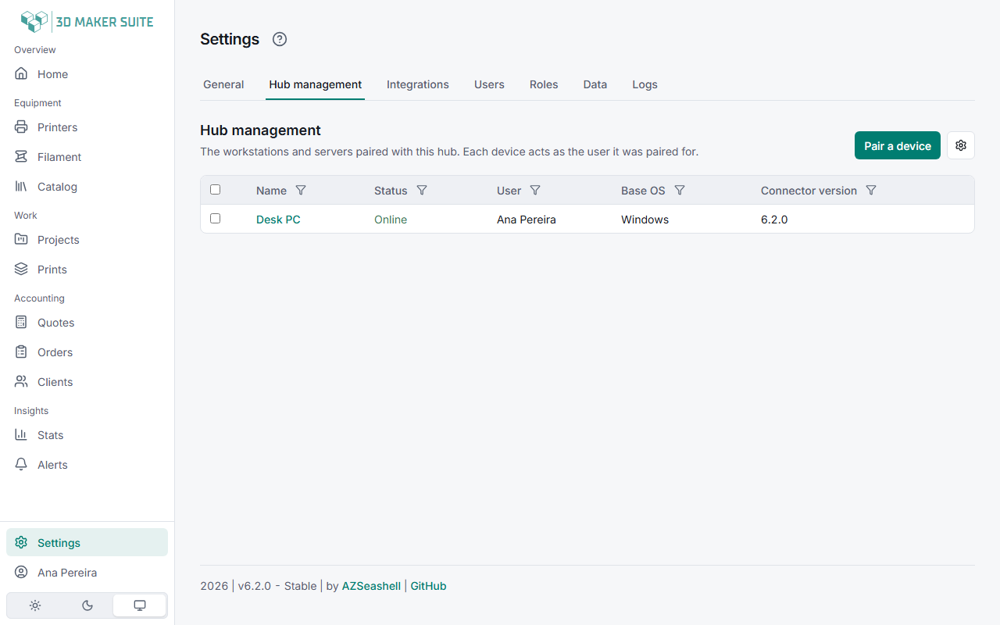

# Hub setup

A hub is the normal 3D Maker Suite server with the hub switch turned on. Computers join it with a small program called a connector. This page explains what a hub is, when to use one, how to turn it on and what to tell your IT people.

## Who can use it

Only admins turn the hub on and pair computers. The hub needs **user accounts**, because every computer that joins acts as one of your users.

## What a hub is for

People still work only in the web app. The hub adds these things:

- **Project files on other computers.** A workstation, a NAS or a file server shares a folder. The hub lists its projects as if they were on the server.
- **A copy of the server's projects on each computer.** Save in your slicer as usual and the hub gets the change. A change made on the hub or on another computer arrives by itself.
- **Printers and spool libraries on a private network.** A hub on a server in another city can't reach a printer in your workshop. A computer in the workshop reads the printer for it.
- **Slicing on another computer.** A hub on a small server, or on an ARM NAS, can let a workstation do the slicing.
- **One slicer preset library** for the whole team.

## When to use one

Use a hub when your files or printers are spread over several computers, or when the server is not on the same network as your printers. If everything is on one computer, you don't need a hub. [Choose how to run](Choose-How-to-Run.md) helps you decide.

With the hub switched off, the app works exactly as before.

## Before you start

- **A server that is always on.** A computer, a home server, a VPS or a NAS that runs 3D Maker Suite with [Docker](Docker.md#on-a-nas). Computers can only join while it is running.
- **User accounts turned on, and at least one admin.** See [First run](First-Run.md).
- **An address every computer can open.** On one network, `http://192.168.1.20:4300` is enough. Across the internet you need a public name with HTTPS, see [Public access](Public-Access.md).
- **Backups.** Make a backup before you turn the hub on, see [Backups and restore](Backups-and-Restore.md).

## Turn the hub on

1. Sign in as an admin.
2. Open **Settings** and stay on **General**.
3. Turn on **Hub**. It sits below **User accounts**.
4. A new **Hub management** tab appears in **Settings**. Computers are paired and listed there.

If **Hub** is greyed out, a note under it says why. Accounts are still off, or no admin exists yet. Turn on **User accounts** first.

While the hub is on, **User accounts** can't be turned off.

## Give the hub an address

Every connector has to open the hub's address. It is the same address you type in your browser to open the web app.

1. **Same network.** Use the server's address on that network, with the port: `http://192.168.1.20:4300`. For this the server must listen on the network. See [Use from another device](Use-From-Another-Device.md).
2. **Over the internet.** Put a reverse proxy with HTTPS in front of the hub and use its name: `https://maker.example.com`. The steps, with Caddy, nginx and Traefik, are on [Public access](Public-Access.md).
3. If you set `APP_ALLOWED_HOSTS`, the name or address the connectors use must be in the list. Otherwise the hub answers `403 forbidden_host` and the connector says it can't reach the hub.
4. Optional: set **Public address** in **Settings → Network**, so the app shows the right address in links.

The connector only connects out to the hub. The computers need no open ports and no VPN. Behind Caddy, nginx or Traefik, the default settings work, because the hub marks its live stream as unbuffered and sends a heartbeat every 15 seconds.

If you put the hub behind a proxy, set `APP_TRUST_PROXY` too. Without it the hub sees every computer at the proxy's address.

## Pair the first computer

Go on to [Connector setup](Connector-Setup.md). It covers installing the connector and pairing it with a code from **Hub management**.

## Hub settings

**Hub management** has its own **Settings** page for the hub as a whole:

| Setting | What it does | Default |
|---|---|---|
| **Pause after this many deletes at once** | When a computer deletes more files than this from one hub folder at once, its sync pauses and asks on its local page before anything moves to the hub's trash | 20 |
| **Keep earlier versions of files** | When a save or an upload replaces a hub file, the old content is kept. Backups include these versions, so they grow | Off |
| **Versions to keep per file** | How many old versions are kept | 5 |
| **New machines receive** | What a newly paired computer gets from the server: **Every project folder**, or **Nothing until picked** | **Nothing until picked** |

## Turn the hub off

Turn **Hub** off in **Settings → General**. Nothing is deleted. The connectors show **The hub is turned off on this server** and keep their pairing. They go on working again when you turn the hub on.

## For company IT

- **Where the connector comes from.** Every release file is listed in `SHA256SUMS` and has a GitHub artifact attestation. Allow it by file hash, or by its install path. The paths per system are on [Connector setup](Connector-Setup.md#for-company-it).
- **Network.** The connector connects out only. It needs HTTPS (or HTTP on a LAN) to the hub, and access to GitHub releases to update itself. Its own page listens on `127.0.0.1:4301` and can't be reached from other computers.
- **What the hub stores.** Only a hash of each computer's token. Nothing is stored that could pair a computer again.
- **What a connector can do.** It carries out a fixed list of jobs: list, read and write files in its own folders and in the folders it shares, report the slicers installed on the computer, read the status and history of the printers the hub gives it, and read a spool library. It never runs a command the hub sends, and it never sends a command to a printer.
- **What it can write outside its own folders.** Only two things: a Spoolman spool's used weight and a spool of yours that Spoolman doesn't have yet. It never deletes or changes anything else there.
- **Signing.** The installers are not code-signed yet, so Windows and macOS warn once.

## Limits and tips

- **One hub per computer.** A connector doesn't start on a computer where a hub is running.
- **One hub for each connector.** A computer is paired with one hub at a time.
- **Match the versions.** A connector follows the hub's version. After you update the hub, each connector updates itself when it reconnects.
- **Run the hub on a computer that stays on.** While it is off, computers keep their local files and sync again when it is back.
- **A user who is disabled can't pair.** Create the code for an active user.

## Problems and fixes

- **No Hub management tab.** The hub is off, or you aren't an admin. Check **Settings → General**.
- **The hub switch can't be turned on.** Turn on **User accounts** and sign in as an admin first.
- **The connector says it can't reach the hub.** Check the address, and that the hub is running. With `APP_ALLOWED_HOSTS` set, add the name the connector uses, then restart the app.
- **The connector says the hub is off.** Turn **Hub** on in **Settings → General**.
- **Every computer is locked out after a few wrong codes.** Behind a reverse proxy, set `APP_TRUST_PROXY`. See [Public access](Public-Access.md#problems-and-fixes).

## Related pages

- [Connector setup](Connector-Setup.md)
- [Hub management](Hub-Management.md)
- [Choose how to run](Choose-How-to-Run.md)
- [Public access](Public-Access.md)
- [First run](First-Run.md)
- [Backups and restore](Backups-and-Restore.md)
