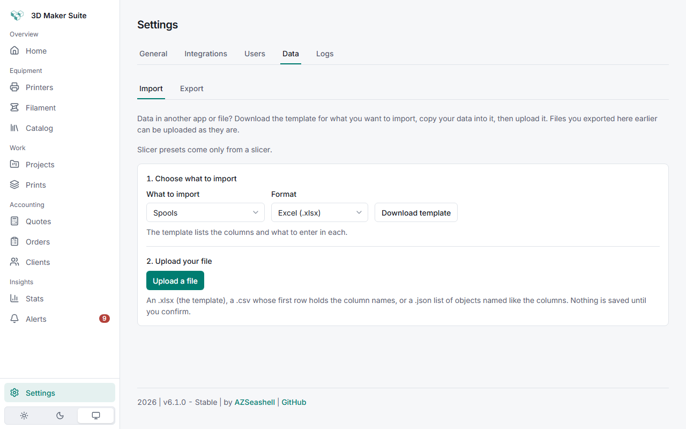
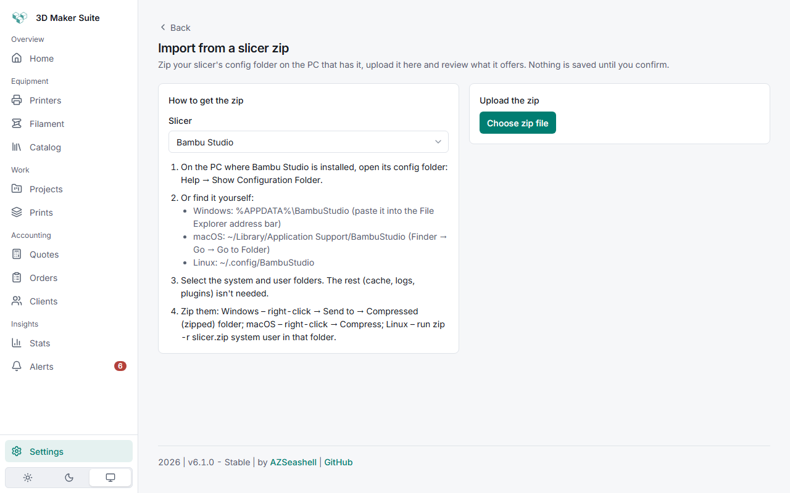

# Import and export

Bring data in from spreadsheets, a slicer's config folder or an integration, and take your data out as files. Nothing is saved on an import until you have reviewed the rows and confirmed.

Open it from **Settings**, on the **Data** tab. It has two tabs: **Import** and **Export**. A review screen opens after an upload, and a separate page takes a slicer zip.

## Who can use it

People with **Set up integrations**. It shows the **Data** tab and lets them upload, review and import. Reviewing what an integration brought is also open to people with **Review imports**, for the tasks set to allow it, see [Sources and sync](Sources-and-Sync.md#review-and-import). Rights are on the [Roles](Roles.md#integrations) page.

It works the same with or without a hub, and with or without user accounts. Without accounts, everyone who reaches the app can use it.

## Before you start

- A file can only point to things that already exist. Brands, printer models and filament materials a row names must exist first: import them first, or add them in [Catalog](Catalog.md). A slicer zip or an integration creates them for you.
- Printer, process and filament **presets** are not in a spreadsheet. They come only from a slicer, see [Slicer zip import](#slicer-zip-import) and [Presets](Presets.md).
- The app takes a [backup](Backups-and-Restore.md) before an import saves anything.

## Import

The **Import** tab says **Data in another app or file? Download the template for what you want to import, copy your data into it, then upload it. Files you exported here earlier can be uploaded as they are.** Under it: **Slicer presets come only from a slicer.**

You can import 16 kinds of data. Pick one in **What to import**:

| Group | Kinds |
|---|---|
| Your things | **Spools**, **Printers**, **Accessories**, **Accessory installs**, **Projects**, **Prints** |
| Money | **Clients**, **Quotes**, **Orders**, **Order projects** |
| Maintenance | **Maintenance types**, **Maintenance** |
| Catalog | **Printer brands**, **Printer models**, **Filament brands**, **Filament materials** |

### Steps on the tab

1. **Choose what to import.** Pick the kind in **What to import**. Pick a **Format**: **Excel (.xlsx)**, **CSV (.csv)** or **JSON (.json)**. Press **Download template**.
2. **Upload your file.** Press **Upload a file**. It takes an `.xlsx` (the template), a `.csv` whose first row holds the column names, or a `.json` list of objects named like the columns.

The review opens at once. If the file can't be read, the tab says **Couldn't read that file. Use the template, a CSV whose first row holds the column names, or a JSON list.**

### The template

- The `.xlsx` has one sheet of columns, a **Lists** sheet with the allowed values, and an **Instructions** sheet. The `.csv` is the header row alone. The `.json` is an empty list.
- Columns marked `*` are required. Leave a cell empty to keep what the app already has.
- Headers are read by their name in the template, or by the column key.
- Money is in your currency's units, not cents. Dates are `YYYY-MM-DD`, and date and time `YYYY-MM-DD HH:MM`, taken as UTC unless you add an offset like `+01:00`.
- For a brand, material or preset column, give an existing name or a new one. A new brand or material is added with the row.

### Notes per kind

| Kind | What to know |
|---|---|
| **Spools** | A spool is its **Brand** (optional), **Material**, **Name** (optional) and colour. It needs no filament preset. Without **Price paid**, it costs its material's default price per kg. **Number** is unique, and empty takes the next free one |
| **Prints** | One set of **Spool**, **Filament** and **Filament used (g)** per colour: the first set, then **Spool 2** and so on, up to 16. **Track usage** empty or `yes` takes the filament from your spools. `no` saves the print without changing the spools' weights. Every imported print needs a **Project**, or **No project** for a calibration print |
| **Printers** and **Accessories** | **Count in costs**, **Lifetime (hours)** and **Include maintenance** left empty take the defaults of the cost settings |
| **Accessory installs** | One row per period an accessory is on a printer. **Accessory** and **Printer** must exist, by number or name. **Installed** is required. Leave **Removed** empty while it is still on the printer. A removal before the install, or a period that overlaps another install, is invalid |
| **Maintenance types** | **Name** and **Target** (printer or accessory) are required. **Every** and **Warn before** are in days, hours and prints, and an empty one isn't used. **Warn alert** and **Due alert** are yes or no. **Models**, **Printers**, **Accessory types** and **Accessories** are lists separated by `;`. Empty lists mean every printer or accessory |
| **Maintenance** | One row per maintenance done. **Type** and **Done** are required, plus the **Printer** or the **Accessory** the type is for, exactly one. Empty **Runtime at (h)** and **Prints at** take what the printer or accessory had then |
| **Projects** | A row with a **Number** updates that project. **Folder** is the full path of the project's folder, inside one of your project folders. See [Project folders in the review](#project-folders-in-the-review) |
| **Clients** | Matched by **Mobile**, else **Email**, else **VAT number** |
| **Quotes** | Typed-in prints: a **Unit cost** plus the pricing columns. **Client** and **Project** must exist |
| **Orders** | Reference a **Client**, a **Quote** and one or more projects separated by `;`. **Status** is one of your order statuses |
| **Order projects** | One row per project of an order: the **Order** number and the **Project**. Changing a row moves the link, unless the order has prints of the project it leaves |
| **Printer models** | **Picture** only says whether a model has one. A file can't add a picture |

An unknown reference is an invalid row, and the message says which one is missing.

## Review rows

After an upload, the **Review rows** screen shows the file's columns in the file's order. Each row has a status.

| Status | Meaning |
|---|---|
| **New** | Nothing like it exists yet. It will be created |
| **Identical** | Already in the app with the same values. Nothing to do |
| **Changed** | Matches an existing item with different values |
| **Ambiguous** | Matches more than one item. Pick which one in **Update which** |
| **Invalid** | A value is missing or wrong. The message says which. Fix the cell, or the file |

Chips above the table filter by status, with their counts.

- **Action.** Per row choose **Create**, **Update** or **Skip**, or **Use suggestion**. For matched rows, each column can overwrite the existing value with the file's, or keep your edits and fill the rest from the file.
- **Edit a cell.** Click it. The input fits the kind of value: text, number, date, date and time, a list, a name (one you have, or a new one) or a colour. **Enter** or leaving the cell keeps the edit. **Escape** drops it. An edited cell has a bar on its left and an undo button. A value that can't be read shows its error as you type. **Id**, and the **Number** of an updating row, can't be edited.
- **Bulk edit.** Tick rows. A bar shows how many are selected, with **Clear** and **Bulk edit…**. The form has an **Action** and one field per column, each on **Don't change**, so only what you change is applied. **Apply** writes to the selected rows. Nothing is saved until **Import**. A row that still has a problem stays selected and says why. A new filter or status chip ends the selection.
- **Import.** The button counts the rows, for example **Import 12 rows**. The dialog says **A backup is taken first. If any row fails, nothing is imported.** After it, the page says **Import finished: 10 created, 2 updated.** with a **View** link to the data. If it fails, it says **Couldn't import, so nothing was changed.** with the reason.

The edits are checked again when you import, and any error stops the whole import.

### Spools of new prints

Each filament slot of a new print has a spool picker.

- From a file, it starts on the spool the row names. A slot with none stays empty, and its grams wait on the **Filament to review** page, see [Filament review](Filament-Review.md).
- The spools that fit the slot, with the same material and colour, are listed first.
- A spool opened after the print started is not offered, and neither is an empty one.
- **Add new spool…** at the end of the list adds a spool without leaving the review, and picks it.
- **Track usage** is a tick on every print row. Untick it to save a print without changing the spools' weights.

### Project folders in the review

A row without a folder, or whose folder isn't there, is highlighted. For each row you can:

- **Choose…** a folder inside your project folders. If it already has files, you can take the project's name, description and link from the folder.
- **Create folder.** The app makes it when you import. Leave the name empty to name it by number and name, like `012_Vase`.
- **No folder.** The project is saved without one.

To fix many at once, tick the rows, open **Bulk edit…** and set **Folder** to **Move to root**. Each row gets that root plus its own last folder. After the import, each folder is scanned. The **Prints** column shows the prints each project gets. Click it to open **Prints of row N**, which lists the prints it has and the ones linked by name, and **Add a print** adds another.

## Export

The **Export** tab says **Take your data out, to keep, edit or use elsewhere.** Its **Spreadsheet** card has the same columns as the import template, plus an `id` column.

1. Pick **What to export**.
2. Pick a **Format**.
3. Press **Export**.

The file is named like `Spools export.xlsx`. Edit it and upload it again on the **Import** tab: a row with an `id` updates that item. For a full copy of everything, take a [backup](Backups-and-Restore.md) instead.

The brands, models, filament brands and materials tables in [Catalog](Catalog.md) have their own **Import** and **Export** buttons. They use the same flow. Export needs **Catalog** at **Read**, and Import **Catalog** at **Manage**.

## Source review

When an integration, or an uploaded slicer zip, brings rows that need your decision, they wait for you on a review screen. It is the same screen as **Review rows**, with the text **Review what this source offers. Nothing is saved until you confirm.**

Open it from the **⋯** menu of a line, with **Review and import**, on **Settings → Sources** pages, or from a **Sync needs review** alert. See [Sources and sync](Sources-and-Sync.md#review-and-import). **Review and import a period…** in the same menu reviews every print in a period, imported or not.

- A source with nothing to offer says **Nothing found**.
- If it can't be read, the screen says **Couldn't read this from the integration. Check that it is connected and set up in Integrations.** with **Open integrations**.
- **Dismiss** on changes keeps what you have. A dismissed change only comes back when the source changes it again.
- In an integration's review, a column left on **Don't change** follows the choice made for that type in its **Edit** settings. Bulk edit can set a column to **Keep my edits, fill the rest with import values**.
- Importing from a review is not a sync. A print you skip still comes in with the next sync.

### Prints from an integration

Each filament is matched to a spool of the same material and colour, opened by the print's day, that still holds the grams.

- **One spool fits.** It is picked, and the print is imported without asking.
- **Several fit.** The app picks the one the printer last used in that AMS slot, else the oldest. The pick shows in yellow with **Picked from several spools of this colour: check it**, and the print waits for you.
- **None fits.** The slot says **No spool: the grams wait for review**.

A print whose title matches no project waits for you to pick a project or **No project (e.g. a calibration print)**.

### Presets gone from the slicer

A preset the slicer no longer has is never deleted for you. The review lists it under **Gone from the slicer**. **Nothing uses it:** **Delete** removes its row after you confirm. **Something uses it:** the row stays, and the review says what uses it. **Keep the rest** keeps the rows and doesn't ask again until the slicer's presets change. See [Catalog settings](Catalog-Settings.md#sources).

## Slicer zip import

For a server with no slicer on it, such as a NAS, you can import the presets from your slicer's config folder. Open **Import from a slicer zip**, from **No connector? Upload a zip** on [Catalog settings](Catalog-Settings.md#upload-a-zip).

The page says **Zip your slicer's config folder on the PC that has it, upload it here and review what it offers. Nothing is saved until you confirm.** Pick the **Slicer**, then follow **How to get the zip** and **Upload the zip**:

1. On the PC with the slicer, open its config folder: in the slicer, **Help → Show Configuration Folder**. Or find it yourself:
   - Windows: `%APPDATA%\BambuStudio` or `%APPDATA%\OrcaSlicer` (paste it into the File Explorer address bar)
   - macOS: `~/Library/Application Support/BambuStudio` or `~/Library/Application Support/OrcaSlicer` (Finder, **Go**, **Go to Folder**)
   - Linux: `~/.config/BambuStudio` or `~/.config/OrcaSlicer`
2. Select only the **system** and **user** folders. Cache, logs and plugins aren't needed.
3. Zip them. Windows: right-click, **Send to**, **Compressed (zipped) folder**. macOS: right-click, **Compress**. Linux: run `zip -r slicer.zip system user` in that folder.
4. Press **Choose zip file** and pick the zip. The page says **Reading the zip…**.
5. Review what it offers, one type at a time: **Printer presets**, **Process presets** and **Filament presets**. Nothing is saved until you confirm.

Only `.json` and `.png` files are read. The zip must be under 100 MB. **Upload again** starts over. If the page says **This upload is gone. Upload the zip again.**, the upload expired.

## Common tasks

### Bring in spools from a spreadsheet

1. Open **Settings**, **Data**, **Import**.
2. Pick **Spools**, then **Download template**.
3. Copy your spools into the template, one row each.
4. Press **Upload a file** and pick it.
5. Check the rows. Fix any **Invalid** one.
6. Press **Import** and confirm.

### Edit many rows in a spreadsheet

1. On **Export**, pick the kind and format, and press **Export**.
2. Edit the file. Keep the `id` column.
3. Upload it on **Import**. Rows with an id show as **Changed**.
4. Review and press **Import**.

### Move a print history from another app

1. Download the **Prints** template.
2. Fill it. Give each print a **Project**, or **No project**, and one set of spool columns per colour.
3. Upload it. Untick **Track usage** on rows whose spools you already updated.
4. Import.

## Related settings

- [Catalog settings](Catalog-Settings.md) holds the sources, and the zip upload for slicers.
- [Sources and sync](Sources-and-Sync.md) holds **Sync now**, **What to sync** and the review of an integration.
- [Roles](Roles.md#integrations) holds **Set up integrations**, **Run syncs** and **Review imports**.

## Limits and tips

- Any error stops the whole import, and nothing changes.
- An upload kept for review expires. Upload the file again if the page says so.
- Brands, models and materials a file names must already exist, or be added by the same review.
- A row you made by hand whose name later comes in from a slicer is linked to it, and keeps your values.
- Importing doesn't overwrite a field with an empty cell.

## Problems and fixes

| What you see | What to do |
|---|---|
| **Couldn't read that file.** | Use the template, a CSV with a header row, or a JSON list |
| **Couldn't build the template. Is the server running?** | Check that the server is up, then try again |
| **Not found, or matches more than one** | Give the number or the exact name of a thing that exists once |
| **This spool was opened after the print started** | Pick another spool, or none |
| **Not inside one of your project folders** | Pick a folder under a root in [Project folders](Project-Folders.md) |
| **Another project, or an earlier row, has this folder** | Give it a different folder |
| **The accessory is on a printer during that period** | Fix the dates so an accessory is on one printer at a time |
| **Couldn't import, so nothing was changed.** | Read the message, fix the row, import again |
| **This zip doesn't look like a slicer config folder.** | The zip needs the **system** and **user** folders in it |
| **This zip is too large.** | Zip only the **system** and **user** folders |
| **Couldn't read this from the integration.** | Check that it is connected in [Integrations](Integrations.md) |

## Related pages

- [Catalog](Catalog.md)
- [Presets](Presets.md)
- [Sources and sync](Sources-and-Sync.md)
- [Backups and restore](Backups-and-Restore.md)
- [Filament review](Filament-Review.md)
