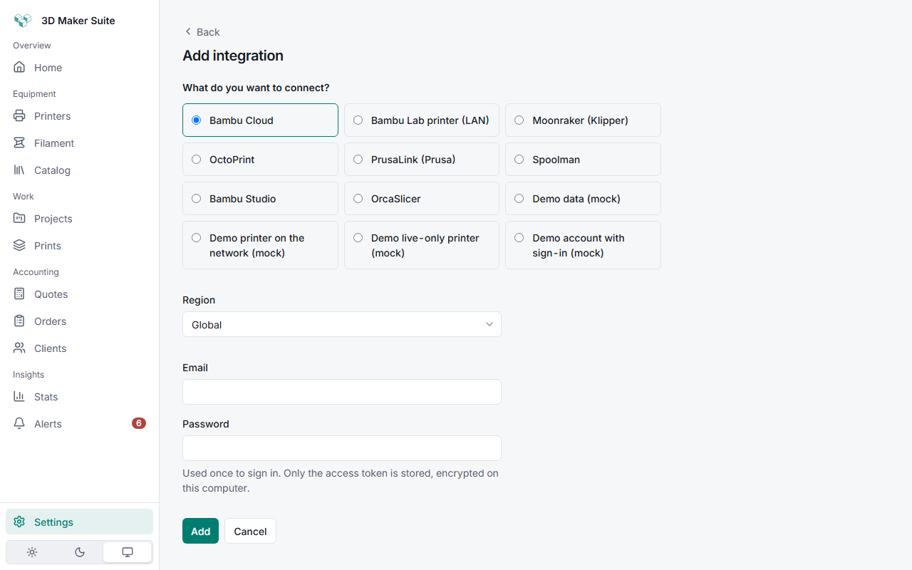

# Integrations

The page where you connect other services to the app: a Bambu Cloud account, a printer on your network, a Spoolman, or a slicer. Each one is called an integration. You never have to use one. Everything can be typed in by hand.

Open **Settings**, then the **Integrations** tab. This page explains the cards, adding and editing an integration, removing one, and the sync log. It also holds the [list of supported printers](#supported-printers). Each kind of integration has its own guide:

| Integration | Guide |
|---|---|
| **Bambu Cloud**: your Bambu account, with its printers, print history and spools | [Bambu Cloud](Bambu-Cloud.md) |
| **Bambu Lab printer (LAN)**: a Bambu printer on your network, live | [Bambu LAN](Bambu-LAN.md) |
| **Moonraker (Klipper)**: a Klipper printer, live, with its history | [Moonraker](Moonraker.md) |
| **OctoPrint**: any printer behind OctoPrint, live | [OctoPrint](OctoPrint.md) |
| **PrusaLink (Prusa)**: a Prusa printer, live | [PrusaLink](PrusaLink.md) |
| **Spoolman**: your spool inventory, both ways | [Spoolman](Spoolman.md) |
| **Bambu Studio** and **OrcaSlicer**: slicers, on this server or on a computer | [Slicers](Slicers.md) |

## Who can use it

| You can | You need |
|---|---|
| Open the tab, add, edit, switch off and remove integrations, sign in again, and make a slicer the default | **Set up integrations** |
| Run a sync or review what it found from a card | **Run syncs** or **Review imports**, and the sync set to allow it. See [Sources and sync](Sources-and-Sync.md) |

**Set up integrations** is a switch on a role, with the hint **Add, sign in and configure integrations and slicers.** Without it, you see the **Integrations** tab only when an admin lets you sync or review something that lives on this page. You then see no buttons or switches, and the page says **An admin can let you sync or review an integration's data here.** when there is nothing for you.

Works the same with or without a hub. A hub adds the choices **Reached from** and **Where**, which are explained below.

## Before you start

Nothing. Add an integration only when you want its data. Keep your credentials at hand: the Bambu account's email and password, a printer's address and access code or key, or Spoolman's address. Credentials are stored encrypted on the server and are never shown again or written to the log.

## Integrations page

Under the title, **Add integration** opens the [add form](#add-or-edit-an-integration). With no integrations yet, the page says **No integrations yet. Connect a vendor account to import your printers and print history automatically.**

There is one card for each account type or slicer, such as **Bambu Cloud**, **Moonraker (Klipper)** or **OrcaSlicer**. Accounts and printers come first, then slicers. A card only exists once something is set up under it.

A card is closed at first. Click its title to open it. The page remembers which cards you opened, in this browser. A card with an error opens by itself.

On the closed card you see:

| Part | What it shows |
|---|---|
| The title | The integration, for example **Bambu Cloud** |
| The count | How many it holds: **1 account**, **2 printers**, **1 source** or **1 install** |
| A coloured edge and a badge | **Error** (red) when an enabled one fails. **Paused** (orange) when all of them are switched off |
| **Default slicer** | On a slicer card, when you have more than one slicer. See [Slicers](Slicers.md#the-default-slicer) |
| **⋯** | The card's menu: **Remove integration**, and **Make default slicer** on a slicer card |

Open, the card adds a button on the right, **Add another account**, **Add another printer** or **Add another source**. A slicer card has **Add to this server** instead, until the slicer is on this server. Spoolman has no add button once it is set up.

### Account and printer blocks

An account (Bambu Cloud), a printer on your network (Bambu LAN, Moonraker, PrusaLink, OctoPrint) and a Spoolman each have a block inside their card.

| Part | What it means |
|---|---|
| The photo or initials, and the title | The name the source reported. Until it has one, the title is the integration's name followed by **account** |
| The line under the title | The email and region of a Bambu Cloud account. **Reached through {machine}** when a computer on the printer's network reads it for the hub |
| **Signed in** or **Signed out** | For an account that signs in. **Signed out** is a link to the **Edit** page, where you sign in again |
| The state | **Synced** with a time, **Syncing…**, **Not synced yet**, the error, or **Switched off: nothing is synced from this account.** |
| **Test connection** | Checks the connection now. It says **Connection works.** or why not. Shown while the integration is on and signed in |
| **Enabled** | Off, nothing is synced from it and it counts as **Paused**. Nothing is deleted |
| **⋯** | **Edit** and **Delete** |
| **Live status**, **Write usage back** | Switches for what the integration does besides syncing. See below |
| **Prints sources** | On a printer on your network: opens that printer's line on [Prints settings](Prints-Settings.md#record-prints) |

The switches depend on the integration:

| Switch | On | Where |
|---|---|---|
| **Live status** | The app follows what the printer is doing and records each print when it ends | The printers on your network |
| **Write usage back** | The filament each print takes from a spool linked to this source is written back to it | Spoolman |

**Delete** asks **Delete {name}?** and says **Imported printers and prints stay. The credentials and the sync log are removed.** Confirm with **Delete**.

### Sync sources configurations

At the bottom of a card, a row of buttons: **Printers**, **Prints**, **Filament**, **Catalog**. Each one opens the **Sources** tab of that module, where this integration's data types have their own line. When a source syncs, what it syncs and how are set there, not on the card. See [Sources and sync](Sources-and-Sync.md). A button shows only for a module you may open and only for what the card can feed. A printer on your network has no **Printers** button: it is one printer, linked when you add it.

### Remove an integration

The **⋯** menu at the top right of a card has **Remove integration**. It asks **Remove {name}?** and lists everything under the card.

- **Stays:** imported printers, prints and spools. They are unlinked from this source.
- **Goes:** credentials, schedules, the sync log, and slicer installs the hub made. A slicer installed by hand stays on its machine.

If it is your default slicer, the dialog says so, and slicing falls back to another slicer. While a sync runs, the dialog says **A sync is running. Try again when it has finished.** To remove only one account or printer, use **Delete** in its own **⋯** menu.

## Add or edit an integration

**Add integration** opens the form. **Back** returns to the cards.

1. Under **What do you want to connect?**, pick one tile.
2. For a slicer, pick **Where** (see [Slicers](Slicers.md#add-a-slicer)). For anything else, fill in its fields, below.
3. Under **Printer**, for a printer on your network: pick **New printer from this source**, or a printer you already have. See [Printer link](#printer-link).
4. Press **Test** to try the connection, then **Add**.

The tiles show everything this version can connect. Tiles ending in **(mock)** are demo sources for developers. They only exist when the server runs with `APP_MOCK_INTEGRATION=1`, so you won't see them on a normal install.

A source you can add only once, such as Spoolman, says **Already set up: find its card on the Integrations page.** and the **Add** button stays off. Saving a printer asks the printer what it is, as **Test** does. If it doesn't answer, nothing is saved. An account is created only when its sign-in goes through.

### Fields

| Field | What it means | Required | Example |
|---|---|---|---|
| **Region** | Bambu Cloud: **Global** or **China** | Yes | Global |
| **Email**, **Password** | Bambu Cloud: your account. The password is used once and never stored | Yes | |
| **Verification code** | Bambu Cloud: asked after the password when Bambu wants a code | When asked | `123456` |
| **Address** or **Printer IP** | Where the printer or Spoolman is on your network. See each guide for the exact form | Yes (Bambu LAN: IP or serial) | `192.168.1.50` |
| **Access code**, **API key**, **Password**, **User** | What the printer or Spoolman asks for. Stored encrypted. See each guide | Depends | |
| **Brand**, **Model** | Moonraker and OctoPrint: what to call the printer. PrusaLink: **Model** | No | Voron 2.4 |
| **Printer** | Which printer this source is. See [Printer link](#printer-link) | Yes | New printer from this source |
| **Name** | The name of a new printer. Leave empty to use the name the printer announces. Spoolman: its own name on the card | No | Workshop X1 |
| **Reached from** | **This server**, or a computer on the printer's network. See [Reach through a computer](#reach-through-a-computer) | No | This server |

A password or key field never shows what is saved. On the edit page it says **Saved. Leave empty to keep it.**

### Printer link

A printer on your network is always one printer in the app. Under **Printer**, pick:

- **New printer from this source:** the app makes a printer from what the source reports. **Name** is optional. Leave it empty to use the name the printer announces.
- **A printer you already have:** it keeps its own name, model and costs. Saving asks the printer what it is, as **Test** does. Pick your Bambu Cloud printer in **Bambu Lab printer (LAN)** to get one printer with two sources.

A printer that another network source already is, is left out of the list: **Another network source is already that printer. Pick another one.** One integration is one printer, so there is no **Printers** sync for it, and a printer you added by hand never comes back twice.

To link it to another printer later, open **Edit** and pick another **Printer**. The one it had stays, unlinked. The page shows **Printer name** with **Rename on the printer page** for a printer you picked.

### Reach through a computer

When the hub is on and a computer has **Reach printers** (or **Reach spool libraries**) switched on, the form has **Reached from**. Pick that computer when the server can't see the printer itself, for example a hub on a server in another city. **Test** and saving then go through that computer, so it must be online. An offline one shows as **{name} (offline)**. See [Hub setup](Hub-Setup.md) and [Connector setup](Connector-Setup.md). The computer's page has **Set up in Integrations**, which opens this form with it already picked.

### Edit

**Edit** is in the **⋯** menu of an account or printer block. The page is called **Edit {name}**. It has the same fields as the add form, with what is saved. Press **Test** to try the new values before you press **Save changes**.

A Bambu Cloud account also has a **Sign in** section on this page, with **Email**, **Password** and, when asked, **Verification code**. Use it to sign in again. See [Bambu Cloud](Bambu-Cloud.md#sign-in-again). A slicer has no edit page. Its settings are on its card, see [Slicers](Slicers.md).

When the add or save fails, the form says why:

| What you see | What to do |
|---|---|
| **Some fields aren't valid. Check the address and the other fields.** | Fix the address and the other fields |
| **Fill in the key or access code.** | Enter it |
| **Fill in at least one of: {fields}.** | Fill in one of them |
| **Pick the printer this is, or a new printer.** | Choose under **Printer** |
| **The source answered but names no printer.** | Check that the address is a printer, not another service |
| **That machine doesn't reach this kind of source. Turn its switch on on the machine page first.** | Open the computer's page and switch on **Reach printers** or **Reach spool libraries** |
| **The connector on that machine is too old for this source. Update it to the hub's version.** | Update the connector |
| **That machine is offline. Try again once it is online.** | Start the connector there |
| **The hub is off. Turn it on to reach a source through a machine.** | Turn on **Hub** in [Settings](Settings-General.md#hub) |

## Sync log

Every run of a sync is kept in a log: when it ran, what it did and what failed. Open it from the **⋯** menu of a line on a **Sources** tab, with **Sync log**. It opens a window called **Sync log: {type} from {source}**. You need **Set up integrations**.

| Column | What it shows |
|---|---|
| **Started** | When the run began. Newest first. It can be sorted and filtered by date |
| **Type** | What it synced, such as **Printers**, **Print history** or **Spools**. A run of everything says **Everything** |
| **Range** | The period a print review covered, such as **From 01/11/2026**. **–** when there was none |
| **Trigger** | **Manual** (someone pressed **Sync now** or reviewed) or **Scheduled** |
| **Result** | **{n} imported** and **{n} already known**, or the error in red. Can be filtered by **Succeeded** or **Failed** |

With nothing yet, it says **No syncs yet.** Ten runs show per page. A failed sync also raises a **Sync failed** alert, and the app keeps working with the data it has. The error texts:

| Error | What it means and what to do |
|---|---|
| **Sign-in required. Check the credentials.** | The key, code or password is wrong. Enter it again with **Edit** |
| **Sign-in expired. Connect again.** | The account's sign-in ran out. Sign in again |
| **The vendor is limiting requests. It will retry later.** | Wait. The sync tries again by itself |
| **The vendor service can't be reached.** | Check the server's internet connection, or the printer's address |
| **Wrong email or password.** | Try again |
| **That code is wrong or has expired. Check it and try again.** | Ask for a new code |
| **The vendor's servers refused this app's request. If it keeps happening, check for an update of 3D Maker Suite.** | Update the app |
| **The vendor changed its service and this version can't read it any more. Check for an update of 3D Maker Suite.** | Update the app |
| **The slicer couldn't slice the file.** | See [Slicers](Slicers.md#problems-and-fixes) |
| **Something went wrong. See the server log for details.** | Open **Settings → Logs** |

## Supported printers

A printer on your network is read-only: the app never starts, pauses or stops a print, and it changes no setting on the printer. Prints are recorded when a job ends, once, also when two sources report the same printer.

| Printer | Source | Live status | Prints recorded | Grams | Spool |
|---|---|---|---|---|---|
| Klipper | [Moonraker](Moonraker.md) | yes | live, and its history | file totals per tool; the length really extruded for a cancelled print | the Spoolman spool a job names |
| Bambu Lab | [Bambu LAN](Bambu-LAN.md) | yes | live | the job's 3MF, per AMS slot | AMS RFID tag; trays loaded by themselves |
| Bambu Lab | [Bambu Cloud](Bambu-Cloud.md) | no | history | from the cloud | the cloud's filament manager |
| Prusa (MK4, XL, MINI, MK3) | [PrusaLink](PrusaLink.md) | yes | live | the job file's totals | loaded spool |
| Any printer behind OctoPrint | [OctoPrint](OctoPrint.md) | yes | live | the job file's totals | loaded spool |

Bambu Cloud and Bambu LAN can both be set up for one printer. It stays one printer, and each print is recorded once. [Spoolman](Spoolman.md) is a spool library, not a printer source: it imports your spools and gets each print's usage written back.

How well each one is checked:

- Bambu LAN was checked on an A1 with its normal settings. A printer with **LAN Only** mode on, and other Bambu models, are untried.
- PrusaLink and OctoPrint follow printer messages that others published. Neither is checked on a real printer yet.

Klipper printers include Voron, RatRig, Sovol, Qidi, Elegoo Neptune 4, Snapmaker U1, rooted Creality printers and most other machines with Moonraker. A printer that none of these sources can read can still be added by hand on [Printers](Printers.md).

## Common tasks

### Connect a printer on your network

1. Open **Settings**, then **Integrations**, and press **Add integration**.
2. Pick the tile for your printer. See the [table above](#supported-printers).
3. Pick **Printer**, enter the address and the key or code, and press **Test**.
4. Press **Add**.
5. On the printer's card, switch on **Live status**.

The printer's page now shows where it is read from, see [Connection and monitoring](Printers.md#connection-and-monitoring).

### Stop one integration without losing anything

1. Open its card and find its block.
2. Switch **Enabled** off.

Nothing is synced from it, and the card says **Paused**. Switch it on again when you want it back.

### Read a printer on another network

1. In **Hub management**, open the computer in that network and switch on **Reach printers**.
2. In **Integrations**, press **Add integration** and pick the printer's tile.
3. Under **Reached from**, pick the computer.
4. Press **Test**, then **Add**.

## Related settings

- **Sources** tabs on [Printers settings](Printers-Settings.md#sources), [Filament settings](Filament-Settings.md#sources), [Prints settings](Prints-Settings.md#sources), [Projects settings](Projects-Settings.md#sources) and [Catalog settings](Catalog-Settings.md#sources) hold the lines of each integration.
- **Hub** in [Settings](Settings-General.md#hub) turns on the hub that **Reached from** and **Where** need.

## Limits and tips

- Credentials are stored encrypted on disk and never logged or sent back to the browser.
- A printer you added by hand and a source that reads the same printer are one printer. You never get a copy.
- Removing an integration keeps what it imported, unlinked from the source.
- **Live status** reads a printer you can't reach from this server only through a computer that reaches it for you.

## Problems and fixes

| What you see | What to do |
|---|---|
| The **Integrations** tab is missing | Your role lacks **Set up integrations**. See [Who can use it](#who-can-use-it) |
| **No integrations are available in this version yet.** | The server loaded no integrations. Update the app |
| **Couldn't load integrations. Is the server running?** | Check that the app is running, then reload |
| A card says **Error** | Open it. The block says what failed. Use **Test connection**, then **Edit** |
| **Signed out** | Click it and sign in again on the **Edit** page |
| **That didn't work. Try again.** | Try again. If it repeats, check **Settings → Logs** |
| **Installed twice on this server: the copy found installed here and a download. Both keep working; delete one.** | On a slicer card, **Delete** one of the two installs |

## Related pages

- [Bambu Cloud](Bambu-Cloud.md), [Bambu LAN](Bambu-LAN.md), [Moonraker](Moonraker.md), [OctoPrint](OctoPrint.md), [PrusaLink](PrusaLink.md), [Spoolman](Spoolman.md)
- [Slicers](Slicers.md)
- [Sources and sync](Sources-and-Sync.md)
- [Printers](Printers.md)
- [Hub setup](Hub-Setup.md)
