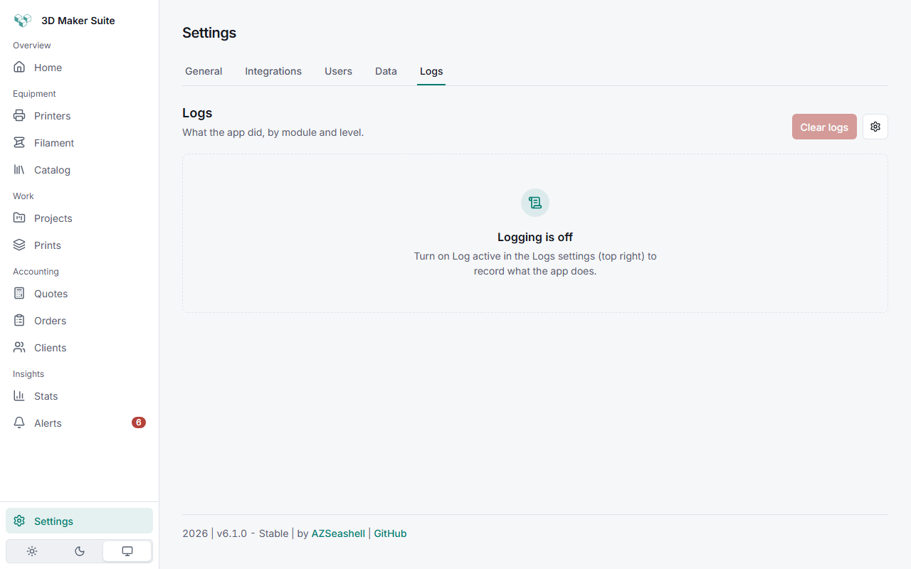

# Logs

A record of what the app does, by module and level, to help with troubleshooting.

Open it from **Settings**, on the **Logs** tab. The gear at the top right opens [Logs settings](#logs-settings).

## Who can use it

People with the **Logs** right. It lets them read the log, clear it and change what is logged. Without the right, the tab is hidden. It works the same with or without a hub, and with or without user accounts.

## Before you start

Logging is **off** by default. Turn on **Log active** in [Logs settings](#logs-settings) first. While it is off, the tab says **Logging is off** and **Turn on Log active in the Logs settings (top right) to record what the app does.** Entries written earlier stay readable.

## Logs tab

The tab shows a table called **Logs**, newest first. It refreshes by itself every ten seconds. With no entries it says **No log entries** and **Entries appear here as the app works.**

| Column | What it shows |
|---|---|
| **Time** | When it happened, in your date and time format |
| **Level** | **Debug**, **Info**, **Success**, **Warning** or **Error**. Warnings and errors are coloured |
| **Module** | The part of the app that wrote it |
| **User** | Who did it. Empty for background jobs, such as an automatic sync |
| **Message** | What happened. A message with a small arrow opens to show its details |

Every column sorts, and every column has a filter, so you can narrow the list by time, level, module, user or words in the message. The filters stay in the address, so a filtered list can be bookmarked.

Credentials, tokens and passwords are never written to the log.

### Levels

| Level | Use |
|---|---|
| **Debug** | Fine detail, for finding a problem. Off by default |
| **Info** | Normal events |
| **Success** | Something finished well, such as a sync or a backup |
| **Warning** | Something needs a look but the app carried on |
| **Error** | Something failed |

### Modules

**System**, **Printers**, **Accessories**, **Maintenance**, **Filament**, **Projects**, **Prints**, **Quotes**, **Orders**, **Clients**, **Stats**, **Alerts**, **Import**, **Integrations**, **Backups** and **Settings**.

### Clear logs

**Clear logs** at the top right asks **Clear all logs?** and says **Every log entry is deleted. This can't be undone.** The button is off while the table is empty. Clearing doesn't turn logging off.

## Logs settings

The gear opens **Logs settings**, a single card. It saves as you change it.

| Field | What it means | Default |
|---|---|---|
| **Log active** | Turns logging on and off | Off |
| **Levels to keep** | Which of the five levels are written | **Info**, **Success**, **Warning** and **Error** |
| **Modules to log** | Which parts of the app write entries. Untick a module to leave it out | All modules |
| **Keep for (days)** | Older entries are removed every hour. 1 to 365 | 14 |
| **Maximum entries** | The oldest entries beyond this are removed every hour. 100 to 1,000,000 | 10,000 |

The card says **Keeps a record of what the app does in its database, for troubleshooting. Credentials are never written.** A number outside its range goes back to the saved value.

Entries live in the app's database, so they are kept with your data and included in a [backup](Backups-and-Restore.md).

## Common tasks

### Record a problem for a bug report

1. Open **Settings**, then **Logs**, and press the gear.
2. Turn on **Log active**, and tick **Debug** under **Levels to keep**.
3. Do the thing that fails.
4. Open the **Logs** tab and filter **Level** to **Error** and **Warning**. Open the message to see its details.

### Find what one person did

1. Open the **Logs** tab.
2. Filter **User** by their name.

### Keep the log small

1. Open the gear.
2. Keep **Debug** unticked, untick the modules you don't need, and lower **Keep for (days)** or **Maximum entries**.

## Related settings

- [Users](Users.md) and [Roles](Roles.md) say who has the **Logs** right.
- [Backups and restore](Backups-and-Restore.md) include the log.

## Limits and tips

- Entries of a request show the user who made it. Background jobs have no user.
- Log entries only appear for what happens while **Log active** is on.
- Debug entries fill the log fast. Untick **Debug** again when you are done.

## Problems and fixes

| What you see | What to do |
|---|---|
| **Logging is off** | Turn on **Log active** in Logs settings |
| **No log entries** | Do something in the app, or check the **Levels to keep** and **Modules to log** |
| **Couldn't load the logs.** | Check the connection to the server, then reload |
| An entry I expect is missing | Its level or module is unticked, or it is older than **Keep for (days)** |
| The tab is missing | You need the **Logs** right |

## Related pages

- [Settings](Settings-General.md)
- [Users](Users.md)
- [Troubleshooting](Troubleshooting.md)
- [Backups and restore](Backups-and-Restore.md)
