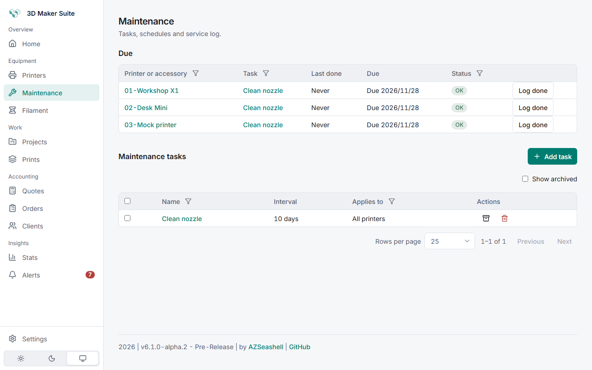
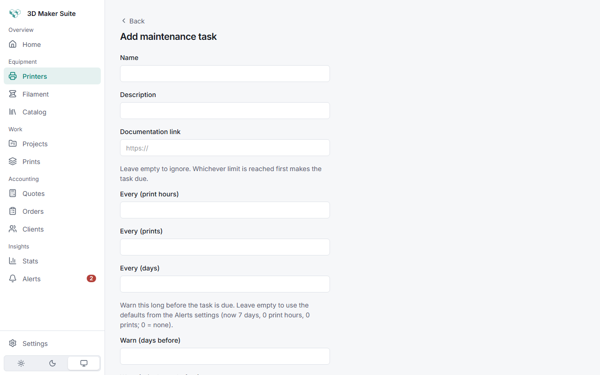
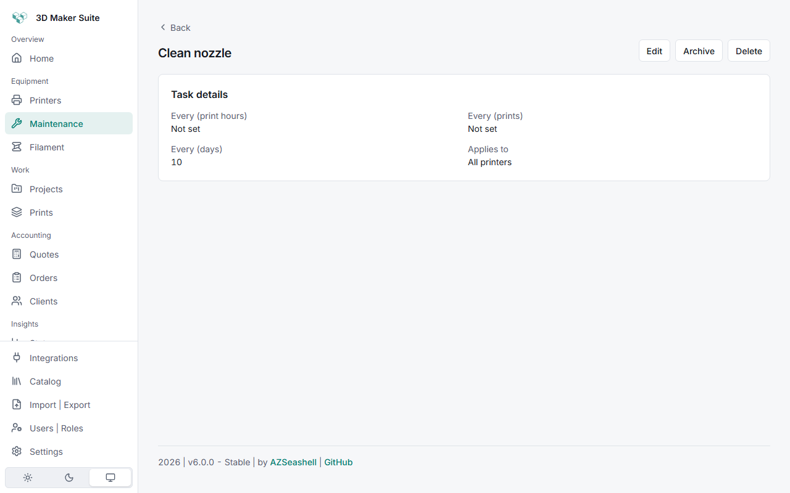

# Maintenance

What your printers and accessories need done and when: the **Due** list, logging work as done, and the tasks that decide what is due.

Maintenance is the third tab of the **Printers** page. You describe a task once, for example **Clean nozzle** every 10 days, and the app lists it for every printer or accessory it applies to. It works out when each one is due from the prints, print time and days since the work was last done.

## Who can use it

| You can | You need |
|---|---|
| See the tab, **Due** and a task's page | **Maintenance** with **Read** |
| Press **Log done** | **Maintenance** with **Write** |
| Add, edit, archive, restore or delete a task | **Maintenance** with **Manage** |

Someone who can read only **Maintenance** (and not **Printers**) sees only this tab. Works the same with or without a hub.

## Before you start

- Add the printers and accessories first. A task is listed only for those that exist and are not archived. See [Printers](Printers.md) and [Accessories](Accessories.md).
- Maintenance counts the print hours and prints logged on a printer or accessory. If the numbers are wrong, use **Correct usage** on its page first. See [Printers](Printers.md#correct-usage).

## Maintenance tab

Open **Printers**, then **Maintenance**. It has two sections: **Due** and **Maintenance tasks**.

### Due

**Due** has one line for each printer or accessory and task that applies to it. The most urgent come first. With no tasks, it says **Nothing scheduled** and **Add a maintenance task below and it will show up for every matching printer or accessory.**

| Column | What it shows |
|---|---|
| **Printer or accessory** | What the task is for. It opens that printer or accessory |
| **Task** | The task. It opens [the task's page](#task-details) |
| **Last done** | The date it was last logged, or **Never** |
| **Due** | What is left, for the limit that is closest, for example `4 h 30 min of printing left`, `3 prints left` or `Due 12 Jun 2026`. When it is late, the text says `overdue`, for example `2 prints overdue` or `Overdue since 12 Jun 2026`. **No interval set** if the task has no limit |
| **Status** | **OK**, **Upcoming** or **Overdue** |
| The last column | The **Log done** button |

Press a header to sort. **Printer or accessory** and **Task** can be filtered by name, and **Status** by **Overdue**, **Upcoming** or **OK**.

How the status is worked out:

- A task can have a limit in print hours, in prints, in days, or in any of them. The one that is used up first decides the status.
- **Upcoming** starts when 90% of that limit is used. **Overdue** starts at 100%.
- The count starts at the last time the task was logged. If it never was, it starts when the printer or accessory was added, with no prints and no hours.
- An accessory counts the prints and hours of the printers it was on, while it was on them.

### Log maintenance done

Press **Log done** on a line to open **Log maintenance done**. It names the task and the printer or accessory.

| Field | What it means | Required | Example |
|---|---|---|---|
| **Date** | The day the work was done. It starts as today and can't be in the future. A past day counts the usage up to then | Yes | `2026-11-18` |
| **Cost** | What it cost, in your currency. Used when the printer or accessory has **Include maintenance in costs** on | No | `4.50` |
| **Notes** | What you did | No | `Replaced the nozzle` |

Press **Save**. The line starts counting again from that day. Cancel with **Cancel** or the Escape key.

A log can't be edited or deleted afterwards. It stays as permanent history.

### Maintenance tasks

**Maintenance tasks** lists every task. **Add task** opens [the add form](#add-or-edit-a-task). Press a column header to sort. **Name** and **Applies to** can be filtered, and **Show archived** finds archived tasks.

| Column | What it shows |
|---|---|
| **Name** | The task, with its description under it. It opens [the task's page](#task-details) |
| **Interval** | Its limits, for example `250 h, 20 prints, 10 days`. Empty if it has none |
| **Applies to** | **All printers**, **All accessories**, or the models, printers, accessory types or accessories it is limited to |
| The last column | **Archive** or **Restore** for the row, and the selection checkbox |

A person with **Manage** can tick rows to archive, restore or delete many at once. How this works, and what blocks a delete, is on [Archive and delete](Archive-and-Delete.md).

## Add or edit a task

**Add task** opens the form. On a task's page, **Edit** opens the same form with its values. **Save task** saves it. A new task goes back to the tab, and an edited one to its page.

### Fields

| Field | What it means | Required | Example |
|---|---|---|---|
| **Name** | What the work is | Yes | `Clean nozzle` |
| **Description** | A short line shown under the name in the list | No | `Wipe and check for clogs` |
| **Documentation link** | A web address with how to do it. It shows on the task's page | No | `https://wiki.bambulab.com/` |
| **Every (print hours)** | Due after this many print hours. Decimals are allowed | No | `250` |
| **Every (prints)** | Due after this many prints | No | `50` |
| **Every (days)** | Due after this many days | No | `10` |

Leave a limit empty to ignore it. Whichever limit is reached first makes the task due. A task with no limit at all is listed with **No interval set** and is never due.

The next fields decide the alerts for this task. Each lead field is empty by default, which uses the defaults in **Settings → Alerts**. The form shows those defaults. `0` means no warning for that limit.

| Field | What it means |
|---|---|
| **Warn (days before)** | Raise a warning this many days before the task is due |
| **Warn (print hours before)** | The same, in print hours |
| **Warn (prints before)** | The same, in prints |
| **Warn before it is due** | On by default. Switch it off to get no warning for this task |
| **Raise an error when overdue** | On by default. Switch it off to get no error when the task is overdue |

The last fields say what the task is for.

| Field | What it means |
|---|---|
| **For** | **Printers** or **Accessories**. A task is for one of them, not both |
| **Only for models** and **Only for printers** | Shown for **Printers**. Search and select models, printers, or both |
| **Only for accessory types** and **Only for accessories** | Shown for **Accessories**. Search and select types, accessories, or both |

Leave the lists empty to apply the task to every printer, or to every accessory. A model applies to every printer of that model, also printers you add later. Switching **For** clears the lists of the other kind.

## Task details

Press a task's name to open its page. The title is the task, with its description under it. **Edit** and **Archive** are at the top right and need **Manage**. An archived task has an **Archived** label.

The **Task details** card shows:

| Row | What it shows |
|---|---|
| **Every (print hours)**, **Every (prints)**, **Every (days)** | The limits, or **Not set** |
| **Applies to** | What it is limited to, or **All printers** or **All accessories** |
| **Documentation link** | The link, shown as the site's name. It opens in a new tab. Only shown when set |

The page doesn't list the work already logged. That history shows as **Last done** in [Due](#due).

## Common tasks

### Set up the first task

1. Open **Printers**, then **Maintenance**.
2. Press **Add task**.
3. Type a **Name**, for example `Lubricate rods`.
4. Set a limit, for example `200` in **Every (print hours)**.
5. Leave **For** on **Printers** and the lists empty to cover every printer. Pick a model to cover only its printers.
6. Press **Save task**. The task now shows in **Due** for each printer.

### Log work as done

1. Open **Printers**, then **Maintenance**.
2. Find the line in **Due**. Use the filters if the list is long.
3. Press **Log done**.
4. Check the **Date**. Add the **Cost** and **Notes** if you want.
5. Press **Save**.

You can also open **Maintenance due** on the Dashboard and press **View all** to land on this tab. See [Dashboard](Dashboard.md).

### Log work done earlier

1. Press **Log done** on the line.
2. Set **Date** to the day you did it.
3. Press **Save**.

The usage is counted up to that day, so prints made since then count toward the next due date.

### Put a task on one printer only

1. Open the task and press **Edit**.
2. In **Only for printers**, search and select the printer.
3. Press **Save task**.

### Stop a task without losing its history

1. Open the task and press **Archive**.

An archived task leaves **Due** and its logs stay. **Restore** brings it back. A task with logs can't be deleted.

## Related settings

- **Settings → Alerts** has the default warning time for tasks: days, print hours and prints before the due date.
- **Settings → Costs** has the defaults for **Include maintenance in costs**.
- Alerts for due and overdue tasks are shown in **Alerts**. Which people get them is set per role and per user.

## Limits and tips

- A task is for printers or for accessories, not both. Make two tasks if you need both.
- A task's limits are counted from the last time it was logged, for each printer or accessory on its own.
- A past **Date** counts the usage up to that day. A **Date** in the future is not allowed.
- Maintenance logs are permanent. Log with care, and use **Notes** to explain.
- **Correct usage** on a printer or accessory changes due dates at once. Work already logged keeps the usage it recorded when it was done.
- Archiving a printer, an accessory or a model removes its lines from **Due**.

## Problems and fixes

| What you see | What to do |
|---|---|
| The **Maintenance** tab doesn't show | Your role has no **Maintenance** right |
| No **Log done** button | It needs **Maintenance** with **Write** |
| No **Add task** button | It needs **Maintenance** with **Manage** |
| **Nothing scheduled** | Add a task, or check that it isn't archived and applies to a printer that exists |
| A printer is missing from **Due** | Check **Only for models** and **Only for printers**, and that the printer isn't archived |
| A task shows **No interval set** | Edit it and fill in at least one of the **Every** fields |
| **Couldn't save the task.** or **Couldn't save. Try again.** | Check the fields and try again. If it keeps failing, see [Troubleshooting](Troubleshooting.md) |
| **Couldn't load maintenance. Is the server running?** | Check that the app is running and reload |

## Related pages

- [Printers](Printers.md)
- [Accessories](Accessories.md)
- [Dashboard](Dashboard.md)
- [Archive and delete](Archive-and-Delete.md)
