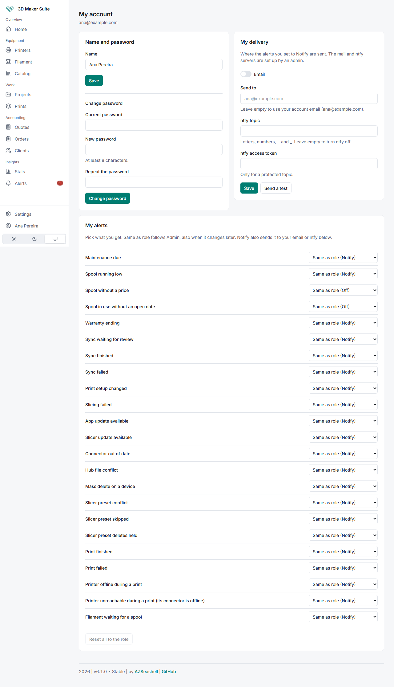

# My account

Your own name and password, where your alerts are sent, and which alerts you get.

Open it from the account menu: click your name at the bottom of the menu (the person icon on a narrow screen, or under **More** on a phone), then **My account**. The page is called **My account** and shows your email under the title. It has three cards: **Name and password**, **My delivery** and **My alerts**.

## Who can use it

Everyone who signs in, with any role. There is no right for this page, and it only ever changes your own account.

Without user accounts, nobody signs in and the page says **Nobody has to sign in right now, so there is no account to manage.** Turn accounts on in [Settings](Settings-General.md#user-accounts). Works the same with or without a hub.

## Before you start

You need to be signed in. To get alerts by email or ntfy, an admin must first set up the mail or ntfy server in [Alerts settings](Alerts-Settings.md).

## Name and password

The first form changes your name. The second changes your password.

| Field | What it means | Required | Example |
|---|---|---|---|
| **Name** | How your name shows in the app and in the logs. Up to 100 characters | Yes | `Sam` |
| **Current password** | Proves it's you | Yes, to change the password | |
| **New password** | At least 8 characters | Yes, to change the password | a long phrase |
| **Repeat the password** | Must match the new password | Yes, to change the password | |

Press **Save** under **Name**, and **Change password** under the password fields.

- A wrong current password shows **The current password is wrong.**
- Two different new passwords show **The two passwords don't match.**
- After a change, the page says **Password changed. Your other devices were signed out.** You stay signed in here.
- Your email can't be changed on this page. A user manager changes it on your user page, on the **Users** tab of **Settings**.

## My delivery

Where the alerts you set to **Notify** are sent. The card says **The mail and ntfy servers are set up by an admin.**

| Field | What it means | Required | Example |
|---|---|---|---|
| **Email** | Turns email on for you | No | On |
| **Send to** | The address to use. Leave empty to use your account email | No | `me@example.com` |
| **ntfy topic** | The ntfy topic of your phone or computer. Letters, numbers, `-` and `_`, up to 64. Leave empty to turn ntfy off | No | `sam-printers` |
| **ntfy access token** | Only for a protected topic. It is stored encrypted and never shown again | No | |
| **Remove the stored token** | Shown when a token is stored. Turn it on and press **Save** to delete it | No | |

Press **Save**, and the card says **Saved.** With a token stored, the box says **A token is stored. Type a new one to replace it.** Leave it empty to keep it.

**Send a test** sends a test message to each channel you turned on. For each one it says **Email: sent.** or **Email: failed.**, and the same for ntfy. If you have nothing on, it says **Nothing to test. Turn on email or set a topic, and ask an admin whether the servers are on.** Save before you test, because the test uses what is saved.

## My alerts

Pick what you get for each kind of alert. The card says **Pick what you get. Same as role follows {role}, also when it changes later. Notify also sends it to your email or ntfy below.**

Each kind has a list:

| Choice | What it does |
|---|---|
| **Same as role ({value})** | Follows your role, also when the role changes later. This is the starting point |
| **Off** | You don't get this alert |
| **In app** | It shows in [Alerts](Alerts.md) |
| **Notify** | It shows in the app and is also sent to your email or ntfy |

Only the kinds your role allows are listed. With none, the card says **This role gets no alerts.** A change saves as you pick it. **Reset all to the role** puts every kind back to **Same as role**.

## Common tasks

### Change your password

1. Open **My account**.
2. In **Name and password**, type **Current password**.
3. Type **New password** and **Repeat the password**.
4. Press **Change password**.

### Get alerts on your phone

1. Install the ntfy app on your phone and subscribe to a topic of your own.
2. In **My delivery**, type the topic in **ntfy topic** and press **Save**.
3. Press **Send a test**. The phone should ring.
4. In **My alerts**, set the kinds you want to **Notify**.

### Get alerts by email

1. In **My delivery**, turn on **Email**. Fill **Send to** if it isn't your account email.
2. Press **Save**, then **Send a test**.
3. In **My alerts**, set the kinds you want to **Notify**.

## Related settings

- [Alerts settings](Alerts-Settings.md) holds the thresholds and the email and ntfy servers.
- **Roles** sets the default for each kind of alert. **Same as role** follows it.
- [Settings](Settings-General.md) holds your language, units, date and time format, theme and accent.

## Limits and tips

- Changing your own role, rights or state isn't possible. Another user manager does that.
- Changing your password signs out every other device, not this one.
- An alert is sent once per person and channel. A destination that fails is tried again at a later check.
- Read, snooze and dismiss on [Alerts](Alerts.md) are yours alone.

## Problems and fixes

| What you see | What to do |
|---|---|
| **Nobody has to sign in right now, so there is no account to manage.** | User accounts are off. Turn them on in **Settings** |
| **The current password is wrong.** | Retype it. If you forgot it, ask an admin to reset it on the **Users** tab of **Settings** |
| **That didn't work. Try again.** | Check the connection, then try again |
| **Email: failed.** | The mail server isn't set up or can't be reached. Ask an admin to check [Alerts settings](Alerts-Settings.md) |
| **Nothing to test.** | Turn on **Email** or set an **ntfy topic**, then save |
| I get no email or ntfy message | Check that the kind is set to **Notify** in **My alerts**, and that **Email** or the topic is set |

## Related pages

- [Alerts](Alerts.md)
- [Alerts settings](Alerts-Settings.md)
- [Settings](Settings-General.md)
- [Sign in](Sign-In.md)
