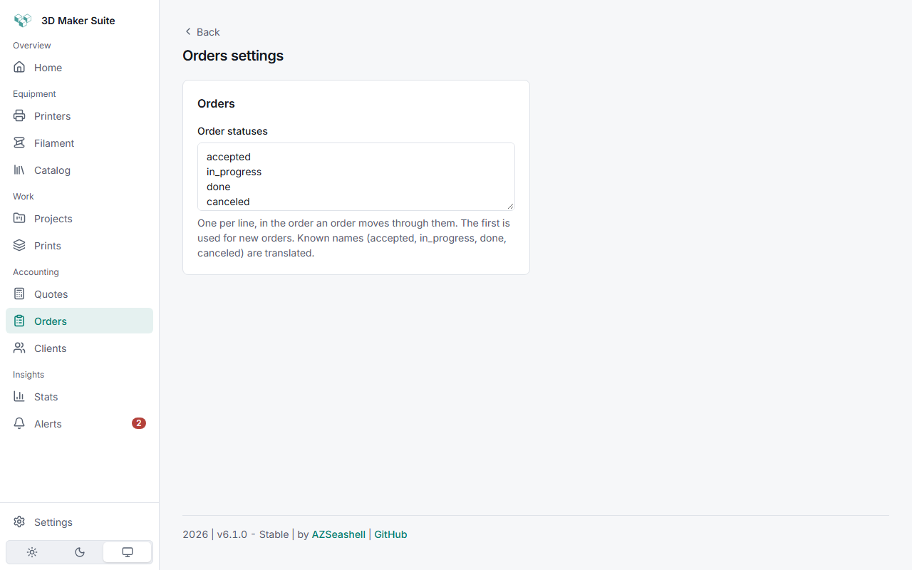

# Orders settings

The list of statuses an order moves through.



Open it with the gear button at the top right of [Orders](Orders.md). The back arrow returns to **Orders**. The page is called **Orders settings** and has one card, **Orders**. It has no tabs and no **Sources**, because orders are made here, not imported.

## Who can use it

| You can | You need |
|---|---|
| Open the page and change it | **Quotes, orders and clients** with **Manage** |

Someone without **Manage** doesn't get the gear and is sent back to **Orders**. The list saves as you leave the box. There is no save button. Works the same with or without a hub.

## Before you start

Nothing. The app comes with four statuses.

## Order statuses

| Field | What it means | Required | Example |
|---|---|---|---|
| **Order statuses** | One status per line, in the order an order moves through them. The first is used for new orders | Yes | `Quoted` |

The hint reads **One per line, in the order an order moves through them. The first is used for new orders. Known names (accepted, in_progress, done, canceled) are translated.**

The app starts with these, one per line:

```
accepted
in_progress
done
canceled
```

They show as **Accepted**, **In progress**, **Done** and **Canceled**. Any other line shows exactly as you typed it.

- Edit the lines, then click outside the box. The list is saved.
- Blank lines and repeated lines are dropped.
- The list can't be empty. If you clear it, the old list comes back.
- Put the status new orders should start with on the first line.
- The statuses are filters in the **Status** column of [Orders](Orders.md#orders-list), and the choices in the order form and on the order's page.

## Common tasks

### Add a status

1. Open **Orders**, then the gear.
2. Add a line in **Order statuses**, where it belongs in the order of work, for example `Waiting for payment`.
3. Click outside the box.

### Change which status starts an order

1. Move the status you want to the first line.
2. Click outside the box.

### Rename a status

1. Change its line. A built-in name such as `done` shows a translated label, so give a new name a clear one, for example `Delivered`.
2. Click outside the box.

## Limits and tips

- An order that has a status you removed keeps it. It still shows, and you can still pick it on that order, but it isn't in the lists of other orders.
- Renaming a line doesn't rename the status on orders that already have it. Those keep the old name. Change them one by one, or keep the old line.
- The built-in names are translated, so type them as written (`in_progress`, not `In progress`) to keep that.
- The list is shared by everyone who uses this server.

## Problems and fixes

| What you see | What to do |
|---|---|
| I cleared the box and the old list came back | The list can't be empty. Type the statuses you want |
| A status I removed still shows on an order | The order keeps it. Pick a new one on the order |
| No gear on **Orders** | Your role has no **Manage** on **Quotes, orders and clients** |

## Related pages

- [Orders](Orders.md)
- [Quotes settings](Quotes-Settings.md)
- [Clients](Clients.md)
