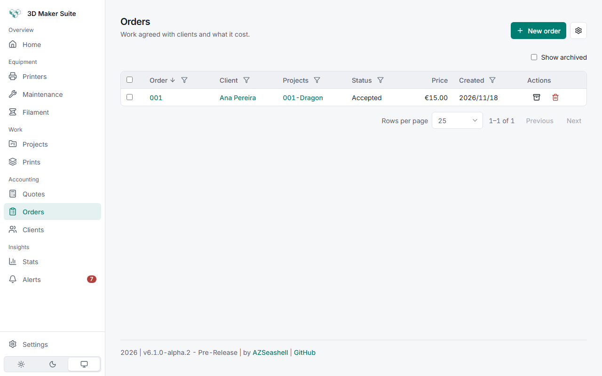
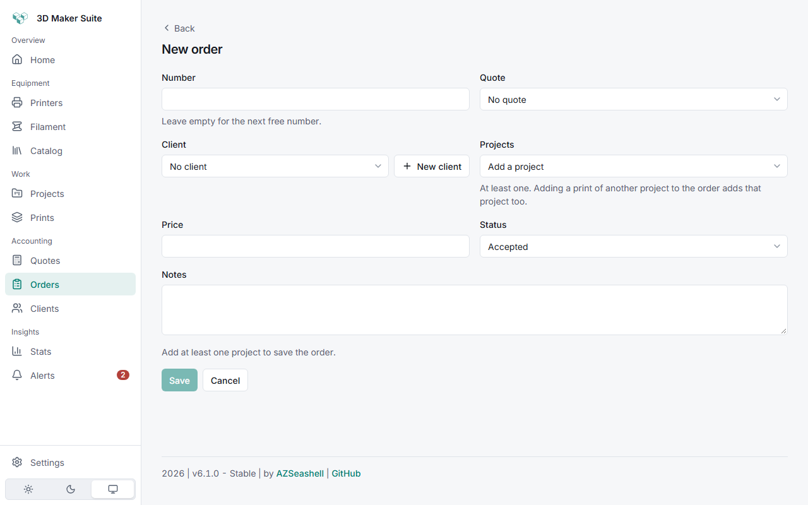
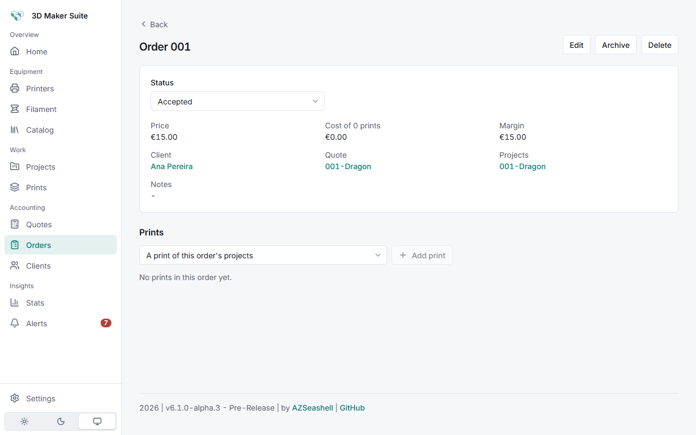

# Orders

Work you agreed to do for a client: the list of orders, the order form, and an order's page with its status, price, cost, margin and prints.

An order records what you will charge (**Price**), which projects it covers and who it is for. Prints you link to it add up to its cost, so the page shows your **Margin**. An order never changes a project, a print or a spool.

## Who can use it

The right is **Quotes, orders and clients** (it covers quotes and clients too).

| You can | You need |
|---|---|
| See the list and open an order | **Read** |
| Make an order, change it, change its status, archive, restore or delete it | **Write** |
| Add or remove its prints | **Write** on **Prints** too |
| Open the Orders settings | **Manage** |

Works the same with or without a hub.

## Before you start

- Add the projects the order is for. See [Projects](Projects.md).
- Add the client under [Clients](Clients.md), or add one from the form without leaving it.
- To start from a price, make a [quote](Quotes.md) first. You can also start an order from scratch.
- Check the statuses in [Orders settings](Orders-Settings.md).

## Orders list

Open **Orders**. With none saved, the page says **No orders yet.** The buttons at the top right are **New order** and the gear, which opens [Orders settings](Orders-Settings.md). Both need **Write**.

The table is called **Orders**:

| Column | What it shows |
|---|---|
| **Order** | The number with leading zeros, for example `007`. Opens the order. Sorts and filters by number |
| **Client** | The client, linked. Sorts, and filters by client |
| **Projects** | The projects of the order, each linked. Filters by project |
| **Status** | The status. Sorts, and filters by status |
| **Price** | What you charge for the order |
| **Created** | The date. Sorts and filters by date |

The list starts with the highest number first. Click a heading to sort. **Show archived**, archive, restore and delete work as on every list; see [Archive and delete](Archive-and-Delete.md). An order can't be deleted while prints belong to it. Archive it, or take the prints out first.

The same table, with its own filter, also shows on a [client's page](Clients.md#client-details) and a [project's page](Projects.md#saved-quotes-and-orders). A section there only shows when there are orders.

## Add or edit an order

**New order** opens the form, called **New order**. **Edit** on an order opens **Edit order**. On a wide screen the fields sit in two columns.

| Field | What it means | Required | Example |
|---|---|---|---|
| **Number** | The order's number. Leave it empty for the next free number. Another order may already have it, even an archived one: then you see **Another order has this number. It may be archived.** | No | `7` |
| **Quote** | The quote this order comes from, or **No quote**. Picking one fills what is still empty: its client, its project and its total as the price | No | `001-Dragon` |
| **Client** | **No client** or one of your clients. **New client** adds one without leaving the form | No | `Ana Pereira` |
| **Projects** | The projects the order covers. At least one. Pick one from **Add a project**, and remove one with the **×** on its chip. Adding a print of another project to the order adds that project too | Yes | `Dragon` |
| **Price** | What you charge, in your currency | Yes | `24.21` |
| **Status** | One of the statuses in [Orders settings](Orders-Settings.md). A new order starts at the first | Yes | `Accepted` |
| **Notes** | Anything you want to remember | No | `Pick up on Friday` |

- **Save** saves the order and opens its page. **Cancel** goes back.
- **Save** stays off, and the form says **Add at least one project to save the order.**, until there is a project.
- Removing a project that still has prints in the order gives **A project you removed still has prints in this order. Remove those prints first.**
- **Couldn't save the order.** means the server refused it. Try again.
- The quote list and the client list show the newest 100.

### Start from a quote

Open a quote and press **Create order**. The form opens with the quote picked, and its client, its project and its total already filled in. Change anything, then press **Save**. See [A saved quote's page](Quotes.md#a-saved-quotes-page).

## Order details

Open an order from the list. The title is its name, for example **Order 007**, with an **Archived** badge when it is archived. The header has **Edit**, and **Archive** and **Delete**, with **Write**.

### Status

The **Status** box at the top of the card changes the status at once, without the form. It lists the statuses of [Orders settings](Orders-Settings.md). If the order has a status you later removed from the list, it still shows and stays pickable.

### Price, cost and margin

| Item | What it shows |
|---|---|
| **Price** | What you charge for the order |
| **Cost of 3 prints** | The cost of the prints linked to the order: material, energy, wear and maintenance of each, added up. The label follows the count: **Cost of 1 print**, **Cost of 3 prints** |
| **Margin** | The price minus that cost. It shows in red when the cost is higher than the price |
| **Client** | The client, as a link, or `-` |
| **Quote** | The quote it came from, as a link, or `-` |
| **Projects** | Each project, linked |
| **Notes** | Your notes |

The cost uses what each print saved. It only counts prints you linked, so a margin with no prints is the whole price. See [Prints](Prints.md#print-details) for how a print's cost is made.

### Prints

The **Prints** section lists the prints that belong to the order, as the table on the [Prints](Prints.md) page, with its own filter and sorting. Without any, it says **No prints in this order yet.**

- **A print of this order's projects** lists prints of the order's projects that have no order yet, the newest 100. Pick one and press **Add print**.
- The button with a broken link on a row (**Remove … from the order**) takes the print out of the order. The print stays.
- If that was the last print of a project and the order has other projects, a box asks **Remove the project too?** It says the order has no prints of that project left. **Remove project** takes the project off the order, and the other button leaves it.

A print can also join an order from its own form: see the **Order** field in [Prints](Prints.md#add-or-edit-a-print).

## Worked example

You quoted a dragon print for `24.21` for 3 prints, and the client accepted.

1. Open the quote and press **Create order**. The **Price** is `24.21`.
2. Save. The status is **Accepted** and the cost is `0.00` for 0 prints, so the margin is `24.21`.
3. As the 3 prints finish, give each the order in its form. Say they cost `1.31` each.
4. The page now reads **Cost of 3 prints** `3.93` and **Margin** `20.28`.
5. Set the status to **Done**.

## Common tasks

### Make an order from a quote

1. Open the quote, then press **Create order**.
2. Check the order, then press **Save**.

### Make an order with no quote

1. Open **Orders**, then **New order**.
2. Pick the client and add at least one project.
3. Type the **Price**, check the **Status**, then press **Save**.

### Move an order along

1. Open the order.
2. Pick the next status in **Status**. It saves at once.

### Link a print to an order

1. Open the order and go to **Prints**.
2. Pick the print in **A print of this order's projects**, then press **Add print**.

### Stop tracking an order

1. Open the order.
2. Press **Archive**, or set the status to **Canceled**. Archive hides it from the list, and **Show archived** brings it back.

## Related settings

- [Orders settings](Orders-Settings.md) has the list of statuses.
- [Quotes settings](Quotes-Settings.md) has the costs behind the cost of each print.

## Limits and tips

- The margin only counts prints linked to the order. Link every print before you read it.
- A print belongs to one order. Picking an order on a print moves it from the old one.
- An order needs at least one project, but a project doesn't need to have prints.
- A client or quote that an order uses can't be deleted. Archive it instead; the order keeps pointing at it.
- Money is shown in the currency of the settings.

## Problems and fixes

| What you see | What to do |
|---|---|
| **This doesn't exist, or you can't open it.** | It was deleted. Go back to **Orders** |
| **Another order has this number. It may be archived.** | Pick another number, or leave **Number** empty. **Show archived** finds the other order |
| **A project you removed still has prints in this order. Remove those prints first.** | Take its prints out of the order, then remove the project |
| **Add at least one project to save the order.** | Add a project in the **Projects** field |
| **Couldn't save the order.** | Try again. The server log has the reason |
| An order can't be deleted | Prints belong to it. Remove them from the order, or archive it. See [Archive and delete](Archive-and-Delete.md) |
| The margin looks too high | Not every print is linked to the order yet |
| No **New order** button | Your role has no **Write** on **Quotes, orders and clients** |

## Related pages

- [Orders settings](Orders-Settings.md)
- [Clients](Clients.md)
- [Quotes](Quotes.md)
- [Projects](Projects.md)
- [Prints](Prints.md)
