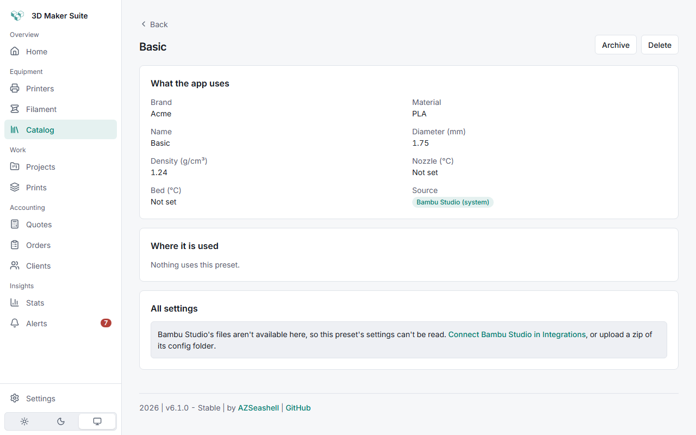
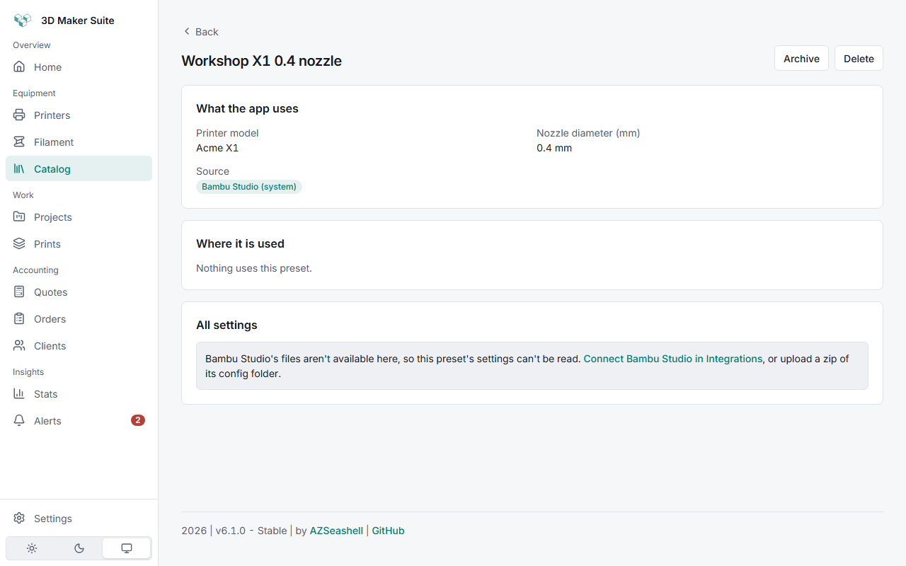
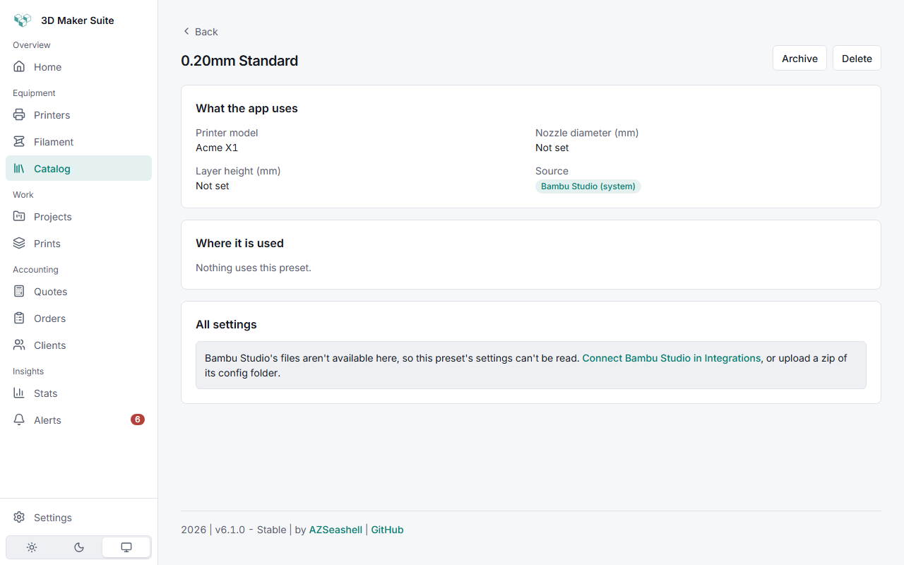

# Presets

The slicer settings the app knows about: printer presets, process presets and filament presets, how they arrive, and a preset's own page.

A preset is a saved set of slicer settings, such as `0.20mm Standard @BBL A1` or `Bambu PLA Basic`. The app reads presets from your slicer's files. It does not make them and it does not edit them: you change a preset in the slicer. The app uses a preset to know which printer, nozzle, layer height and filament a slice or a print used.

## Who can use it

| You can | You need |
|---|---|
| See the preset tables and a preset's page | **Catalog** with **Read** |
| Archive, restore or delete a preset | **Catalog** with **Manage** |
| Delete or restore a preset in the preset library | **Catalog** with **Write**, with a hub |

## The three kinds

| Kind | What it holds | Where you see it |
|---|---|---|
| Printer presets | A printer's settings in the slicer: its model and nozzle | **Catalog → Printers → Printer presets** |
| Process presets | How to print: layer height and quality settings | **Catalog → Printers → Process presets** |
| Filament presets | A filament's settings: brand, material, temperatures | **Catalog → Filament → Filament presets** |

Every preset is either a **system** preset, which the slicer ships, or a **user** preset, which someone made in the slicer. The **Source** column says which. See [Catalog](Catalog.md#the-source-column).

## How presets arrive

Presets come only from a slicer. There is no add button. Under the preset tables, the box **How presets arrive** says how:

- **Connect a slicer in Integrations.** The slicer on the server, or on a computer paired with the hub, shares its presets.
- **Upload a zip of the slicer's config folder.** The link leads to the zip upload on [Catalog settings](Catalog-Settings.md#sources).

**Where is the config folder, and what do I zip?** opens the steps for each slicer on Windows, macOS and Linux.

After the first import, the app re-reads the files when the slicer's files change, or when you press **Sync**. A slicer update that adds new system presets is picked up the same way.

## Printer presets

The table **Printer presets** under **Catalog → Printers**.

| Column | What it shows |
|---|---|
| **Name** | The preset. It opens [its page](#the-preset-page) |
| **Printer model** | The model the preset is for |
| **Brand** | The model's brand |
| **Nozzle diameter (mm)** | The nozzle the preset is for |
| **Source** | Where it came from |
| **In use** | **In use** with a green dot, or **Unused** |
| The last column | **Archive** or **Restore**, and the selection checkbox |

## Process presets

The table **Process presets** under **Catalog → Printers**. It has the same columns as printer presets, with **Layer height (mm)** after the nozzle.

## Filament presets

The table **Filament presets** under **Catalog → Filament**.

| Column | What it shows |
|---|---|
| **Filament** | The preset's name, made of its brand, material and name. It opens its page |
| **Brand** | The filament brand |
| **Material** | The material |
| **Nozzle (°C) / Bed (°C)** | The temperatures, for example `220 / 60 °C` |
| **Source** | Where it came from |
| **In use** | **In use** or **Unused** |
| The last column | **Archive** or **Restore**, and the selection checkbox |

### What In use means

**In use** means a plate, a printer, a print or an older version of a slicer file still uses the preset. **Unused** means nothing does. You can filter by it to find presets that are safe to archive.

## The preset page

Open a preset from its name. The back arrow returns to the table it is in. A preset can be archived or deleted from here, with **Manage**. The page is read only. To change a preset, change it in the slicer.

The page has three cards.

### What the app uses

The fields the app takes from the preset.

| Kind | Fields |
|---|---|
| Printer preset | **Printer model**, **Nozzle diameter (mm)** |
| Process preset | **Printer model**, **Nozzle diameter (mm)**, **Layer height (mm)** |
| Filament preset | **Brand**, **Material**, **Name**, **Diameter (mm)**, **Density (g/cm³)**, **Nozzle (°C)**, **Bed (°C)** |

Every preset also shows its **Source**. A user preset that is in the hub's preset library has the link **Open in the preset library**. An archived preset shows an **Archived** label.

### Where it is used

Lists what uses the preset, such as printers, plates and prints. If nothing does, it says **Nothing uses this preset.** A preset that is used can't be deleted. See [Archive and delete](Archive-and-Delete.md).

### All settings

Every setting in the preset's own file, not only the ones the app uses.

- **Search settings and values** filters the list. A line says how many settings show, for example `12 of 340 settings`.
- **Show settings from** chooses between **All** and **This preset**. A preset is often built on a parent preset, and **All** shows the values it gets from it. The **From** column says where each value comes from.
- **Show all** and **Show less** fold long values.
- **Download JSON** saves the settings as a file.

The card can show a message instead:

| Message | What it means |
|---|---|
| **Reading the preset's file…** | Wait a moment |
| **This preset was made by hand in an older version, so it has no file to read.** | Nothing to show. It was made before presets came only from a slicer |
| **{slicer}'s files aren't available here, so this preset's settings can't be read.** | Press **Connect {slicer} in Integrations**, or upload a zip of its config folder |
| The slicer no longer has this preset | It was renamed or removed in the slicer |
| The parent preset is not in the slicer's files | The values it would give are missing |
| A number of rows wait for your review | The slicer's files changed. What shows is the file's current settings, so it may differ from what the app uses above |

## Common tasks

### Find out why a preset is in the list

1. Open the preset from **Catalog**.
2. Read **Source**, and **Where it is used**.

### Hide a preset you don't use

1. Open **Catalog**, then the preset's table.
2. Press **Archive** on its row, or on its page.
3. It is no longer offered in pickers. **Restore** brings it back.

### See every setting of a preset

1. Open the preset's page.
2. Under **All settings**, search or press **Download JSON**.

## Related settings

- [Catalog settings](Catalog-Settings.md) has the sources, the consumers and the preset library.

## Limits and tips

- Presets are read only. The app never writes a change back to a slicer from this page.
- An archived preset is hidden from pickers but stays on what uses it.
- An item you deleted that came from an import shows **You deleted this** in the next review. See [Archive and delete](Archive-and-Delete.md#deleted-by-an-import).

## Problems and fixes

| What you see | What to do |
|---|---|
| The tables have no presets | Connect a slicer or upload its zip. See [How presets arrive](#how-presets-arrive) |
| **Preset not found.** | The preset was deleted. Go back to the table |
| **Could not read the settings. Try again in a moment.** | Reload. If it stays, check the slicer's files |
| A preset can't be deleted | Something uses it. Archive it instead |

## Related pages

- [Catalog](Catalog.md)
- [Catalog settings](Catalog-Settings.md)
- [Sources and sync](Sources-and-Sync.md)
- [Archive and delete](Archive-and-Delete.md)
