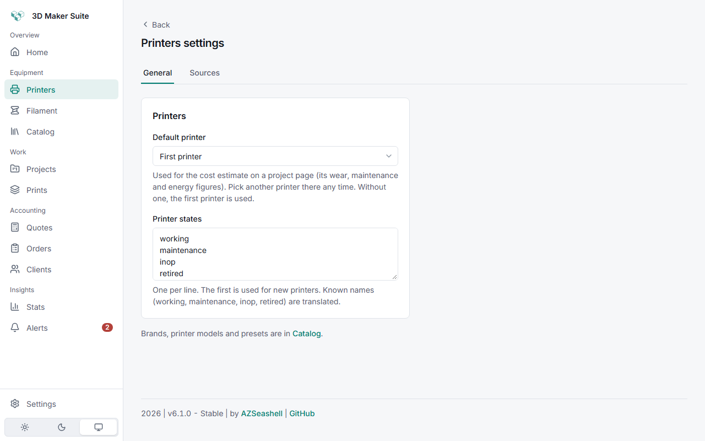
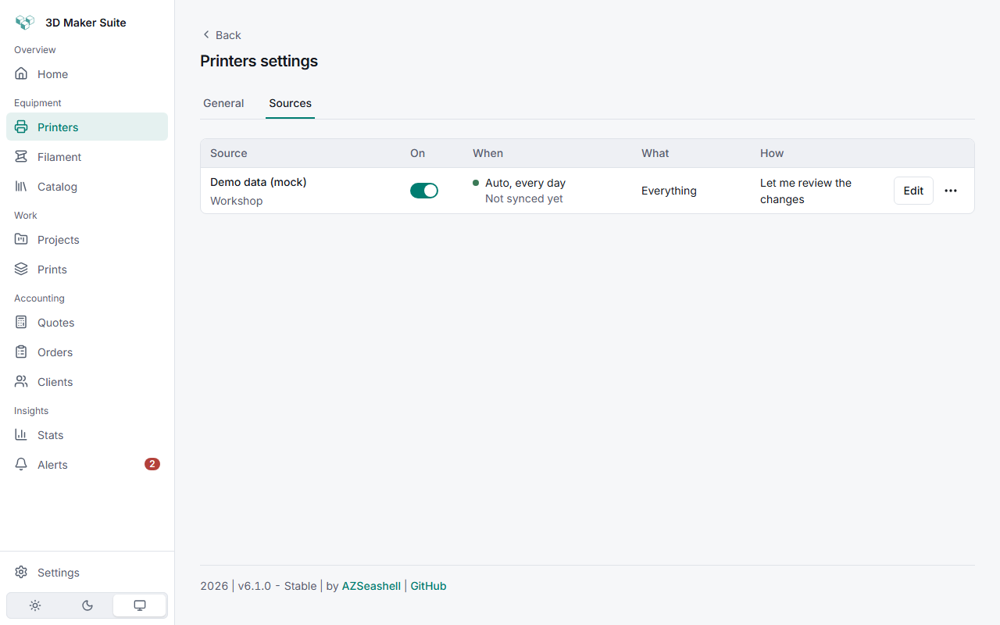

# Printers settings

The settings of the **Printers** page: which printer the cost estimate uses, the list of printer states, and where printers come from.

Open it with the gear button at the top right of **Printers**. It has two tabs, **General** and **Sources**. The back arrow returns to **Printers**.

## Who can use it

| You can | You need |
|---|---|
| Open **General** and change it | **Printers** with **Manage** |
| Open **Sources** | **Printers** with **Manage**, or the **Run syncs** or **Review imports** right on a source that feeds printers |

Someone who has only the sync or review right sees the gear open **Sources** and no **General** tab. Changes save as you leave a field. There is no save button.

## General

### Printers

| Field | What it means | Required | Example |
|---|---|---|---|
| **Default printer** | The printer used for the cost estimate on a project page (its wear, maintenance and energy figures). You can pick another printer on that page at any time. **First printer** uses the first one in the list | No | `Workshop X1` |
| **Printer states** | The states a printer or accessory can have, one per line. The first one is used for new printers. The known names `working`, `maintenance`, `inop` and `retired` show as **Working**, **Maintenance**, **Out of order** and **Retired**. Blank lines and repeats are dropped, and the list is never empty | Yes | `working` |

A state you remove from the list stays on the printers that have it, and they can keep it. You just can't pick it for another printer.

A line under the cards links to the Catalog, where printer brands, models and presets moved.

## Sources

The **Sources** tab lists the accounts that can bring printers in, such as Bambu Cloud. Each line is **Printers** from one source, with when it syncs and what it syncs. You switch a source on in **Settings → Integrations**. If none is on, the tab says **No sources** and that printers here are added by hand.

How a line works is explained once, on [Sources and sync](Sources-and-Sync.md): **Auto** and **Manual**, **Sync now**, **What to sync**, **Review and import** and the sync log.

Printers that are read on your network (Bambu LAN, Moonraker, PrusaLink, OctoPrint) are not synced. Their card in **Settings → Integrations** gives live status instead. See [Printers](Printers.md#connection-and-monitoring).

## Common tasks

### Add a state

1. Open **Printers**, then the gear.
2. Under **Printer states**, add a line, for example `Loaned out`.
3. Click outside the field. It is saved.

### Choose the printer for cost estimates

1. Open the gear.
2. In **Default printer**, pick the printer.

## Related settings

- **Settings → Costs** has the energy price and the printer and accessory lifetime.
- The review level of prints is in **Prints → Settings**.

## Limits and tips

- Renaming a state line makes a new state. Printers that had the old one keep it.
- A project page can use another printer for one estimate, without changing this setting.

## Problems and fixes

| What you see | What to do |
|---|---|
| The gear doesn't show | Your role has no **Manage** on **Printers** and no sync or review right |
| **No sources** on the Sources tab | Switch on **Printers** for an account in **Settings → Integrations**, or add printers by hand |
| The settings page can't load | Check that the app is running and reload |

## Related pages

- [Printers](Printers.md)
- [Sources and sync](Sources-and-Sync.md)
- [Dashboard](Dashboard.md)
