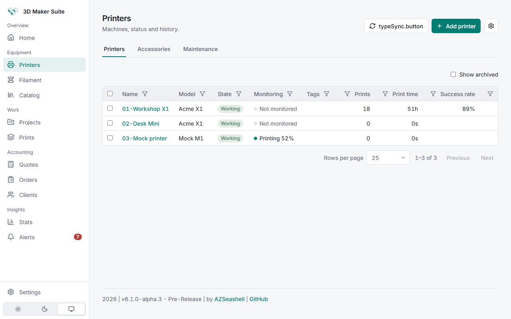
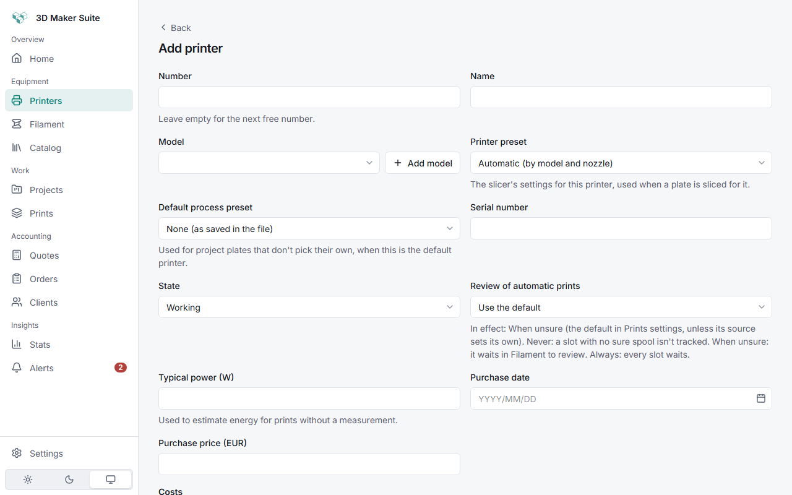
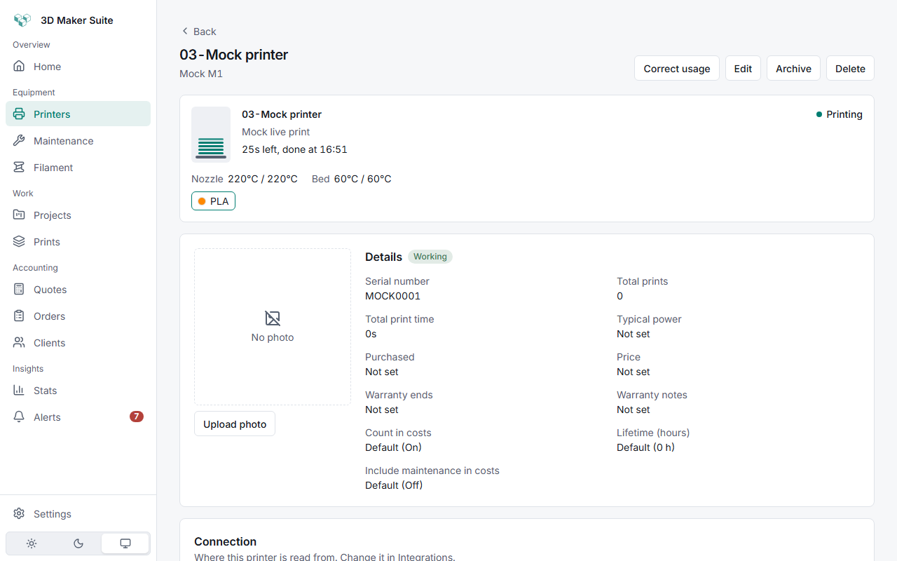

# Printers

Your printers: the list, adding and editing one, and a printer's own page with its live status, usage, costs, loaded spools, accessories and notes.

The **Printers** page has three tabs: **Printers**, **Accessories** and **Maintenance**. This page covers the **Printers** tab and a printer's page. The other two tabs have their own pages: [Accessories](Accessories.md) and [Maintenance](Maintenance.md). The gear button has [Printers settings](Printers-Settings.md).

## Who can use it

| You can | You need |
|---|---|
| See the list and a printer's page | **Printers** with **Read** |
| Install or remove an accessory on a printer | **Printers** with **Write** |
| Add, edit, archive, restore or delete a printer. Correct usage, set photos, loaded spools and notes | **Printers** with **Manage** |
| Press **Sync** | The **Run syncs** right, and a source with **Printers** on **Auto** |
| See where a printer is read from, with an **Edit in Integrations** link | **Integrations** |

Someone who can read only **Maintenance** opens the page on that tab. Works the same with or without a hub.

## Before you start

- A printer needs a **Model**. Models come from the catalog, and you can add a model while you add the printer. If you use Bambu Cloud, the printer and its model can come in by a sync instead. See [Sources and sync](Sources-and-Sync.md).
- For live status, a source on your network has to read the printer. See [Connection and monitoring](#connection-and-monitoring).

## Printers list

The **Printers** tab lists every printer. The buttons at the top right are:

| Button | What it does |
|---|---|
| **Sync** | Syncs the printers of every source that has **Printers** on **Auto**. Not shown when there is none. See [Sources and sync](Sources-and-Sync.md#sync-now-and-the-sync-button) |
| **Add printer** | Opens [the add form](#add-or-edit-a-printer) |
| The gear | Opens [Printers settings](Printers-Settings.md) |

With no printers yet, the page says **No printers yet** and shows the same buttons.

### Columns

| Column | What it shows |
|---|---|
| **Name** | The printer. It opens the printer's page |
| **Model** | Brand and model |
| **State** | **Working**, **Maintenance**, **Out of order**, **Retired**, or a state you added |
| **Monitoring** | Whether the app can see the printer right now. See [Connection and monitoring](#connection-and-monitoring) |
| **Tags** | The printer's tags, when tags are on |
| **Prints** | How many prints are logged on it, with corrections |
| **Print time** | Total print time |
| **Success rate** | Share of finished prints that succeeded |
| **Power** | Typical power in watts |
| The last column | **Archive** or **Restore** for the row, and the selection checkbox |

Sort by pressing a column header. Each column has a filter too. **Monitoring** can be filtered by **Not monitored**, **Synced only**, **Idle**, **Printing**, **Paused**, **Offline**, **Machine offline** and **Source error**. **State** is filtered by your states.

Rows never jump by themselves. While the list is sorted or filtered by **Monitoring** and a printer's state changes, a message says **Some printers' states changed.** Press **Refresh the list** to reload it.

**Show archived** finds archived printers. A person with **Manage** can tick rows to archive, restore or delete many at once. How these work, and what blocks a delete, is on [Archive and delete](Archive-and-Delete.md).

## Add or edit a printer

**Add printer** opens the form. **Edit**, on a printer's page, opens the same form with the printer's values. **Save** goes to the printer's page. **Cancel** goes back.

### Fields

| Field | What it means | Required | Example |
|---|---|---|---|
| **Number** | The printer's number. Leave it empty on a new printer for the next free one. Another printer, even an archived one, can't have the same number | No | `3` |
| **Name** | What you call it | Yes | `Workshop X1` |
| **Model** | A model of the catalog. **Add model** next to it adds a brand and a model from here. A model fills **Typical power (W)** when that is empty | Yes | `Bambu Lab A1` |
| **Printer preset** | The slicer's settings for this printer, used when a plate is sliced for it. **Automatic (by model and nozzle)** lets the app choose. Picking one sets the printer's nozzle to the preset's nozzle, and the form says so | No | `Automatic` |
| **Default process preset** | The slicer's print settings used for project plates that don't pick their own, when this is the default printer. Presets for the model are listed first | No | `0.20mm Standard` |
| **Serial number** | The printer's serial. When a source gives it, such as Bambu LAN or Bambu Cloud, the field is read-only and says **From** that source | No | `01P00A123456789` |
| **State** | Where the printer is in its life. The list is in [Printers settings](Printers-Settings.md#general) | Yes | **Working** |
| **Review of automatic prints** | How much of the printer's prints wait in **Filament to review**. **Use the default** follows the source, then the global level | No | **Use the default** |
| **Typical power (W)** | Used to estimate the energy of prints with no measurement | No | `120` |
| **Purchase date** | When you got it | No | `2026-03-04` |
| **Purchase price (EUR)** | In your currency, which the label shows. Spread over its lifetime as wear in costs | No | `349.00` |
| **Warranty ends** | The end of the warranty | No | `2028-03-04` |
| **Warranty notes** | Free text | No | `Shop receipt in the drawer` |
| **Tags** | Labels you pick, when tags are on | No | |

**Costs** is a group of three fields. Each one is **Default (…)**, which uses the value from the cost settings and shows it, or your own value:

| Field | What it means |
|---|---|
| **Count in costs** | **Off** leaves this printer's wear and maintenance out of costs. Its accessories follow their own setting |
| **Lifetime (hours)** | The purchase price is spread over these hours as wear. `0` leaves wear out. Empty uses the default |
| **Include maintenance in costs** | Spreads what you logged on maintenance tasks over the runtime |

If the number is taken, the form says **Another printer already has this number. It may be archived.**

## Printer details

A printer's page has the printer's name as its title, with its model under it and an **Archived** badge when it is archived. The back arrow goes to the list.

At the top right, for people with **Manage**:

| Button | What it does |
|---|---|
| **Correct usage** | Opens [Correct usage](#correct-usage) |
| **Edit** | Opens the form |
| **Archive** or **Restore**, and **Delete** | See [Archive and delete](Archive-and-Delete.md) |

The page is a stack of cards, in this order.

### Live status

Shown when a source reports what the printer is doing. It is the same card as on the [Dashboard](Dashboard.md#the-widgets).

- The state: **Offline**, **Idle**, **Preparing**, **Printing**, **Paused**, **Finished**, **Cancelled** or **Failed**.
- A stack of layers that fills from the bottom as the print goes on. It follows the layers when the printer counts them, and the percent if not.
- The job's title, the time left and when it will be done. For a failed print, the reason.
- **Nozzle**, **Bed** and **Chamber** temperatures, with the target after the slash.
- A chip per **Filament** slot, with its colour and material. A slot that feeds the print has a coloured border.
- **Through** and a machine name when the printer is reached through a [connector](Connector-Setup.md).

An offline printer says **Not answering. Its last print is kept until it is back.** When its machine is offline, it says **Can't be reached: the connector on … is offline.** A print that ends meanwhile is recorded when the machine is back.

Status is read-only. The app never controls a printer. It refreshes by itself: every 3 seconds while the printer prepares, prints or is paused, and every 15 seconds otherwise.

### Details

The photo, with **Upload photo** and **Remove photo** for people with **Manage**. A printer with no photo of its own shows its model's picture, and **No photo** when there is none. The card's title carries the printer's state, such as **Working**. Next to the photo, in a list: **Serial number**, **Total prints** and **Total print time** (the lifetime totals, with corrections), **Typical power**, **Purchased**, **Price**, **Warranty ends**, **Warranty notes** and the three **Costs** values. A value that isn't set says **Not set**.

### Connection

Where this printer is read from, one block per source. Nothing here can be edited. See [Connection and monitoring](#connection-and-monitoring).

### Usage

The numbers for the printer: **Prints**, **Print time**, **Energy** and **Success rate**, with how many succeeded, failed and were cancelled. A date range above them changes the period. Energy uses **Typical power (W)** for prints with no measurement.

### Loaded spools

For each filament slot, the spool loaded in it. A new print on a slot uses up the spool loaded in it. If the printer reports another material for the slot, the print waits in **Filament to review**.

- Pick a spool in a slot, **Clear** it, or add **Another slot** for a printer with no slot list.
- A printer that reads its slots loads the matching spool itself. The slot then says **Loaded by the printer**.
- When several spools fit, the slot says **Probably …**, and **Accept** loads it as your choice.
- A spool you picked stays until the printer reads another spool's tag in that slot.

Slots are named as the printer numbers them: **Slot 1** and up, **Single-slot unit 1** and up for a unit with one slot, and **External spool** for the spool outside any unit. Setting a loaded spool needs **Manage**. This card is not shown on an archived printer.

### Accessories

The accessories installed on this printer, with their type, the date they were put on and their state. Each name opens the accessory.

1. Press **Add accessory**. This lists accessories that are not on a printer. If all are in use, it says so.
2. Choose the **Accessory** and the **Installed on** date. Add a **Removed on** date only to record a past period.
3. Press **Add**.

**Remove** asks for the removal date. The accessory stays in its history with that date. Both need **Write**.

### Maintenance history

Every record logged for this printer is listed here, newest first: **Date**, **Done by**, **Cost**, **Usage then** (print hours and prints at that date) and **Notes**. **Done by** is empty for records made before 6.2.0 and for imported ones. See [Maintenance history](Maintenance.md#maintenance-history) for editing and deleting a record.

### Notes

Free notes, for example `X axis clicking, part ordered`.

1. Type in **Add a note**, then press **Add note**.
2. **Pin** keeps a note at the top. **Mark resolved** greys it out, and **Reopen** brings it back. **Delete** removes it.

Notes need **Manage**.

## Correct usage

Use this when the counted numbers are off, for example a printer bought used, prints made before you started logging, or a counter read off the machine.

1. On the printer's page, press **Correct usage**.
2. Under **Corrected**, type the real **Print hours** and **Prints**. **Counted** shows what the app counted.
3. Add a **Note** if you want, for example where the numbers come from.
4. Press **Save usage**.

The app saves the difference as a correction. Prints you log later add on top. **Corrections** lists every one with its note. The totals, costs and maintenance due dates use the corrected numbers at once. Maintenance already logged keeps the numbers it had when it was done.

## Connection and monitoring

The **Monitoring** column says whether the app can see each printer right now.

| Monitoring | Meaning | What to do |
|---|---|---|
| **Not monitored** | No source reads the printer, or its integration is paused | Add the printer's integration, or resume it in **Settings → Integrations** |
| **Synced only** | Every source only syncs the printer and its prints on a schedule and gives no live status. Bambu Cloud alone is like this | Nothing is wrong. For live status add a source on your network, for a Bambu printer **Bambu LAN** |
| **Idle**, **Printing 45 %**, **Paused** | The printer answers. This is what it is doing | Nothing |
| **Checking…** | A source has just started and hasn't read the printer yet | Wait a few seconds |
| **Offline** | The printer doesn't answer, or its source fails for another reason | Check that it is on, on the network, and that the address is right |
| **Machine offline** | The printer is reached through a computer whose connector is offline | Start the connector there. See [Connector setup](Connector-Setup.md) |
| **Source error** | The source refuses its access code or key, or the account is signed out | Press **Edit in Integrations** and enter it again |

A printer with several sources shows the best one. A source that sees the printer wins over one that doesn't.

The **Connection** card on the printer's page has one block per source: the source and its **Address**, **Credentials** (only that one is set, such as **Access code: set**, never its value), **Reached from** (**This server**, or the machine with **(online)** or **(offline)**), whether it is **Paused**, the **Last sync** and the **Monitoring** state with what to do about it. **Edit in Integrations** opens the source. Without the **Integrations** right, the address and the credentials line are left out.

Which printers can report status depends on the source. Klipper printers report through [Moonraker](Moonraker.md), Bambu Lab printers through [Bambu LAN](Bambu-LAN.md), and Prusa printers through [PrusaLink](PrusaLink.md). Any printer behind [OctoPrint](OctoPrint.md) does too. See [Supported printers](Integrations.md#supported-printers).

## Common tasks

### Add a printer by hand

1. Open **Printers** and press **Add printer**.
2. Type the **Name** and pick the **Model**. Add the model first if it isn't there.
3. Fill in what you know, such as **Purchase price**.
4. Press **Save**.

### Put a printer out of use

1. Open the printer and press **Edit**.
2. Set **State** to **Out of order** or **Retired**.
3. Press **Save**. Or press **Archive** to hide it from lists and pickers. See [Archive and delete](Archive-and-Delete.md).

### Count a second-hand printer's old prints

1. Open the printer and press **Correct usage**.
2. Type the hours and prints from its display.
3. Press **Save usage**.

## Related settings

- **Printers → Settings**: the default printer and the printer states. See [Printers settings](Printers-Settings.md).
- [Quotes settings](Quotes-Settings.md): the lifetime and the default for **Count in costs** and **Include maintenance in costs**.
- **Prints → Settings**: the review level for everyone.

## Limits and tips

- A printer on the network is one printer, however many sources read it. Bambu Cloud and Bambu LAN make one, not two.
- A source never renames a printer. Rename it on its page, with **Edit**.
- Archiving is blocked while accessories are installed on the printer. Remove them first.
- A printer's **Delete** is blocked while prints or maintenance records use it. Archive it instead.

## Problems and fixes

| What you see | What to do |
|---|---|
| **Couldn't load printers. Is the server running?** | Check that the app is running, then reload the page |
| **This doesn't exist, or you can't open it.** | It was deleted. Go back to the list |
| **Another printer already has this number.** | Pick another number, or look in **Show archived** |
| A printer says **Synced only** and you want live status | Add a source on your network. See [Sources and sync](Sources-and-Sync.md) |
| A print is not charged to a spool | It waits in **Filament to review**. Load the right spool in the slot |
| Many things are wrong | See [Troubleshooting](Troubleshooting.md) |

## Related pages

- [Printers settings](Printers-Settings.md)
- [Dashboard](Dashboard.md)
- [Sources and sync](Sources-and-Sync.md)
- [Archive and delete](Archive-and-Delete.md)
- [Hub setup](Hub-Setup.md) and [Connector setup](Connector-Setup.md)
