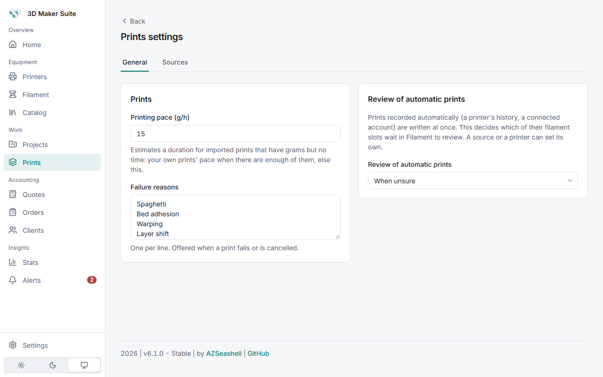
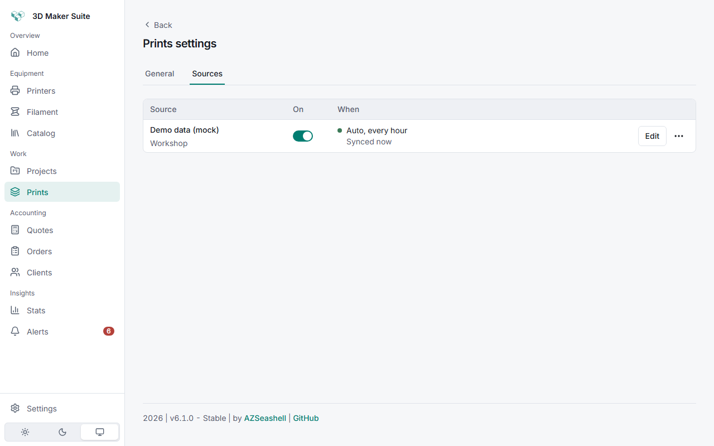

# Prints settings

The settings of the **Prints** page: the pace used to estimate durations, the failure reasons, how much filament waits for review, and where prints come from.

Open it with the gear button at the top right of **Prints**. It has two tabs, **General** and **Sources**. The back arrow returns to **Prints**.

## Who can use it

| You can | You need |
|---|---|
| Open **General** and change it | **Prints** with **Manage** |
| Open **Sources** | **Prints** with **Manage**, or the **Run syncs** or **Review imports** right on a source that feeds prints |

Someone who has only the sync or review right sees the gear open **Sources** and no **General** tab. Changes save as you leave a field. There is no save button.

## General

### Prints

| Field | What it means | Required | Example |
|---|---|---|---|
| **Printing pace (g/h)** | Estimates a duration for imported prints that have grams but no time. The app uses your own prints' pace when there are enough of them, else this number | Yes | `15` |
| **Failure reasons** | The reasons offered when a print fails or is cancelled, one per line. Blank lines and repeats are dropped | No | `Spaghetti` |

A reason you remove stays on the prints that have it.

### Review of automatic prints

The card is called **Review of automatic prints**. It says that prints recorded automatically (a printer's history, a connected account) are written at once, and that this setting decides which of their filament slots wait in **Filament** to review.

| Field | What it means | Required | Example |
|---|---|---|---|
| **Review of automatic prints** | **Never**: a slot with no sure spool isn't tracked. **When unsure**: it waits in [Filament review](Filament-Review.md). **Always**: every slot waits | Yes | **When unsure** |

A source or a printer can set its own level, which wins over this one. The table of what each level does is on [Filament review](Filament-Review.md#review-level).

## Sources

The **Sources** tab lists every source that brings prints in. With none on, it says **No sources** and that prints here are added by hand. Switch a source on in **Settings → Integrations**.

How a line works is explained once, on [Sources and sync](Sources-and-Sync.md): **Auto** and **Manual**, **Sync now**, **Review and import** and the sync log. Print history has no **What to sync** option, because an imported print never changes.

| Source | How its prints arrive |
|---|---|
| Bambu Cloud | From the account's history, on the line's schedule |
| Moonraker | Live as each print ends, and from its history on the line's schedule |
| Bambu LAN, PrusaLink, OctoPrint | Live as each print ends. The line says **Recorded live as each print ends** and has no schedule |

### Record prints

A printer on your network has its own line, **Record prints from** the printer's source. Its switch decides whether the printer records prints.

- Off: the line says **Not recorded. Live status goes on.** No print is recorded. The printer's live status, its alerts and the dashboard carry on. Prints you already have stay.
- A printer with **Live status** off can't record live, and its line says **Live status is off, so no print is recorded.** Switch live status on first.
- When you switch it on again, recording starts from that moment. Prints from the time it was off don't come in by themselves. Moonraker keeps its history, so **Review and import** can bring those in. Bambu LAN, PrusaLink and OctoPrint keep no history the app can read.
- If Bambu Cloud and Bambu LAN both feed the same printer, they are two lines. To stop the printer's prints completely, switch off both.

### Edit a line

**Edit** on a line sets:

| Field | What it means |
|---|---|
| **Review of automatic prints** | This source's review level. **Use the default** follows the General tab. It shows the level in effect and where it comes from |
| **Track usage** | On: the filament of its prints is taken from your spools. Off: the prints and their filament are saved, and the spools' weights don't change |

## Common tasks

### Add a failure reason

1. Open **Prints**, then the gear.
2. Under **Failure reasons**, add a line, for example `Bed adhesion`.
3. Click outside the field. It is saved.

### Make fewer slots wait for review

1. Open the gear, then **General**.
2. Set **Review of automatic prints** to **Never**.
3. Or open **Sources**, press **Edit** on one line and set its own level.

### Bring in prints from a source

1. Switch on **Prints** for the account in **Settings → Integrations**.
2. Open the gear, then **Sources**.
3. Press **Sync now** in the line's **⋯** menu, or let **Auto** do it.

## Related settings

- **Settings → Costs** has the energy price and the cost figures of a print.
- The gear on **Alerts** has the alert for filament that waits for review.
- A printer's own review level and its **Record prints** switch are on [Printers](Printers.md).

## Limits and tips

- The pace is only a guess. A real duration from a file or a source replaces the estimate.
- With **Never**, a slot without a sure spool is not tracked, so spools may stay heavier than they are. **When unsure** keeps them honest.
- The most specific review level wins: printer, then source, then this page.

## Problems and fixes

| What you see | What to do |
|---|---|
| The gear doesn't show | Your role has no **Manage** on **Prints** and no sync or review right |
| **No sources** on the Sources tab | Switch on **Prints** for an account in **Settings → Integrations**, or add prints by hand |
| A printer's prints don't arrive | Check that **Record prints** and **Live status** are on for it |
| The settings page can't load | Check that the app is running and reload |

## Related pages

- [Prints](Prints.md)
- [Filament review](Filament-Review.md)
- [Sources and sync](Sources-and-Sync.md)
- [Printers](Printers.md)
