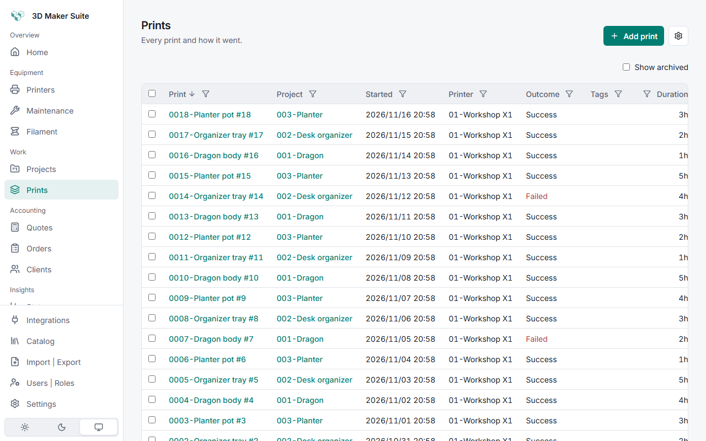
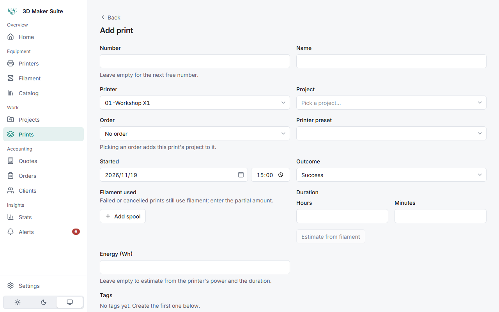
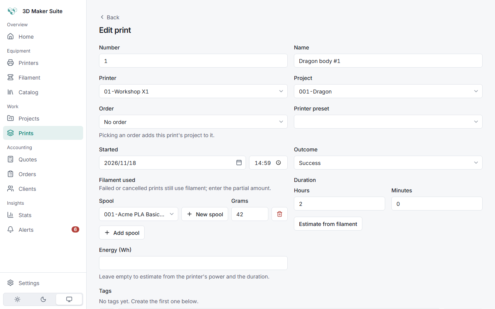
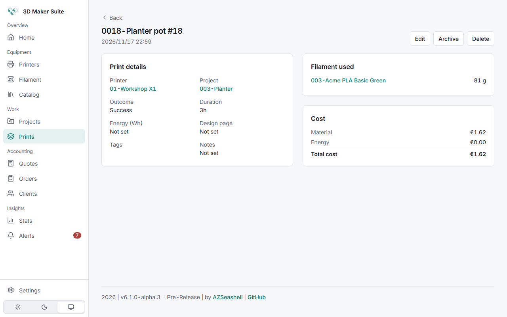

# Prints

Your print history: the list, adding and editing a print, and a print's page with its filament and cost.

A print is one job that ran on one printer. It knows its project, outcome, duration, the filament it used and what it cost. Prints arrive by hand, by [import](Sources-and-Sync.md) from a file, or from a source such as a printer on your network or Bambu Cloud. Each print takes its filament from a spool, and the spool's weight goes down.

## Who can use it

| You can | You need |
|---|---|
| See the list and a print's page | **Prints** with **Read** |
| Add or edit a print, archive, restore or delete it | **Prints** with **Write** |
| Change the Prints settings | **Prints** with **Manage** |

Works the same with or without a hub.

## Before you start

- A print needs a printer. See [Printers](Printers.md).
- A new print needs a project, or **No project** for a print that belongs to none, such as a calibration print. See [Projects](Projects.md).
- To take filament from a spool, the spool has to exist. See [Filament](Filament.md). You can add one from the print form.

## Prints list

Open **Prints**. With no prints, the page says **No prints yet** and **Log a print to track how it went and how much filament it used.**

The buttons at the top right are a sync button (it fetches prints from your sources), **Add print** and the gear, which opens [Prints settings](Prints-Settings.md). **Add print** needs **Write**.

When imported prints have filament slots that no one has matched to a spool, a line above the list says, for example, **3 filament slots from imported prints need a spool.** **Review** opens [Filament review](Filament-Review.md).

### Columns

| Column | What it shows |
|---|---|
| **Print** | The print's number and name. It opens [the print's page](#print-details) |
| **Project** | The project, as a link, or **No project** |
| **Started** | When the print began |
| **Printer** | The printer, with an **Archived** label if it is archived |
| **Outcome** | **Success**, **Failed** or **Cancelled**, and the failure reason if there is one. Anything but success shows in red |
| **Tags** | The print's tags, when tags are on |
| **Duration** | How long it took. A duration that begins with `~` is an estimate, see [Estimated durations](#estimated-durations) |
| **Filament** | The grams used, all spools together |
| **Cost** | The total cost. Open it to see the breakdown |
| The last column | **Archive** or **Restore** for the row, and the selection checkbox |

Press a column header to sort. The list is sorted by **Print**, highest first. **Print**, **Project**, **Started**, **Printer**, **Outcome** and **Duration** have filters too. In the **Duration** filter, type minutes. **Show archived** finds archived prints. You can tick rows to archive, restore or delete many at once. How this works is on [Archive and delete](Archive-and-Delete.md).

## Add or edit a print

**Add print** opens the form. On a print's page, **Edit** opens the same form with its values, and the title says **Edit print**. **Save print** opens the print's page, or the list for a new print. **Cancel** goes back.

### Fields

| Field | What it means | Required | Example |
|---|---|---|---|
| **Number** | The print's number. Leave it empty for the next free number. Each number is used once, archived prints too | No | `42` |
| **Name** | What you call the print | Yes | `Benchy` |
| **Printer** | The printer it ran on. Only printers that are not archived are listed | Yes | `Workshop A1` |
| **Project** | The project it belongs to. A new print must have one. **No project** is on the list too. An old print may be saved without one | Yes, for a new print | `Benchy` |
| **Order** | The order the print is for, or **No order**. It lists the newest 100 orders. Picking an order adds this print's project to it | No | `Order 7` |
| **Printer preset** | The printer's machine preset. It shows only when the printer has a model, and lists the presets for that model | No | `Bambu Lab A1 0.4 nozzle` |
| **Started** | The date and time it began | Yes | `2026-06-01 14:30` |
| **Outcome** | **Success**, **Failed** or **Cancelled** | Yes | **Success** |
| **Failure reason** | Only when the outcome is not **Success**. Pick one of your reasons, or **No reason**. The reasons are in [Prints settings](Prints-Settings.md#prints) | No | `Spaghetti` |
| **Filament used** | One line per spool, see below | No | `PLA Red`, `42` |
| **Hours** and **Minutes** | The duration. **Minutes** goes up to 59 | No | `1` and `20` |
| **Energy (Wh)** | The energy used. Leave it empty to estimate it from the printer's power and the duration | No | `180` |
| **Tags** | Your own labels, when tags are on | No | `gift` |
| **Notes** | Free text | No | `Layer shift at 60%` |

If you take a print out of its order, or change its project, the app may ask whether the project should leave the order too.

### Filament used

Failed or cancelled prints still use filament, so enter the partial amount. Each line has a **Spool**, with how much is left in it, and **Grams**. The spool list leaves out empty and archived spools, and spools you opened after the print started.

- **Add spool** adds a line. **Remove spool** (the trash button) removes it.
- The plus beside a spool opens **New spool** to add a spool without leaving the form.
- A line with no spool or no grams is not saved.

The weights of the spools go down when you save.

Slots of an imported print that wait for a spool don't show on the form. They are in [Filament review](Filament-Review.md).

### Estimated durations

A print that has grams but no time gets an estimated duration: its grams divided by the printer's pace in grams per hour. The app uses the pace of the printer's own prints when it has enough of them, else the default **Printing pace (g/h)** in [Prints settings](Prints-Settings.md#prints). An estimate shows as `~1h 20m`, with a tip that says so.

On the form, **Estimate from filament** fills **Hours** and **Minutes** the same way. It is off until there are grams on a line. Typing in the duration fields makes the value yours again, and a real duration from a file or a source replaces the estimate.

If the number is taken, the form says **Another print already has this number. It may be archived.** Any other failure says **Couldn't save the print. Check that every spool has enough filament.**

## Print details

Press a print's name to open its page. The title is the print's name and the line under it is its start time, with an **Archived** label if it is. The buttons at the top right need **Write**:

| Button | What it does |
|---|---|
| **Edit** | Opens [the form](#add-or-edit-a-print) |
| **Archive** or **Restore**, and **Delete** | See [Archive and delete](Archive-and-Delete.md). Deleting says that the print is removed and its filament returned to the spools |

### Print details card

| Row | What it shows |
|---|---|
| **Printer** | The printer, as a link |
| **Project** | The project, as a link, or **Not set** |
| **Order** | The order, as a link. Only when the print belongs to one |
| **Printer preset** | Only when one is set |
| **Outcome** | The outcome and the failure reason |
| **Duration** | The time, with `~` when it is estimated |
| **Energy (Wh)** | The energy, or **Not set** |
| **Design page** | **Open design page**, when the print came with a link to its design. It opens in a new tab |
| **Tags** | The print's tags, when tags are on |
| **Notes** | Your notes |

### Filament used card

One line for each filament slot: the spool as a link, and the grams. The grams can carry a note:

- **estimated** in front: the grams are a guess, for example a total scaled by how far a failed print got.
- **from the printer**, **from the job file** or **from the project plate**: where the grams came from.

A slot with no spool says **Waiting for review** or, if you chose not to track it, **Not tracked**. See [Filament review](Filament-Review.md).

### Cost card

The breakdown of what the print cost: **Material**, **Energy**, **Printer wear** and **Maintenance** (the last two when they count in costs), then **Total cost**. When some filament has no price, a line says how much, because the material cost is then too low. The same breakdown opens from the **Cost** column of the list. The figures come from [Quotes settings](Quotes-Settings.md).

## Common tasks

### Log a print by hand

1. Open **Prints** and press **Add print**.
2. Type the **Name**, pick the **Printer**, the **Project** and the start time.
3. Under **Filament used**, press **Add spool**, pick the spool and type the grams.
4. Set the **Outcome** and the duration.
5. Press **Save print**.

### Log a failed print

1. Follow the steps above, and set **Outcome** to **Failed**.
2. Pick the **Failure reason**.
3. Enter the grams that were really used, not the whole model.

### Fix the filament of a print

1. Open the print and press **Edit**.
2. Change the spool or the grams on the line.
3. Press **Save print**. The spools' weights follow the new grams.

### Find all failed prints

1. On **Prints**, open the filter on **Outcome**.
2. Pick **Failed**.

## Related settings

- [Prints settings](Prints-Settings.md) has the failure reasons, the printing pace, the review level and the sources of prints.
- [Quotes settings](Quotes-Settings.md) has the cost figures.
- The gear on **Alerts** has the alert when filament waits for review.

## Limits and tips

- A print without a project is fine when you choose **No project**. A synced print with no matching project waits for you to pick a project or **No project**.
- Failed and cancelled prints cost filament. Enter their grams so the spools and costs stay right.
- Imported prints never change on their own. Edit them here if something is wrong.

## Problems and fixes

| What you see | What to do |
|---|---|
| **Couldn't load prints. Is the server running?** | Check that the app is running and reload. **Clear** removes the filters |
| No **Add print** button | Adding needs **Prints** with **Write** |
| **Add print** can't save, the button is off | There is no printer yet. Add one in [Printers](Printers.md) |
| **Another print already has this number. It may be archived.** | Use another number, or leave the field empty |
| **Couldn't save the print. Check that every spool has enough filament.** | A spool has less than the grams you typed. Lower them or pick another spool |
| A spool is missing from the list | It is empty, archived, or it was opened after the print started |
| **This doesn't exist, or you can't open it.** | The print was deleted. Go back to the list |

## Related pages

- [Prints settings](Prints-Settings.md)
- [Filament review](Filament-Review.md)
- [Filament](Filament.md)
- [Printers](Printers.md)
- [Projects](Projects.md)
- [Archive and delete](Archive-and-Delete.md)
