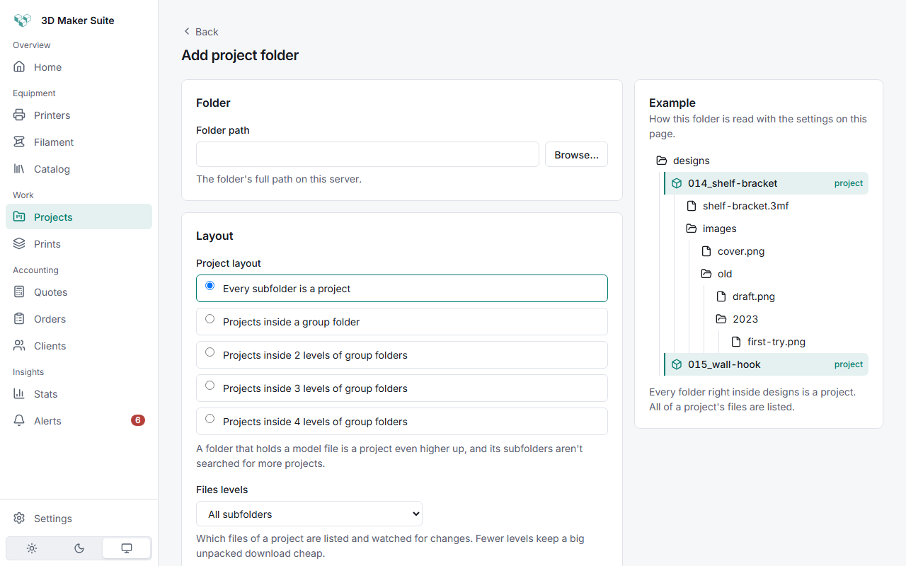

# Project folders

The page of one project folder: where it is, how the app reads it, when it slices and rescans, and who can edit it.

A project folder is a folder on disk that holds your projects. The app watches it and makes a project of each folder inside. You open this page from [Projects settings](Projects-Settings.md#project-folders): **Add folder** makes a new one, and a name in the **Folder** column edits it. The back arrow returns to **Projects settings**.

## Who can use it

| You can | You need |
|---|---|
| Add a folder, change one, and see the example | **Projects** with **Manage** |
| Edit a folder on someone's workstation | **Manage** on the hub, or **Projects** with **Manage** and the right to edit that computer |

The folder's **Who can edit** setting decides who may change the *projects* in it. It does not decide who may change the folder's own settings here.

## Before you start

- The folder must exist. On Docker, mount it first and use its path **inside the container**. See [Docker](Docker.md#project-folders).
- To use a folder on a workstation, turn on the hub, turn on **Send projects to server** for the computer, and share the folder under **Sources** in [Projects settings](Projects-Settings.md#sources). The computer must be online.
- Two project folders can't overlap. A folder can't be inside another one, or hold one.

## Add or edit a folder

The page title is **Add project folder** for a new one, and the folder's name for an existing one. Under the title, an existing folder shows where it is: **This server** or the computer's name.

On a wide screen the form is on the left and the **Example** is on the right. On a phone the example sits in the middle of the form. A bar at the bottom saves your changes. Nothing is saved until you press it.

### Folder

| Field | What it means | Required | Example |
|---|---|---|---|
| **Source** | Where the folder is: **This server**, or a computer that shares folders. Shown only when a computer is online and shares a folder, and only when adding. When editing it is read only | Yes | `This server` |
| **Folder path** | The folder's full path. Type it, or press **Browse…**. On a computer it must be inside one of the folders it shares. Read only when editing. The path can't change: to use another folder, add it as a new project folder | Yes | `D:\3d-files` |

The hint under the path says **The folder's full path on this server.** or, for a computer, **A folder in the machine's shared folders. It stays on that machine: its connector watches it and sends the projects to the server.**

When editing, a label next to the path says **Missing**, **Offline** or **Not shared on the device** if the folder can't be read now.

On **This server**, the folder picker can create a new folder. On a computer it can't.

### Layout

| Field | What it means | Required | Example |
|---|---|---|---|
| **Project layout** | At which level the project folders are. **Every subfolder is a project**, **Projects inside a group folder**, or **Projects inside 2, 3 or 4 levels of group folders** | Yes | `Every subfolder is a project` |
| **Files levels** | Which files of a project are listed and watched. **All subfolders**, **Only files in the project folder**, or **1 to 10 levels of subfolders**. Fewer levels keep a big unpacked download cheap | Yes | `All subfolders` |

A group folder only holds projects, such as `Furniture` holding `Shelves` and `Wall`. It is not a project itself. A folder that holds a model file is a project even higher up, and its subfolders aren't searched for more projects.

When you change a setting on an existing folder, a warning explains what happens:

| Change | What happens |
|---|---|
| **Project layout**, folder on the server | Projects already found stay as they are. The next scan (**Scan folders** on **Projects**) adds the projects it finds at the new level. None are moved or merged |
| **Project layout**, folder on a computer | The computer lists the folder again when you save. Projects no longer at a project level show as missing, and the ones at the new level are added |
| **Files levels**, folder on the server | Each project's file list changes at the next scan |
| **Files levels**, folder on a computer | The computer sends the projects' file lists again when you save |

### Example

The **Example** card shows a small made-up folder tree, read with the settings on the form. It changes as you click. Project folders are marked **project**, group folders **group** and files or folders that aren't listed **not listed**. Under the tree, two sentences say it in words, for example **Every folder right inside designs is a project. All of a project's files are listed.** The name at the top is the last part of your path, or `designs` while the path is empty.

Use it to check a layout before you save. The tree is only a picture: it doesn't read your real folder.

### Slicing

The **Slicing** card has one switch, **Auto slice**. When a sliced 3MF in one of the folder's projects changes, its plates are sliced again with their saved setup. Each project can change this in its own print setup. It is on for a new folder. It needs a slicer, see [Slicers](Projects.md#print-setup).

### Rescan

The **Rescan** card has the switch **Rescan this folder periodically**. It catches changes the folder watcher misses, on network shares (SMB, NFS) and cloud folders. Only folders that changed are read again. You don't need it on a local disk. It is on for a new folder, every hour.

With it on, you set when it runs.

| Field | What it means | Example |
|---|---|---|
| **Frequency** | **Every 15 minutes**, **Every hour**, **Every day**, **Every week** or **Every month** | `Every hour` |
| **Minute**, **Time**, **Hour**, **Day of the week** or **Day of the month** | When inside that period. Which fields show depends on the frequency. **Any time** counts from the last rescan | `Any time` |

The time is in the server's time zone, also for a folder on a computer.

### Who can edit

The **Who can edit** card decides who may change the projects in this folder: their files and their data.

| Choice | Who |
|---|---|
| **All users who can edit projects** | Everyone whose role has **Projects** with **Write** |
| **Admins** | Only admins |
| **Picked users** | Only the people you tick under **Users who can edit** |
| **Nobody else** | No one except the folder's own user on a computer |

Everyone else who sees the projects can still view and download the files. For a folder on a computer, the line says that its user, shown by name, can always edit. For a folder on the server it says **Everyone else who sees the projects can still view and download the files.**

With accounts off, there is only one user and **Who can edit** has no effect.

### Save

The bar at the bottom has the save button, which turns on once something changed. After saving it says **Saved.** For a new folder, saving opens its page. If it fails, it says why:

| Message | What to do |
|---|---|
| **That folder doesn't exist on the server.** | Check the path. On Docker, use the path inside the container |
| **That folder doesn't exist on the device.** | Check the path on that computer |
| **This folder is a project folder already.** | It is in the table already |
| **This folder is inside another project folder on that device, or holds one.** | Pick another folder, or remove the other one |
| **The machine doesn't share this folder. Share it first in Projects settings → Sources.** | Share it, then add it |
| **The device is offline. Start its connector, then try again.** | Start the connector |
| **The device didn't answer. Check that its connector is running, then try again.** | Check the connector |
| **Couldn't save your last change.** | Try again |

## Common tasks

### Add a folder from this server

1. Open **Projects**, the gear, then **Add folder**.
2. Type the path or press **Browse…**.
3. Pick the **Project layout** that matches how you keep your files. Check the **Example**.
4. Press **Save**.
5. Go back to **Projects** and press **Scan folders**.

### Add a folder from a workstation

1. Share the folder first. See [Share a workstation's folder](Projects-Settings.md#share-a-workstations-folder-with-the-server).
2. Press **Add folder**, then choose the computer as **Source**.
3. Press **Browse…**. It lists the folders the computer shares. Pick one.
4. Press **Save**.

### Change how deep the app looks

1. Open the folder from the table.
2. Choose another **Project layout**, and check the **Example**.
3. Press the save button, and read the warning.
4. For a folder on the server, press **Scan folders** on **Projects**.

### Let only some people edit

1. Open the folder and go to **Who can edit**.
2. Choose **Picked users**.
3. Tick the people under **Users who can edit**.
4. Press **Save**.

### Rescan a folder on a network share

1. Open the folder.
2. Switch on **Rescan this folder periodically** if it is off.
3. Choose a **Frequency**, and a time if you want one.
4. Press **Save**.

## Related settings

- [Projects settings](Projects-Settings.md) has the list of folders, the file limits and the trash.
- **Settings → Users** and **Roles** have the right **Projects** with **Write**, and **Edit everyone's projects**.

## Limits and tips

- A folder's path can't change. Add the new folder, then use **Change project folder…** in [Projects settings](Projects-Settings.md#change-project-folder) to move the projects over.
- A folder that holds a model file is a project even if your layout says it is a group.
- Pick the deepest layout you really use. A deeper layout reads more folders.
- A network share often sends no change events. Keep **Rescan this folder periodically** on for it, or press **Scan folders**.
- With **Auto slice** on, a changed sliced 3MF is sliced again on its own. Switch it off for a folder of finished files you never edit.

## Problems and fixes

| What you see | What to do |
|---|---|
| **This project folder doesn't exist any more.** | Someone removed it. Go back to [Projects settings](Projects-Settings.md) |
| **Source** doesn't show | No computer is online with a shared folder, so the folder can only be on the server |
| A folder on a computer can't be picked | It is outside the folders the computer shares. Share it first |
| No new projects after saving a new layout | For a folder on the server, press **Scan folders** on **Projects** |
| Projects show as missing after a layout change on a computer | They are no longer at a project level. Change the layout back, or move them |
| **Missing** next to the path | The folder is gone or not mounted. Mount it, or add the right one |

## Related pages

- [Projects settings](Projects-Settings.md)
- [Projects](Projects.md)
- [Docker](Docker.md)
- [Hub setup](Hub-Setup.md)
