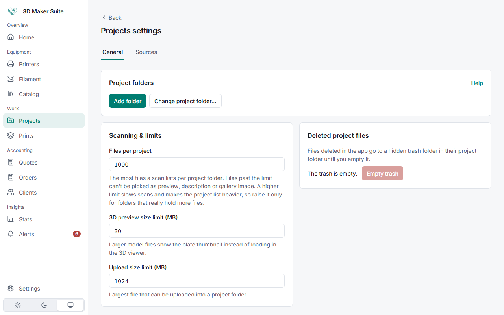
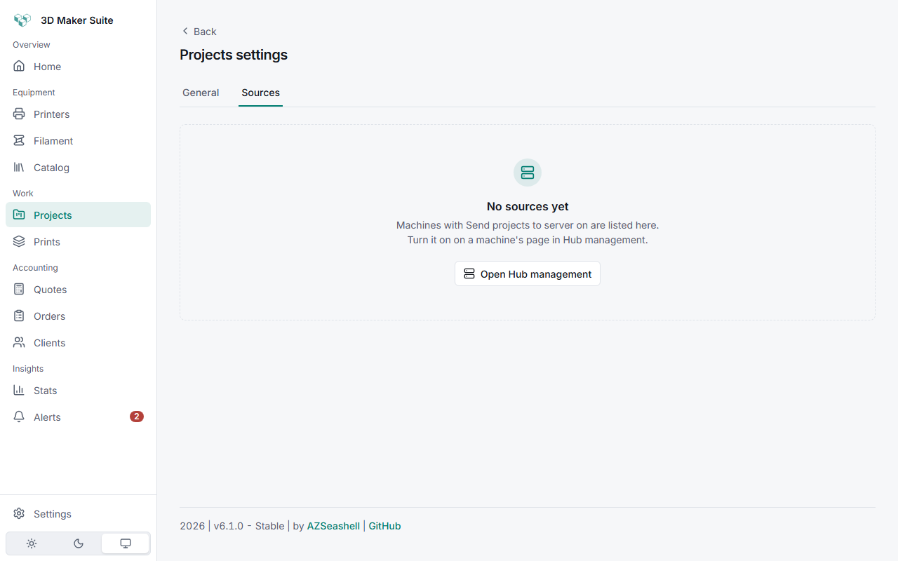
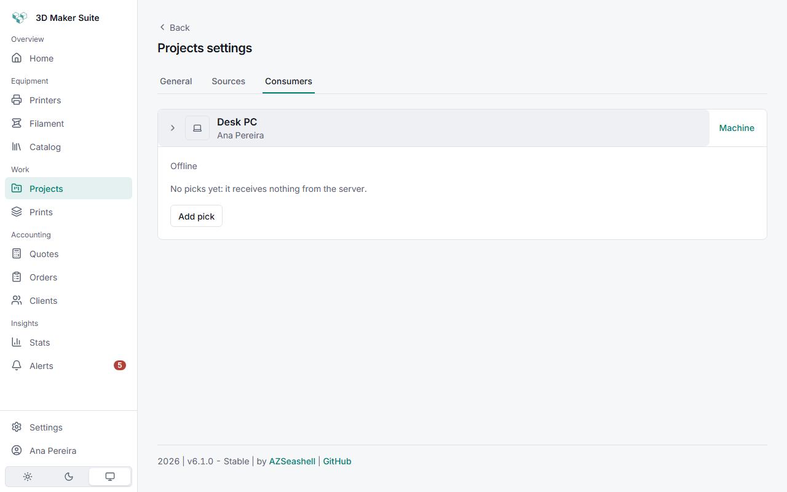

# Projects settings

The settings of the **Projects** page: the folders the app watches, how many files it lists, the size limits, which computers send or get projects, and the trash of deleted files.

Open it with the gear button at the top right of **Projects**. The back arrow returns to **Projects**. It has a **General** and a **Sources** tab. With a [hub](Hub-Setup.md) turned on there is a third tab, **Consumers**.

## Who can use it

| You can | You need |
|---|---|
| Open **General**, add, change and remove project folders, set the limits, empty the trash | **Projects** with **Manage** |
| Open **Consumers** (hub on) | **Projects** with **Manage** |
| Open **Sources** | **Projects** with **Manage**, or the right to edit a computer that sends projects |
| Switch or remove a folder a computer shares | **Hub management** rights, or **Projects** with **Manage**, and the right to edit that computer |
| Change what a computer gets (picks) | **Manage** on the hub or on **Projects** |

Someone who can only edit a computer sees the gear open **Sources**, and no **General** tab. **Sources** and **Consumers** only list computers when a hub is on.

Limits and switches on **General** save as you leave a field. There is no save button on this page. Folders have their own page, see [Project folders](Project-Folders.md).

## General

### Project folders

The first card, **Project folders**, lists the folders the app watches for projects. It has two buttons: **Add folder** and **Change project folder…**. A **Help** link opens this page.

With no folder yet, only the buttons show. **Add folder** opens the folder's own page, see [Project folders](Project-Folders.md#add-or-edit-a-folder).

Once there is a folder, a table appears. Click a column header to sort.

| Column | What it shows |
|---|---|
| **Folder** | The last part of the path, as a link to the folder's page. Hover to see the whole path. Next to it, a label if something is wrong: **Missing** (the folder is gone or not mounted), **Offline** (its computer is not connected) or **Not shared on the device** (the computer stopped sharing it) |
| **Machine** | **This server**, or the name of the computer the folder is on |
| **Projects** | How many projects live in this folder |
| **Auto slice** | **On** or **Off**. See [Auto slice](Project-Folders.md#slicing) |
| Trash button | **Remove** the folder from the app, after you confirm |

**Remove this project folder?** says **… stops being watched. Its files stay where they are.** Nothing on disk is deleted. If projects still use the folder, it says **Projects still use this folder, maybe archived ones. Unlink or delete them first, then remove it.**

#### Change project folder

**Change project folder…** moves many projects to another project folder in one go. Use it when you moved your files to a new disk or a new computer, or renamed the main folder.

It opens a dialog with a table **Projects with a folder**: **Project**, **Project folder**, **Subfolder** and **State** (**OK**, **Missing** or **Offline**). You can sort and filter every column. Tick the projects you want, or use the box in the header to **Select all** the ones the filter shows. Projects you may not edit have no tick box.

When projects are ticked, a bar shows the count, with two buttons.

| Button | What it does |
|---|---|
| **Change folder…** | Opens **Change folder of N projects**. Pick the **New project folder**. Tick **Move files from the previous folder to the new one** to take the files along. Without it, only the app's link changes and nothing on disk moves, so use that when you already moved the files. A line says what will happen. Confirm with **Change folder** |
| **Unlink N folders** | Opens **Unlink the folders of N projects?**. Nothing on disk changes, and each project keeps everything it knows. Scans leave the folders alone, so they don't come back as new projects. Link a folder again on the project's edit page |

Projects keep their subfolder. A project whose subfolder isn't in the new place shows as missing afterwards.

After a change, the dialog says **N projects changed.** or **N projects unlinked.** If some were skipped, it lists each one with the reason and leaves it ticked, so you can fix the cause and try again. The reasons are:

| Reason | What to do |
|---|---|
| **It no longer exists.** | Nothing. The project was deleted |
| **You can't edit this project.** | Ask someone who can |
| **It has no folder.** | Nothing to change |
| **It's already in that project folder.** | Pick another folder |
| **Another project already uses that folder. It may be archived.** | Unlink or move the other project first |
| **Its folder couldn't be read, so nothing changed.** | Check the folder, then try again |
| **Files on a device can't be moved from here. Move them yourself, then change the project folder with Move files off.** | Move the files by hand, then change the folder without **Move files** |
| **A file with the same name is already in the new folder, so nothing moved.** | Rename or remove the file there |
| **The new folder is inside the current one, so nothing moved.** | Pick a folder outside it |
| **Moving the files failed. Some may already be in the new folder, so check both.** | Look in both folders, then fix by hand |
| **It couldn't be changed. Try again.** | Try again |

### Scanning & limits

| Field | What it means | Required | Example |
|---|---|---|---|
| **Files per project** | The most files a scan lists for one project folder, from 100 to 100000. Files past the limit can't be picked as preview, description or gallery image. A higher number slows scans and makes the project list heavier, so raise it only for folders that really hold more files | Yes | `1000` |
| **3D preview size limit (MB)** | A model file bigger than this shows its plate picture instead of loading in the 3D viewer. At least 1 | Yes | `30` |
| **Upload size limit (MB)** | The biggest file you can upload into a project folder. At least 1 | Yes | `1024` |

### Hub devices

This card shows only when the hub is on.

| Field | What it means | Required | Example |
|---|---|---|---|
| **Device folder size limit (MB)** | How much one folder's scan on a computer may send to the hub. It sends descriptions, then the cover, then plate pictures, then gallery picks, in that order. What doesn't fit is left out, so plate pictures are dropped first. From 1 to 128. A change sends the folders again | Yes | `32` |

### Deleted project files

Files you delete in the app don't vanish at once. They go to a hidden trash folder inside their project folder, and stay there until you empty it here.

The card says how much is waiting, for example **3 deleted items, 12.4 MB**, or **The trash is empty.** **Empty trash** is off while there is nothing to empty. Pressing it asks **Empty the trash?** and says **The deleted files are removed for good. This can't be undone.** If it fails, it says **Couldn't empty the trash. A file in it may be in use.**

The trash covers every project folder at once. You can't empty one folder's trash alone.

## Sources

**Sources** is about computers that send their project folders to the server. A computer shows here when it has **Send projects to server** on, on its page in **Hub management**. Without any, and without a hub, the tab says **No sources yet** and **Machines with Send projects to server on are listed here. Turn it on on a machine's page in Hub management.** A button **Open Hub management** takes you there.

Each computer is a card with its name and its user, and a link **Machine** to its page. At the top of the card, **Offline** means its connector isn't connected. A line about its connector being older than the hub means you must update the connector.

The card has a table **Folders** *computer name* **shares**.

| Column | What it shows |
|---|---|
| **Item** | The shared folder |
| **On** | A switch. Off pauses the folder, so it stops sending projects. Nothing is deleted |
| **Project folder** | The project folders inside it, or **No project folder yet** |
| **⋯** menu | **Remove**, which stops sharing the folder |

Below the table, **Add folder** opens a folder picker that browses the computer's whole disk. Pick a folder, then confirm **Share *path* with the server?** with **Share**. The projects in it become visible to the people who can see that computer's projects.

**Remove** asks **Stop sharing *path*?**. Project folders inside it stay, shown as **Not shared on the device**, until it is shared again. Nothing on the computer changes.

If you can't edit the computer, the switches are off and there are no buttons. If a computer's connector hasn't sent its shared folders yet, the card says **Its connector hasn't sent its shared folders yet. Update the connector, then they show here.**

To use a shared folder, add it as a project folder with **Add folder** on **General**, and pick that computer as the **Source**.

## Consumers

**Consumers** is the other direction: which computers **get** projects from the server. It shows only with a hub. A computer is listed when it has **Get projects from server** on, on its page in **Hub management**. Without any, the tab says **No consumers yet**.

Each card has a table **What *computer name* receives**. Each line is a **pick**: a project folder, or one folder inside it, that the computer receives.

| Column | What it shows |
|---|---|
| **Item** | The pick, for example **Models (whole folder)** or **Models / Clients / Acme** |
| **On** | A switch. Off pauses the pick |
| **Access** | **Read**: the computer gets the files and can't change them. **Edit**: its saves go back to the server |
| Buttons | **Edit**, and a **⋯** menu with **Remove** |

With no picks, the card says **No picks yet: it receives nothing from the server.**

**Add pick** opens a dialog.

| Field | What it means | Required | Example |
|---|---|---|---|
| **Project folder** | One of the server's own project folders | Yes | `Models` |
| **Folder inside it** | **The whole project folder**, or **Choose a folder…** to pick one inside it | No | `Clients / Acme` |
| **Access** | **Edit** or **Read** | Yes | `Edit` |

A line explains that the computer works as its user. **Edit** sends the computer's saves back to the server and **Read** keeps the files read only there. It never gets more than that user may see or edit, and when the computer's user changes, the new user's rights apply. A pick that already exists says **This machine has this pick already.**

**Edit** on a line changes only its **Access**. **Remove** asks **Stop receiving *pick* on *computer*?** and says its files leave the computer, except ones changed there that the server doesn't have yet. Nothing on the server changes.

## Common tasks

### Add your project folders

1. Open **Projects**, then the gear.
2. On **General**, press **Add folder**.
3. Pick the folder and press **Add folder** on its page. See [Project folders](Project-Folders.md#add-or-edit-a-folder).
4. Go back to **Projects** and press **Scan folders**.

### Move all projects to a new disk

1. Copy the files to the new disk, keeping the folder layout.
2. Add the new location with **Add folder**.
3. Press **Change project folder…**, tick the projects, press **Change folder…**.
4. Pick the **New project folder** and leave **Move files from the previous folder to the new one** off, because you already copied them.
5. Press **Change folder**. Check that the state says **OK**.
6. Remove the old folder from the table when no project uses it.

### Share a workstation's folder with the server

1. In **Hub management**, turn on **Send projects to server** for the computer.
2. Open **Sources** here. On the computer's card, press **Add folder**, pick the folder and press **Share**.
3. On **General**, press **Add folder**, choose the computer as **Source** and pick the shared folder.

### Give a computer the server's projects

1. In **Hub management**, turn on **Get projects from server** for the computer.
2. Open **Consumers**. On its card, press **Add pick**.
3. Choose the **Project folder**, a **Folder inside it** if you want one, and **Access**. Press the confirm button.

### Free the space of deleted files

1. Open the gear, then **General**.
2. Look at **Deleted project files**. Check the size.
3. Press **Empty trash**, then confirm.

## Related settings

- [Project folders](Project-Folders.md) has the settings of a single folder: layout, files levels, auto slice, rescan and who can edit.
- [Projects](Projects.md) has the scan button, the project forms and the files.
- **Settings → Integrations** has the slicers. Auto slice needs one.
- **Hub management** has the switches **Send projects to server** and **Get projects from server** of each computer. See [Hub setup](Hub-Setup.md).

## Limits and tips

- A scan lists at most **Files per project** files. If a project is missing files from the preview picker, raise it a little.
- Files past **3D preview size limit (MB)** still download. They just show the plate picture.
- The upload limit protects your disk. A network share or a NAS may also have its own limit.
- A change to **Device folder size limit (MB)** sends all the computers' folders again, so it can take a moment.
- Removing a project folder never deletes files. It is refused while projects still use it, so unlink or delete them first. **Change project folder…** can unlink many at once.
- On Docker, the path of a folder is the path inside the container. See [Docker](Docker.md#project-folders).

## Problems and fixes

| What you see | What to do |
|---|---|
| The gear doesn't show | Your role has no **Manage** on **Projects**, and no right to edit a computer |
| **Missing** next to a folder | The folder is gone or not mounted. Mount it, or fix the path. Its projects stay |
| **Offline** next to a folder | Start the connector on that computer |
| **Not shared on the device** | Share the folder again on **Sources** |
| **That folder doesn't exist on the server.** | Check the path. On Docker, use the path inside the container |
| **That folder doesn't exist on the device.** | Check the path on that computer |
| **This folder is a project folder already.** | It is in the table. Open it there |
| **This folder is inside another project folder on that device, or holds one.** | Folders can't overlap. Use the outer one, or remove it first |
| **The machine doesn't share this folder. Share it first in Projects settings → Sources.** | Share it on **Sources**, then add it |
| **The device is offline. Start its connector, then try again.** | Start the connector |
| **The device didn't answer. Check that its connector is running, then try again.** | Check the connector |
| **This folder is shared already, inside another shared folder.** | It is covered already |
| **Couldn't save your last change.** | Try again. Check that the app is running |

## Related pages

- [Project folders](Project-Folders.md)
- [Projects](Projects.md)
- [Hub setup](Hub-Setup.md)
- [Docker](Docker.md)
