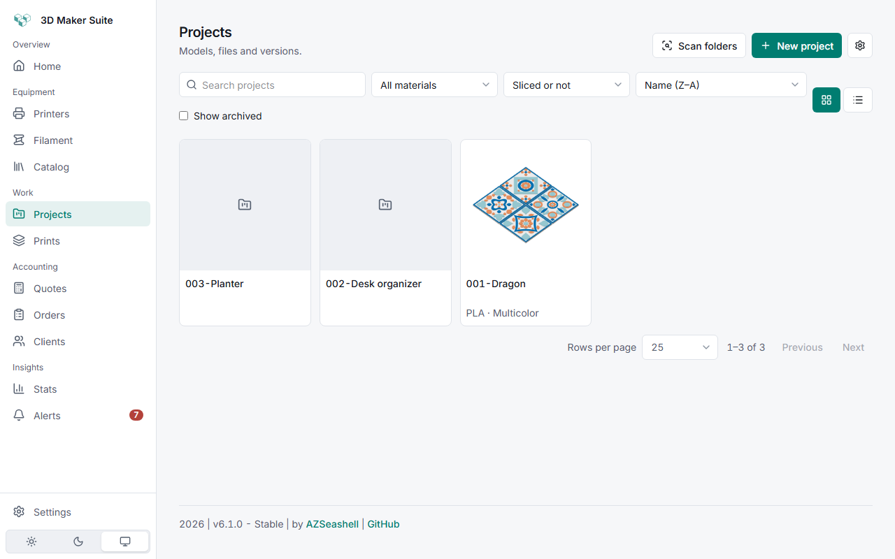
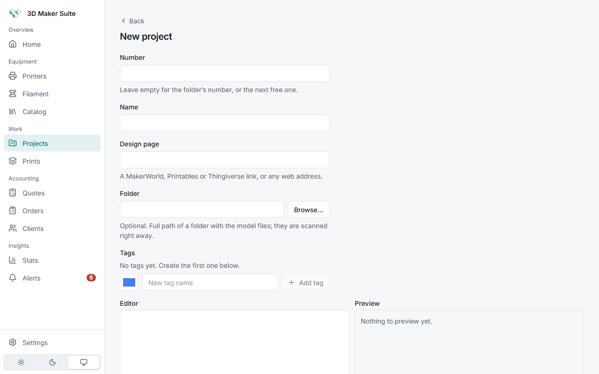
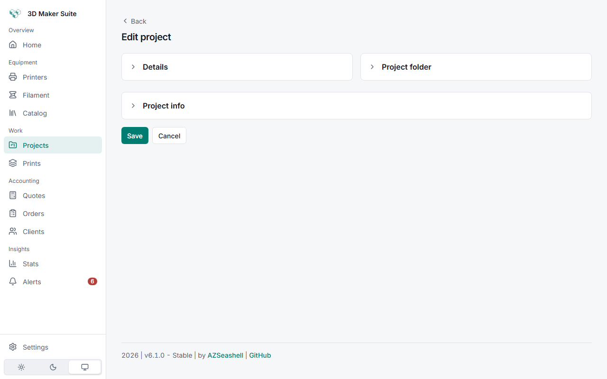
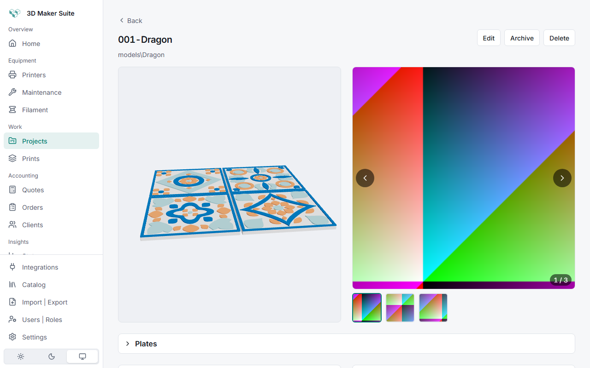
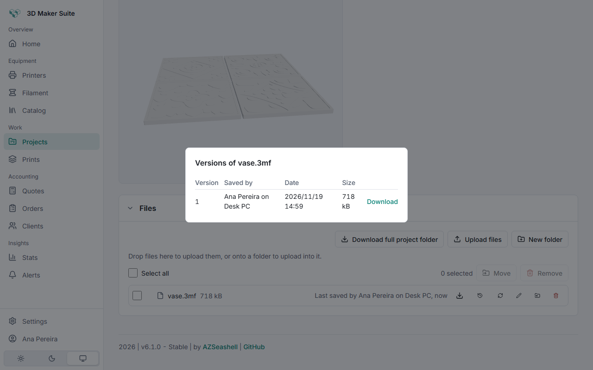

# Projects

Your models and the files that go with them: the list, adding and editing a project, and a project's page with its pictures, 3D preview, plates, costs, prints, quotes, orders and files.

A project is a folder of files on disk: models, pictures, notes and links. The app finds the folders you tell it to watch, and makes a project of each one. You can also make a project by hand. Nothing is moved or renamed for you, and what you edit in the app is kept when the folders are scanned again.

You open **Projects** from the sidebar, under **Work**.

## Who can use it

| You can | You need |
|---|---|
| See the list and a project's page, and download its files | **Projects** with **Read**. Without **See everyone's projects**, you only see the projects you own |
| Scan the folders, add a project, edit one, upload, create folders, rename, move, delete and replace files, and archive, restore or delete a project | **Projects** with **Write**. Editing also needs the project to be yours, or the right **Edit everyone's projects** |
| Change files in a folder that is on someone else's workstation | The right **Edit files on other workstations** |
| Archive, restore or delete many projects at once | **Projects** with **Manage** |

With accounts on, a project has an owner. The page says **Owner:** and a name. If you can't change the project, it says **You can view and download this project, but not change it.** Without accounts, there are no owners and no one is held back.

## Before you start

- Add the folders that hold your models, then scan them. See Projects settings, which the gear button opens, and [Docker](Docker.md#project-folders) if you run in a container.
- You can also start with no folders: **New project** makes a project by hand.
- For the cost estimate you need a spool or filament price, and a default printer. See [Printers settings](Printers-Settings.md#printers).
- To slice in the app you need a slicer connected. It is set up under **Settings → Integrations**.

## Projects list

Open **Projects**. The page header has three buttons:

- **Scan folders** reads every project folder again, in full. It shows its progress, for example **Scanning 3 of 12**, and ends with **Scan finished: 2 new, 1 updated.** Use it after changing files on a network share, which often sends no change events. A folder that is missing, such as an unmounted share, shows **Folder not found:** and its path, and its projects stay. A folder that could not be read shows **1 folder could not be read.**
- **New project** opens [the add form](#add-or-edit-a-project).
- The gear opens Projects settings.

With no projects yet, the page says **No projects yet** and **Add the folders that hold your models in Projects settings and scan them, or create a project by hand.** Its **Project folders** button opens Projects settings.

A project is named by its number and name, for example `001-Dragon`.

### Grid and list

Two buttons at the right switch between **Grid view** and **List view**. The app remembers your choice on this device.

The grid shows one card per project: its picture, its name, and under it the materials, with **Multicolor** when it uses more than one color. A card with no picture shows a folder icon. An **Archived** label shows on archived projects. Press a card to open the project.

The list shows the same projects as a table.

| Column | What it shows |
|---|---|
| **Project** | The picture, the name, which opens the project, and a link icon (**Open design page**) when the project has a design page. **Archived** and **Offline** labels show here too |
| **Materials** | The materials of the project's models. A filter lists the materials found |
| **Multicolor** | A check when the project uses more than one color. The filter has **Multicolor** and **Single color** |
| **Slicing** | **Needs slicing** (in orange) or **Sliced**. Empty when no print setup exists. The filter also has **Not set up** |
| **Last print** | When the project was last printed |
| **Tags** | The project's tags, when tags are on |
| **Files** | How many files the project has, or **No folder** |
| The last column | **Archive** or **Restore**, and the selection checkbox for people with **Manage** |

Press a column header to sort, and use the filter in a header to narrow the rows. How the checkboxes, **Archive**, **Restore** and **Delete** work is on [Archive and delete](Archive-and-Delete.md).

### Filters

Above the grid:

| Filter | What it does |
|---|---|
| **Search projects** | Finds projects by name |
| **Filter by tag** | Only projects with that tag. Shown when tags are on |
| **Filter by collection** | Only projects in that collection. Shown only when a collection exists |
| **Filter by material** | Only projects that use that material. Shown when any project has a material |
| **Filter by slicing** | **Sliced or not**, **Needs slicing** or **Sliced** |
| **Sort by** | **Name (A–Z)**, **Name (Z–A)**, **Last printed (newest)** or **Last printed (oldest)**. It starts at **Name (Z–A)**, so the highest number comes first |
| **Show archived** | Adds archived projects to the list |

**Clear filters** resets them. When nothing matches, the page says **No projects match these filters.** In the list view, the filters sit in the column headers, and only the collection filter stays above the table.

The filters are kept in the address, so you can bookmark a filtered list.

## Add or edit a project

**New project** opens a form with one card of fields. **Edit** on a project's page opens the same fields, split into cards you can open and close.

**Save** keeps your changes. **Cancel** goes back. If a save fails, the form says **Couldn't save the project. Check the folder path and the link.**

When you edit, only the fields you changed count as edited. Those are kept when the folder is scanned again. A field you never touched keeps following the folder.

### Details

| Field | What it means | Required | Example |
|---|---|---|---|
| **Number** | The project's number. On the add form, leave it empty to use the folder's number, or the next free one. Another project can't have the same number, even an archived one. The form then says **Another project already has this number. It may be archived.** | No | `12` |
| **Name** | The name shown everywhere | Yes | `Dragon` |
| **Design page** | A MakerWorld, Printables or Thingiverse link, or any web address. It shows as a button on the project's page | No | `https://makerworld.com/...` |
| **Owner** | Who owns the project. Only when you edit, and only an administrator sees it. Not shown for a folder on someone's workstation, which belongs to that workstation's user. **Nobody** is allowed | No | |
| **Folder** | Only on the add form. The full path of a folder with the model files. The folder is scanned right away. The browse button picks it | No | `D:\3d\designs\Dragon` |
| **Create the project folder in** | Only on the add form, when **Folder** is empty and you can change files in a project folder. A folder named after the project is made there. Pick **No folder** to make a project with none. You upload its files on the next page | No | |
| **Tags** | Toggle your tags, or type a name and press **Add tag** to make one. Shown when tags are on | No | `gift` |

After you save a new project that has a folder, the app opens it. With no folder, it goes back to the list.

### Project folder

Only when you edit. It shows the project's **Folder** and the buttons to change it.

| You see | What you can do |
|---|---|
| **This project has no folder yet. Create one named after the project, or link a folder that already has its files.** | **Create folder**, with a **Create the folder in** list when there are several project folders, or **Link a folder…** |
| The folder, and **Switch to another folder…** and **Unlink folder** | Move the project to another folder, or let go of this one |
| **The project folder was not found** | **Recreate folder**, **Link another folder…** or **Unlink folder** |
| **Unlinked from** and a path, and **Link it again** | Link the kept folder again, and the project is back as it was |

**Link a folder…** picks a folder on the server, and it must be inside one of your project folders. A project in a folder on a workstation can't switch folders from here, and when that workstation is offline, the card has no buttons.

**Switch to another folder…** and **Unlink folder** ask what happens to the current folder, under **The current folder**:

| Choice | What happens |
|---|---|
| **Move it to the trash** | The folder and all its files move to the trash folder of its project folder. They stay there until you empty the trash in Projects settings. The project forgets its files and print setup |
| **Move its content to the new folder** | Only when switching, and only when the old folder has files. Everything moves into the new folder, and the empty folder is removed. The project starts fresh in the new folder, so slice again if needed |
| **Keep it as it is** | Nothing changes on disk. Scans leave the folder alone, so it doesn't come back as a new project. When you unlink, the project keeps everything it knows |

Confirm with **Switch folder** or **Unlink folder**. If the folder is missing, there is nothing to move or keep, and the project just forgets it.

If a folder can't be changed, the card says one of:

| Message | What to do |
|---|---|
| **That folder is not inside one of your project folders.** | Pick a folder under a project folder, or add the folder in Projects settings |
| **Another project already uses that folder. It may be archived.** | Link another folder, or unlink the folder from the other project first |
| **A folder with the project's name already exists there. Link it instead.** | Use **Link a folder…** |
| **That folder doesn't exist.** | Check the path |
| **To create a folder, first set up a project folder.** | Add a folder in Projects settings |

### Project info

The text shown on the project's page, written in Markdown.

| Field | What it means | Required | Example |
|---|---|---|---|
| **Project info file** | The file the text is kept in. **None** keeps the text in the app only. A file loads its text at once, and **Save** writes your changes back to it. Only `.md` files are listed | No | `README.md` |
| **Editor** | Where you type. Next to it, **Preview** shows the result as you type. On a narrow screen, they are two tabs. **Nothing to preview yet.** shows while it's empty | No | |

**New file…** in the list opens **New project info file**: pick a **File name** and a **Folder**, then press **Create file**. A Markdown file is made in the project folder with the text typed so far, and picked as the project info file. If the name is taken, the dialog says **A file with this name already exists there.** If the file can't be written, the form says **Couldn't write the project info file. Check the folder and try again.**

A project with no folder has no file to pick, and the text stays in the app.

### Preview and gallery

Shown when the project has models, or has images in its folder.

| Field | What it means | Required | Example |
|---|---|---|---|
| **Preview file** | The model shown first on the project's page. **Automatic** picks the newest project file | No | `dragon.3mf` |

Under it, the **Gallery** picks images from the project folder (SVG, PNG and JPEG):

- **Selected images** is the gallery itself. A star makes an image the cover, and a cross removes it from the gallery.
- Under the list, a line says **Cover: automatic (a picture named like a cover, else the plate preview)**, or **Cover:** and the name, with **Use automatic** to go back.
- **Available images** lists the rest. The plus button adds an image. **Add shown** adds every image the list shows.
- **All available images** or **Images from selected folders** chooses what the list shows. With folders, pick them under **Folders**. Until you do, the list says **Pick a folder to see its images.**
- **Search images** narrows the list. When nothing matches, it says **No image matches.**
- The eye button on an image opens it in a full-screen viewer.

### Print setup card

Only when you edit a project that has `.3mf` files in a working folder. It is explained in [Print setup](#print-setup). **Save** saves it with the rest of the form.

## Project details

Press a project's name to open it. The header has the back arrow, the project's name, an **Archived** label when it is, and these buttons:

- **Design page**, when the project has one. It opens in a new tab.
- **Edit**, **Archive** or **Restore**, and **Delete**, for people who can change the project. **Delete** asks first. The text says **The project is deleted. This can't be undone.** When the project has a folder, it adds **and its folder too if no file is left in it**. A project with a kept folder says it is deleted once that folder has no files left. What blocks a delete is on [Archive and delete](Archive-and-Delete.md#a-projects-folder).

Under the name the page shows the project's folder, and **Offline** when its workstation isn't connected. A project in a folder that is gone shows a warning, **The project folder was not found**, with the same buttons as the edit page: **Recreate folder**, **Link another folder…** and **Unlink folder**. It says **{path} was deleted, renamed or is offline. Recreate it, link the folder where the files are now, or unlink it.** While the folder is missing, only the stored picture shows.

### Gallery

Shown when the project has gallery images. The big picture is a square with arrows and a count such as `1 / 3`. Swipe, use the arrow keys, or press the arrows. Thumbnails sit under it, with scroll buttons when they don't all fit. The cover comes first, then the images changed most recently. Press the big picture to open it in the full-screen viewer, which has **Previous image**, **Next image**, **Zoom in**, **Zoom out**, **Reset zoom** and **Close**.

For a project on a workstation, an image that is too big to send to the server isn't shown, and the page says so: **1 picked image is too large to keep from the device and isn't shown.**

### 3D preview

The model of the project, next to the gallery. Drag to turn it and scroll to zoom. A project with more than one model has a **Model file** list under it. A file without a preview shows `(no preview)` after its name.

Only `.3mf` and `.stl` files open in 3D. In other cases the page shows the plate picture instead, with a note:

| Note | Why |
|---|---|
| **Loading 3D preview…** | The viewer is loading |
| **This file type has no 3D preview.** | The file is, for example, a `.step` |
| **This model is 41.0 MB, over the 25 MB 3D preview limit (change it in Projects settings). Showing the thumbnail.** | The file is bigger than **3D preview size limit (MB)** in Projects settings |
| **The 3D preview could not be loaded. Showing the thumbnail.** | The viewer failed to load the file |

### Plates

A card for the `.3mf` file shown, closed at first. It has one tile per plate with its picture, its name (or **Plate 1**), and a line of what is known about it:

- The print time and weight, when the file was sliced.
- **Slicing…** while the app slices it.
- The result of the app's own slice. **outdated** after it means the file changed since.
- **Last print:** with the time and weight of the newest successful print of that plate.
- **Sliced, but the slicer saved no estimate** or **Not sliced**.

Under it, a dot, the material and the grams for each filament slot. A model with more than one plate also has a **View all** tile, **All 4 plates**, with a mosaic. Press a plate to show only that plate in the 3D preview. Press it again, or **View all**, to show the whole file.

### Cost cards

Next to the plates, two cards show the cost.

**Production cost of one print** adds up one print of the whole project, from its sliced plates, using your default printer. It says which printer it used, or **multiple printers**, and shows the **Print time**, the **Material usage** (grams per spool, then the total per material) and the **Aggregated cost**. When only some plates are sliced, it says **2 of 4 plates are sliced; the estimate only counts those.** The material cost uses the spools or filaments you picked in the print setup, and the average price of the material when you picked none. A line warns when some filament has no price, and the cost is then too low.

With nothing sliced, the card says **No estimate yet. Set up and slice the print to see it.** with a **Print setup** button that opens the print setup on the edit page. A project in a folder it doesn't have now shows no estimate.

**Cost of printed copies** appears once the project has prints. It adds the cost of all of them: **Material**, **Energy**, and **Printer wear** and **Maintenance** when those are on, then **Total cost**. The lines are set in [Quotes settings](Quotes-Settings.md).

Below them, the project's tags.

### Project info

The text from the project info file, or typed in the app, shown as Markdown. A `.txt` file shows as plain text. Open at first.

### Prints

The prints of this project, as a table like the one on the **Prints** page. It only shows when the project has prints.

### Saved quotes and Orders

The quotes and orders that include this project, as tables like the ones on the **Quotes** and **Orders** pages. A section only shows when the project has any.

### Files

A card, closed at first. It lists the project's folder as a tree. A folder opens with its arrow, and says **Empty folder** when it has nothing.

Each row has the name and size, who saved it last (**Last saved by Alex on Workshop PC, 2 hours ago**, or **in the browser**), and these buttons:

| Button | What it does | Who sees it |
|---|---|---|
| **Download** | A file comes as it is, a folder as a zip | Everyone who can see the project |
| **Versions of** the file | Opens [the versions](#versions) | Everyone, when the hub is on |
| **Upload into** a folder | Uploads files into it | People who can change the project |
| **New folder in** a folder | Makes a folder inside it | People who can change the project |
| **Replace** a file | Uploads a new file over it | People who can change the project |
| **Rename**, **Move** and **Delete** | Open [their dialogs](#file-dialogs) | People who can change the project |

Above the tree:

- **Download full project folder** zips the whole folder, named after it.
- **Upload files** picks files from your computer.
- **New folder** makes a folder at the top level.
- **Drop files here to upload them, or onto a folder to upload into it.** Dropping works on the card, and on any folder row.

Under the buttons, **Select all** and the checkboxes pick rows. A bar says how many are selected (**2 selected**) and has **Move** and **Remove**. Picking a folder covers what is inside it.

Uploads show a progress bar for each file, **Uploading dragon.3mf…**. If one fails, the message names the file and says why.

#### File dialogs

| Dialog | What you do |
|---|---|
| **New folder** | Type a **Name**. A folder name can't contain `\` or `:`, or start with a dot. Press **Create** |
| **Rename** a file or folder | Type a new **Name**, not used in that folder. Press **Rename** |
| **Move** a file or folder | Pick the **Destination folder**, or **Project folder (top level)**. A folder can't go into itself. Press **Move** |
| **Delete** a file or folder | Press **Delete**. It moves to the trash folder of its project folder, and you empty that in Projects settings. It is not erased at once |
| **Replace existing file?** | Shows when an upload has the name of a file that is there: **dragon.3mf already exists. Uploading replaces it.** Press **Replace**, or cancel |
| **Move 3 items** and **Remove 3 items?** | The same as the single dialogs, for the selected rows. Rows that fail stay selected, with **2 items could not be changed.** |

Messages you may see:

| Message | What it means |
|---|---|
| **A file or folder with this name already exists.** | Pick another name |
| **The file is over the upload limit (Projects settings).** | Raise **Upload size limit (MB)** in Projects settings, or upload a smaller file |
| **That didn't work. Check the name and try again.** | The name has a character that isn't allowed, or the folder can't be written to |
| **Couldn't read this folder.** | The folder can't be listed. Try again |

#### Versions

With the hub on, the history button of a file opens **Versions of** its name. A table lists each **Version**, who saved it (**Alex on Workshop PC**, or **The hub**), the **Date**, the **Size**, and a **Download** link. When none is kept, it says **No earlier versions are kept.** A version is kept when a file is replaced, and the hub setting **Keep earlier versions of files** is on.

#### Replacing a file that changed

With the hub on, and always in a folder on a workstation, a replace first checks that the file is still the one the list showed. If a slicer or another user saved it in between, nothing is overwritten. Your upload is kept next to it as a **conflict** copy, the page says **dragon.3mf changed after this list loaded, so it wasn't replaced. Your upload was kept as dragon (conflict Alex 2026-11-19).3mf**, and a **Sync conflict** alert is raised. Compare the two, keep one and delete the other.

#### A project on a workstation

When the project's folder is on another computer, **Files** is a flat list of what its last scan found, and the files are fetched from that computer. You can download, upload and replace files, but not rename, move, delete or make folders. Do those on the workstation. When the workstation is offline, the card says **Its device is offline. Files can be downloaded and uploaded once the device is back.**

## Print setup

Print setup tells the app how to slice the project, so it can show print time, weight and cost. It is on the edit page, in the **Print setup** card, which only shows for a project with `.3mf` files in a working folder. The card says **Pick the plates one print of this project takes, and the process preset and filaments for each.**

### Project-wide settings

| Field | What it means | Required | Example |
|---|---|---|---|
| **Slicer** | The slicer for plates that have none of their own. Only shown when more than one slicer is connected. **Default slicer** follows the default. A slicer that lacks a preset a plate needs is marked **(doesn't fit 2 plates' presets)** | No | |
| **Slice again when the file changes** | **As the project folder says**, **On** or **Off**. When the 3MF changes, the app slices the plates it sliced again. If the change adds or removes plates or filament slots, you get an alert instead | No | **On** |

These two save the moment you change them.

### Plates

Each `.3mf` file is a block with a checkbox and **2 of 4 plates**. Tick the file for every plate, or tick plates one by one. A plate shows its picture and name, and under it its status:

- **Needs slicing**, **Waiting to slice** or **Slicing…**.
- The last result, for example `1 h 12 min · 38 g`.
- **The file changed since this setup was saved**, or **Not in the file any more**.
- **Waiting for the slice worker: its device is offline. It slices when the device is back.**
- The reason a slice failed, for example **Plate 2 has no objects in this file. Add some in the slicer and save, or remove the plate.**

A ticked plate has a column of lines, top to bottom, as in the slicer. Changing one resets the lines below it:

| Line | What it means |
|---|---|
| **Slicer** | The plate's own slicer. **Project slicer** follows the project |
| **Printer** | Which of your printers the plate is sliced for. Printers made for the file are listed first, under **Made for this file**, then **Your other printers** |
| **Printer preset** | The slicer's preset for the printer. **As saved in the file** when the file's printer matches |
| **Process preset** | The print settings. **As saved in the file**, **Default** (the printer's default), or a preset. The file's own changes, such as supports, still go on top |
| **Slot 1 · PLA** | One line per filament slot. A filament **Preset**, and the **Spool** to take it from, or **No spool**. A spool of another material shows a hint, with **Use** to switch to the best match, and **Keep** to leave it |

A filament that isn't a preset of the slicer slices as the file's own filament. Its price still counts.

### Defaults for all plates

Shown when a plate is ticked. Set the **Slicer**, **Printer**, **Printer preset** and **Process preset** once, then press **Apply to 4 plates**. Each plate can still be changed after.

### Slice

**Slice** slices the plates that were never sliced, or changed since. It saves the setup first. The line next to it says how it is going: **Slicing… 2 plates left.**, **Every plate is sliced and up to date.**, or what to do next.

| Message | What to do |
|---|---|
| **Set up a slicer in Settings → Integrations to slice.** | Connect a slicer |
| **“Name” isn't one of this slicer's presets: it's hand-made, or another slicer's.** | Import it from this slicer, pick another preset, or pick another slicer |
| **No printer preset for “Name”.** | Import the printer model's printer presets from the slicer |
| **No default process preset for “Name”.** | Pick a process preset for the plate, or set one on the printer |
| **The slicer failed:** and a reason | Read the reason. The server log has more |

If you leave the page without pressing **Save**, a changed setup is not saved. **Save** saves the setup together with the other fields.

## Common tasks

### Bring in the projects from my folders

1. Open Projects settings with the gear, and add the folders that hold your models.
2. Go back to **Projects** and press **Scan folders**.
3. Wait for **Scan finished**.

### Make a project by hand

1. Press **New project**.
2. Type a **Name**.
3. Leave **Folder** empty to have a folder made under **Create the project folder in**, or pick an existing folder.
4. Press **Save**.
5. On the project's page, open **Files** and press **Upload files**.

### Set the cover and the gallery

1. Open the project and press **Edit**.
2. Open **Preview and gallery**.
3. Under **Available images**, press the plus on each picture you want.
4. Under **Selected images**, press the star on the one for the cover.
5. Press **Save**.

### Write the project info in a file

1. Open the project's **Edit** page and the **Project info** card.
2. In **Project info file**, pick **New file…**.
3. Name it, for example `README.md`, and press **Create file**.
4. Write in **Editor**, and watch **Preview**.
5. Press **Save**. The file on disk has your text.

### See what a print costs before you print

1. On the edit page, open **Print setup**, and tick the plates one print takes.
2. Pick the printer, and the spool for each filament slot.
3. Press **Slice**.
4. Go back to the project. **Production cost of one print** has the time, the material and the cost.

### Move a project's files to another folder

1. On the edit page, open **Project folder**, and press **Switch to another folder…**.
2. Pick the new folder.
3. Choose **Move its content to the new folder**, and press **Switch folder**.

### Keep a project but stop the app watching its folder

1. On the edit page, press **Unlink folder**.
2. Choose **Keep it as it is**, and press **Unlink folder**.
3. To undo it later, press **Link it again**.

## Related settings

- Projects settings has the project folders, how deep the app looks, the file and upload limits, the 3D preview size limit, the folders a workstation shares, and the trash of deleted files. The gear on **Projects** opens it.
- [Printers settings](Printers-Settings.md#printers) has the default printer the cost estimate uses.
- [Quotes settings](Quotes-Settings.md) has the energy, wear and maintenance figures, and the price of the material.
- **Settings → General** has the switch for tags.
- **Settings → Integrations** has the slicers.

## Limits and tips

- A scan only adds and updates. It never renames or moves a folder, and never overwrites what you edited.
- Renaming a project's files, in the app or on disk, is safe. Renaming its folder is safe too, when the number at the start of the name stays.
- Only `.3mf` and `.stl` files open in the 3D preview.
- A deleted file goes to a hidden trash folder first, so a mistake can be undone until you empty it.
- Download a project before you delete its folder. Backups don't hold your project files, only the database. See [Backups and restore](Backups-and-Restore.md).
- On a network share or cloud folder, changes can be late. Use **Scan folders** after you change files there.

## Problems and fixes

| What you see | What to do |
|---|---|
| **No projects yet** | Add folders in Projects settings and scan, or press **New project** |
| A project is missing from the list | Check **Show archived** and the filters. Without **See everyone's projects**, you only see your own |
| **Folder not found:** and a path | The folder is gone or not mounted. Mount it, or fix the path in Projects settings. Its projects stay |
| **1 folder could not be read.** | The app has no right to read it. Check the folder's permissions |
| **The project folder was not found** | Use **Recreate folder**, **Link another folder…** or **Unlink folder** |
| **Couldn't save the project. Check the folder path and the link.** | The folder path doesn't exist, or the design page isn't a web address |
| **Another project already has this number. It may be archived.** | Pick another number, or look for the other project with **Show archived** |
| No **Edit**, **Upload files** or **Rename** | You can't change this project: no **Write** on **Projects**, someone else owns it, or its folder is on a workstation |
| The 3D preview shows a picture and a note | See [3D preview](#3d-preview) |
| **No estimate yet.** | Set up and slice the print. See [Print setup](#print-setup) |
| The cost looks too low | A spool or filament has no price. The cost card warns about it. Set the price on the spool |
| A replaced file has a **conflict** copy next to it | Someone saved the file while you uploaded. Compare the two, keep one and delete the other |
| **Its device is offline.** | The workstation isn't connected. Start its connector |
| A project can't be deleted | It has prints, orders or quotes, or files are left in its folder. See [Archive and delete](Archive-and-Delete.md) |

## Related pages

- [Printers](Printers.md)
- [Filament](Filament.md)
- [Presets](Presets.md)
- [Printers settings](Printers-Settings.md)
- [Archive and delete](Archive-and-Delete.md)
- [Hub setup](Hub-Setup.md)
- [Connector setup](Connector-Setup.md)
- [Docker](Docker.md)
- [Glossary](Glossary.md)
