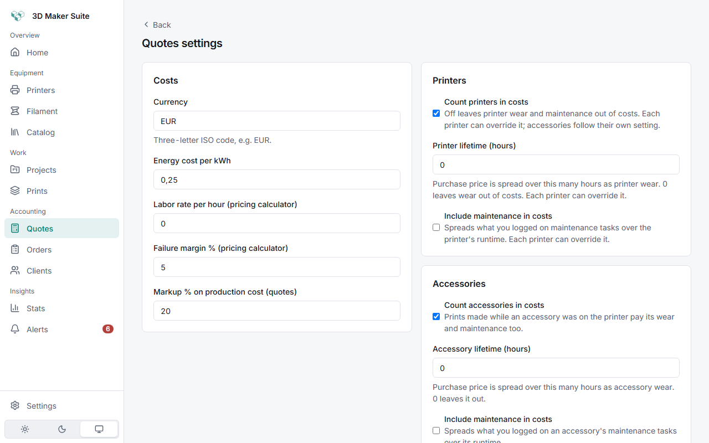

# Quotes settings

The numbers behind every price: your currency, the energy price, the pricing defaults of a quote, and what counts as printer and accessory wear and maintenance.

Open it with the gear button at the top right of [Quotes](Quotes.md). The back arrow returns to **Quotes**. The page is called **Quotes settings** and has three cards, **Costs**, **Printers** and **Accessories**. It has no tabs and no **Sources**, because quotes are made here, not imported.

## Who can use it

| You can | You need |
|---|---|
| Open the page and change it | **Quotes, orders and clients** with **Manage** |

Someone without **Manage** doesn't get the gear and is sent back to **Quotes**. Changes save as you leave a field or click a box. There is no save button.

The same costs also feed the cost of a print, a project and the stats, not only quotes. Works the same with or without a hub.

## Before you start

- Give each printer a purchase price on its page, or the wear stays `0`. See [Printers](Printers.md).
- Put a price on your spools or materials for the material cost. See [Filament](Filament.md).

## Costs

The first card holds your currency and the rates a new quote starts from.

| Field | What it means | Required | Example |
|---|---|---|---|
| **Currency** | A three-letter ISO code. It sets how every amount is shown. Anything that isn't three letters is put back | Yes | `EUR` |
| **Energy cost per kWh** | What a kilowatt hour costs you. Energy of a print is its power times its time, at this price | Yes | `0.30` |
| **Labor rate per hour (pricing calculator)** | The labor rate a new quote starts with | No | `12.00` |
| **Failure margin % (pricing calculator)** | The failure margin a new quote starts with | No | `5` |
| **Markup % on production cost (quotes)** | The markup a new quote starts with | No | `30` |

The last three are only starting values. Each quote has its own, and a saved quote keeps its own. See [Pricing](Quotes.md#pricing) for how they are used.

## Printers

| Field | What it means | Required | Example |
|---|---|---|---|
| **Count printers in costs** | **Off** leaves printer wear and maintenance out of every cost. Each printer can override it. Accessories follow their own setting | No | On |
| **Printer lifetime (hours)** | A printer's purchase price is spread over this many hours as wear. `0` leaves wear out. Each printer can override it | No | `3000` |
| **Include maintenance in costs** | Spreads what you logged on maintenance tasks over the printer's runtime. Each printer can override it | No | On |

**Wear per hour** is the purchase price divided by the lifetime. A printer bought for `360.00` with a lifetime of `3000` hours costs `0.12` per hour. A printer with no purchase price has no wear.

**Maintenance per hour** is what you have logged on its maintenance tasks, divided by the hours it has run so far. It grows more exact as you log.

## Accessories

| Field | What it means | Required | Example |
|---|---|---|---|
| **Count accessories in costs** | **On**: prints made while an accessory was on the printer pay its wear and maintenance too | No | On |
| **Accessory lifetime (hours)** | An accessory's purchase price is spread over this many hours as wear. `0` leaves it out | No | `2000` |
| **Include maintenance in costs** | Spreads what you logged on an accessory's maintenance tasks over its runtime | No | On |

An accessory's own **Count in costs**, **Lifetime (hours)** and maintenance switch win over these. See [Accessories](Accessories.md).

## How each value reaches a price

| Value | Where it shows |
|---|---|
| **Currency** | Every amount in the app |
| **Energy cost per kWh** | **Energy** in a print, a project and a quote |
| **Labor rate**, **Failure margin**, **Markup** | The starting values of a new quote's **Pricing** |
| **Count printers in costs**, **Printer lifetime**, maintenance | **Printer wear** and **Maintenance** in a print, a project and a quote. A quote uses the printer's rate with the accessories on it now |
| Accessory settings | The same lines, for prints made with the accessory installed |

A change applies to costs worked out from now on. A print's cost, and the cost on a project, are always worked out from today's settings. A saved quote's total in the list stays as saved until you open it and press **Save changes**.

## Common tasks

### Change the currency

1. Open **Quotes**, then the gear.
2. In **Currency**, type the three-letter code, for example `USD`.
3. Click outside the field. It is saved. Amounts keep their numbers and show with the new currency.

### Leave printer wear out of every price

1. Open the gear, then **Printers**.
2. Switch off **Count printers in costs**.
3. A printer that sets its own **Count in costs** still counts.

### Change what a new quote starts with

1. Open the gear, then **Costs**.
2. Set **Labor rate per hour**, **Failure margin %** and **Markup %**.
3. Open **New quote**. The **Pricing** fields have the new values.

## Related settings

- A printer's own **Count in costs**, **Lifetime (hours)** and maintenance switch are on [Printers](Printers.md).
- An accessory's are on [Accessories](Accessories.md).
- The default printer for estimates is in [Printers settings](Printers-Settings.md).
- Order statuses have their own settings page.

## Limits and tips

- Use the same currency for your prices, spools and what you charge. The app doesn't convert between currencies.
- A lifetime of `0` turns wear off, which makes quotes cheaper than the real cost. Set a lifetime you believe.
- The failure margin is a percent of production cost plus labor. The markup is a percent of production cost only.

## Problems and fixes

| What you see | What to do |
|---|---|
| The gear doesn't show | Your role has no **Manage** on **Quotes, orders and clients** |
| A currency won't stay | It must be exactly three letters, such as `EUR`. Another value is put back |
| Wear stays `0` | The printer has no purchase price, **Count printers in costs** is off, or the lifetime is `0` |
| The settings page can't load | Check that the app is running and reload |

## Related pages

- [Quotes](Quotes.md)
- [Printers](Printers.md)
- [Accessories](Accessories.md)
- [Printers settings](Printers-Settings.md)
