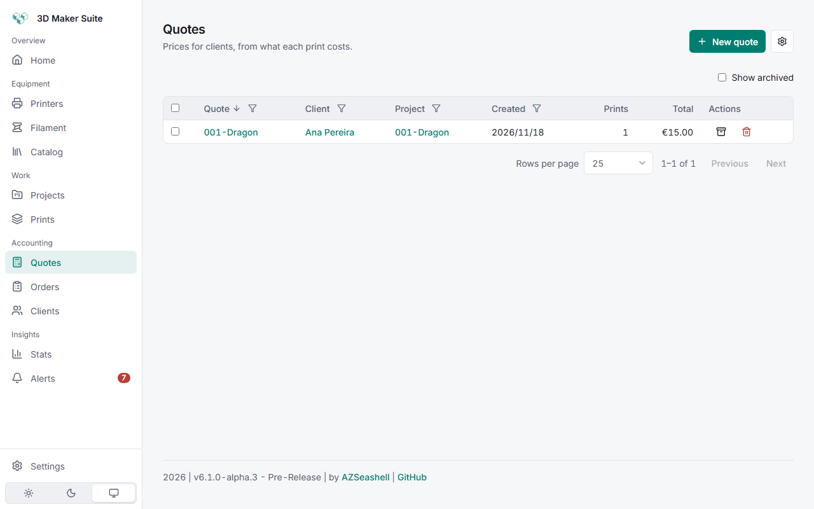
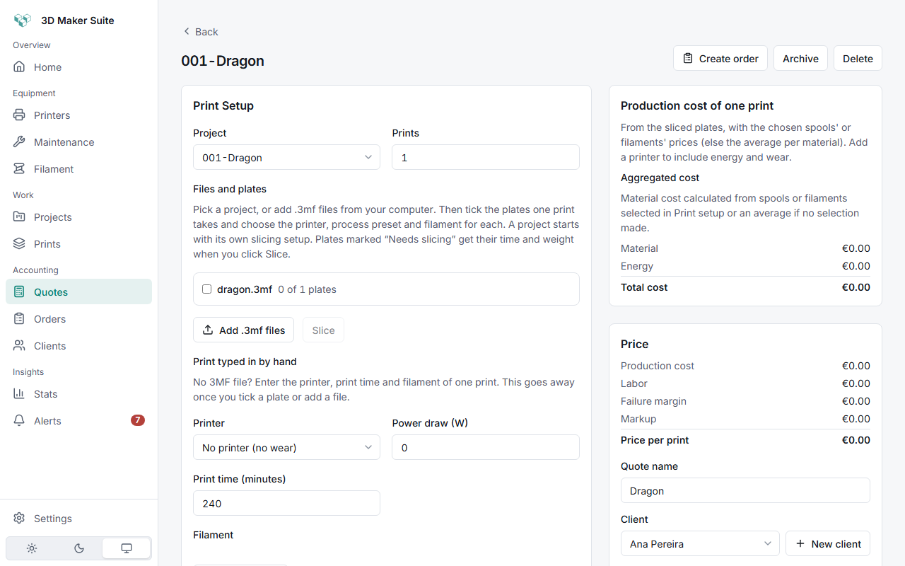

# Quotes

Prices for clients: the list of saved quotes, and the quote form, where a print setup, its production cost and your pricing become a price.

A quote works out what one print costs you, adds labor, a margin for failed prints and a markup, and multiplies that by the number of prints. You save it with a name and a client, and later turn it into an order. A quote never changes a project, a printer or a spool.

## Who can use it

The right is **Quotes, orders and clients** (it covers orders and clients too).

| You can | You need |
|---|---|
| See the list and open a quote: with **Read** it has no save, upload, slice or **Create order** buttons | **Read** |
| Make a quote, change it, archive, restore or delete it | **Write** |
| Open the Quotes settings | **Manage** |

Works the same with or without a hub.

## Before you start

- Set your currency, energy price and pricing defaults in [Quotes settings](Quotes-Settings.md). The form starts from them.
- For a price from a real file you need a project or a `.3mf` file, and a slicer connected under **Settings → Integrations**. Without a file you type the print in by hand.
- Add your printers, and a price on your spools or materials, to get wear and material in the cost. See [Printers](Printers.md) and [Filament](Filament.md).

## Quotes list

Open **Quotes**. With none saved, the page says **No saved quotes yet.** The buttons at the top right are **New quote** and the gear, which opens [Quotes settings](Quotes-Settings.md). Both need **Write**.

The table is called **Saved quotes**:

| Column | What it shows |
|---|---|
| **Quote** | The number and name, for example `001-Dragon`. Opens the quote. Sorts and filters by name |
| **Client** | The client, linked. Sorts and filters by client |
| **Project** | The project. Sorts and filters by project |
| **Created** | The date. Filters by date |
| **Prints** | How many prints the quote is for |
| **Total** | The price for all the prints, in your currency |

The list starts sorted by name, from Z to A. Click a heading to sort. **Show archived**, archive, restore and delete work as on every list; see [Archive and delete](Archive-and-Delete.md). A quote can't be deleted while an order uses it. Archive it instead.

The same table, with its own filter, also shows on a client's page and a [project's page](Projects.md#saved-quotes-and-orders). A section there only shows when there are quotes.

## Quote form

**New quote** opens the form. An opened quote has the same form, filled with what you saved, and its name as the title. On a wide screen it has two columns: what you enter on the left, what it comes to on the right. On a phone they stack.

Everything you enter works out the result at once. Nothing is saved until you press **Save quote**.

### Print setup

The card is called **Print Setup**.

| Field | What it means | Required | Example |
|---|---|---|---|
| **Project** | A project whose files and saved print setup are used. **No project** for a quote with no project. Picking one brings its plates, printers, presets, spools and slices | No | `Dragon` |
| **Prints** | How many prints the client wants | Yes | `3` |

Under **Files and plates** the hint says **Pick a project, or add .3mf files from your computer. Then tick the plates one print takes and choose the printer, process preset and filament for each.**

- **Add .3mf files** uploads files from your computer for this quote only. They show in a list, each with a remove button. A file that isn't a `.3mf` gives **Couldn't read that file. Only .3mf files can be added.**
- Each file has its plates. Tick the plates one print takes, and set the slicer, printer, printer preset, process preset and filaments for each. The lines work as in [Print setup of a project](Projects.md#print-setup), including **Defaults for all plates**. A project starts with its own setup. Changing it here changes only this quote.
- A plate you untick and tick again gets its setup, and its slice, back.
- **Slice** slices the plates that have no time and weight yet. The line next to it says **Slicing… 2 plates left.**, **Every plate is sliced and up to date.**, or what is wrong, for example **Set up a slicer in Settings → Integrations to slice.** The slicing is the one of the project: see [Slice](Projects.md#slice). A plate marked **Needs slicing** adds nothing to the cost until it is sliced.

One print is every ticked plate once. A plate's cost uses its own printer. A plate with no printer uses your default printer, or else the first one.

### A print typed in by hand

With no project plates and no files, the card shows **Print typed in by hand**: **No 3MF file? Enter the printer, print time and filament of one print.** Once you tick a plate or add a file, it says **The ticked plates are the print. To type a print in by hand instead, untick every plate and remove the added files.**

| Field | What it means | Required | Example |
|---|---|---|---|
| **Printer** | Whose wear and maintenance count. **No printer (no wear)** leaves them out. Picking one fills its power | No | `Workshop X1` |
| **Power draw (W)** | For the energy. `0` means no energy cost | No | `120` |
| **Print time (minutes)** | The time of one print. It sets energy, wear and maintenance | Yes | `120` |
| **Filament**, **Material** | A name for the material. Same names add up | No | `PLA` |
| **Grams** | The weight of one print | Yes | `50` |
| **Price per kg** | In your currency. Empty means unknown and the cost warns about it | No | `20.00` |

**Add filament** adds a line and the bin button, **Remove filament**, removes one. The last line can't be removed.

### Pricing

| Field | What it means | Required | Example |
|---|---|---|---|
| **Labor (hours per print)** | Your time for one print | No | `0.5` |
| **Labor rate per hour** | Starts at the default of the settings | No | `12.00` |
| **Failure margin (%)** | Covers failed prints. Added on production cost plus labor | No | `5` |
| **Markup on production cost (%)** | Your profit. Added on production cost only | No | `30` |

### Production cost of one print

Shows on the right. It says which printer it used (**According to print setup settings, using Workshop X1.**), or **using multiple printers**. With no printer: **From the sliced plates, with the chosen spools' or filaments' prices (else the average per material). Add a printer to include energy and wear.**

- **Material usage**: the grams per spool, then the total per material.
- **Aggregated cost**: **Material**, **Energy**, then **Printer wear** and **Maintenance** when they are on, and **Total cost**. The hint says **Material cost calculated from spools or filaments selected in Print setup or an average if no selection made.**
- A warning, for example **40 g of filament has no price, so the material cost is too low. Set a price on the spool or filament preset.**

How each line is worked out:

| Line | How |
|---|---|
| **Material** | Grams of each filament times its price per kg. A picked spool uses its own price (what you paid over its starting weight). Otherwise the material's average, from your spools, or the price on the material |
| **Energy** | The printer's power times the print time, times your energy price per kWh |
| **Printer wear** | The print time times the printer's wear per hour: its purchase price over its lifetime, with the accessories on it now |
| **Maintenance** | The print time times the printer's maintenance cost per hour, when that is on |

### Price

The card is called **Price**:

| Line | How |
|---|---|
| **Production cost** | The total cost above |
| **Labor** | Hours times the labor rate |
| **Failure margin** | The failure margin percent of production cost plus labor |
| **Markup** | The markup percent of the production cost only |
| **Price per print** | The four lines added. With one print this is the total |
| **Total for 3 prints** | The price per print times the number of prints |

Every line is rounded to the smallest coin on its own, so the lines add up to the total you see.

### Save the quote

| Field | What it means | Required | Example |
|---|---|---|---|
| **Quote name** | Shown with the quote's number, as `001-Dragon`. The number is given when you save | Yes | `Dragon` |
| **Client** | **No client** or one of your clients. **New client** adds one without leaving the form | No | `Ana Pereira` |
| **Notes** | Anything you want to remember | No | `Matte finish` |

- **Save quote** saves a new quote and opens its page.
- On a saved quote the buttons are **Save changes** (**Changes saved.**) and **Save as new**, which keeps the old one and makes a copy with the current values.
- **Couldn't save the quote.** means the server refused it. Try again.

### A saved quote's page

The header has **Create order**, and **Archive** and **Delete** with **Write**. **Create order** opens the new order with the quote already picked, and its client, its project and its total filled in. See the Orders page.

The list shows the total you saved. Opening a quote works its cost out again from today's prices and rates, so the page can differ from the list. Pressing **Save changes** saves the new numbers.

## Worked example

Your settings: energy `0.30` per kWh. A printer bought for `360.00`, with a lifetime of `3000` hours, and a power of `120` W. A spool of PLA that cost `20.00` for 1000 g. Defaults: labor rate `12.00`, failure margin `5`, markup `30`.

A 2 hour print that uses 50 g of PLA, `0.5` hours of labor, for 3 prints:

| Line | Working | Result |
|---|---|---|
| **Material** | 50 g × 20.00 per kg | 1.00 |
| **Energy** | 120 W × 2 h = 0.24 kWh × 0.30 | 0.07 |
| **Printer wear** | 360.00 ÷ 3000 h = 0.12 per hour × 2 h | 0.24 |
| **Production cost** | 1.00 + 0.07 + 0.24 | 1.31 |
| **Labor** | 0.5 h × 12.00 | 6.00 |
| **Failure margin** | 5 % of (1.31 + 6.00) = 0.3655 | 0.37 |
| **Markup** | 30 % of 1.31 = 0.393 | 0.39 |
| **Price per print** | 1.31 + 6.00 + 0.37 + 0.39 | 8.07 |
| **Total for 3 prints** | 8.07 × 3 | 24.21 |

## Common tasks

### Price a project

1. Open **Quotes**, then **New quote**.
2. Pick the **Project**. Its plates appear with its saved setup.
3. Tick the plates one print takes, and check the printer and spools.
4. Press **Slice**, and wait for **Every plate is sliced and up to date.**
5. Set **Prints**, and the **Pricing** fields.
6. Name the quote, pick the client and press **Save quote**.

### Price a file you only have on your computer

1. Press **New quote**, then **Add .3mf files**.
2. Tick the plates, choose the printer and filament, and press **Slice**.
3. Fill in **Pricing**, name the quote and save it.

### Price a print with no file

1. Press **New quote** and leave **Project** on **No project**.
2. Under **Print typed in by hand** pick the printer, and enter the time, the grams and the price per kg.
3. Fill in **Pricing**, name the quote and save it.

### Turn a quote into an order

1. Open the quote and press **Create order**.
2. Check the order, which has the quote's client, project and total, and save it.

### Offer another amount of prints

1. Open the quote and change **Prints**.
2. Press **Save as new** to keep the old quote too, or **Save changes** to replace it.

## Related settings

- [Quotes settings](Quotes-Settings.md) has the currency, the energy price, the pricing defaults and what counts as wear and maintenance.
- A printer's own **Count in costs**, **Lifetime (hours)** and maintenance switches are on [Printers](Printers.md). An accessory's are on [Accessories](Accessories.md).
- The default printer, used for a plate that has none, is in [Printers settings](Printers-Settings.md).

## Limits and tips

- Only plates that are sliced count. With some plates unsliced, the cost is too low, so slice them all first.
- A spool or material with no price counts as free, and the cost shows the warning. Set the price for a true total.
- The failure margin covers labor too, but the markup doesn't. Use the markup for your profit on the production cost.
- Files you add are kept only with the quote. They don't become a project.
- Money is shown in the currency of the settings. Changing the currency later changes the symbol only, not the amounts.

## Problems and fixes

| What you see | What to do |
|---|---|
| **Couldn't load cost data. Is the server running?** | Check that the app is running, then reload |
| **This doesn't exist, or you can't open it.** | It was deleted. Go back to **Quotes** |
| **Set up a slicer in Settings → Integrations to slice.** | Connect a slicer, or type the print in by hand |
| **Could not start slicing.** | Try again. The server log has the reason |
| The material cost is too low | Set a price on the spool, or on the material or filament preset |
| Wear and maintenance are `0` | The printer has no purchase price or no lifetime, or **Count in costs** is off. See [Quotes settings](Quotes-Settings.md#printers) |
| A quote can't be deleted | An order uses it. Archive it, or change the order first. See [Archive and delete](Archive-and-Delete.md) |
| No **New quote** button | Your role has no **Write** on **Quotes, orders and clients** |

## Related pages

- [Quotes settings](Quotes-Settings.md)
- [Projects](Projects.md)
- [Printers](Printers.md)
- [Filament](Filament.md)
