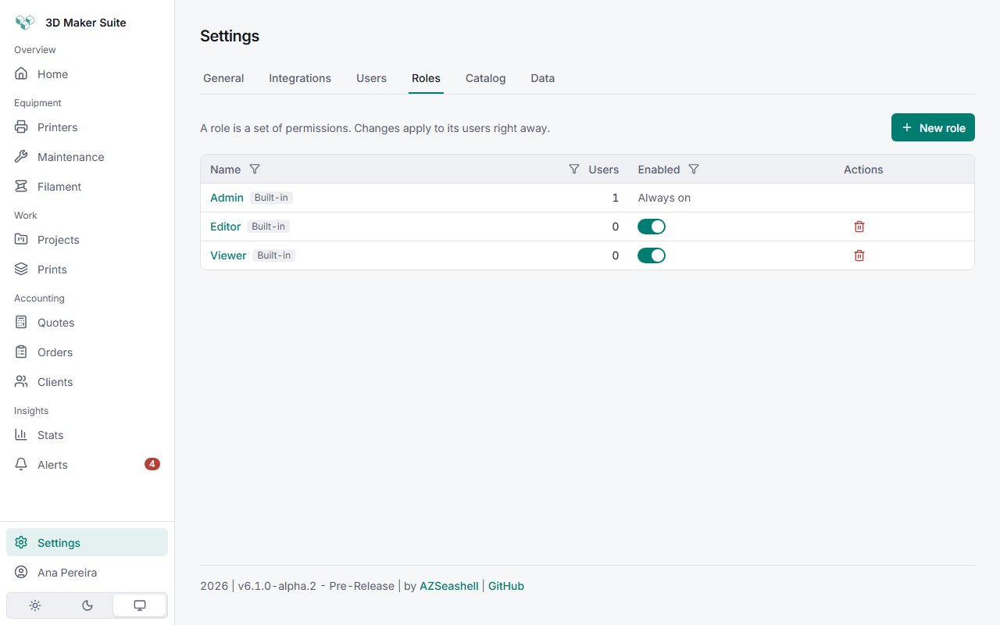

# Roles

A role is a set of rights. Each user has one role and gets what it allows.

Open it from **Settings**, on the **Roles** tab.

## Who can use it

People with the **Users and roles** right, while **User accounts** is on in [Settings](Settings-General.md#user-accounts). The same limits as on [Users](Users.md#who-can-use-it) apply: you can't give a role more than you have yourself, and only an admin changes the **Admin** role's people.

Everyone, whatever their role, marks their own alerts read, snoozes and dismisses them, and changes their own language, units, date and time format, theme and accent. These are not rights, so a role can't take them away.

## Before you start

Know what the people in the role should do. It is easiest to start from the built-in role that is closest, then change it.

## Built-in roles

| Role | What it can do |
|---|---|
| **Viewer** | Reads every module: printers, maintenance, filament, projects, prints, quotes, orders, clients, stats and alerts |
| **Editor** | Writes every module: spools, prints, projects, quotes, orders, clients and tags, plus maintenance done and accessory installs. Runs syncs and reviews imports where allowed |
| **Admin** | Everything. It can't be changed, disabled or deleted |

**Editor** and **Viewer** are ordinary roles. Rename them, change their rights, disable them, or delete them once nobody has them. The row shows **Built-in** next to the name of the three starting roles.

## Roles list

The text above the list says **A role is a set of permissions. Changes apply to its users right away.** **New role** is at the top right.

| Column | What it shows |
|---|---|
| **Name** | The role's name, as a link to its form, with **Built-in** where it applies |
| **Users** | How many people have it |
| **Enabled** | A switch. **Always on** for the Admin role and for your own role |
| **Actions** | **Delete**. The Admin role has none |

- A role that is switched off keeps its users, but they can't sign in, and anyone signed in with it is signed out.
- **Delete** asks **Delete the role?** and says **The role is removed. This can't be undone.** A role that people still have says **1 user has this role. Give them another role first.**, with the number of users. Move them to another role on the [Users](Users.md) page, then delete it.

## Role form

**New role** and a role's name open the form. The Admin role opens read-only, with **The Admin role has every permission. It can't be changed, disabled or deleted.**

| Field | Required | What it means | Example |
|---|---|---|---|
| **Name** | Yes | The role's name. Must be unique, or the page says **A role with this name already exists.** | `Operator` |
| **Start from** | No | Only on a new role. Copies that role's rights, which you change below. The form says **Copies that role's permissions. Change them below.** | **Editor** |
| **Enabled** | No | Off means its users can't sign in. It says **While off, its users can't sign in and are signed out.** | On |

Below the fields are the rights, in five groups, and **My alerts** for the role. Press **Save** when you are done. The state beside it says **Unsaved changes**, **No changes** or **Saved**.

A change applies to the role's users at once, without signing them out.

## What every right allows

Each right has a hint under it in the form. This is the full list.

### Modules

A module has four steps. **None** hides it. **Read** shows it. **Write** adds and edits the day-to-day data. **Manage** also changes its settings and does the bigger jobs. **Stats** has only **None** and **Read**.

Every page checks its right, also when it's opened by its address or from a bookmark. A Viewer who opens an add or edit form, or a module's settings, lands on the item's page or the list, with **Your role can't change this.** A page of a module or admin area the role has no right to says **You can't open this**, with a link to the dashboard. An item the person may not see, such as another person's alert, reads **This doesn't exist, or you can't open it.**, the same as a deleted one. Buttons a role can't use don't show.

| Right | **Write** allows | **Manage** allows |
|---|---|---|
| **Printers and accessories** | Logging accessory installs | Adding and editing printers and accessories |
| **Maintenance** | Logging work done, and editing or deleting the records you logged | Editing the tasks and types, and editing or deleting any record |
| **Filament** | Adding and editing spools | Archiving and deleting many spools at once |
| **Projects** | Adding and editing projects and their files | Setting up the project folders |
| **Prints** | Logging and editing prints | Changing print settings |
| **Quotes, orders and clients** | Making quotes and orders | Changing rates, the currency and the order statuses |
| **Stats** | Not used | Not used. **Read** opens [Stats](Stats.md) |
| **Catalog** | Deleting and restoring [Preset library](Catalog-Settings.md#preset-library) presets, and setting what computers send and receive | Adding, editing, archiving and deleting brands, models, materials and presets, and their import settings |

- **Printers and accessories** need **Printers** at **Read**. The **Maintenance** tab needs **Maintenance** at **Read**, so a role can have one without the other.
- With **Catalog** at **Read**, a person sees the brands, models, materials and slicer presets, their sources and the preset library. The printer, spool and print forms read brands, models, materials and presets with **Printers** or **Filament** at **Read** too, and presets are readable with **Projects** at **Read**.

### Projects of others

| Right | What it allows |
|---|---|
| **See everyone's projects** | Off: only the projects they own. The hint says **Off: only projects they own.** |
| **Edit everyone's projects** | Needs **Projects** at **Write**. Off: only their own, and the others can be downloaded only |
| **Edit files on other workstations** | Change and upload files in folders shared from someone else's computer |

Admin, Editor and Viewer see everyone's projects. Admin and Editor edit them. Only Admin edits files on other workstations. Anyone who sees a project can download its files, folders and the full project folder, also from someone else's computer.

### Integrations

| Right | What it allows |
|---|---|
| **Run syncs** | Run **Sync now**, only for the tasks set to allow it |
| **Review imports** | Review and import what a sync brings, only for the tasks set to allow it |
| **Set up integrations** | Add, sign in and configure integrations and slicers. It also opens the **Data** tab of Settings, see [Import and export](Import-and-Export.md#who-can-use-it) |

A task allows **Can sync now** and **Can review and import** on its own **Edit** form, per kind of data. Both are off by default. A person with **Run syncs** or **Review imports** but not **Set up integrations** sees only the allowed tasks, and none of the accounts, slicer or setup settings. See [Sources and sync](Sources-and-Sync.md).

### Their own machines

Three switches for the sections of a machine's page in Hub management, on the computers paired to that person only. Without any of them, a person still sees their own machines' pages, read-only.

| Right | What it allows |
|---|---|
| **Connection** | Change the port and start at login, and restart or stop the connector |
| **Catalog** | Turn **Receive** and **Share** of System and User presets on or off. Also needs **Catalog** at **Write** |
| **Projects** | Turn **Get projects from server** and **Send projects to server** on or off. Also needs **Projects** at **Write** |

Admin has all three. Editor and Viewer have none.

### Hub, server and users

| Right | What it allows |
|---|---|
| **Manage the hub** | Pair and edit workstations, and change hub settings |
| **Server and updates** | The address, restart and updates |
| **Backups** | Make, download and delete backups. Only an admin restores one |
| **Logs** | Read the logs and change what is logged, see [Logs](Logs.md) |
| **Branding** | The app name, logo and icon for everyone |
| **Alert settings** | Thresholds and the email and ntfy channels, see [Alerts settings](Alerts-Settings.md) |
| **Users and roles** | Add and edit users and roles, never with more than they have themselves |

### My alerts

The last card sets what the role gets for each kind of alert: **Off**, **In app** or **Notify**. It says **What users of this role get unless they change it themselves. A kind only reaches users who have its permission.** The kinds have the same names as in [Which alerts exist](Alerts.md#which-alerts-exist). A person's own choice, in [My account](My-Account.md#my-alerts) or on their user page, wins over it.

## Common tasks

### Make a role for the people who run prints

1. Open **Settings**, then **Roles**, and press **New role**.
2. Type a **Name**, such as `Operator`.
3. In **Start from**, pick **Editor**.
4. Lower the rights they should not have, for example **Quotes, orders and clients** to **None**.
5. Press **Save**.
6. Give the role to people on the [Users](Users.md) page.

### Rename or tighten Viewer or Editor

1. Open the role from the list.
2. Change its **Name** or its rights.
3. Press **Save**. Its users get the change at once.

### Delete a role

1. On [Users](Users.md), move everyone in the role to another role.
2. On the **Roles** tab, press **Delete** on the role and confirm.

## Related settings

- [Users](Users.md) holds each person's role and their own changes to it.
- [Alerts settings](Alerts-Settings.md) holds what the alert kinds mean.
- [Sources and sync](Sources-and-Sync.md) holds the per-task **Can sync now** and **Can review and import** switches.

## Limits and tips

- Changing a role changes every person in it. For one person only, use their user page.
- A role can't give more than the person who edits it has.
- The Admin role is fixed. Make a custom role for "almost admin".
- Updating from an older version keeps each role's rights: nothing to do after the update. A role keeps the higher of its old **Catalog** and **Presets** levels, since they are one module now.

## Problems and fixes

| What you see | What to do |
|---|---|
| **Users still have this role. Give them another role first.** | Move the users on [Users](Users.md), then delete |
| **A role with this name already exists.** | Choose another name |
| **The Admin role can't be changed.** | Make another role instead |
| **You can't give more than you have yourself.** | Ask someone with more rights, or pick a lower step |
| **This doesn't exist, or you can't open it.** | Someone deleted it. Go back to the list |
| **That didn't work. Try again.** | Check the connection, then try again |
| A person can't see a page | Check the module's right in their role, and on their user page |
| **Your role can't change this.** | The person opened a form their role may only read; give the role **Write** or **Manage** if they need it |
| **You can't open this** | The role has no right to that module or admin page |

## Related pages

- [Users](Users.md)
- [My account](My-Account.md)
- [Settings](Settings-General.md)
