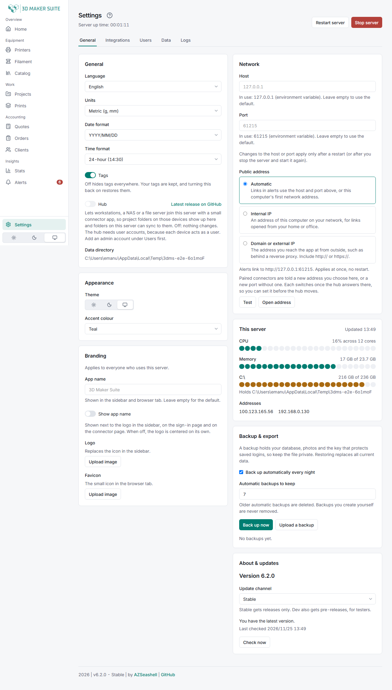

# Settings

The page for how the app looks and behaves for you, and for the server it runs on: language, units, theme, branding, network address, backups and updates.

Open **Settings** at the bottom of the menu. The page opens on its **General** tab, which holds the cards below. The other tabs (**Hub management**, **Integrations**, **Users**, **Roles**, **Data** and **Logs**) have their own pages, and each shows only if you have its right. At the top, the title shows **Server up time**, counting from when the app last started.

## Who can use it

Everyone can open **Settings**. Which cards you see depends on your rights:

| Card or control | You need |
|---|---|
| **General** (language, units, date and time format), **Appearance**, **Data directory** | Nothing. These are yours |
| **Tags**, **Start at login**, **Network**, **This server**, **About & updates**, **Restart server**, **Stop server** | **Server and updates** |
| **User accounts** | The Admin role |
| **Hub** | **Manage the hub** |
| **Branding** | **Branding** |
| **Backup & export** | **Backups**. Only the Admin role restores a backup |

With user accounts on, **Language**, **Units**, **Date format**, **Time format**, **Theme** and **Accent colour** belong to you alone. Everything else on the page is shared by everyone who uses this server. Without accounts, there is one set of settings and whoever opens the app has every right.

## Before you start

Nothing. Changes save as you make them: a list saves when you pick, a text box when you click out of it. If one doesn't save, the page says **Couldn't save your last change.**

## General

| Field | What it means | Example |
|---|---|---|
| **Language** | The language of the app. Only **English** is available for now | English |
| **Units** | **Metric (g, mm)** or **Imperial (oz, in)** | Metric (g, mm) |
| **Date format** | How dates are written: `YYYY/MM/DD`, `YYYY-MM-DD`, `DD/MM/YYYY`, `MM/DD/YYYY` or `DD.MM.YYYY` | `DD/MM/YYYY` |
| **Time format** | **24-hour (14:30)** or **12-hour (2:30 PM)** | 24-hour (14:30) |
| **Tags** | Turns tags on or off everywhere. Off hides them but keeps them. Turning it back on restores them | On |
| **User accounts** | Turns sign-in on or off, see [User accounts](#user-accounts) | On |
| **Hub** | Lets other computers join this server, see [Hub](#hub) | Off |
| **Start at login** | Starts the app when you sign in to this computer. Shown only when your install can do it: the installed app and `pnpm start`. It is hidden in Docker and in `pnpm dev` | On |
| **Data directory** | The folder that holds your database, photos and backups. Read only | `C:\Users\you\AppData\Roaming\3d-maker-suite` |

### User accounts

**User accounts** is a switch for the Admin role. It reads **Off: nobody signs in and the app works for a single user, as before accounts existed. Users and roles are kept, and turning this back on restores them; then everyone signs in again.**

- Turning it **off** asks **Turn off user accounts?** Nobody needs to sign in any more, and everyone who reaches the app has full access. If this server has no `APP_PASSWORD`, the dialog adds that only this computer will reach the app. Confirm with **Turn off**, and the page reloads.
- Turning it **on** sends everyone to the sign-in page. If no account exists yet, you create the admin first, see [Sign in](Sign-In.md#create-the-admin-account).
- It stays on while the hub is on. The line **Turn the hub off first: it needs user accounts.** says so.
- It only shows once you are signed in, or while it is off.

### Hub

The **Hub** switch lets workstations, a NAS or a file server join this server with a small connector app, so project folders on those devices show up here. Off, nothing changes. The link **Latest release on GitHub** opens the connector download.

The switch needs user accounts, because each device acts as a user. Without them it stays off and the page says **The hub needs user accounts**. It tells you to add an admin account first, or to turn on user accounts. See [Hub setup](Hub-Setup.md).

## Appearance

| Field | What it means | Example |
|---|---|---|
| **Theme** | **Light**, **Dark** or **System**, which follows your device | System |
| **Accent colour** | The colour of buttons and highlights: **Teal**, **Blue**, **Violet**, **Rose** or **Amber** | Teal |

The theme and the accent are remembered in your browser, and saved to your account when you have one.

## Branding

For people with the **Branding** right. The card says **Applies to everyone who uses this server.**

| Field | What it means | Required | Example |
|---|---|---|---|
| **App name** | Shown in the sidebar and the browser tab. Up to 60 characters. Leave it empty for the default, 3D Maker Suite | No | `Sam's Print Farm` |
| **Show app name** | Shows the name next to the logo in the sidebar, on the sign-in page and on the connector page. Off, the logo stands alone and centred | No | On |
| **Logo** | Replaces the icon in the sidebar. **Upload image** picks a file, **Reset to default** goes back | No | A PNG |
| **Favicon** | The small icon in the browser tab. Same two buttons | No | A PNG |

An image must be a PNG, JPEG or WebP of up to 5 MB. Otherwise the card says **Couldn't update the image. Use a PNG, JPEG or WebP up to 5 MB.** The sign-in page uses the same name and logo, so people see them before they sign in.

## Network

For people with **Server and updates**. This card sets where the app listens, and the address that alert links point to.

| Field | What it means | Required | Example |
|---|---|---|---|
| **Host** | The address the app listens on. `127.0.0.1` is this computer only. `0.0.0.0` is every device on your network | No | `0.0.0.0` |
| **Port** | The port, 1 to 65535 | No | `4300` |
| **Public address** | The address that links in alert emails and ntfy messages open, see below | No | `https://3d.example.com` |

Under **Host** and **Port**, a line says what is in use and where it comes from: **In use: {value} ({source})**. The source is **command-line flag**, **environment variable**, **saved setting** or **default**. Leave a box empty to use the default.

- A change to **Host** or **Port** applies after a restart. The green line **Restart required** says so. A flag or an environment variable still overrides what you save here.
- A red line, **Reaching the app from other devices needs the APP_PASSWORD environment variable**, shows when the host is open to other devices and no password is set. Without it, only requests addressed to localhost or this host are accepted. With user accounts on, sign-in protects the app instead.

### Public address

Pick one of three choices:

| Choice | What it does |
|---|---|
| **Automatic** | Links use the host and port above, or this computer's first network address |
| **Internal IP** | An address of this computer on your network, for links opened from home or the office. Pick it from the list, or type it in Docker |
| **Domain or external IP** | The address you reach the app at from outside, such as behind a reverse proxy. Start it with `http://` or `https://` |

A typed address has the button **Use this address**, which fills in the address you are using right now. An address that doesn't start with `http://` or `https://` shows **Enter an address that starts with http:// or https://.**

The line under the choices says what an alert links to, for example **Alerts link to {address}. Applies at once, no restart.** With **Automatic** and no address found, it says **Alerts carry no link.** If the `APP_PUBLIC_URL` variable is set, the choices are locked and the line says **Set by the APP_PUBLIC_URL environment variable**.

**Test** asks the server to open the address, and **Open address** opens it in a new tab. The test says one of:

| Result | What to do |
|---|---|
| **Reached this server.** | Nothing, it works |
| **The name wasn't found. Check the spelling and your DNS.** | Fix the name |
| **Nothing answered at this address and port.** | Check the port and that the app is running |
| **The HTTPS certificate isn't valid for this address.** | Fix the certificate |
| **No answer within 5 seconds.** | Check the network and any firewall |
| **Something answered, but it isn't this server (or it redirected).** | Check the proxy points at the app |
| **This server refused the name. Add it to APP_ALLOWED_HOSTS.** | See [Configuration](Configuration.md) |

The test runs from the server, and a home router often can't reach its own external address from inside. A failure can be a false alarm. You can still save the address, and **Open address** checks it from your device.

### Restart server and Stop server

Two buttons at the top right of the page, for people with **Server and updates**.

- **Restart server** restarts the app and reloads the page when it is back. It reads the saved host and port, and comes back at the new address if they changed. If it doesn't answer within about 30 seconds, the page tells you.
- **Stop server** asks **Stop the server?** and warns that every open tab loses its connection. Start the app again from the desktop or Start-menu shortcut.

## This server

A live view of the computer or container the app runs on, refreshed every 30 seconds while the page is open. **Updated {time}** shows the last refresh.

| Row | What it shows |
|---|---|
| **CPU** | The load, as a percent across all cores |
| **Memory** | How much is used, of the total |
| **Disk {name}** | How full the disk is, and which of your folders it holds (the data directory and the project folders) |
| **Addresses** | The addresses of this computer on your network. Use one of them from another device |

In Docker, the host's address isn't visible from the container. The card says to use the address of the NAS or server that runs it. If the info can't be read, the card says **The system info could not be read.**

## Backup & export

For people with **Backups**. It makes, downloads, uploads and restores backups, and sets the automatic ones.

| Field | What it means | Default |
|---|---|---|
| **Back up automatically every night** | A backup at 03:00 | On |
| **Automatic backups to keep** | How many automatic backups stay, 1 to 100 | 7 |

Buttons: **Back up now**, **Upload a backup**. Each backup in the list shows its date, size, **Automatic** and **Includes file versions** where they apply, with **Download**, **Restore** (Admin only) and **Delete**. **Restore** asks **Restore this backup?** and then **Backup ready. Restart the app to finish restoring.** Your data from before is kept in a pre-restore folder.

The full guide, including restoring on a new install, is [Backups and restore](Backups-and-Restore.md). Exporting your data to files is on the **Data** tab, not on this card.

## About & updates

For people with **Server and updates**. It shows **Version {x}**, the update channel and the update history.

| Control | What it does |
|---|---|
| **Update channel** | **Stable** gets releases only. **Dev (pre-releases)** also gets pre-releases, for testers |
| **Check now** | Looks for a new version right away. The app also checks once a day |
| **Update to {version}** | Shown when your install can update itself. Confirm, and the app backs up, installs and restarts |
| **What's new** | The release notes of the new version |
| **Roll back** | In **Update history**, goes back to the version before an update and restores its backup |

When your install can't update itself (Docker, a source copy), the card shows the commands to run instead. The full guide is [Updates](Updates.md). The banner **Version {x} is available** in the app links straight to this card.

## Common tasks

### Show dates and times the way you read them

1. Open **Settings**.
2. In **General**, pick **Date format** and **Time format**.
3. Pick **Imperial (oz, in)** in **Units** if you want it.

### Use your own name and logo

1. In **Branding**, type an **App name**.
2. Press **Upload image** under **Logo**, and choose a PNG, JPEG or WebP of up to 5 MB.
3. Do the same under **Favicon** for the browser tab.

### Reach the app from another device

1. In **Network**, set **Host** to `0.0.0.0` and press outside the box.
2. Press **Restart server**.
3. Read the addresses under **This server** and open one from the other device.
4. Turn on **User accounts** so people sign in. See [Use from another device](Use-From-Another-Device.md).

### Make alert links open the right address

1. In **Network**, under **Public address**, pick **Internal IP** or **Domain or external IP**.
2. Pick or type the address, then press **Test**.
3. Press **Open address** to check it from your device.

## Related settings

- [Alerts settings](Alerts-Settings.md) uses the public address in its email and ntfy links.
- [My account](My-Account.md) holds your name, password and where your alerts go.
- **Users** and **Roles** hold the people and what each may do. The right to see each card is a switch on a role.

## Limits and tips

- The theme and the accent follow you from device to device only when you have an account. Without one they are kept in this browser.
- Turning **User accounts** off doesn't delete users or roles.
- A saved host and port apply only after a restart. A command-line flag or an environment variable wins over them. See [Configuration](Configuration.md).
- Keep **Back up automatically every night** on. A backup holds your database and the key to saved logins, so keep the files private.

## Problems and fixes

| What you see | What to do |
|---|---|
| **Couldn't save your last change.** | Check the connection to the server, then try again |
| A card is missing | Your role lacks the right for it, see [Who can use it](#who-can-use-it) |
| **Start at login** is missing | Your install can't do it, for example Docker or `pnpm dev` |
| **Restart required** | Press **Restart server** |
| The **Network** change has no effect | A flag or an environment variable overrides it. **In use** shows which |
| **Turn the hub off first: it needs user accounts.** | Turn off **Hub**, then **User accounts** |
| **Couldn't update the image. Use a PNG, JPEG or WebP up to 5 MB.** | Use a smaller image in one of those formats |
| **Could not reach GitHub to check for updates.** | Check the server's internet connection |

## Related pages

- [My account](My-Account.md)
- [Sign in](Sign-In.md)
- [Configuration](Configuration.md)
- [Backups and restore](Backups-and-Restore.md)
- [Updates](Updates.md)
- [Public access](Public-Access.md)
- [Hub setup](Hub-Setup.md)
