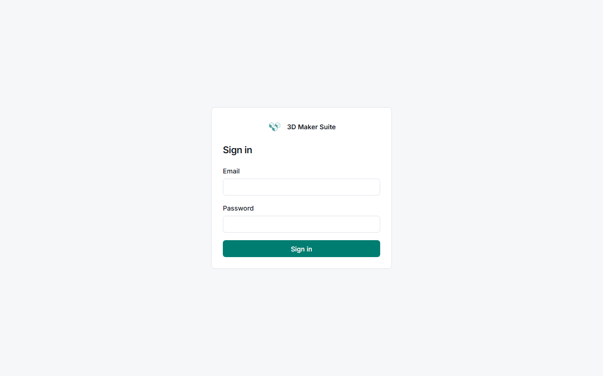

# Sign in

How you sign in, and how the first admin account is created.

## Who can use it

Anyone with an account. The page only exists while **User accounts** is on in [Settings](Settings-General.md#user-accounts). With it off, nobody signs in and these two pages aren't needed.

## Before you start

You need the address of the app and an account. An admin makes accounts on the **Users** tab of **Settings**. If you are the first, see [Create the admin account](#create-the-admin-account).

## Sign in

1. Open the app's address. Without a session, the **Sign in** page opens by itself. If you opened a link to a page inside the app, you land on that page after signing in.
2. Type your **Email** and **Password**.
3. Click **Sign in**.

The page shows the app name and logo from [Branding](Settings-General.md#branding), and it needs no session to load. Nothing else of the app loads before you are in.

To sign out, open the account menu (click your name at the bottom of the menu) and choose **Sign out**.

### Messages

| What you see | What it means |
|---|---|
| **Wrong email or password.** | Check both. The email isn't case sensitive |
| **Too many failed attempts. Try again in 15 minutes.** | The app blocks sign-in for a while after repeated failures. Wait, then try again |
| **This account is disabled. Ask an admin.** | Your account, or your role, is off |
| **Couldn't sign in. Check the connection and try again.** | The server isn't answering |

## Create the admin account

The **Create the admin account** page opens when the app has no account yet. It says **The first account manages everything and adds the others. Until it exists, anyone who can open this page has full access.** Create it right after the first start, before the app is open to your network.

| Field | Required | What it means | Example |
|---|---|---|---|
| **Name** | Yes | How your name shows in the app and the logs. Up to 100 characters | `Sam` |
| **Email** | Yes | What you sign in with | `you@example.com` |
| **New password** | Yes | At least 8 characters | a long phrase |
| **Repeat the password** | Yes | Must match, or the page says **The two passwords don't match.** | |
| **Setup token** | Only from another device | Proves you control the server. The field appears when the server asks for it | `Zk3p...` |

Click **Create account**. You are signed in as an admin.

### The setup token

On the computer that runs the app, no token is needed. From another device, the page says **This device isn't on the server itself. Enter the setup token from the server's console.** and shows the **Setup token** field. The server prints the token when it starts, until the first account exists. In Docker, run `docker logs`. See [First run](First-Run.md#find-the-setup-token) for where to look.

If an admin already exists, the page says **An admin account already exists.** and shows **Go to sign in**.

## Common tasks

### Forgot your password

Ask an admin to reset it from the **Users** tab of **Settings**. If you are the only admin, reset it from the server's shell, see [Troubleshooting](Troubleshooting.md). Then change it in [My account](My-Account.md).

### Sign in again after accounts were off

When **User accounts** is turned back on, everyone is signed out and signs in again. Old sessions never skip the password.

## Limits and tips

- A password is at least 8 characters and at most 256.
- After too many wrong attempts the app blocks sign-in for 15 minutes, so don't keep guessing.
- Behind a reverse proxy, creating the first admin through the public name always asks for the setup token. See [Server and remote access](Server-and-Remote-Access.md#first-admin-through-the-public-name).

## Problems and fixes

| What you see | What to do |
|---|---|
| Sign-in page doesn't open | Check the address and that the app is running, see [Troubleshooting](Troubleshooting.md) |
| **Couldn't create the account. Check the token and try again.** | Re-copy the token from the server's console. A new one is printed at each start |
| I'm sent to sign in all the time | Your browser blocks cookies for the address, or the session ended. Allow cookies and sign in again |

## Related pages

- [First run](First-Run.md)
- [My account](My-Account.md)
- [Settings](Settings-General.md)
- [Server and remote access](Server-and-Remote-Access.md)
