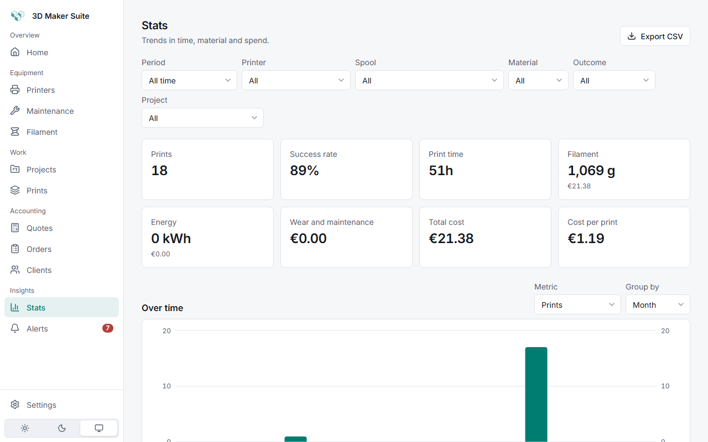

# Stats

Trends in time, material and spend: how many prints you made, how long they took, how much filament they used and what they cost.

## Who can use it

The right is **Stats**.

| You can | You need |
|---|---|
| Open the page and export the CSV | **Stats** with **Read** |

**Stats** has no settings page and no write level. Without the right, the page isn't in the menu. Works the same with or without a hub. A print in a project you can't see still counts in the numbers, but its project shows as **Other project** and has no link.

## Before you start

Stats are made from your [prints](Prints.md). With no prints in the view, the page says **No prints in this view** and **Change the filters or log a print to see numbers here.** Log a print, or change the filters.

Costs use the energy price and the wear and maintenance rates of your printers, and the price of each spool. See [Printers](Printers.md) and [Filament](Filament.md).

## Filters

The filters sit at the top. Each one narrows every number, the chart and the tables below.

| Filter | What it does |
|---|---|
| **Period** | **Last 7 days**, **Last 30 days**, **Last 90 days**, **Last year**, **All time** or **Custom range**. It starts on **All time**, so print time matches the printer page. **Custom range** shows a date picker for the first and last day |
| **Printer** | Only prints on one printer. **All** is the default |
| **Spool** | Only prints that used one spool |
| **Material** | Only prints that used one material. It lists the materials of your spools, not the whole catalog |
| **Outcome** | Only successful, failed or cancelled prints |
| **Project** | Only prints of one project, newest project first |
| **Tag** | Only prints with one tag. It shows only when you have tags and tags are on in **Settings** |

Filters combine: a printer and a material show the prints that match both.

## Stat cards

Eight cards sum up the view.

| Card | What it shows |
|---|---|
| **Prints** | How many prints |
| **Success rate** | Successful prints as a share of all prints, or **–** with none |
| **Print time** | Total time. A second line, **{time} estimated**, says how much of it was estimated rather than measured |
| **Filament** | Grams used. The second line is the material cost. If some grams have no spool price, it says **{weight} has no price** instead |
| **Energy** | kWh used, with its cost below |
| **Wear and maintenance** | The cost of wear and maintenance for the time printed |
| **Total cost** | Material, energy, wear and maintenance added up |
| **Cost per print** | **Total cost** divided by **Prints** |

Money uses the currency in **Settings**. Weights and energy follow your units.

## Over time

The chart called **Over time** shows one bar per day, week or month.

| Field | What it does |
|---|---|
| **Metric** | **Prints**, **Print time** or **Total cost**. It starts on **Prints** |
| **Group by** | **Day**, **Week** or **Month**. It starts on **Month** |

Empty days, weeks or months in the middle are filled with zero, so the time axis stays to scale. The chart reads the filters above it. **Metric** and **Group by** only change the chart.

## Breakdown tables

Four tables split the same numbers up.

| Table | One row per | Cost column |
|---|---|---|
| **Printer** | Printer, linked to its page | **Total cost** |
| **Outcome** | **Success**, **Failed** or **Cancelled** | **Total cost** |
| **Project** | Project, linked to its page. **No project** for prints with none | **Total cost** |
| **Filament** | Brand, material and colour. **Unknown filament** when it isn't known | **Material cost** |

Each table has the columns **Prints**, **Print time**, **Filament** and the cost. Click a heading to sort, and use the filter in a heading to narrow the rows. The **Project** and **Filament** tables show 10 rows; use the pager to see more. Rows sort by cost, highest first, until you pick another sort.

A print on several printers or with several spools is split between the rows by their share of the time and the grams, so a table adds up to the cards.

An archived printer or project keeps its row and is marked as archived.

## Export CSV

**Export CSV** at the top right downloads `stats.csv` for the current filters. The file has one row per bar of the chart (**Group by** decides if that is a day, week or month), then a last row called `total`.

| Column | What it holds |
|---|---|
| `date` | The first day of the period, as `yyyy-mm-dd` |
| `prints` | Prints |
| `successes` | Successful prints |
| `hours` | Print time in hours, two decimals |
| `energy_kwh` | Energy in kWh |
| `filament_g` | Filament in grams |
| `material`, `energy`, `wear`, `maintenance`, `total` | Costs in the main unit of your currency, two decimals, without the symbol |

The CSV always uses grams, hours and a dot for decimals, whatever your units and language.

## Common tasks

### See what one printer cost this year

1. Open **Stats**.
2. Set **Period** to **Last year** and **Printer** to the printer.
3. Read **Total cost** and **Cost per print**.

### See which projects cost the most

1. Set the **Period** you care about.
2. In the **Project** table, click the **Total cost** heading to sort. The most expensive is on top.

### Take the numbers to a spreadsheet

1. Set the filters and **Group by**.
2. Press **Export CSV** and open `stats.csv`.

## Limits and tips

- **Stats** only counts prints. A project's quotes and orders are on [Quotes](Quotes.md) and [Orders](Orders.md).
- A spool without a price adds grams but no material cost. The **Filament** card tells you how many grams have no price. Add the price on the spool to fix it.
- A print without a measured time uses an estimate. **Print time** shows how much. See [Prints settings](Prints-Settings.md) for the pace it uses.
- **Wear and maintenance** is a rate per printing hour set on the printer.

## Problems and fixes

| What you see | What to do |
|---|---|
| **Couldn't load stats. Is the server running?** | Check the app is running, then reload |
| **No prints in this view** | Widen **Period** or set filters back to **All** |
| **{weight} has no price** | A spool has no price. Add it on the spool |
| There is no **Stats** in the menu | Your role has **Stats** set to **None** |
| The **Tag** filter is missing | You have no tags, or tags are off in **Settings** |

## Related pages

- [Prints](Prints.md)
- [Printers](Printers.md)
- [Filament](Filament.md)
- [Dashboard](Dashboard.md)
