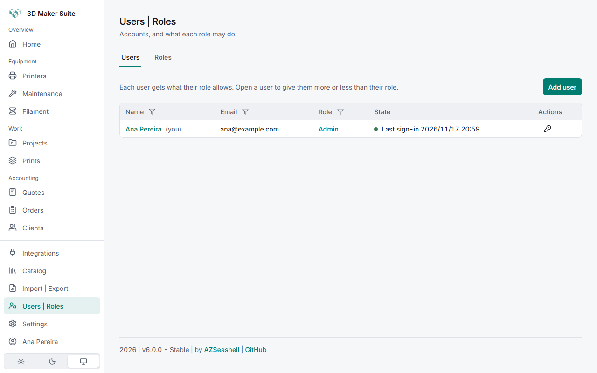

# Users

Who can sign in, which role each person has, and what a single person may do on top of their role.



Open it from **Settings**, on the **Users** tab. A user's own page opens from their name in the list.

## Who can use it

People with the **Users and roles** right. The tab only shows while **User accounts** is on in [Settings](Settings-General.md#user-accounts). With accounts off, nobody signs in, so the **Users** and **Roles** tabs are hidden. Turning accounts on again brings back every user, role and right, and everybody signs in again.

It works the same with or without a hub. With a hub on, each paired computer acts as a user too, see Hub management.

Some limits apply to everyone who manages users:

- You can't give more than you have yourself. Every step you pick, in a role or for a user, is at most your own.
- Only people in the **Admin** role change an admin account, or move someone into or out of the Admin role.
- Nobody changes their own role, rights or state. Another user manager does that. The page says **You can't change your own role or rights. Another user manager can.**
- The app keeps at least one enabled admin. The last one can't be disabled, demoted or deleted.

## Before you start

- Turn on **User accounts** in [Settings](Settings-General.md#user-accounts) and create the first admin, see [First admin](#first-admin).
- Decide the role. The built-in ones are **Viewer**, **Editor** and **Admin**, and you can add more on the [Roles](Roles.md) page.

## First admin

Until the first account exists, the **Users** tab says **Nobody has to sign in right now. Create the first admin to turn on accounts and roles.** and shows **Create the first admin**. The button leads to the setup page. The steps, and the setup token you need from another device, are on [Sign in](Sign-In.md#create-the-admin-account).

The first account is an admin. Create it right after the first start, before the app is open to your network.

## Users list

The text above the list says **Each user gets what their role allows. Open a user to give them more or less than their role.** The list can be sorted and filtered. **Add user** sits at the top right.

| Column | What it shows |
|---|---|
| **Name** | The person's name, as a link to their page. Your own row adds **(you)** |
| **Email** | What they sign in with |
| **Role** | Their role |
| **State** | **Disabled** when the account is off, **Role disabled** when the role is off, else **Last sign-in** with the date and time, or **Never signed in** |
| **Actions** | **Reset password**, **Disable** or **Enable**, and **Delete** |

### Add user

**Add user** opens a dialog.

| Field | Required | What it means | Example |
|---|---|---|---|
| **Name** | Yes | How the person shows in the app and the logs | `Eva` |
| **Email** | Yes | What they sign in with. Must be new, or the page says **A user with this email already exists.** | `eva@example.com` |
| **New password** | Yes | At least 8 characters. Tell the person, who can change it in [My account](My-Account.md) | a long phrase |
| **Role** | Yes | What they are allowed to do | **Editor** |

Press **Add user**. The person can sign in right away.

### Reset password

**Reset password** on a row opens **Reset the password of** that person. Type **New password** and **Repeat the password**. The dialog says **They are signed out everywhere and use the new password next time.** Different passwords show **The two passwords don't match.**

### Disable and enable

**Disable** turns the account off. The person is signed out on every device and can't sign in again, and the row says **Disabled**. Their data and their past actions in the logs stay. **Enable** turns it back on.

### Delete

**Delete** asks to confirm and says **The account is removed and can't sign in again. Their past actions stay in the logs.** It can't be undone. To keep the account but stop sign-in, use **Disable** instead.

## User page

Click a name to open the page. The title is the person's name, with their email under it. It has the fields below, then the rights, then **My alerts**, and a **Save** button with the state beside it: **Unsaved changes**, **No changes** or **Saved**.

| Field | What it means |
|---|---|
| **Name** | How the person shows in the app |
| **Email** | What they sign in with |
| **Role** | Their role. A change applies at once, without signing them out |
| **Can sign in** | Off disables the account. It says **Switching this off signs them out everywhere.** |

An admin account shows **This is an admin account. Only admins change it.** to anyone who isn't an admin.

### Rights

Below the fields, the page lists every right of the [role form](Roles.md#what-every-right-allows). The text says **Same as role follows the role, also when the role changes later. Pick a step to give this user more or less.**

- Each row starts on **Same as role**, and shows **From the role:** with the role's value.
- Pick another step, or **Allow** or **Deny** for an on and off right, to change it for this person alone. The row shows **Changed**, and **The role has** with what the role gives.
- Pick **Same as role** again to follow the role.

For someone in the **Admin** role the page says **Admins have every permission. The only thing to change is whether they edit files on other people's workstations.**

### My alerts

Which alerts this person gets: **Same as role**, **Off**, **In app** or **Notify**. It says **Same as role follows the role. Notify also sends it to the user's own email or ntfy.** The choices are the same as [My account](My-Account.md#my-alerts). On your own user page it says **Your own alerts are on the My account page.**

## Common tasks

### Add a person

1. Open **Settings**, then **Users**.
2. Press **Add user**.
3. Fill **Name**, **Email**, **New password** and **Role**.
4. Press **Add user**, and give the person the password.

### Give one person one more right

1. Open the person's page from the **Users** list.
2. In the rights, find the right and pick a step, or **Allow**.
3. Press **Save**.

### Someone forgot their password

1. Press **Reset password** on their row.
2. Type a new password twice and confirm.
3. Give it to them. They can change it in [My account](My-Account.md#change-your-password).

### You forgot the admin password

If you are the only admin, reset it from the server's shell. The command prints a new password once and ends that user's sessions:

```bash
pnpm user:reset-password you@example.com
```

In Docker:

```bash
docker compose exec app pnpm user:reset-password you@example.com
```

Anyone who can run this already has full access to the data, so it opens nothing new.

### Stop someone signing in

1. Press **Disable** on their row, or turn off **Can sign in** on their page.

They are signed out at once. **Enable** brings the account back.

## Related settings

- [Roles](Roles.md) holds the sets of rights a user gets.
- [Settings](Settings-General.md#user-accounts) turns accounts on and off.
- [Alerts settings](Alerts-Settings.md) holds the mail and ntfy servers that **Notify** uses.

## Limits and tips

- Changing a role or a right applies at once. Only a disable or a password reset signs the person out.
- While a role is disabled, its users can't sign in.
- Passwords can't be read back. Reset one to change it for someone else.
- The hub needs accounts: turn the hub off before turning accounts off.
- With the old shared `APP_PASSWORD` set, it is ignored once an account exists. Create your accounts, sign in once to check, then remove it from your environment or `docker-compose.yml`. See [Configuration](Configuration.md).
- With logging on, each entry of a request shows who made it. See [Logs](Logs.md).

## Problems and fixes

| What you see | What to do |
|---|---|
| **The last enabled admin can't be disabled, demoted or deleted.** | Make another admin first |
| **A user with this email already exists.** | Use another email, or open the existing user |
| **You can't change your own role, rights or state.** | Ask another user manager |
| **Only admins change admin accounts.** | Ask an admin |
| **You can't give more than you have yourself.** | Pick a lower step, or ask someone with more rights |
| **That didn't work. Try again.** | Check the connection, then try again |
| **This doesn't exist, or you can't open it.** | Someone deleted them. Go back to the list |
| The **Users** tab is missing | You lack **Users and roles**, or **User accounts** is off |

## Related pages

- [Roles](Roles.md)
- [Sign in](Sign-In.md)
- [My account](My-Account.md)
- [Settings](Settings-General.md)
- [Logs](Logs.md)
